# Sección 01-A: Ficha técnica y datos de la obra (I) — identidad y publicación

> **Biblia del universo de Sakura-sou no Pet na Kanojo (さくら荘のペットな彼女)**
> Documento de referencia para el proyecto de fanfic alojado en este repositorio.
> Créditos de la obra: ©鴨志田一／アスキー・メディアワークス／KADOKAWA ／「さくら荘」製作委員会.
> Elaborado con fuentes japonesas, chinas y angloparlantes; las referencias completas están al final.

  

---

## 1. Ficha técnica maestra

| Campo | Dato |
|---|---|
| **Título original** | さくら荘のペットな彼女 |
| **Lectura (furigana)** | さくらそうの ペットな かのじょ |
| **Romanización** | *Sakura-sō no Petto na Kanojo* |
| **Traducción literal** | "La chica-mascota de la pensión Sakura" |
| **Título oficial en inglés** | *The Pet Girl of Sakurasou* |
| **Títulos en chino** | 櫻花莊的寵物女孩 (Taiwán/HK) · 樱花庄的宠物女孩 (China continental) |
| **Autor** | 鴨志田一 (Kamoshida Hajime) |
| **Ilustrador** | 溝口ケージ (Mizoguchi Kēji) |
| **Editorial (Japón)** | アスキー・メディアワークス (ASCII Media Works) → **KADOKAWA** desde 2013 |
| **Sello / etiqueta** | 電撃文庫 (Dengeki Bunko) |
| **Tipo de obra** | Novela ligera (ライトノベル) |
| **Género declarado** | 青春 (novela juvenil de formación) · ラブコメ (comedia romántica) · 学園 (escolar) |
| **Público** | Juvenil / *young adult* masculino (etiqueta shōnen-seinen de Dengeki Bunko) |
| **Periodo de publicación** | 10 de enero de 2010 – 8 de marzo de 2014 |
| **Volúmenes** | **13** en total: 10 de historia principal + 3 de relatos cortos |
| **Formato** | A6判 / 文庫判 (tamaño de bolsillo japonés, aprox. 10.5 × 14.8 cm) |
| **Manga** | Adaptación de 草野ほうき (Kusano Hōki), 8 tomos (2011–2015) |
| **Anime** | 24 episodios, J.C.Staff, octubre 2012 – marzo 2013 |
| **Novela visual** | PS Vita / PSP, 14 de febrero de 2013 (Kadokawa Games) |
| **Clasificación del anime** | PG-12 (mayores de 12 años) |
| **Serie relacionada** | 『青春ブタ野郎』シリーズ (mismo autor e ilustrador; cameos cruzados) |

### Las cuatro capas del título

El título funciona por acumulación de tres piezas, y conviene tenerlas claras porque en el fanfic se va a jugar con ellas:

- **さくら荘 (Sakura-sō)** — "la pensión Sakura". El 荘 (sō) es el sufijo que se usa en japonés para pensiones, casas de huéspedes y dormitorios pequeños; no es una residencia escolar moderna sino un edificio viejo de madera de dos plantas. El nombre lo lleva por el cerezo (桜) del jardín.
- **の (no)** — partícula posesiva: "de Sakura-sō".
- **ペットな彼女 (petto na kanojo)** — literalmente "la novia/chica que es [como] una mascota". El な es la variante coloquial del の en las construcciones adjetivales, y le da un tono desenfadado, casi de broma entre amigos.

Traducir "petto" como "mascota" pierde el matiz: en la obra la palabra se usa como broma interna para designar a la persona que **cuida** de alguien (el "dueño" y su "mascota" se invierten todo el tiempo). El título oficial en inglés, *The Pet Girl of Sakurasou*, eligió el otro camino y convirtió "petto" en adjetivo.

---

## 2. Género, tono y etiqueta editorial

**青春 (seishun)** es la palabra clave: no significa "juvenil" a secas, sino el género japonés de historias sobre el paso de la adolescencia a la adultez, con la escuela como escenario y el futuro como problema. La ficha de la propia Wikipedia japonesa cita el *Kono Light Novel ga Sugoi! 2011* para clasificarla como 青春 y ラブコメ.

El editor y el autor fijaron el tono antes de escribir: buscaban una **"obra escolar luminosa" (明るい学園物)**. De ahí salió la premisa central que Kamoshida repitió en entrevista: *"aunque no haya poderes extraños ni grandes incidentes, lo dramático está en la vida cotidiana"* (declaración recogida por MANTANWEB en agosto de 2010, a cargo del editor 荒木人美).

Eso marca tres decisiones que atraviesan toda la obra:

1. **No hay villano ni antagonista sobrenatural.** El conflicto es el talento ajeno, la envidia, el miedo a no ser suficiente.
2. **El elenco es un muestrario social**: el "genio" (Mashiro), la "trabajadora sin talento" (Nanami), el "mediocre que se esfuerza" (Sorata), la "excéntrica brillante" (Misaki), el "profesional precoz" (Ryūnosuke), el "que huye del compromiso" (Jin). El propio editor lo resumió como "crónica juvenil de gente común, genios y pervertidos" (凡人と天才と変態の青春群像).
3. **La comedia convive con el fracaso real.** Los personajes fracasan en audiciones, concursos, exámenes y proyectos, y el relato no los rescata con un golpe de suerte.

---

## 3. El autor: 鴨志田一 (Kamoshida Hajime)

| Dato | Valor |
|---|---|
| Fecha de nacimiento | 11 de abril de 1978 |
| Origen | Prefectura de Kanagawa |
| Oficios | Novelista y guionista |
| Debut | 2007, 『神無き世界の英雄伝』 (Dengeki Bunko, 3 tomos) |
| Apodo/mote | — |
| Lema personal (座右の銘) | 「なぜベストを尽くさないのか」 — *"¿Por qué no dar lo mejor de ti?"* |

**Trayectoria antes de Sakura-sō.** Debutó en 2007 con la serie de fantasía 『神無き世界の英雄伝』 (trilogía, Dengeki Bunko), a la que siguió 『Kaguya 〜月のウサギの銀の箱舟〜』 (cinco tomos, 2008–2009). Es decir, llegó a Sakura-sō con dos series cerradas a cuestas y con la etiqueta de autor de fantasía, no de comedia escolar.

**Qué cambió con Sakura-sō.** Fue su primer éxito comercial y su primera incursión en el guion de animación: participó como guionista en la adaptación televisiva de su propia obra (episodios 3, 7, 18 y 22, ver documento 01-B), y de ahí nació una colaboración duradera con la guionista 岡田麿里 (Okada Mari), con quien volvería a trabajar en proyectos posteriores.

**Obra posterior y vecindad con este universo.**

| Año | Obra | Nota |
|---|---|---|
| 2011 | 放課後あいどる 僕と生徒会長の×× (Gagaga Bunko) | Novela fuera de Dengeki Bunko |
| 2014–2025 | 青春ブタ野郎シリーズ (*Rascal Does Not Dream*) | 16 tomos, Dengeki Bunko; mismo ilustrador, mismos cameos cruzados |
| 2016–2018 | 機動戦士ガンダム 鉄血のオルフェンズ 月鋼 | Novela + manga; también guionista del anime |
| 2017 | Just Because! | Serie original; composición de serie y guion de todos los episodios |
| 2023 | SYNDUALITY Noir | Idea original del argumento |
| 2025– | 機動戦士ガンダムエイト | Guion de manga, *Gundam Ace* |

> **Dato para el fanfic:** el autor cerró Sakura-sō en 2014 y arrancó 青春ブタ野郎 ese mismo año. Los personajes de Sakura-sō aparecen de forma velada en esa otra serie (Jin y Misaki en un noticiario de TV, Ryūnosuke y Rita sin nombre, el nombre de la novelista 由比ヶ浜かんな citado con frecuencia). El universo compartido es, por tanto, canon.

---

## 4. El ilustrador: 溝口ケージ (Mizoguchi Kēji)

| Dato | Valor |
|---|---|
| Oficio | Ilustrador |
| Círculo dōjin | **NtyPe** |
| Relación con el autor | Ilustró Sakura-sō (2010–2014) y toda la serie 青春ブタ野郎 (2014–) |
| Amistades conocidas | El ilustrador カントク (Kantoku), amigo desde la universidad |

**Estilo.** Mizoguchi es un ilustrador de línea limpia y color saturado, con debilidad declarada por el diseño de rostros expresivos y cuerpos de proporción suave; su trabajo en Sakura-sō define buena parte del *look* que el anime heredó (J.C.Staff adaptó los diseños con 藤井昌宏 a la cabeza). En las portadas de los tomos alterna a Mashiro con el resto del elenco, y en los tres volúmenes cortos se permite portadas más de "grupo", casi de póster.

**Curiosidad de autor.** En la entrevista de la revista *Dengeki Moeoh* (abril de 2013) declaró que le encanta "tomar personajes diseñados por otras personas y armonizarlos con su propio estilo", que es exactamente lo que hace en el manga y el anime como diseñador original de personajes.

**Otras obras ilustradas.** 『土くれのティータニア』 (Dengeki Bunko, texto de 増子二郎), 『14歳とイラストレーター』 (MF Bunko J, texto de むらさきゆきや), además de portadas y *end cards* para anime (『僕は友達が少ない』, 『C3』, 『輪廻のラグランジェ』 S2, 『ブラック・ブレット』, 『ご注文はうさぎですか??』, entre otros).

---

## 5. La editorial: de ASCII Media Works a KADOKAWA

- **アスキー・メディアワークス (ASCII Media Works)** nació en 2008 de la fusión de MediaWorks (dueña del sello Dengeki) con ASCII. Publicó los primeros tomos de Sakura-sō bajo su sello estrella, **電撃文庫 (Dengeki Bunko)**.
- En **2013** la compañía se integró en **KADOKAWA** (会社名としては2013年10月にKADOKAWAに統合). Por eso las fichas oficiales de los tomos antiguos siguen diciendo "ASCII Media Works" mientras las reediciones y el catálogo actual aparecen como "KADOKAWA".
- **電撃文庫** es el sello de novela ligera más longevo y competitivo de Japón (nació en 1993) y el que impone el formato: tomo de bolsillo, 300–500 páginas, ilustraciones en blanco y negro cada pocas páginas más una portada a color.

**Consecuencia práctica para la ficha:** cualquier cita bibliográfica de esta obra debe usar el sello editorial vigente al momento de impresión (ASCII Media Works hasta 2012; KADOKAWA/電撃文庫 de 2013 en adelante), y el ISBN del tomo concreto, no el de la serie.

---

## 6. Los 13 volúmenes de la novela ligera

Datos de fecha, extensión y precio tomados de las fichas de producto de KADOKAWA; los ISBN, de la lista de volúmenes de la Wikipedia japonesa.

| # | Título | Fecha de lanzamiento | Páginas | Precio (IVA incl.) | ISBN |
|---|---|---|---|---|---|
| 1 | さくら荘のペットな彼女 | 2010-01-10 | 344 | ¥671 | 978-4-04-868280-0 |
| 2 | さくら荘のペットな彼女 2 | 2010-04-10 | 344 | ¥627 | 978-4-04-868463-7 |
| 3 | さくら荘のペットな彼女 3 | 2010-08-10 | 344 | ¥627 | 978-4-04-868765-2 |
| 4 | さくら荘のペットな彼女 4 | 2010-12-10 | 360 | ¥649 | 978-4-04-870123-5 |
| 5 | さくら荘のペットな彼女 5 | 2011-05-10 | 376 | ¥649 | 978-4-04-870416-8 |
| **5.5** | さくら荘のペットな彼女 5.5 | 2011-09-10 | 344 | ¥627 | 978-4-04-870749-7 |
| 6 | さくら荘のペットな彼女 6 | 2011-12-10 | 376 | ¥649 | 978-4-04-886140-3 |
| 7 | さくら荘のペットな彼女 7 | 2012-04-10 | 392 | ¥671 | 978-4-04-886543-2 |
| **7.5** | さくら荘のペットな彼女 7.5 | 2012-08-10 | 344 | ¥627 | 978-4-04-886801-3 |
| 8 | さくら荘のペットな彼女 8 | 2012-10-10 | 360 | ¥649 | 978-4-04-886986-7 |
| 9 | さくら荘のペットな彼女 9 | 2013-03-09¹ | 408 | ¥693 | 978-4-04-891471-0 |
| 10 | さくら荘のペットな彼女 10 | 2013-07-10 | 472 | ¥715 | 978-4-04-891794-0 |
| **10.5** | さくら荘のペットな彼女 10.5 | 2014-03-08 | 296 | ¥627 | 978-4-04-866412-7 |

¹ Las fichas de KADOKAWA listan el 10 de marzo de 2013; la lista de la Wikipedia japonesa marca el 9 de marzo como fecha de primera impresión. Diferencia de un día entre 初版発行 y 発売日.

**Detalles que importan para la cronología interna:**

- El tomo 1 salió **sin número en el lomo visible** en muchas librerías; la serie se numeró a partir del 2.
- El volumen **10 (julio de 2013)** era, en principio, el final de la historia principal. La editorial lo anunció como "el emotivo final" y a la vez avisó que habría un 10.5.
- El **10.5 (marzo de 2014)** es el cierre real: la web oficial lo llamó literalmente **「本当の完結巻」**, *"el verdadero tomo final"*, e incluye relatos escritos expresamente sobre la vida de Sorata y compañía **después de la graduación**.
- El tomo 10 es el más largo de la serie (472 páginas); el 10.5, el más corto (296).

### Los tres volúmenes cortos (短編集)

| Volumen | Carácter | Función narrativa |
|---|---|---|
| **5.5** (sep. 2011) | Colección de relatos cortos | Publicado a mitad de la serie; historias laterales del día a día del dormitorio. Rompe el ritmo de la trama principal justo después del arco de Nanami. |
| **7.5** (ago. 2012) | Colección de relatos cortos | Coincide con el estreno del anime (octubre de 2012), de modo que refresca la serie para los lectores nuevos que llegan desde la televisión. |
| **10.5** (mar. 2014) | Colección de relatos cortos | Epílogo y despedida: qué pasa con el dormitorio y con cada personaje después de la graduación. Es el tomo que el fandom discute cuando discute "el final". |

Estos tres tomos son la razón de que la serie se cuente en **13 volúmenes** pero en **10 arcos**: la numeración decimal japonesa es una convención editorial que indica "tomo complementario intercalado".

---

## 7. Cronología editorial (2010–2014)

| Fecha | Hito |
|---|---|
| **10 de enero de 2010** | Sale el tomo 1. Debut de la serie. |
| 10 de abril de 2010 | Tomo 2. |
| 10 de agosto de 2010 | Tomo 3. |
| 13 de agosto de 2010 | Entrevista del editor en MANTANWEB: se define la obra como "crónica de gente común, genios y pervertidos". |
| 10 de diciembre de 2010 | Tomo 4. |
| **Abril de 2011** | Arranca el manga de 草野ほうき en *Dengeki G's Magazine*. |
| 10 de mayo de 2011 | Tomo 5. |
| 10 de septiembre de 2011 | Tomo 5.5 (primer volumen corto). |
| 27 de octubre de 2011 | Primer tomo recopilatorio del manga. |
| 10 de diciembre de 2011 | Tomo 6. |
| **10 de abril de 2012** | Tomo 7 y **anuncio de la adaptación a anime** (MANTANWEB). Ese mismo reportaje cifra la serie en más de 850 000 ejemplares vendidos. |
| 28 de junio de 2012 | Drama CD 『椎名ましろのはじめてのお世話』. |
| 10 de agosto de 2012 | Tomo 7.5. |
| 10 de octubre de 2012 | Tomo 8. |
| **9 de octubre de 2012** | Estreno del anime (TOKYO MX). |
| 29 de septiembre de 2012 | Arranca el web radio 『さくら荘のペットなラジオ』. |
| 14 de febrero de 2013 | Juego para PS Vita / PSP. |
| 9 de marzo de 2013 | Tomo 9. |
| **26 de marzo de 2013** | Último episodio del anime. |
| 10 de julio de 2013 | Tomo 10: final de la historia principal; se anuncia el 10.5. |
| Octubre de 2013 | La serie acumula **1 800 000 ejemplares** en circulación (dato de LN News). |
| **8 de marzo de 2014** | Tomo 10.5: cierre definitivo de la serie. |
| Abril de 2014 | 鴨志田一 y 溝口ケージ lanzan 『青春ブタ野郎はバニーガール先輩の夢を見ない』. |
| 27 de junio de 2015 | Último tomo del manga (n.º 8). |

---

## 8. Ediciones internacionales

| Territorio | Editorial | Sello | Notas |
|---|---|---|---|
| **Taiwán / Hong Kong** | 台灣角川 (Kadokawa Taiwan) | Kadokawa Fantastic Novels | Traducción al chino tradicional; 13 tomos. |
| **China continental** | 湖南美術出版社 (edición) / 天聞角川 (distribución) | 天聞角川 | Chino simplificado; misma estructura de 13 tomos. |
| **Corea del Sur** | 鶴山文化社 (Haksan) / D&C Media | — | Traducción al coreano. |

**Lo que no existe (dato relevante para el proyecto):** no hay edición oficial de la novela ligera **en español ni en inglés**. La única versión oficial en inglés de la franquicia es el **anime**, licenciado por Sentai Filmworks (ver 01-B). Cualquier traducción del texto de las novelas que circule en inglés o español es de fans.

---

## 9. Tirada, recepción y premios

- **850 000 ejemplares** en abril de 2012, según *Mainichi Shimbun* en el reportaje del anuncio del anime.
- **1 800 000 ejemplares** en octubre de 2013 (lista de circulación de LN News), el último dato público consolidado de la serie.
- **「みんなで選ぶベストラノベ2011」 → 6.º lugar en la categoría de reseñas/comentarios** (votación de lectores organizada por LN News; resultados publicados en febrero de 2012).
- **「電子書籍アワード2013」 → 10.º lugar en la categoría de novela ligera** (premio de libros electrónicos, 2013).
- **Encuesta de Gigazine (2012)**: el anime quedó **6.º** entre los estrenos del otoño de 2012 con 942 votos, por delante de títulos mucho más promocionados.
- **Crítica posterior**: parte de la recepción angloparlante ha señalado el tratamiento de Mashiro como "mascota sexy y dependiente" y los roles de género de la premisa; es un debate vigente en la fandom de la obra y conviene conocerlo antes de escribir (ver 01-C, sección de recepción).

---

## 10. Portadas de la novela ligera (13 tomos)

<table>
  <tr>
    <td align="center">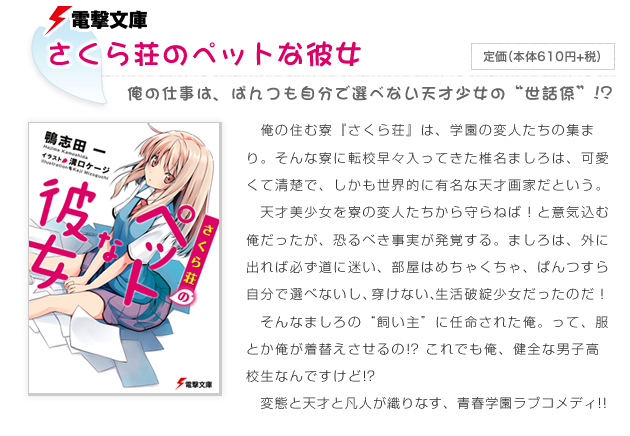 <b>1</b> — 2010-01</td>
    <td align="center">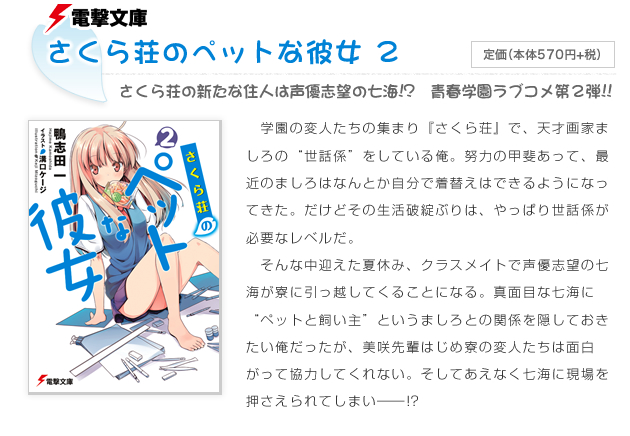 <b>2</b> — 2010-04</td>
    <td align="center">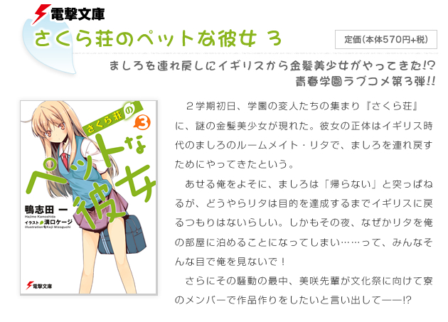 <b>3</b> — 2010-08</td>
    <td align="center">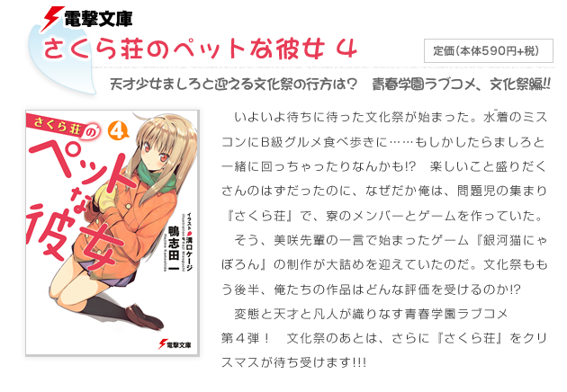 <b>4</b> — 2010-12</td>
  </tr>
  <tr>
    <td align="center">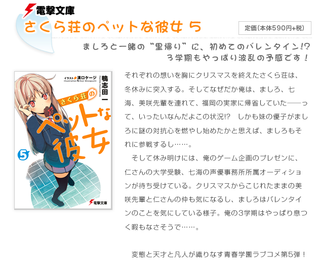 <b>5</b> — 2011-05</td>
    <td align="center">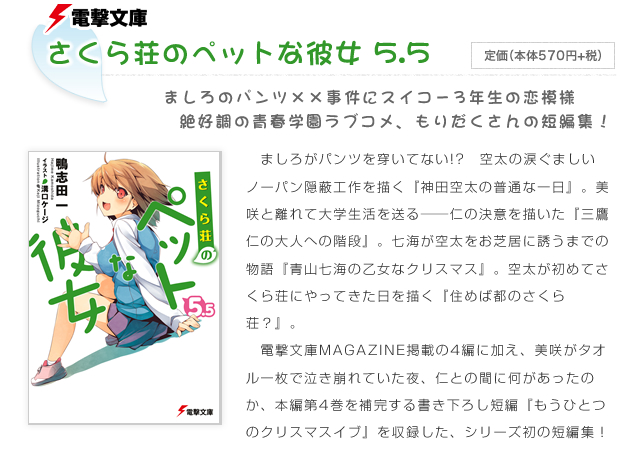 <b>5.5</b> — 2011-09</td>
    <td align="center">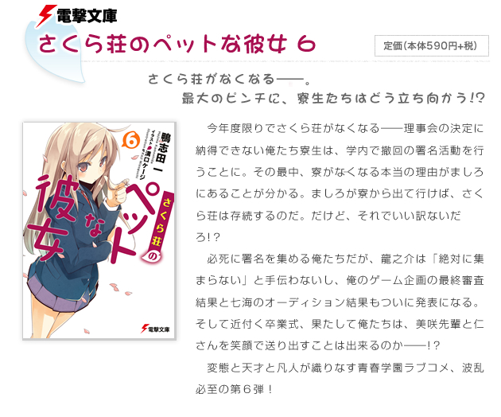 <b>6</b> — 2011-12</td>
    <td align="center">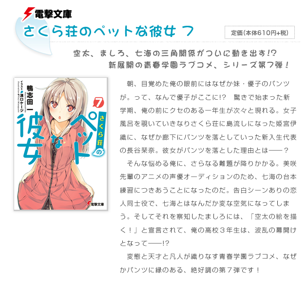 <b>7</b> — 2012-04</td>
  </tr>
  <tr>
    <td align="center">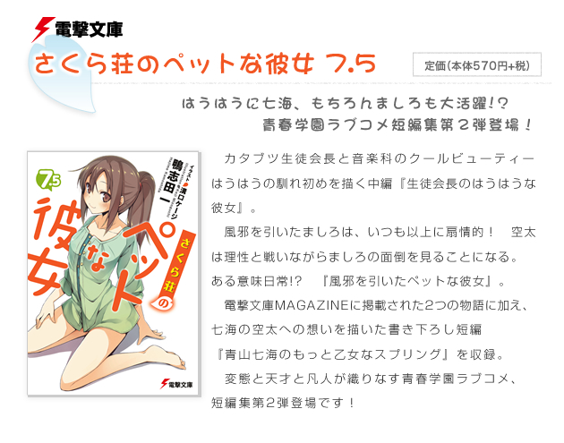 <b>7.5</b> — 2012-08</td>
    <td align="center">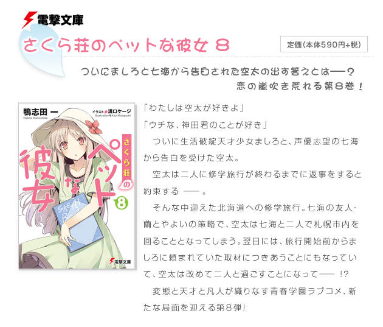 <b>8</b> — 2012-10</td>
    <td align="center">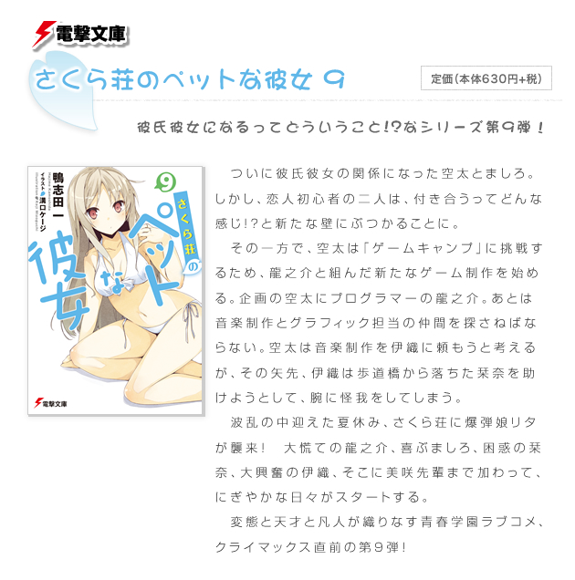 <b>9</b> — 2013-03</td>
    <td align="center">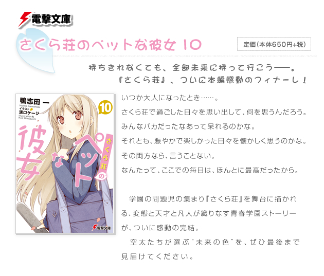 <b>10</b> — 2013-07</td>
  </tr>
  <tr>
    <td align="center">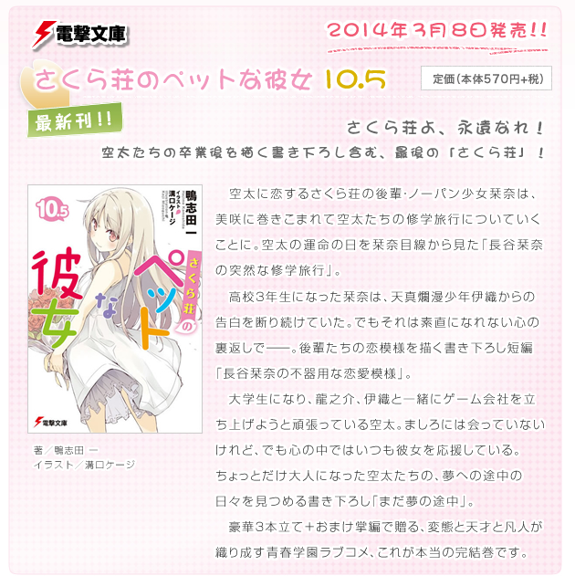 <b>10.5</b> — 2014-03 (cierre)</td>
    <td></td><td></td><td></td>
  </tr>
</table>

*Imágenes tomadas del sitio oficial de la obra en Dengeki (sakurasou.dengeki.com), sección 既刊紹介.*

---

## 11. Glosario mínimo de la ficha (para no perderse)

| Término | Lectura | Significado |
|---|---|---|
| 電撃文庫 | Dengeki Bunko | Sello de novela ligera de KADOKAWA donde se publicó la obra. |
| ライトノベル | raito noberu | "Novela ligera": formato japonés de novela ilustrada juvenil. |
| 青春 | seishun | Género de historias de formación adolescente. |
| 短編集 | tanpenshū | Colección de relatos cortos (los tomos 5.5, 7.5 y 10.5). |
| 初版発行 | shohan hakkō | Fecha de primera impresión, distinta del día de venta. |
| 文庫判 | bunko-ban | Formato de bolsillo japonés. |

---

## 12. Fuentes de esta sección

**Wikis**
1. Wikipedia en japonés — さくら荘のペットな彼女: https://ja.wikipedia.org/wiki/さくら荘のペットな彼女 (ficha, lista de volúmenes con ISBN, antecedentes de producción, personal y reparto del anime).
2. Wikipedia en inglés — *The Pet Girl of Sakurasou*: https://en.wikipedia.org/wiki/The_Pet_Girl_of_Sakurasou (fechas, licencias, listas de volúmenes, recepción).
3. Wikipedia en chino — 櫻花莊的寵物女孩: https://zh.wikipedia.org/wiki/櫻花莊的寵物女孩 (datos de las ediciones en chino y coreano).
4. Sakurasou Wiki (Fandom) — página principal de la obra: https://sakurasou.fandom.com/wiki/Sakurasou_no_Pet_na_Kanojo (resumen, datos de recepción y crítica de roles de género).
5. Wikipedia en japonés — 鴨志田一: https://ja.wikipedia.org/wiki/鴨志田一 (biografía, bibliografía, lema personal).
6. Wikipedia en japonés — 溝口ケージ: https://ja.wikipedia.org/wiki/溝口ケージ (trayectoria, estilo, obras ilustradas).

**Fuentes primarias y oficiales**
7. Sitio oficial de la obra (Dengeki/KADOKAWA): https://sakurasou.dengeki.com/ — sinopsis oficial del editor y sección 既刊紹介 con las portadas.
8. Fichas de producto de KADOKAWA (fecha, páginas, precio, formato) para los 13 tomos, p. ej. tomo 1: https://www.kadokawa.co.jp/product/200912000186/
9. Lista de circulación de novela ligera de LN News: https://ln-news.com/page/circulation (1 800 000 ejemplares, octubre de 2013).

**Prensa japonesa**
10. MANTANWEB, 13 de agosto de 2010 — entrevista al editor 荒木人美, "ラノベ質問状".
11. MANTANWEB, 10 de abril de 2012 — anuncio del anime y cifra de 850 000 ejemplares.
12. Gigazine, 31 de enero de 2013 — ranking de popularidad de los animes del otoño de 2012 (6.º lugar, 942 votos).

---

*Siguiente documento: [01-B — El anime y su equipo](01b-anime-y-staff.md)*
