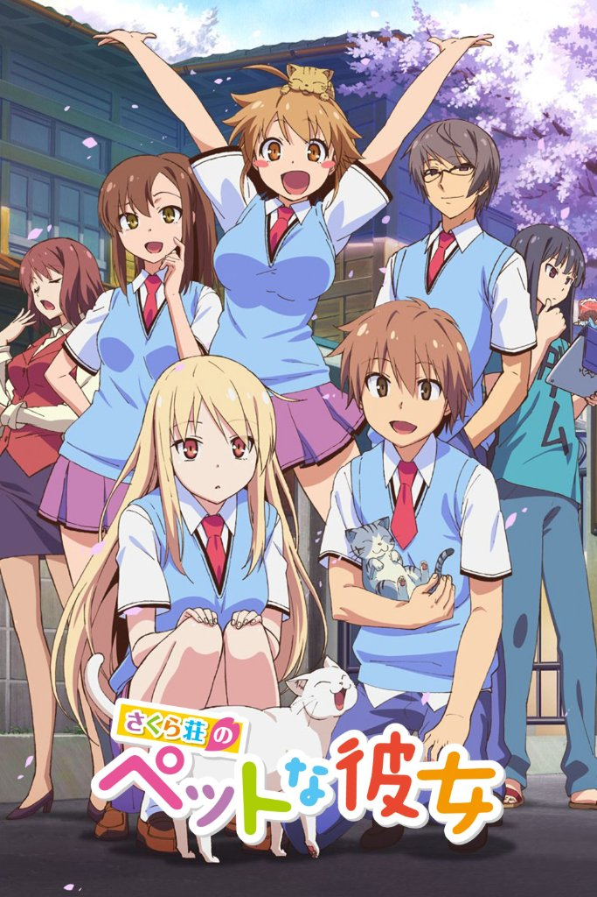
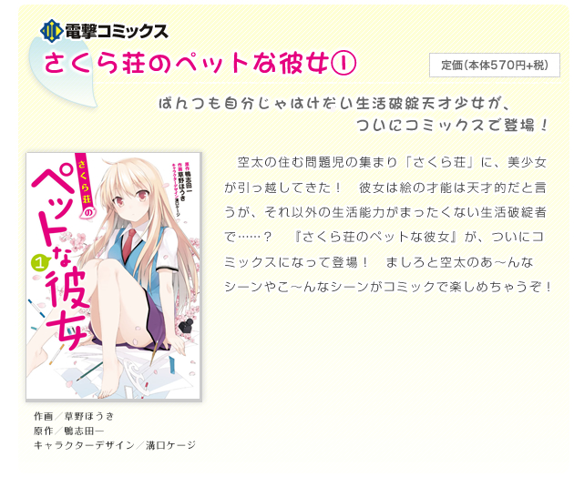
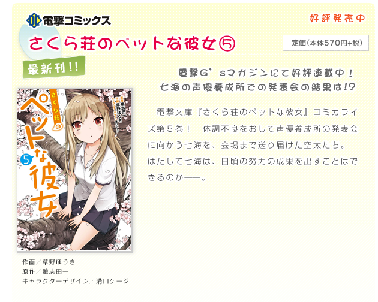

# Sección 01-C: Ficha técnica y datos de la obra (III) — la franquicia completa

> **Biblia del universo de Sakura-sou no Pet na Kanojo (さくら荘のペットな彼女)**
> Documento de referencia para el proyecto de fanfic de este repositorio.
> Aquí se reúne todo lo que la obra generó **alrededor** de la novela y el anime: manga, drama CDs, radio, videojuegos, crossovers y recepción crítica.

  

---

## 1. Mapa de la franquicia

| Producto | Formato | Periodo | Cantidad | Responsable |
|---|---|---|---|---|
| Novela ligera | Libro (Dengeki Bunko) | 2010–2014 | 13 tomos | 鴨志田一 / 溝口ケージ |
| Manga | Revista + tomos | 2011–2015 | 8 tomos | 草野ほうき (dibujo) |
| Antología 4-koma | Tomo único | 2013 | 1 tomo | Varios autores |
| Drama CD | CD | 2012–2013 | 4 discos | Reparto del anime |
| Web radio | Streaming | 2012–2013 | ~14 emisiones | Kayano Ai / Takamori Natsumi |
| Novela visual | PS Vita / PSP | 2013 | 1 juego | 熱中日和 / Kadokawa Games |
| Cartas con voz | App móvil | 2013 | 3 tandas | 嫁コレ |
| Juego de pelea (aparición) | Arcade | 2014 | Personaje de apoyo | Sega / Dengeki Bunko |
| Drama por votación | Streaming | 2016 | 4 emisiones | Kadokawa / Dwango |

---

## 2. El manga (2011–2015)

**Ficha**

| Campo | Dato |
|---|---|
| Título | さくら荘のペットな彼女 |
| Dibujo (作画) | **草野ほうき** (Kusano Hōki) |
| Historia | 鴨志田一 (obra original) |
| Diseño de personajes | 溝口ケージ |
| Revista original | 電撃G's magazine (Dengeki G's Magazine) |
| Primera entrega | Número de **abril de 2011** |
| Revista de continuación | 電撃G'sコミック (Dengeki G's Comic), del Vol. 1 al Vol. 14 |
| Sello recopilatorio | 電撃コミックス (Dengeki Comics) |
| Tomos | **8** |
| Editorial | ASCII Media Works → KADOKAWA |

**Cómo se publicó.** Empezó en *Dengeki G's Magazine*, una revista orientada a los juegos y franquicias de Dengeki (donde convivía con *Love Live!*), y cuando esa cabecera se transformó en *Dengeki G's Comic* el manga se mudó con ella y siguió hasta el volumen 14 de la nueva revista. Los ocho tomos recopilatorios salieron entre **octubre de 2011** y **junio de 2015**.

**Los 8 tomos**

| # | Fecha | ISBN |
|---|---|---|
| 1 | 2011-10-27 | 978-4-04-870986-6 |
| 2 | 2012-05-26 | 978-4-04-886508-1 |
| 3 | 2012-10-27 | 978-4-04-891026-2 |
| 4 | 2013-03-27 | 978-4-04-891460-4 |
| 5 | 2013-09-27 | 978-4-04-891921-0 |
| 6 | 2014-03-27 | 978-4-04-866387-8 |
| 7 | 2014-10-27 | 978-4-04-866941-2 |
| 8 | 2015-06-27 | 978-4-04-865083-0 |

**Antología oficial de 4-koma**

| Título | Fecha | ISBN | Notas |
|---|---|---|---|
| 4コマ公式アンソロジー さくら荘のペットな彼女 | 2013-02-27 | 978-4-04-891409-3 | Tomo único, sello Dengeki Comics EX. Varios autores invitados; formato de tira cómica de cuatro viñetas. Coincide con el momento álgido de la franquicia (anime en emisión + juego). |

**Diferencia con el anime:** el manga sigue el orden de la novela, no el del anime, y se permite escenas que el anime recorta. Se publicó en chino por 台灣角川 (Taiwán/HK).

<table>
  <tr>
    <td align="center"> Manga, tomo 1 (2011)</td>
    <td align="center"> Manga, tomo 5 (2013)</td>
  </tr>
</table>

---

## 3. Drama CDs (2012–2013)

La franquicia produjo **cuatro discos de drama**, uno antes del anime y tres durante su emisión. Todos con el reparto de la serie.

| # | Título | Fecha | Libreto | Notas |
|---|---|---|---|---|
| 1 | 椎名ましろのはじめてのお世話 *El primer cuidado de Shiina Mashiro* | 2012-06-28 | 鴨志田一 (cuadernillo escrito para el disco) | Anunciado junto con el lanzamiento del sitio web oficial. Incluía: CD, cuadernillo original del autor, tres separadores tipo "acta de Sakura-sō" y tres forros de libro intercambiables. Portada de 溝口ケージ. |
| 2 | TVアニメ「さくら荘のペットな彼女」ドラマCD 1 | 2013-01-30 | 中瀬理香 (Nakase Rika) | MFCZ-1025 |
| 3 | TVアニメ「さくら荘のペットな彼女」ドラマCD 2 | 2013-02-27 | 西都大貫 (con 高岡広明 como asistente) | MFCZ-1026 |
| 4 | TVアニメ「さくら荘のペットな彼女」ドラマCD 3 | 2013-04-24 | 中瀬理香 | MFCZ-1027 |

Los tres discos del anime contienen **episodios originales que no están ni en la novela ni en la serie**, así que son material "semi-canon" útil: no contradicen nada y añaden escenas de convivencia.

---

## 4. Web radio

| Campo | Dato |
|---|---|
| Título | さくら荘のペットなラジオ |
| Emisión | 29 de septiembre de 2012 – 23 de marzo de 2013 |
| Plataformas | 超!A&G+ (Chō! A&G+) y アニメイトTV (desde el 6 de octubre) |
| Frecuencia | Cada dos sábados |
| Presentadoras | **茅野愛衣** (Kayano Ai, Mashiro) y **高森奈津美** (Takamori Natsumi, Misaki) |

Es el clásico programa de promoción de la temporada: arranca una semana antes del estreno y termina el mismo mes que el último episodio. Para el fanfic sirve como fuente de "cómo hablan los personajes fuera de la ficción", porque las actrices usaban los apodos y muletillas de la serie.

---

## 5. Novela visual para PSP y PS Vita (2013)

| Campo | Dato |
|---|---|
| Título | さくら荘のペットな彼女 |
| Género | Simulación de producción de juegos × novela romántica (ゲーム制作シミュレーション×恋愛アドベンチャー) |
| Plataformas | **PlayStation Vita** y **PlayStation Portable** |
| Fecha | **14 de febrero de 2013** (San Valentín, a propósito) |
| Desarrollo | 熱中日和 (Netchubiyori) |
| Producción y planificación | ASCII Media Works |
| Distribución | 角川ゲームス (Kadokawa Games) |
| Jugadores | 1 |
| Puntuación | 31/40 en la crítica cruzada de *Famitsu* (número 1262), "Salón de Plata" |

**Original del juego:** la personaje **中野乙羽 (Nakano Otoha)**, estudiante de primer año de Suikō, con voz de 大坪由佳. El juego fue el único lugar donde nació; después fue adoptada por el anime como extra en los episodios 12 y 23.

**Mecánica:** el jugador administra un equipo que hace un juego (como el grupo de Sorata), con rutas románticas por heroína. Es decir, el juego dramatiza la misma fantasía que la serie propone como meta: convertir el talento disperso del dormitorio en un producto terminado.

---

## 6. Apariciones en otros juegos

**『嫁コレ』 (Yome Colle)** — aplicación móvil de tarjetas con voz.
- **5 de julio de 2013**: tarjeta de 椎名ましろ.
- **19 de julio de 2013**: tarjeta de 青山七海.
- **13 de agosto de 2013**: tarjeta de 上井草美咲.

**『電撃文庫 FIGHTING CLIMAX』** — juego de pelea 2D en arcade, en operación desde el **18 de marzo de 2014**. Desarrollado por エコールソフトウェア (École Software) y フランスパン (French-Bread), distribuido por **Sega**. Reúne personajes de todo el catálogo de Dengeki Bunko; de esta obra aparece **椎名ましろ como personaje de apoyo** (*support character*), no jugable.

---

## 7. El crossover con 青春ブタ野郎: 多数決ドラマ (2016)

El proyecto **多数決ドラマ** ("drama por votación mayoritaria") de Dengeki Bunko consistía en emitir un drama en Nico Nico donde el público votaba las decisiones de la historia. Su **segunda entrega** fue un crossover:

> **多数決ドラマ『青春ブタ野郎は文化祭ヒロインの夢を見ない』 with さくら荘のペットな彼女**

| Campo | Dato |
|---|---|
| Emisión | 5 de febrero – 18 de marzo de 2016 (4 emisiones) |
| Guion | **鴨志田一** |
| Visual clave y SD | 溝口ケージ |
| Producción de video | NEFT FILM |
| Producción de sonido | Magic Capsule |
| Lema | 「君の選択が未来を決める！」 — *"¡Tu elección decide el futuro!"* |

**Reparto:** 石川界人 (Azusagawa Sakuta), 瀬戸麻沙美 (Sakurajima Mai), **茅野愛衣 (椎名ましろ)**, 東山奈央 (Koga Tomoe), 水瀬いのり (Makinohara Shōko), 内田雄馬 (Kunimi Yūma) y 久保ユリカ (Azusagawa Kaede).

**La primera votación la ganó Mashiro**, y ese episodio se emitió el 5 de febrero de 2016. Es el único material animado/actuado en el que Mashiro comparte escena con el elenco de *Rascal Does Not Dream*, y confirma que ambos universos conviven oficialmente.

---

## 8. Cameos y guiños dentro de la obra del autor

En la serie 『青春ブタ野郎』 (2014–2025), del mismo autor e ilustrador, aparecen guiños a Sakura-sō:

| Personaje de Sakura-sō | Dónde aparece | Forma |
|---|---|---|
| 上井草美咲 y 三鷹仁 | 『青春ブタ野郎はロジカルウィッチの夢を見ない』 (tomo 3) | Salen en una sección de noticias de televisión |
| 赤坂龍之介 y リタ・エインズワース | 『青春ブタ野郎はプチデビル後輩の夢を見ない』 (tomo 2) | Aparecen sin que se diga el nombre |
| 姫宮沙織 | 『青春ブタ野郎はシスコンアイドルの夢を見ない』 (tomo 4) | Se la ve aceptando la propuesta de matrimonio de Sōichirō |
| 由比ヶ浜かんな (seudónimo de 長谷栞奈) | Toda la serie | Sus novelas se citan constantemente |

Para el fanfic: **el canon permite que Sakura-sō siga existiendo en el trasfondo de un Tokio ficticio compartido**. Si en algún momento se necesita un guiño, hay precedente oficial.

---

## 9. Cronología completa de la franquicia

| Fecha | Hito |
|---|---|
| 2010-01-10 | Novela, tomo 1. |
| 2011-04 | Arranca el manga en *Dengeki G's Magazine*. |
| 2011-09-10 | Novela, tomo 5.5 (primer volumen corto). |
| 2012-04-10 | Anuncio del anime; 850 000 ejemplares vendidos. |
| 2012-06-28 | Drama CD 1 (『椎名ましろのはじめてのお世話』). |
| 2012-09-29 | Arranca el web radio. |
| 2012-10-09 | Estreno del anime. |
| 2012-11-02 | Sentai Filmworks licencia la serie para Norteamérica. |
| 2012-11 | Polémica del samgyetang (episodio 6). |
| 2013-01-30 | Drama CD 2 y primer volumen de Blu-ray. |
| 2013-02-14 | Juego para PS Vita / PSP. |
| 2013-02-27 | Antología oficial de 4-koma y drama CD 3. |
| 2013-03-26 | Último episodio del anime. |
| 2013-04-24 | Drama CD 4 (último). |
| 2013-07-05 | Primera tarjeta de 嫁コレ (Mashiro). |
| 2013-07-10 | Novela, tomo 10: final del arco principal. |
| 2013-10 | 1 800 000 ejemplares en circulación. |
| 2013-08-28 | Último volumen de Blu-ray/DVD. |
| 2014-03-08 | Novela, tomo 10.5: cierre definitivo. |
| 2014-03-18 | 椎名ましろ entra a 『電撃文庫 FIGHTING CLIMAX』 como apoyo. |
| 2015-06-27 | Último tomo del manga. |
| 2016-02-05 | 多数決ドラマ crossover con 青春ブタ野郎. |
| 2020-08-25 | Sentai lanza el anime doblado al inglés en Blu-ray. |

---

## 10. Recepción y crítica

**Lo comercial** (repetido aquí porque es el dato que más se cita):
- 850 000 ejemplares en abril de 2012 (*Mainichi Shimbun*).
- 1 800 000 ejemplares en octubre de 2013 (LN News).
- 6.º lugar entre los estrenos del otoño de 2012 en la encuesta de Gigazine, con 942 votos.
- 6.º lugar en el apartado de reseñas de 「みんなで選ぶベストラノベ2011」.
- 10.º lugar en la categoría de novela ligera de los 電子書籍アワード2013 (premio de libro electrónico).

**Lo crítico.** La objeción más repetida, y que aparece incluso en la ficha de la Sakurasou Wiki (Fandom) en su sección de recepción, es que la premisa convierte a Mashiro en una **"mascota sexy y dependiente"**, y que la serie se apoya en roles de género tradicionales: el chico común que "cuida" de la genio incapaz de vestirse sola y que además es un objeto de deseo. El contraargumento habitual es que la obra usa esa premisa como **punto de partida cómico** que luego desmonta: Mashiro es la persona más talentosa y la que toma las decisiones profesionales más duras, y Sorata es quien tiene que crecer.

**Cómo lo trata esta biblia:** se documenta el debate sin resolverlo. Si el fanfic retoma al personaje de Mashiro, conviene decidir conscientemente si se reproduce el gag del "dueño y mascota" o se subvierte, porque es el punto donde la obra envejece peor para una parte del público.

**El punto ciego del anime:** al no adaptar los tomos 8 a 10.5, la serie termina antes del cierre real. Quien solo vio el anime **no sabe cómo acaba**. Eso explica que la fandom siga discutiendo "el final" quince años después, y es una razón práctica para que este proyecto tenga la biblia completa antes de escribir.

---

## 11. Cifras rápidas (para citar sin equivocarse)

| Dato | Valor |
|---|---|
| Volúmenes de novela | 13 (10 + 3 cortos) |
| Volúmenes de manga | 8 + 1 antología |
| Episodios de anime | 24 |
| Volúmenes de Blu-ray/DVD | 8 |
| Drama CDs | 4 |
| Temas musicales | 3 openings + 2 endings + 2 insertadas |
| Ejemplares en circulación (2013) | 1 800 000 |
| Año de cierre de la novela | 2014 |
| Año de cierre del manga | 2015 |

---

## 12. Fuentes de esta sección

1. Wikipedia en japonés — さくら荘のペットな彼女: https://ja.wikipedia.org/wiki/さくら荘のペットな彼女 (manga con ISBN, drama CDs, radio, juego, 嫁コレ, FIGHTING CLIMAX, 多数決ドラマ, cameos).
2. Wikipedia en japonés — 多数決ドラマ: https://ja.wikipedia.org/wiki/多数決ドラマ (ficha, reparto y calendario del crossover de 2016).
3. Wikipedia en inglés — *The Pet Girl of Sakurasou*: https://en.wikipedia.org/wiki/The_Pet_Girl_of_Sakurasou (manga, novela visual, recepción).
4. Wikipedia en chino — 櫻花莊的寵物女孩: https://zh.wikipedia.org/wiki/櫻花莊的寵物女孩 (ediciones en chino del manga).
5. Sakurasou Wiki (Fandom): https://sakurasou.fandom.com/wiki/Sakurasou_no_Pet_na_Kanojo (recepción y crítica de roles de género).
6. Sitio oficial de la obra: https://sakurasou.dengeki.com/books/ (portadas y datos de los tomos).
7. LN News, lista de circulación: https://ln-news.com/page/circulation.

---

*Documento anterior: [01-B — El anime y su equipo](01b-anime-y-staff.md) · Volver al [índice de la biblia](README.md)*
