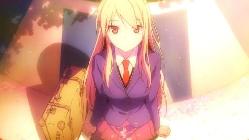
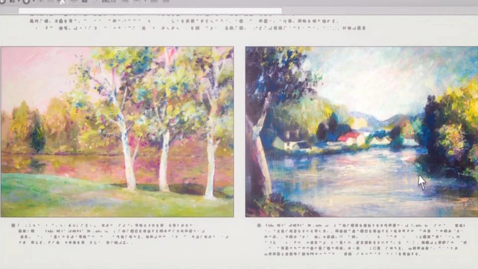
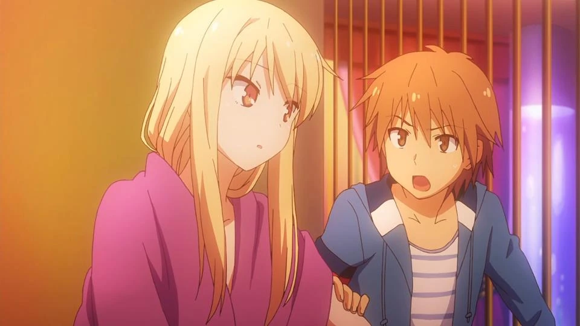
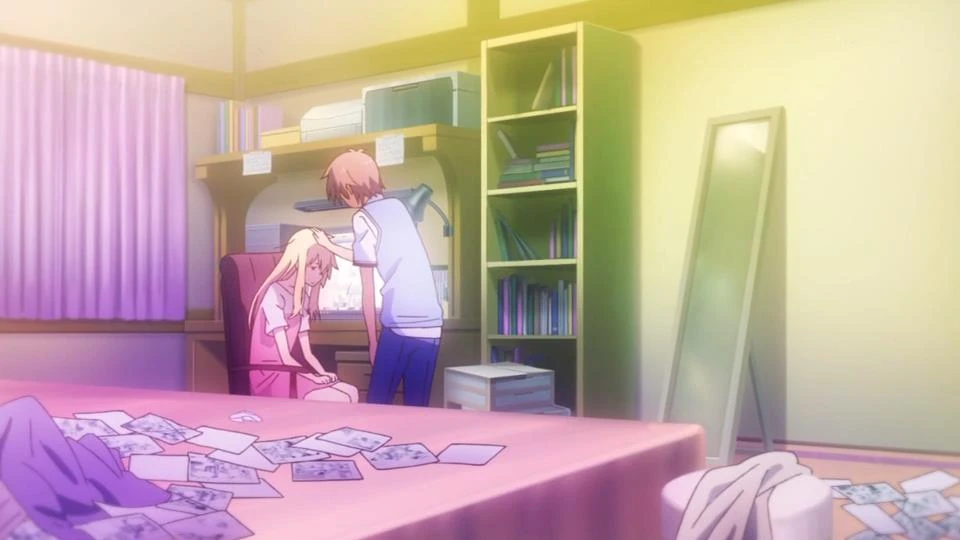
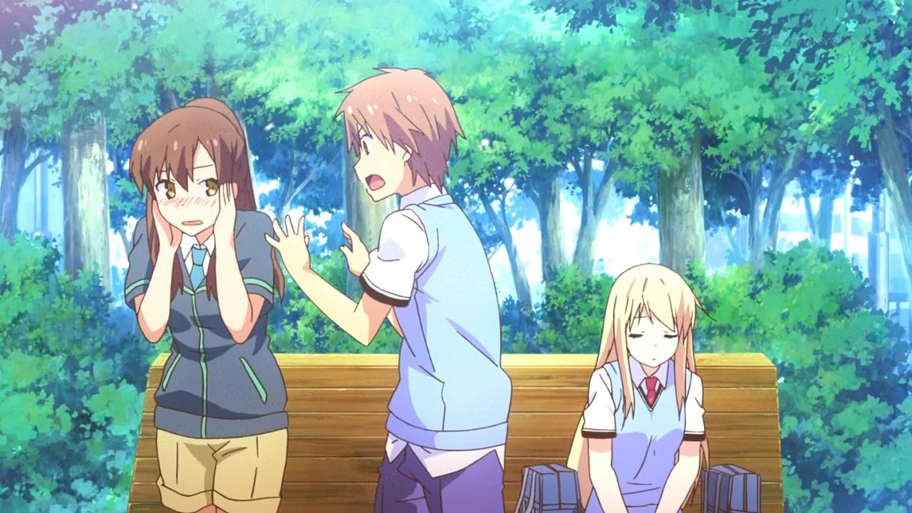
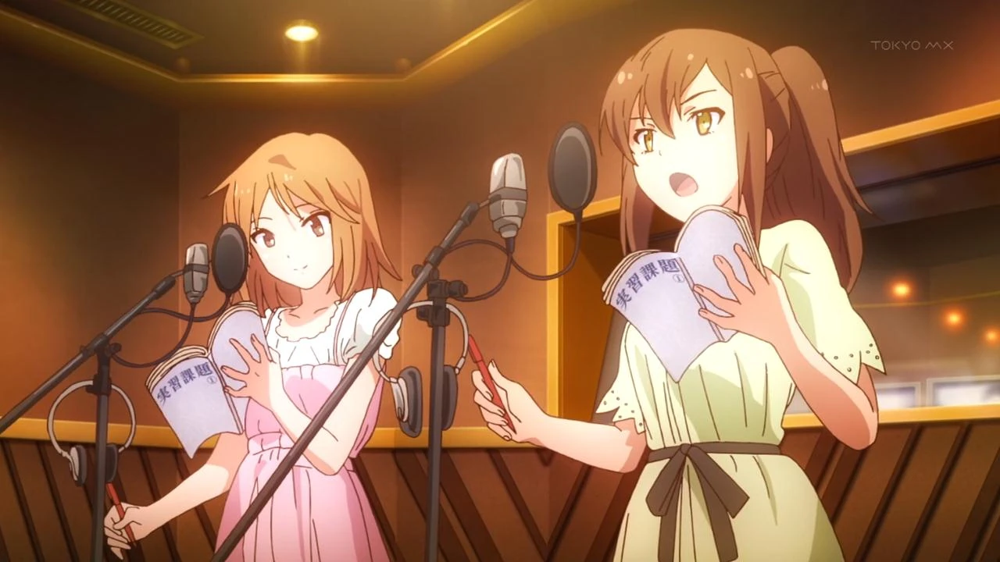
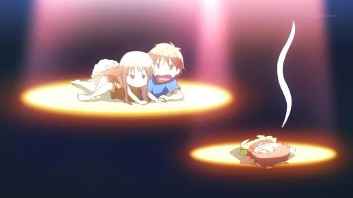
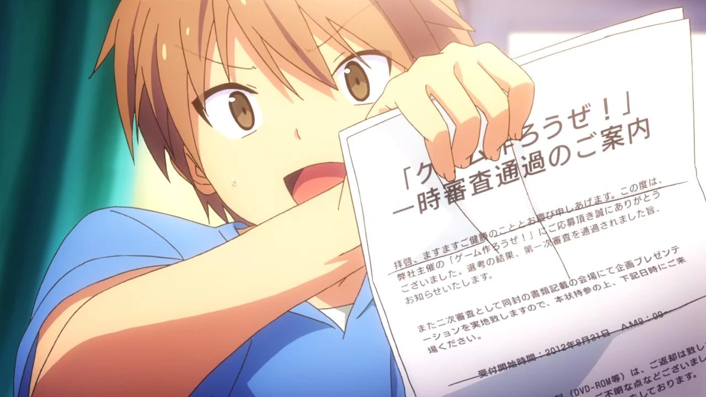

# Sección 02-A: Temporada 1 — episodios 1 a 8 (con spoilers)

> **Biblia del universo de Sakura-sou no Pet na Kanojo (さくら荘のペットな彼女)**
> Documento de referencia para el proyecto de fanfic de este repositorio.
> ⚠️ **Aviso: esta sección está llena de spoilers.** Se cuentan los episodios completos, con giros incluidos.

  

---

## Cómo leer esta sección

La temporada 1 tiene **24 episodios** emitidos entre el 9 de octubre de 2012 y el 26 de marzo de 2013. Por volumen de información la dividimos en tres documentos:

| Documento | Episodios | Tramo de la historia |
|---|---|---|
| **02-A** (este) | 1 – 8 | Presentación del mundo, llegada de Mashiro, primer verano, primer fracaso |
| 02-B | 9 – 16 | Llegada de Rita, el festival cultural, invierno y Año Nuevo |
| 02-C | 17 – 24 | San Valentín, la amenaza de demolición y la graduación |

**Convenciones de estas fichas**

- El título japonés va primero y la traducción propia entre paréntesis. **No existe traducción oficial al español.**
- "Storyboard" (絵コンテ, *ekonte*) es la persona que dibuja el guion gráfico del capítulo; "dirección de episodio" (演出, *enshutsu*) es quien lo ejecuta en producción. No son lo mismo, y en esta serie casi nunca coinciden.
- Las fechas son de primera emisión en TOKYO MX (martes a las 00:30, es decir, madrugada del lunes al martes).
- Marco en **negritas** los momentos que después se recuperan en otro capítulo, porque esta serie funciona por ecos.

---

## Episodio 1 — ねこ・しろ・ましろ *("Gato, blanco, Mashiro")*

**Ficha:** guion 岡田麿里 (Okada Mari) · storyboard y dirección いしづかあつこ (Ishizuka Atsuko) · emitido el 9 de octubre de 2012 · sin opening (arranca en frío).

**Lo que pasa.** El episodio abre con Sorata soñando despierto en clase, aburrido; cuando "despierta" del sueño, lo primero que ve es el trasero de su gato. Ese doble engaño (soñar que sueña) es la primera pista del tono de la serie: nada es tan dramático como parece, y lo importante suele estar a ras del suelo. En su cuarto encuentra a **Misaki durmiendo en su cama**, a la que echa sin ceremonias: no es una intrusa, es la vecina de la 201 que entra por la ventana.

Al salir, 千石千尋 (Sengoku Chihiro), la supervisora del dormitorio, le encarga arreglar la **placa con el nombre** de la entrada. Ese encargo es el pretexto para presentar el edificio y a sus habitantes: Misaki (201), animadora amateur genial y excéntrica; 三鷹仁 (Mitaka Jin), el popular de la 103; 赤坂龍之介 (Akasaka Ryūnosuke), programador de la 102 que no sale de su cuarto y se comunica a través de **メイドちゃん (Maid-chan)**, una IA que él mismo programó; y 神田空太 (Kanda Sorata) en la 101, el único que se define como "normal".

En la escuela, sus amigos 宮原大地 (Miyahara Daichi) y 青山七海 (Aoyama Nanami) le recuerdan que está en Sakura-sō por haber recogido gatos callejeros en un dormitorio donde están prohibidos. Nanami, que trabaja en una tienda de conveniencia, le regala una bolsa de comida para gato: el primer gesto de cariño del personaje, y el primero de muchos que Sorata no va a saber leer.

Chihiro le pide otro favor: recoger en la estación a su prima, que se muda al dormitorio y se transfiere a la escuela. Sorata va, compra un dulce, y en la banca de la estación encuentra a una chica de pelo blancuzco y mirada vacía. Es **椎名ましろ (Shiina Mashiro)**. Antes de irse, los dos hablan de sus colores favoritos: **el título del episodio resume lo que entra en la vida de Sorata: el gato (ねこ), el blanco (しろ) y Mashiro (真白, literalmente "blanco puro")**.

De vuelta en Sakura-sō, Misaki monta una fiesta de bienvenida con banquete y una proyección de su última animación, doblada en vivo por ella misma con diálogos absurdos. Solo Jin responde a la petición de opinión.

Al día siguiente, Chihiro le encarga "cuidar" de Mashiro. Sorata cree que se trata de acompañarla al colegio. Descubre la verdad a golpes: Mashiro **no sabe vestirse, no sabe lavar ropa, no sabe secarse el pelo, no sabe despertarse ni ordenar su cuarto**. Es una genio absoluta y una incapacitada total para la vida diaria. Sorata la viste, la peina y la lleva a la escuela; llegan pasada la segunda hora.

**Por qué importa.** El episodio instala los dos motores de toda la serie: **(a)** el gag del "dueño y mascota" —una persona que cuida de otra— y **(b)** la pregunta de qué significa ser "normal" en un edificio lleno de genios. La placa de la entrada, que Sorata repara al principio, **volverá a aparecer en el último episodio**: la serie empieza y termina con el mismo gesto doméstico.

**Detalles que sirven al escribir.**

- Los cuartos son 101 (Sorata), 102 (Ryūnosuke) y 103 (Jin) abajo; 201 (Misaki), 202 (Mashiro) y 203 (Nanami) arriba. La escalera exterior es el lugar donde ocurren las conversaciones serias.
- Sorata tiene dos gatos propios en el cuarto, ひかり (Hikari, blanca) y のぞみ (Nozomi, negra), además de una camada callejera que va colocando en adopción durante la serie.
- Mashiro no es tímida ni fría: es **literal**. Responde exactamente lo que le preguntan, sin filtro social. Casi todos los malentendidos del anime nacen de eso.
- El opening no suena en este episodio; la serie prefiere empezar sin él para que la aparición del tema en el episodio 2 funcione como "esto ya arrancó".

---

## Episodio 2 — 絵を描いてきたの *("Vine a pintar")*

**Ficha:** guion 岡田麿里 · storyboard y dirección 鈴木薫 (Suzuki Kaoru) · 16 de octubre de 2012 · OP 「君が夢を連れてきた」 / ED 「DAYS of DASH」.

**Lo que pasa.** Sorata convoca una "junta" de residentes para repartir el cuidado de Mashiro. La discusión se le va de las manos y termina **nombrándolo a él único responsable**: así queda formalizado el "ましろ当番" (turno Mashiro), que será la fuente de casi toda la comedia del primer cour.

La mañana siguiente es un desastre doméstico y Sorata sale sin desayunar. En la tienda de conveniencia, mientras él elige comida, **Mashiro abre un baumkuchen y se lo come sin pagar**. Cuando Sorata le pregunta qué hacía en Inglaterra, ella contesta: 「絵を描いてきたの」, *"vine a pintar"* — de ahí el título. Nanami aparece (trabaja ahí) y presencia la escena.

En el camino a la escuela, Mashiro presenta a Sorata diciendo que es **"mi primer chico"** (su primer amigo hombre). Nanami lo interpreta como otra cosa, se incomoda y se va. La confusión se arrastra todo el capítulo, y es la primera vez que la serie usa el malentendido como combustible romántico.

En la escuela, Miyahara nota raro a Nanami; Sorata, sin dinero para comer por culpa de Mashiro, le reclama "responsabilidad" a Chihiro y ella cambia de tema con una sonrisa. Luego Mashiro aparece en su salón para decir que se quiere ir sola a casa; Sorata la deja y Nanami se enoja.

Después de clases, Sorata ve a Mashiro con una mujer en la puerta: es **飯田綾乃 (Iida Ayano), su editora**. De ahí sale la revelación de que Mashiro **quiere ser mangaka**. Las dos pasan por la tienda donde trabaja Nanami y Mashiro, con su literalidad característica, aclara el malentendido; Ayano, sabiendo que Mashiro se muere por un baumkuchen, le compra dos.

En Sakura-sō, Sorata encuentra un rastro de **coles** por el pasillo: es el "regalo" de cumpleaños de Misaki para Jin. Recordando el regalo del año anterior, Jin le pide que lo acompañe; dentro de una caja gigante está **Misaki envuelta solo con listón**. Sorata se retira con dignidad.

Esa noche, Mashiro entra a su cuarto y le pide que se desvista para dibujar el cuerpo de un hombre. Tras negociar, Sorata acepta conservar los calzoncillos. Mashiro lo observa, dibuja y le hace preguntas sobre la relación entre hombres y mujeres: el "estudio" dura toda la noche. Es la primera vez que la serie plantea el tema del episodio: **Mashiro investiga el amor como quien investiga anatomía, porque no lo ha sentido nunca**.

Al día siguiente Sorata se topa con Nanami, todavía avergonzada, y de vuelta al dormitorio encuentra un libro de arte, lo hojea y comenta que la imagen es bonita. Mashiro dice "gracias" y Sorata no entiende. Jin le suelta la frase clave: no sabe con quién vive. Sorata investiga: **Mashiro es una pintora de fama mundial, formada en Inglaterra**.

**Por qué importa.** Aquí se define el eje temático: **la genialidad no se puede imitar y el cuidado sí**. Mashiro no sabe vivir; Sorata no sabe qué quiere. La serie empieza a construir el intercambio que sostendrá todo: él le da vida cotidiana, ella le da un espejo donde mirar su propia falta de rumbo.

**Detalles.**

- El **baumkuchen** se convierte en el símbolo de Mashiro: es lo único que pide por sí misma durante buena parte de la serie, y en el episodio 14 será también su manera de pedir perdón.
- La escena del modelaje es más casta en el anime que en la novela, donde el erotismo del "dueño y mascota" está más marcado.
- La relación de Ayano con Mashiro es profesional pero afectuosa: es quien le exige resultados y quien le dice la verdad sobre su manga durante toda la serie.

---

## Episodio 3 — 近すぎて遠い… *("Tan cerca y tan lejos…")*

**Ficha:** guion 鴨志田一 (Kamoshida Hajime, el autor) · storyboard 神戸守 (Kanbe Mamoru) · dirección 高島大輔 (Takashima Daisuke) · 23 de octubre de 2012.

**Lo que pasa.** Mashiro entra al baño mientras Sorata se baña para investigar "escenas de regadera" para su manga, y le avienta agua fría en la cara. Cuando se va, Sorata intenta decirle "échale ganas" y **no le sale**.

En la sala común, Jin habla por teléfono con una mujer y luego interroga a Sorata sobre sus metas. Jin aprieta y aprieta hasta que Sorata pierde la paciencia y se va. Chihiro, que llega justo entonces, discute con Jin sobre el tema: el espectador entiende que Jin no lo hace por crueldad, sino porque ve en Sorata su propia indecisión.

En su cuarto, Sorata encuentra el anuncio de un **concurso de diseño de videojuegos** y se interesa. Intenta pedirle ayuda a Ryūnosuke, no se atreve, y termina haciendo **carteles de gatos perdidos**. Es la definición perfecta del personaje: quiere algo grande y hace algo pequeño para no enfrentarlo.

En la escuela, Nanami lo ayuda a pegar carteles; Mashiro aparece con ella y pide encargarse de los gatos, y Sorata se lo niega. Mashiro le propone salir el domingo y él rechaza, diciéndole que le pida a Jin.

El domingo, Misaki lo saca de la cama a gritos: **Jin y Mashiro se fueron a un hotel**. Chihiro intenta explicar que es "investigación", pero nadie le cree. Misaki y Sorata los persiguen con ayuda de Maid-chan, que les da la ubicación; en el camino pasan por la tienda donde trabaja Nanami y **Misaki se derrumba**: ve a Jin con otra y pregunta por qué no puede ser ella la que está a su lado.

En la entrada del hotel, Misaki se echa a llorar y se va a casa. Sorata intenta golpear a Jin y **recibe él el puñetazo**; pierde el conocimiento. Despierta dentro de la habitación, con Mashiro, y Jin ya se fue. Mashiro le explica que todo estaba planeado con Jin —incluido que Jin recibiría el golpe, aunque sus reflejos ganaron— y que ella solo vino a dibujar el cuarto para su manga. Sorata le reclama la imprudencia y Mashiro le contesta con la frase que duele: **ella vino por un motivo, él no vino por nada; el que no sabe por qué está ahí es Sorata**. Es una de las acusaciones más duras que recibe el protagonista en toda la serie, y viene de quien menos habla.

Esa noche, Sorata llama a Jin para pedirle que vuelva por Misaki. Jin responde con una salida grosera y le deja claro que no piensa volver. Sorata da vueltas a la pelea con Mashiro y **decide irse de Sakura-sō**. Al día siguiente lo anuncia, y Mashiro se enoja como no se la había visto.

**Por qué importa.** Es el episodio donde la serie deja de ser comedia de convivencia y se vuelve una historia sobre **no tener rumbo**. La decisión de Sorata no es un berrinche: es el reconocimiento de que está viviendo en una casa de gente que sabe lo que quiere y él no.

**Detalles.**

- Este es el primer episodio que escribe el autor de la novela. Se nota: se permite escenas incómodas que Okada habría suavizado, como la del hotel.
- **El cuarto de hotel y el dibujo de Mashiro después reaparecen** en su manga: la escena real se convierte en material de ficción dentro de la ficción.
- El "concurso de diseño de juegos" que aparece aquí es el mismo que le dará estructura a toda la temporada 1 y que reaparecerá hasta el episodio 21.

---

## Episodio 4 — 色を変える世界 *("El mundo que cambia de color")*

**Ficha:** guion 岡田麿里 · storyboard y dirección 桜美かつし (Sakurami Katsushi) · 30 de octubre de 2012.

**Lo que pasa.** Sorata empaca para mudarse al dormitorio general. Recuerda el momento en que le dijo a Mashiro que se iba; ella, en cambio, se encierra a terminar su manga para el concurso de nuevos autores.

Misaki lo detiene en la puerta: Mashiro aparece con yukata. Sorata no atina a decir nada, las dos lo llaman idiota y se van. Jin sale con otro yukata y le explica que es **Tanabata**, la fiesta de los deseos. Mientras los demás ayudan a los niños a colgar sus tanzas, Sorata y Mashiro se sientan en una banca a pensar el deseo de ella. Cuando lo cuelga, **se suelta la lluvia** y la fiesta se cancela.

Refugiados en la sala común, Mashiro recibe una llamada: **no ganó**. Sorata intenta consolarla y lo hace peor, con una frase que la hiere. Al darse cuenta, sale corriendo bajo la lluvia. Jin lo alcanza y le habla de la gente de arte, atrapada entre el mundo real y el suyo; en la misma conversación **Jin confiesa que también está enamorado de Misaki** y que no soporta la distancia que hay entre ellos.

De vuelta, Sorata encuentra en su cuarto los libros de diseño de juegos que le prestó Ryūnosuke. Maid-chan le dice, con su franqueza de IA, que los lea hasta despedazarse. Mashiro, mientras tanto, se encierra.

Al día siguiente no contesta a los golpes en la puerta; Sorata le deja el desayuno afuera. Al quitar la rama de bambú del Tanabata, lee el deseo de Mashiro: **"que el deseo de Sorata se cumpla"**.

En la escuela, Nanami y él planean cuidar a los dos últimos gatos sin adoptar. Ayano lo intercepta y lo lleva a una cafetería: le muestra la manga de Mashiro. Está basada en Sakura-sō, **con los géneros invertidos** —el chico es seguro como Mashiro, la chica es insegura como Sorata—. Ayano explica que la obra es excelente pero **el final no funciona**, y que si lo cambia podría publicarse. Sorata entiende por qué Mashiro escribió ese final: lo escribió con la salida de él.

Antes de volver a casa pasa por la escuela a entregar su **encuesta de orientación vocacional**, y ahí vemos lo que escribió: **"quiero ser desarrollador de videojuegos"**. Es el momento en que el personaje por fin se define, y ocurre sin fanfarria, en un formulario.

Llega a Sakura-sō y le explica todo a Mashiro a gritos a través de la puerta: que tenía miedo de intentarlo y fracasar, que después de ver su trabajo la admiró, que quiere ser como ella. Misaki sube a interrumpir y Jin la detiene. Sorata entra y ve el plato intacto y a Mashiro dormida: **pasó la noche redibujando el final que ella quería, no el que pasó**.

Sorata decide quedarse. Se lo cuenta a Mashiro cuando despierta, incluida la posibilidad de que su manga se publique, y ella le pide algo pequeño y enorme: **que la llame por su nombre, Mashiro**, desde ese día. Misaki y Jin entran a celebrar.

**Por qué importa.** Es el episodio pivote del primer cour: **el fracaso de Mashiro y el casi-abandono de Sorata se resuelven en el mismo movimiento**. También fija una regla del universo: en esta serie la gente **sí** pierde concursos, audiciones y premiaciones, y el consuelo nunca es "ganarás la próxima", sino "te vi intentarlo".

**Detalles.**

- El título viene de la idea de que el mundo de Mashiro, que era blanco y negro, **empieza a tener color** al convivir con los demás; su pintura posterior lo refleja literalmente.
- El deseo del Tanabata es el mejor ejemplo del método de la serie: un objeto pequeño (una tira de papel) dice más que cualquier discurso.
- Desde este episodio Sorata la llama "Mashiro" y no "Shiina"; el cambio de trato es el contrato emocional de la serie.

---

## Episodio 5 — さくら荘のまじめな彼女 *("La chica seria de Sakura-sō")*

**Ficha:** guion 志茂文彦 (Shimo Fumihiko) · storyboard 桜美かつし · dirección 池端隆史 (Ikehata Takashi) · 6 de noviembre de 2012.

**Lo que pasa.** Sorata estudia con Mashiro y descubre que **sacó cero en todos los exámenes, incluido inglés**, habiendo vivido en Inglaterra. La razón: estaba absorbida por la fecha de entrega de su manga. Jin llega a ayudar; Misaki entra por la ventana con el dato clave: los exámenes de recuperación de la carrera de arte **son los mismos que el examen de práctica**. Mashiro ya se los había memorizado todos, y responde correctamente a cualquier pregunta que Sorata le lance al azar. Su memoria es tan monstruosa como su talento.

Después de estudiar, Misaki los invita a jugar videojuegos y Sorata pierde contra Mashiro en el primer intento. La escena sirve para mostrar que Mashiro aprende rápido cualquier sistema, no solo el arte.

Al día siguiente Sorata la lleva al examen de recuperación y, en su salón, Nanami se muere de hambre: él le da el baumkuchen que era para Mashiro. Cuando se va a trabajar, Sorata se entera de que **Mashiro sacó 100 en todo**. En el camino a casa ven a Nanami a punto de desmayarse por sobrecarga; se niega a admitirlo y explica por qué trabaja tanto: **quiere ser seiyū**, sus padres se oponen, ella paga la escuela y las clases. Sorata, medio en broma, le dice que se mude a Sakura-sō.

Entonces Mashiro vuelve a llamarlo por su nombre delante de Nanami, y la confusión estalla otra vez. Mashiro se queda dormida a media explicación, lo que empeora todo. Nanami decide **mudarse al dormitorio para comprobar qué pasa de verdad**.

Sorata entra en pánico: si Nanami vive ahí, verá su rutina como "dueño" de Mashiro. Jin sugiere que él y Mashiro **finjan una relación**; Mashiro propone "aniquilar a Nanami" como plan C. Sorata y Jin la descartan con horror.

Nanami se instala en la 203. Misaki le abre las cajas y esparce su ropa interior buscando "algo interesante"; Mashiro aparece con la ropa manchada de té y Nanami se la lleva a cambiarse, descubriendo el estado del cuarto. Sorata le explica el problema, y Nanami **le quita el turno Mashiro**: una chica debe cuidar a una chica, dice. La decisión le explota en la cara: Mashiro no aprende a lavar ni a limpiar, y sigue yendo a la habitación de Sorata a pedirle que le doble la ropa interior. Nanami termina ayudándole en todo, y de paso descubre lo mucho que Mashiro trabaja en su manga. Impresionada, intenta igualarla y se sobreexige.

Mientras tanto, Sorata avanza su proyecto del concurso y le pide a Ryūnosuke que lo revise: el veredicto es "no está mal, pero le falta muchísimo".

Esa noche, Mashiro se mete a su cama a dormir. Sorata le pide que, cuando su manga se publique, se la venda; Mashiro ya está dormida.

**Por qué importa.** El episodio hace dos cosas: define a **Nanami como la "chica seria"** del título (la que no tiene talento natural y compensa con esfuerzo), y establece el **triángulo** sin subrayarlo: Nanami se muda por celos y termina admirando a su rival.

**Detalles.**

- La llegada de Nanami al dormitorio completa el mapa de cuartos: 201 Misaki, 202 Mashiro, 203 Nanami.
- El gag de la ropa interior es recurrente y sirve para recordar que Mashiro no tiene ningún pudor aprendido.
- Aquí aparece por primera vez el "concurso interno" del dormitorio: quién cuida mejor de Mashiro. En el fondo es una competencia por el afecto de Sorata.

---

## Episodio 6 — 雨あがりの青 *("El azul después de la lluvia")*

**Ficha:** guion 伊藤美智子 (Itō Michiko) · storyboard 鈴木薫 (con いしづかあつこ) · dirección 鈴木薫 · 13 de noviembre de 2012.

**Lo que pasa.** Nanami busca a Mashiro, no está en su cuarto y la encuentra durmiendo en el de Sorata. La regaña, la levanta, y cuando van a lavar ropa descubren que Sorata duerme ahí mismo. Entre regaños, Mashiro intenta echar el detergente sin quitarle la tapa y Nanami entiende, por la mirada de Mashiro, algo que no dice: **prefiere que Sorata sea quien la cuide**.

En la escuela de seiyū, Nanami y sus compañeras se preparan para una audición interna que filtra alumnas. Inspirada por el esfuerzo de Mashiro con su manga, Nanami decide apretar más.

En Sakura-sō cocina para todos y sigue practicando de noche. Sorata y Jin comentan que se está exigiendo demasiado; Jin le dice que la deje, que ninguno de los dos entiende su situación. Cuando Sorata se va, **descubre que Jin piensa estudiar en Osaka**, es decir, irse lejos de Misaki.

De vuelta en el dormitorio, Sorata se queda pensando hasta que Misaki aparece de la nada. Ella entiende lo que él está insinuando y **se derrumba**: se pone a llorar. Sorata le pregunta qué quiere exactamente con Jin, y Misaki responde que quiere ser su novia, y le pide ayuda. Para animarla, la invita a jugar un videojuego, sin saber qué más decirle.

Al día siguiente Nanami está hecha polvo; Sorata está a punto de enviar su trabajo al concurso cuando su gato hace que se envíe solo, y Mashiro lo llama para decirle que Nanami "está rara". La encuentran intentando ir a la escuela y **se desmaya**; Sorata la atrapa en el aire.

En la junta del dormitorio se discute si dejarla ir. La mayoría dice que no. **Mashiro, la que menos habla, dice que sí**: si se ha esforzado tanto, hay que dejarla intentarlo. Todos terminan acompañándola.

En la escuela de seiyū, Nanami entra; Sorata y Mashiro esperan bajo la lluvia en una tienda. Ahí Sorata recuerda su promesa de comprar la manga de Mashiro, pero descubre que ella está pendiente de Nanami, no de sí misma. **La audición es un fracaso**: ni siquiera pasa el filtro, y sus compañeras se enojan con ella.

Esperando un taxi, Nanami se disculpa con Sorata por las molestias y se llama a sí misma idiota por haber trabajado tanto para nada. Sorata la corta: **"si tú eres idiota, el mundo entero también"**, y le dice que todos en Sakura-sō la han visto dar todo. Nanami confiesa que llevaba tiempo esperando que alguien le dijera exactamente eso, y llora de alivio.

En el dormitorio, Sorata, Jin y Misaki hablan de ella; Mashiro la cuida mientras duerme. Jin suelta su frase: **"tenía una impresión distinta de ella"**.

**Por qué importa.** Es el primer episodio donde el fracaso le toca a Nanami, y el que establece el tema central del personaje: **trabajar duro no garantiza nada, y aun así se sigue trabajando**. El título, "el azul después de la lluvia", es un juego con su apellido (青山, "montaña azul") y con el color del cielo cuando escampa: la serie dice que después del fracaso viene algo, aunque no sea un premio.

**Detalles.**

- La escena del desmayo y el "si tú eres idiota" es la semilla del arco romántico de Nanami; sin este episodio, su confesión del 16 no se entendería.
- Aquí se confirma que **Jin se va a Osaka**, dato que se convertirá en bomba en el episodio 11 y en el 18.
- Mashiro hablando para defender que Nanami vaya es el primer indicio de que entiende a la gente mejor de lo que aparenta.

---

## Episodio 7 — 彼女のきょうしゅう *("La nostalgia de ella")*

**Ficha:** guion 鴨志田一 · storyboard 高柳滋仁 (Takayanagi Shigehito) · dirección 池田重隆 (Ikeda Shigetaka) · 20 de noviembre de 2012.

**Lo que pasa.** Llega de visita **神田優子 (Kanda Yūko), la hermana pequeña de Sorata**, y lo primero que ve es a su hermano persiguiendo a Mashiro desnuda por el pasillo (él resbaló con una cáscara de plátano "puesta por los dioses" mientras intentaba que se pusiera ropa interior). Es la declaración de intenciones del episodio: todo lo que sigue es comedia de malentendidos con una adolescente como testigo.

Yuuko dice venir a pedir consejo sobre la preparatoria; en realidad, como confesará después, **solo quería ver a su hermano**. Está en tercero de secundaria y tiene un complejo de hermano mayor que roza el absurdo. Mashiro, preguntada por la relación entre ellos, responde que Sorata es su **"dueño"**, lo que hunde a Yuuko en la peor interpretación posible. Nanami llega, Yuuko la interroga, y la respuesta de Nanami ("me ayuda mucho") suena a otra cosa. Para probar que hay más hombres en la casa, Sorata toca la puerta de Ryūnosuke y solo contesta Maid-chan: Yuuko concluye que su hermano vive en una casa de harén.

Paralelamente, **Misaki va a la autoescuela** y es un peligro público: acelera y no frena. Su instructora, 難波しおり (Nanba Shiori), a la que Misaki llama "Nancy", termina con la cara blanca.

La tubería del baño se rompe y el pasillo se inunda; Sorata lo arregla con Yuuko de ayudante. Mashiro aparece frotándose el estómago y dice "ya está listo", que Yuuko interpreta mal: era la cena. Como el baño quedó inservible, todos van a los **baños públicos**, donde el episodio se convierte en una escena de complejos: Yuuko se compara con Mashiro y Nanami, hay bromas, gritos, y Jin le lanza a Sorata la pregunta incómoda de a quién está imaginando. Nanami le avienta un tubo a la cabeza. Misaki, mientras tanto, aprueba el examen y saca su licencia con la instructora al borde del colapso.

Sorata **revisa el buzón cada mañana** esperando el resultado del concurso: el gesto se repite y sirve de reloj emocional. Yuuko confiesa que el "consejo" era una excusa y propone una **cita**. Al oír la palabra, Mashiro y Nanami se apuntan.

El paseo incluye puestos, un parque y un santuario. Al salir del santuario **el grupo se parte en dos** sin darse cuenta: Sorata queda con Nanami, que tropieza en las escaleras y es atrapada por él (el momento romántico más limpio del episodio), y Mashiro queda con Yuuko. Mashiro compra (bueno, se come) una manzana acaramelada sin pagar, y las dos esperan sentadas; Yuuko duda de que Sorata las encuentre, y Mashiro responde que **él es el encargado de ella**, con una confianza absoluta. Sorata llega, y el dueño del puesto le cobra la manzana.

Yuuko se va a Fukuoka, pero antes anuncia que **va a estudiar para entrar a Suikō** y estar con su hermano. Misaki, con licencia en mano, la despide desde el andén.

**Por qué importa.** Es el episodio de respiro del cour, y hace un trabajo callado: **presenta a la familia de Sorata** (la hermana, y pronto los padres), muestra a Mashiro defendiendo su lugar junto a él sin rodeos, y avanza el arco de Misaki con el permiso de conducir, que será clave en el episodio 14.

**Detalles.**

- El título, 彼女のきょうしゅう, admite dos lecturas: 郷愁 ("nostalgia") y 強襲 ("asalto"). El episodio va de la nostalgia de Yuuko por su hermano y del asalto de Mashiro al territorio afectivo de la familia. La lectura más probable es la primera, pero la ambigüedad es intencional.
- **La cita en el santuario y el tropiezo de Nanami** anticipan el episodio 17, donde Sorata vuelve a correr por ella.
- Yuuko se lleva un "no" del padre respecto a Suikō (lo sabremos en el 15) y eso motoriza su examen de febrero.

---

## Episodio 8 — どでかい花火をあげてみろ *("¡Lanza un fuego artificial enorme!")*

**Ficha:** guion 花田十輝 (Hanada Jukki) · storyboard いしづかあつこ / 宮浦栗生 (Miyaura Kurio) · dirección 池端隆史 · 27 de noviembre de 2012.

**Lo que pasa.** Nanami le entrega a Sorata **dos cartas**. La primera es del comité del concurso de videojuegos: **pasó la primera ronda** y debe hacer una presentación el 31 de agosto. La segunda es una hoja con una sola frase escrita: 「恋を教えて」, *"enséñame qué es el amor"*.

Sorata se rompe la cabeza pensando quién la escribió hasta que Mashiro entra a preguntarle, literalmente, "¿qué es el amor?". Confirma que fue ella: su editora le dijo que para escribir una historia romántica necesitaba sentirlo. Sorata intenta explicarle con un juego de palabras: 恋 (amor) y 鯉 (carpa) se pronuncian igual, *koi*, así que le habla de peces. El chiste es la síntesis perfecta del personaje.

Mashiro le dice que **su junta de serialización es el mismo día** que su presentación, y le ofrece ayuda; él la rechaza porque ella también tiene que prepararse. Nanami entra y se la lleva a rastras, porque Mashiro está sin pantalones otra vez. La confusión romántica se repite cuando Mashiro le dice a Nanami que vino a preguntarle a Sorata sobre el amor.

Ryūnosuke le da su consejo para la presentación: "usa traje, ya está", y le sugiere practicar frente a todos. Jin, Misaki, Nanami y Mashiro lo observan desde la ventana y se ofrecen a escucharlo. **La primera práctica es un desastre**: es tan aburrida que Mashiro se queda dormida. Sorata promete reescribir todo y repetir al día siguiente. El ciclo se repite **diez veces** hasta que la presentación queda en pie; Nanami le lleva bocadillos cada noche y Mashiro se instala en su cuarto a dibujar diseños de personaje, convencida de que ahí entiende mejor el amor.

El día de la presentación, Mashiro le da un **amuleto de la suerte que compró ella sola** (la primera vez que hace una compra por iniciativa propia en su vida). Sorata, impresionado, le desea suerte a los dos por igual.

En la presentación conoce a **藤沢和希 (Fujisawa Kazuki)**, uno de los jueces y egresado de Suikō, hoy presidente de una empresa. Kazuki le hace una pregunta al arranque que Sorata no sabe contestar, y **el juego queda fuera**. En Sakura-sō, Sorata llora sentado en el porche; Mashiro sale a preguntarle cómo le fue, y él, sin poder decirlo, le responde con un desplante y le pide que se vaya a dibujar. Mashiro se aleja decepcionada. Nanami lo escucha todo desde dentro.

Jin y Misaki organizan una **fiesta en la piscina** de la escuela para consolarlo y para darle la bienvenida formal a Nanami. Nanami se opone por Sorata, pero Misaki la ignora. Sorata está a punto de tirar el guion de la presentación y la carta del concurso, y no puede.

En la piscina todos juegan, luego hacen sukiyaki y el guardia los descubre: Jin confiesa que **no tenían permiso** y grita "¡corran por su vida!". Escapan, y ya afuera, cuando Sorata admite que está triste, **estallan fuegos artificiales** sobre ellos. Mashiro los apremia a seguir corriendo y todos miran el cielo mientras bajan las escaleras.

Sorata y Nanami hablan: ella le hace ver que el problema no fue perder, sino que se tomó el concurso tan en serio que **dejó de disfrutarlo**, y que solo va a poder seguir haciendo esto si lo sigue haciendo pase lo que pase. Sorata lo entiende. Nanami deja caer otra señal de sus sentimientos que él no capta.

En el dormitorio continúan la fiesta con luces de bengala. Nanami le dice a Mashiro que **por fin empieza a entender qué es el amor**.

**Por qué importa.** Es el cierre emocional del primer tramo: Sorata pasa de "quiero ser alguien" a "quiero seguir haciendo esto". Y el título, dicho por Misaki, es el consejo que resume la serie entera: **no apuntes a lo posible, lanza el fuego artificial más grande que puedas**.

**Detalles.**

- El 31 de agosto como fecha de presentación sitúa la historia al final del verano: la temporada 1 avanza en tiempo real desde la primavera.
- Kazuki vuelve a aparecer en los episodios 16, 20, 21 y 22; es el único adulto del elenco que representa el mundo profesional.
- La escena de la piscina tiene su migaja al final: **después de los créditos, Rita habla del "cacao mass"** y desmiente el mito de la hemorragia nasal por comer chocolate. Es el primer cameo de un personaje que llegará en el episodio 9.

---

## Mapa de continuidad (episodios 1–8)

| Hilo | Dónde arranca | Dónde sigue |
|---|---|---|
| El concurso de videojuegos | Ep. 3 (anuncio) | Ep. 8 (1.ª ronda), 13 (2.º intento), 16 (presentación), 21 (rechazo final) |
| La manga de Mashiro | Ep. 2 (quiere ser mangaka) | Ep. 4 (no gana), 13 (debuta), 15 (éxito) |
| El amor de Nanami | Ep. 5 (se muda) | Ep. 6, 8, 12, 16, 17, 21, 22 |
| El amor de Misaki por Jin | Ep. 3 (se derrumba) | Ep. 6, 7 (licencia), 11, 13, 14, 23, 24 |
| Jin se va a Osaka | Ep. 6 (lo descubre Sorata) | Ep. 11 (lo oye Misaki), 18 (aprueba) |
| Yuuko y Suikō | Ep. 7 (lo anuncia) | Ep. 15, 16, 18, 24 |
| La placa de la entrada | Ep. 1 | Ep. 24 (cierre) |

---

## Verificación de esta sección

- **Títulos y fechas de emisión:** contrastados con la tabla de episodios de la Wikipedia japonesa y con la ficha de cada episodio en la Sakurasou Wiki.
- **Guion, storyboard y dirección:** tomados de la tabla japonesa de 各話リスト (lista de episodios), que cita el personal por capítulo.
- **Contenido de la trama:** reconstruido a partir de los resúmenes de la Sakurasou Wiki en inglés y contrastado con la ficha de personajes de la Wikipedia japonesa, que documenta los hechos canónicos que el anime adapta (memoria fotográfica de Mashiro, el concurso, la salida de Jin a Osaka, la manga de Mashiro).
- **Puntos donde las fuentes divergen o son ambiguas:** la lectura de きょうしゅう en el título del episodio 7 (se indica en el texto); el número exacto de iteraciones de la práctica de la presentación (diez, según la wiki en inglés).

---

## Fuentes de esta sección

1. **Wikipedia en japonés — さくら荘のペットな彼女**, tabla 各話リスト (títulos, guion, storyboard, dirección, fechas) y sección de personajes: https://ja.wikipedia.org/wiki/さくら荘のペットな彼女
2. **Sakurasou Wiki (Fandom)** — fichas "Episode 1" a "Episode 8": https://sakurasou.fandom.com/wiki/Episode_1 (resúmenes detallados, reparto por episodio, galerías de capturas)
3. **Wikipedia en inglés — *The Pet Girl of Sakurasou***: https://en.wikipedia.org/wiki/The_Pet_Girl_of_Sakurasou (contexto de emisión y licencias)
4. **Sitio oficial de la obra (Dengeki)**: https://sakurasou.dengeki.com/ (sinopsis oficial y material promocional)
5. **Anime News Network**, ficha de la serie y episodios: https://www.animenewsnetwork.com/encyclopedia/anime.php?id=13819

---

*Siguiente documento: [02-B — Episodios 9 a 16](02b-temporada-1-episodios-9-16.md)*
