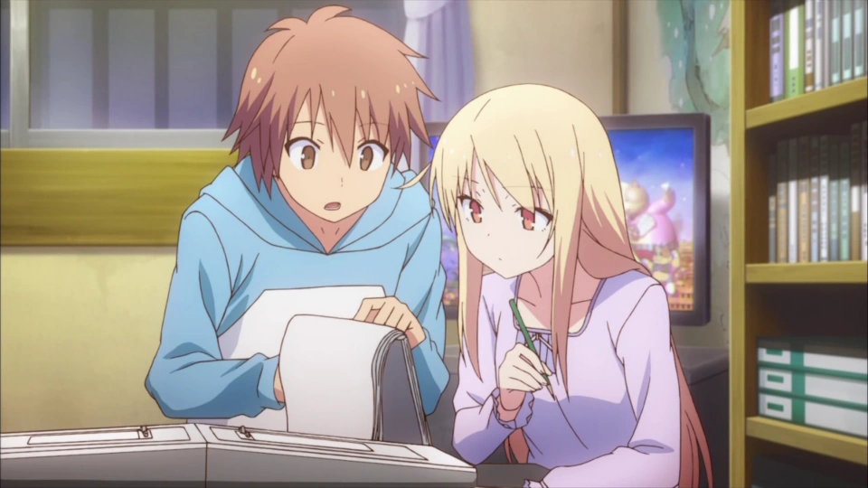
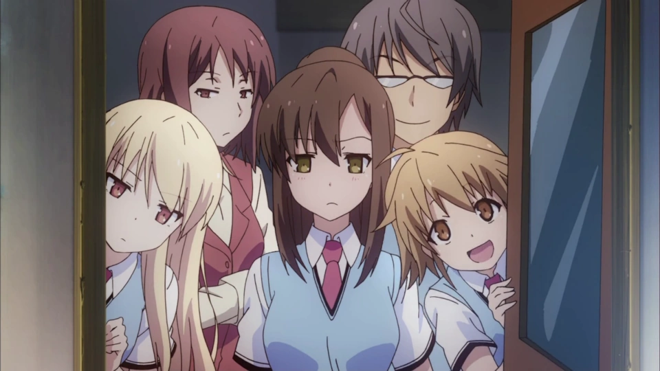
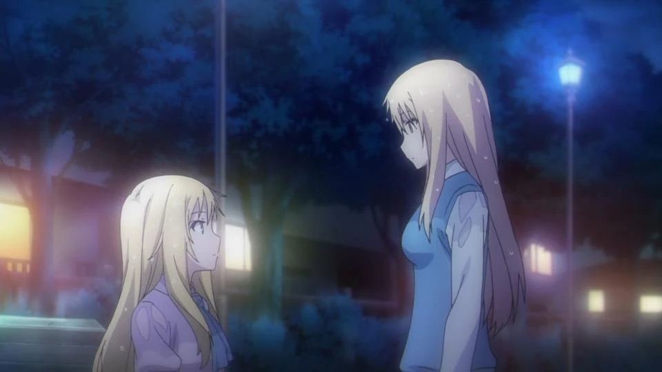
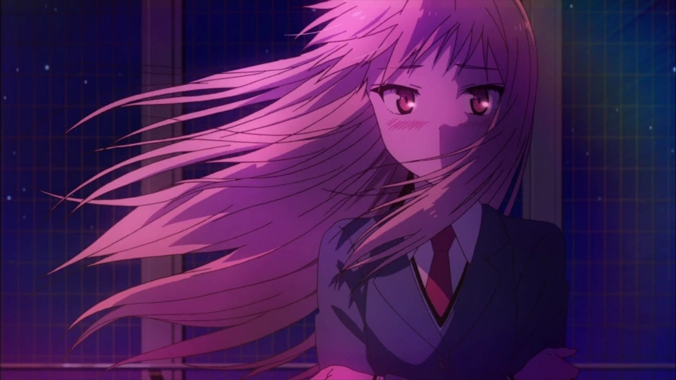
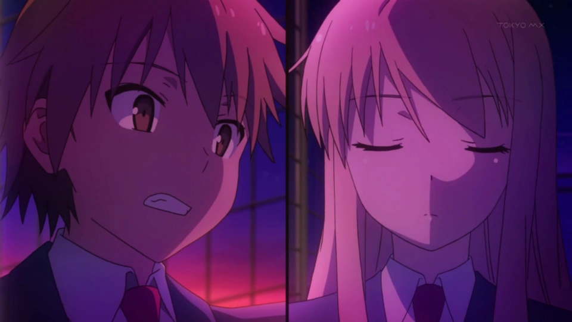
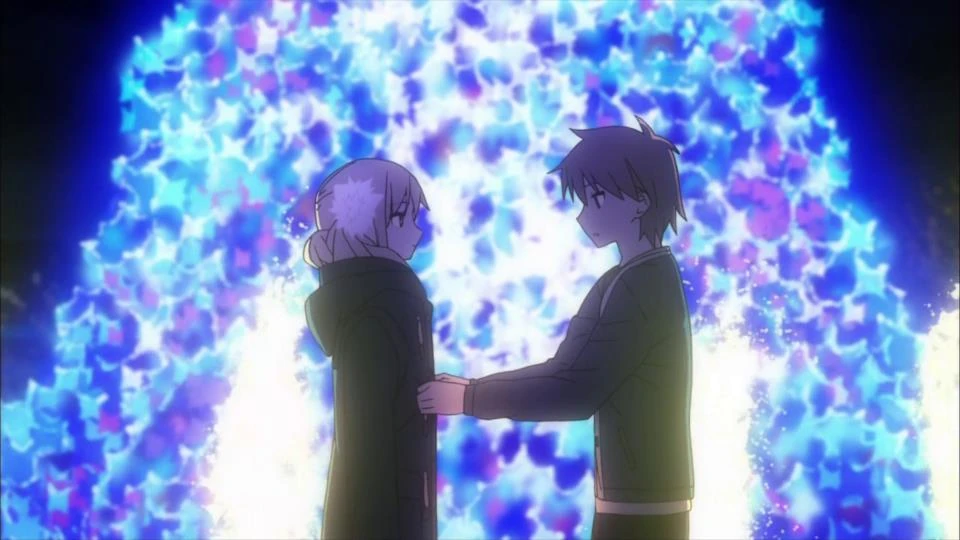
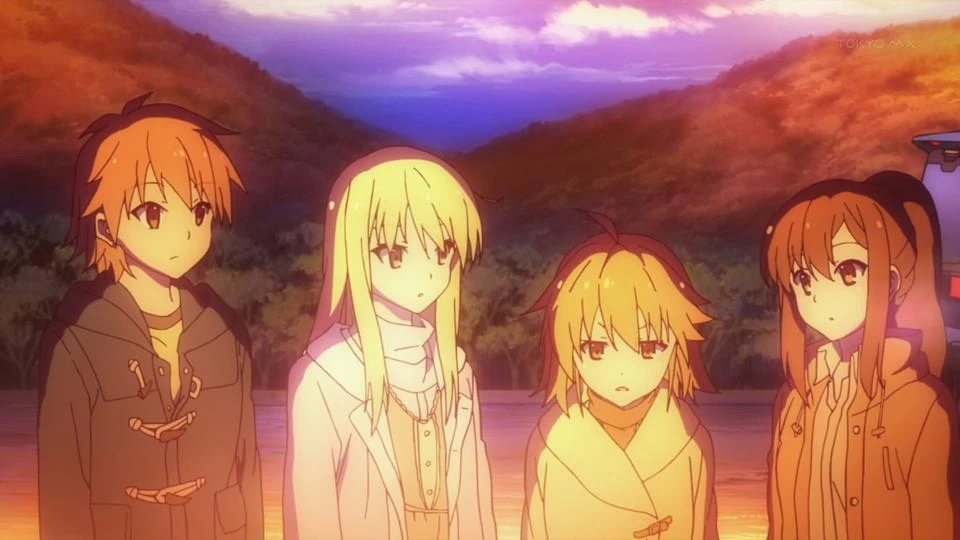
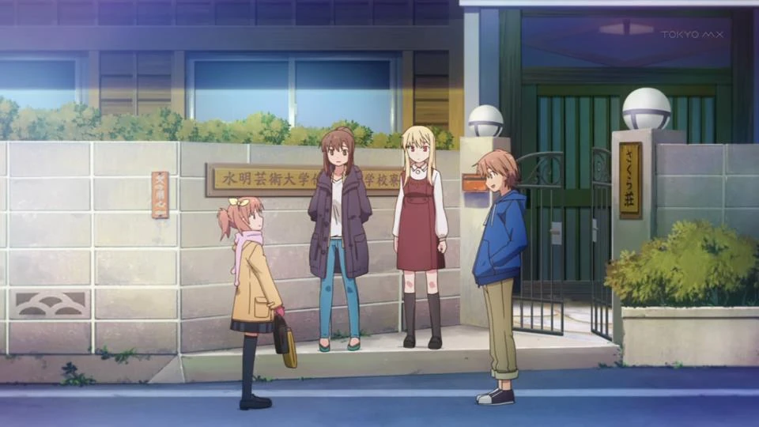

# Sección 02-B: Temporada 1 — episodios 9 a 16 (con spoilers)

> **Biblia del universo de Sakura-sou no Pet na Kanojo (さくら荘のペットな彼女)**
> Documento de referencia para el proyecto de fanfic de este repositorio.
> ⚠️ **Spoilers completos del tramo central de la temporada.**

  

---

## Contexto del tramo

Estos ocho episodios cubren **el otoño y el invierno del primer año**: la llegada de Rita Ainsworth, la producción del corto 『銀河猫にゃぼろん』 (Ginga Neko Nyaboron, *Nyaboron, el gato galáctico*) para el festival cultural, la primera Navidad y el Año Nuevo en Fukuoka. En términos de la novela, es el corazón de los tomos 3 a 5.

Es el tramo donde la serie deja de girar alrededor de "quién cuida a Mashiro" y empieza a girar alrededor de **quién se atreve a decir lo que siente**. Todos los personajes quedan retratados en su forma más vulnerable: Jin confiesa, Misaki es rechazada, Rita se rinde, Sorata fracasa dos veces, Nanami casi se rompe.

---

## Episodio 9 — 秋の嵐がやってきた *("Llegó la tormenta de otoño")*

**Ficha:** guion 志茂文彦 · storyboard 二瓶勇一 (Nihei Yūichi) · dirección 佐藤真人 (Satō Masato) · 4 de diciembre de 2012.

**Lo que pasa.** Sorata despierta con Misaki y Mashiro pintando un mural en su pared: están dibujando a **にゃぼろん (Nyaboron)**, un personaje que Misaki imagina desde el kínder y que **por fin va a ser serializado**. Dice que contar la historia completa toma tres días, y no exagera.

En la escuela, Sorata le pide a Nanami que pase por él al día siguiente porque llegó tarde (Misaki le quitó la pila al despertador). En el salón empieza a correr el rumor de que Nanami lo persiguió hasta Sakura-sō. Cuando la vergüenza está en su punto máximo, Miyahara se levanta a defenderlos y el rumor **se transforma en otro peor**: que él y Sorata son pareja. La comedia de rumores escolares es aquí un mecanismo de precisión.

Nanami protesta en la cena: la culpa de los rumores es el estilo de vida del dormitorio, y exige reglas. Su discurso se interrumpe con el timbre: Sorata abre la puerta y encuentra a **リタ・エインズワース (Rita Ainsworth)**, una chica rubia, extranjera y hermosa. Sorata, en inglés, le dice que no habla inglés. Mashiro sale corriendo a abrazarla. Chihiro la reconoce y explica que fue **la compañera de cuarto de Mashiro en Inglaterra**.

Rita anuncia que viene a **llevarse a Mashiro de vuelta a Inglaterra**; Mashiro se niega con violencia y la empuja fuera, cerrando la puerta. Sorata, apiadado, sale a buscarla y la invita a quedarse, contra la opinión de todos.

Rita insiste en dormir en el cuarto de Sorata; él se niega hasta que ella promete contarle **todo el pasado de Mashiro en Inglaterra**. En la mañana, Rita amanece abrazada a él en el futón justo cuando Nanami abre la puerta, y luego entra Mashiro: el cuadro de enredo está servido. Mashiro le pregunta si ahora está del lado de Rita. Rita contesta que se quedará con Sorata hasta que Mashiro decida volver a Inglaterra. **Ryuunosuke sale de su cuarto por primera vez** —solo para cumplir el mínimo de asistencia— y se presenta ante los miembros nuevos, a los que nunca había visto en persona.

En la escuela, Ryūnosuke teclea ruidosamente y come tomates en clase hasta que 白山小春 (Shirayama Koharu), la profesora de japonés, estalla. Él le responde que solo va a clase a cubrir el mínimo de asistencia y que, si quiere su atención, le enseñe algo interesante. Es el retrato de un genio insoportable, y la serie lo quiere así.

Nanami le advierte a Sorata algo importante: **no todo tiene segunda oportunidad**. Si Mashiro se va a Inglaterra, no será fácil traerla de vuelta.

Cuando Sorata va a devolverle la ropa a Mashiro, ella le dice por primera vez **「空太のばか」** (*"Sorata, tonto"*), y lo repite en todos los contextos posibles: en la casa, en la escuela, incluso durante un juego de Misaki sobre "primeras y últimas letras". Es la primera emoción negativa que Mashiro expresa de forma sostenida, y el síntoma de que le importa.

Al final, Mashiro está pintando en el salón de arte y sus compañeras salen con la cara descompuesta: la escena prepara una de las claves del siguiente episodio, la **mirada de los demás hacia el talento**.

**Por qué importa.** La llegada de Rita trae el pasado de Mashiro y, con él, la primera comparación explícita entre genio y no-genio: Rita es la prueba de que convivir con Mashiro puede **romper** a una persona. El episodio también presenta a Ryūnosuke en sociedad, que hasta ahora era una voz en el chat.

**Detalles.**

- Rita habla japonés con fluidez y un acento marcado; su llegada está anunciada desde el "cacao mass" del final del episodio 8.
- La frase "no todo tiene segunda oportunidad" es la advertencia que después se cumplirá, al menos parcialmente, en el episodio 22.
- El personaje de Nyaboron nació de un dibujo infantil de Misaki: la serie insiste en que **los genios también tienen infancias raras**.

---

## Episodio 10 — キライキライ、ダイスキ *("Te odio, te odio, te quiero mucho")*

**Ficha:** guion 志茂文彦 · storyboard y dirección 細川ヒデキ (Hosokawa Hideki) · 11 de diciembre de 2012.

**Lo que pasa.** Sorata trabaja como productor del proyecto (el corto de Nyaboron) mientras Rita juega videojuegos en su cuarto. Rita ve sus bocetos y le enseña a dibujar usando referencias; también le confiesa su curiosidad por saber qué sienten los genios al ver el resultado de su trabajo.

Cuando Sorata le pregunta por qué dejó de pintar, Mashiro entra con los diseños de personaje y la conversación se corta.

El equipo se reparte el trabajo: **Jin** hace el guion gráfico, **Misaki** dibuja los fondos y las secuencias, **Ryūnosuke** programa, **Sorata** ensambla todo y coordina. Rita, ajena al proyecto, los observa trabajar. Una noche, mientras espía a Sorata, se topa con Ryūnosuke, que le dice sin anestesia que su sonrisa es falsa y que le basta saber que dejó de pintar para entenderla.

En la siguiente junta aparecen dos problemas: **el consejo estudiantil exige una presentación** para autorizar la proyección en el festival, y **faltan fondos por terminar** con dos días de plazo. Necesitan otra persona. Al salir se cruzan con el presidente del consejo, 舘林総一郎 (Tatebayashi Sōichirō), acompañado de su novia **姫宮沙織 (Himemiya Saori)**, que se ofrecerá a aportar la música.

Mashiro dice que hay alguien que puede igualar su calidad de dibujo: **Rita**. Al pedirle ayuda, Rita se niega porque ya dejó la pintura. Ante la insistencia de Mashiro, **confiesa la verdad**: dejó de dibujar por ella. Sus compañeros del atelier en Inglaterra se frustraron al no poder alcanzar a Mashiro y abandonaron uno por uno; Mashiro no bajó su nivel para que los demás no se sintieran mal, y eso Rita lo vivió como desprecio. Peor: **fue Rita quien le enseñó el manga a Mashiro**, con la esperanza de que la crítica la destrozara y sintiera lo mismo que todos los demás. El manga fue un éxito. Rita admite que quería que Mashiro fuera famosa para poder presumir que estudiaron juntas.

Ryūnosuke le responde señalándole lo que de verdad quiere, pero con tanta dureza que la hiere más. Rita sale corriendo bajo la lluvia y olvida su bolsa. Nanami, Mashiro y Sorata van tras ella y la encuentran en un parque.

Sorata le habla de lo que significa vivir entre genios: le dice que **ella es extraordinaria precisamente porque, cuando todos se alejaron, ella se acercó y fue amiga de Mashiro durante diez años**, y porque vio lo que solo se ve mirando de frente lo que no quieres ver. Rita admite que Ryūnosuke tenía razón, pero dice que eso no lo hace mejor persona. Mashiro se acerca y confiesa que **no entendía nada** de lo que pasaba a su alrededor: no sabía que sus compañeros sufrían.

Finalmente Rita accede a dibujar los fondos. El equipo termina el corto.

**Por qué importa.** Es el episodio donde la serie dice su tesis más incómoda: **el talento de uno puede herir a los demás sin que uno lo sepa**. Rita no es una villana: es la persona que se rompió. Y el título (que se traduce como "te odio, te odio, te quiero mucho") le pertenece a ella, porque su relación con Mashiro es exactamente eso.

**Detalles.**

- Aquí se entiende por qué Ryūnosuke vive encerrado, tema que se desarrollará en el episodio 20 cuando Maid-chan revele su pasado.
- Saori (la hermana de Iori, que aparecerá en el 18) ya está vinculada al proyecto como responsable musical.
- El trabajo de Rita en el corto es la razón por la cual ella sigue en Japón hasta el episodio 12.

---

## Episodio 11 — 銀河猫にゃぼろん *("Nyaoboron, el gato galáctico")*

**Ficha:** guion 志茂文彦 · storyboard 佐山聖子 (Sayama Seiko) · dirección 高島大輔 · 18 de diciembre de 2012.

**Lo que pasa.** Empieza el **festival cultural de Suikō**. El salón de Sorata y Nanami monta un puesto de **chocolate banana**; Sorata está demacrado de tanto trabajar en Nyaboron y Nanami lo releva para que vuelva a la sala de preparación.

Ahí, Sorata y Jin ajustan el programa y prueban la respuesta del sistema. Misaki llega con bebidas energéticas y los manda a ver la presentación del salón de Mashiro, disfrazada de gato. En el camino ven a Mashiro afuera con un cartel. Dentro, Misaki (de oso) sirve omelette rice y ofrece dibujar caricaturas con catsup; se arma una pelea entre Misaki y Mashiro por quién dibuja en el plato de Sorata, que gana Mashiro, para disgusto de Misaki.

En Sakura-sō, Rita está en el cuarto de Ryūnosuke viendo cómo termina el programa, y lo invita al festival. Él se niega por su ginefobia. Ella se le acerca con lenguaje corporal sugestivo. Justo entonces vuelve el grupo.

La producción se traslada al cuarto de Sorata: Mashiro y Rita dibujan, Misaki anima, Ryūnosuke programa, Nanami practica la narración, Jin prueba la animación. Nanami, que no puede hacer mucho, prepara bocadillos, se mancha de salsa y va al baño a limpiarse. Sorata entra después y **la encuentra desnuda**: se estaba pesando sin ropa porque creía que la ropa le sumaba un kilo. Mientras espera a que se vista, escucha a Rita hablando por teléfono con **el padre de Mashiro**: alguien la espera en Inglaterra.

Al día siguiente, Ryūnosuke aparece en la escuela con el uniforme de maid de Nanami (porque Rita durmió en su cuarto y no pudo quedarse). Le pide a Sorata que revise el clímax: es demasiado plano, y ninguno sabe cómo mejorarlo. Le sugiere ir a la **conferencia de Fujisawa Kazuki** a buscar inspiración.

En la charla, Sorata escucha la idea que le cambiará el enfoque: **para hacer algo bueno para los demás, primero tiene que ser bueno para ti**.

Al salir se encuentra con Mashiro, que le dice que **Jin está con 上井草風香 (Kamiigusa Fūka)**, su exnovia y **hermana mayor de Misaki**, mientras Misaki los observa desde lejos. El flashback revela que Fūka fue el primer amor de Jin y que él la usó como puente para estar cerca de Misaki; Fūka lo entiende y se despide con dignidad. Fūka pide una segunda oportunidad, Jin dice que no le interesa, y ella responde que era broma.

En la misma conversación, **Misaki escucha que Jin se va a la Universidad de las Artes de Osaka**. Sale corriendo; Sorata la alcanza y le pide perdón por no habérselo dicho. Misaki no se enoja: pregunta si **todavía tiene una oportunidad**. Mashiro contesta con un "sí" seco, y eso la enciende: pide terminar Nyaboron y convertir el festival en un gran recuerdo. En medio del alboroto, Mashiro se desmaya y se duerme en el hombro de Sorata.

En la sala de preparación, con Mashiro dormida en su hombro, Sorata recuerda que ella dibujó el final que **quería** que pasara, no el que pasó. Ahí tiene la idea: en el clímax, en lugar de gritar el nombre del ataque, **el público grite lo que de verdad siente**. Todos aceptan. Terminan a cinco horas de la función y duermen un rato. Antes de dormir, Mashiro le manda un mensaje: quiere verlo. Está afuera de su cuarto y le pide que la cuide hasta que se duerma.

**Por qué importa.** Es el episodio donde la serie une sus dos tramas: **el corto y los sentimientos**. La solución creativa de Sorata (que el público grite lo que siente) es la misma solución narrativa de la serie: poner el corazón afuera.

**Detalles.**

- La revelación de Jin y Fūka explica por qué Misaki y él nunca han formalizado: **Jin ama a Misaki, pero le da miedo dañarla**.
- La llamada de Rita con el padre de Mashiro introduce la presión externa que se resolverá en el episodio 12.
- Fujisawa aparece como personaje físico por primera vez desde el 8; su papel de mentor se consolida aquí.

---

## Episodio 12 — 愛のパワーin文化祭 *("El poder del amor en el festival cultural")*

**Ficha:** guion 岡田麿里 · storyboard 宍戸淳 (Shishido Jun) · dirección 池端隆史 · 25 de diciembre de 2012.

**Lo que pasa.** Retoma exactamente donde quedó el 11: Mashiro duerme en el cuarto de Sorata porque se lo pidió. Mientras espera que se duerma, ella le pregunta si le ha hecho daño. Sorata está a punto de confesarse y descubre que ella ya se durmió. Es la primera vez que la serie pone la declaración sobre la mesa y la retira en el mismo plano.

Por la mañana, el equipo descarga el material para la función y encuentra una multitud afuera del teatro: Jin desvía la atención hacia el presidente del consejo, Tatebayashi. Chihiro busca asiento y termina junto a **Fujisawa Kazuki**, su viejo amigo y ex residente de Sakura-sō. Tras bambalinas, Nanami repasa sus líneas y el grupo se reúne: Sorata les dice que hagan de esto su mejor recuerdo, y con Misaki al frente lanzan el grito de guerra.

La función avanza bien: el público participa y juega con las escenas, hasta el clímax. Cuando se les pide gritar su "amor" —los pensamientos dormidos del corazón, según Nanami— **el público se queda callado** y la función está a punto de fracasar. Sorata se culpa. Entonces **Mashiro se levanta y grita: "¡Gracias por todo!"** a Sorata. Misaki sigue: **"¡Jin, deja de mirar a Fūka y mírame a mí!"**. Rita: **"¡Ryūnosuke, dame tu correo!"**. El público se contagia y la sala entera grita lo que tenía guardado. La función es un éxito.

Al empacar, Jin le aclara a Misaki que Fūka fue una de sus exnovias y que así se quedará, y le regala el collar que compró con Mashiro. Entonces ven a **Mashiro y Rita subiendo a un taxi hacia el aeropuerto**.

Nanami encuentra a Sorata y le dice que no las encuentra. Sorata duda en detenerlas; Nanami lo obliga: le dice que cuando gritó "gracias, Mashiro" no dijo lo que de verdad quería decir. Sorata se derrumba: no soporta que Mashiro pueda tirar por la borda los últimos seis meses. Nanami lo consuela y le dice que se lo diga a ella.

Mientras Nanami busca a Mashiro en el edificio, se topa con **Miyahara, que le confiesa su amor**, y ella lo rechaza y sale corriendo, porque no puede decidir nada en ese momento.

Todos llegan al aeropuerto y Sorata corre a abrazar a Mashiro, rogándole que no se vaya. **Mashiro le explica que solo fue a despedir a Rita**: no se iba a ninguna parte. Rita aclara que cuando dijo "Mashiro vuelve a donde pertenece" se refería a **Sakura-sō**. Le da a Ryūnosuke un correo (que en realidad es el de Sorata) y, como "castigo", le da un beso en la mejilla antes de irse. Desde la terraza, todos la despiden.

Mashiro, que sigue sin entender la reacción de Sorata, dice que siente algo raro por dentro y se pregunta si eso será **amor**.

**Por qué importa.** Es uno de los mejores finales de cour de la serie: cierra el arco del festival, resuelve el malentendido del aeropuerto y deja la pregunta que abrirá toda la segunda mitad. Además, **Nanami rechaza a Miyahara**, lo que la define: no puede aceptar a otro mientras esté enamorada de Sorata.

**Detalles.**

- El grito de Mashiro ("gracias por todo") es el único momento en que expresa gratitud de forma espontánea en toda la primera temporada.
- El collar de Misaki volverá a mencionarse en el episodio 14.
- El beso de Rita a Ryūnosuke se aclara en el episodio 17: era **su primer beso**.

---

## Episodio 13 — 冬の一歩手前で *("A un paso del invierno")*

**Ficha:** guion 伊藤美智子 · storyboard 玉川真人 (Tamagawa Masato) · dirección 稲本隆史 (Inamoto Takashi) · 8 de enero de 2013.

**Lo que pasa.** Arranca con el final del 12 deformado en sueño: Mashiro pregunta qué es el amor y **Nyaboron se vuelve real**; Sorata despierta.

En la azotea, Jin le muestra a Sorata las **encuestas del público** sobre Nyaboron: en general positivas. Sorata le cuenta que envió **otro proyecto** al mismo concurso, esta vez con ayuda de Ryūnosuke. Hablan también del beso de Rita en el aeropuerto. Llegan Nanami y Mashiro; Misaki aparece desde el techo y Jin finge dormir para evitarla, aunque al final lo despierta y recibe la **caja de bentō** que ella preparó con una declaración de amor dentro.

En el salón se habla de los planes de Navidad. Al final del día, Nanami se encuentra con Jin en el vestidor: descubre que **Misaki le mandó una carta de amor con un formulario de matrimonio**, y Jin le da **dos boletos** para una función en Nochebuena, diciéndole que los use mientras pueda.

En Sakura-sō, Mashiro entra al cuarto de Sorata sin tocar y le dice que quiere **aprender a cocinar**. Él se niega por lo evidente, discuten y acepta. La lección va mal: Mashiro **se corta el dedo** cortando pepino. Sorata le dice que pida a Ayano una extensión de plazo.

Ayano llega, ve el dedo y, cuando se va, Sorata la detiene para hablar. En el restaurante, Ayano le dice que Mashiro **está cambiando a una chica "normal"**, y le pregunta si prefiere a la Mashiro de antes o a la de ahora (advirtiendo que, elija lo que elija, sigue siendo Mashiro). Sorata responde que prefiere a la de antes.

Al volver, Sorata encuentra una carta del concurso: **perdió otra vez**. Rompe el sobre y la carta, visiblemente afectado. Mashiro entra con delantal; él le grita, le avienta la carta y le dice que, si le dieron la oportunidad de dibujar, no la desperdicie en otras cosas. Mashiro, con una emoción que no se le había oído, le contesta que si eso es lo que quiere, **que se largue de su cuarto**.

En su habitación, Sorata mira la nota que le dio Ayano (que debía entregarle a Mashiro) cuando aparece Misaki vestida de Santa con minifalda y lo invita a su cuarto. En el pasillo se topa con Nanami y le pide que lo acompañe. Ya con los dos, Misaki les pide que **el 24 dejen el dormitorio libre para ella y Jin**. De regreso, Nanami le pide a Sorata que la acompañe al evento con el boleto que le dio Jin; Sorata acepta y lo sella con un **pinky swear** (promesa de dedos meñiques).

**Por qué importa.** Es el episodio que siembra la Navidad: Misaki quiere declararse, Nanami quiere declararse, Sorata acaba de fracasar otra vez y Mashiro empieza a cambiar sin que él sepa qué hacer con eso. La pregunta de Ayano ("¿la de antes o la de ahora?") es la pregunta central del personaje.

**Detalles.**

- El segundo fracaso de Sorata ocurre con el mismo proyecto que le pidieron mejorar: es la prueba de que **el esfuerzo no garantiza el resultado**, tesis que se confirmará en el 21.
- La nota de Ayano que Sorata no entrega es un hilo que reaparecerá.
- El dedo cortado es el primer daño físico de Mashiro en su intento de aprender algo doméstico, y funcionará como recordatorio en el 14.

---

## Episodio 14 — イヴの窓辺とそれぞれの灯り *("La víspera, junto a la ventana, cada una con su luz")*

**Ficha:** guion 花田十輝 · storyboard 佐山聖子 · dirección 池田重隆 · 15 de enero de 2013.

**Lo que pasa.** El episodio abre con un **monólogo cruzado**: Sorata habla de Mashiro, Nanami de Sorata, Ryūnosuke de los residentes (mientras le escribe un correo a Rita), Jin de Misaki, y Mashiro observa en silencio desde un edificio grande. Es la declaración de intenciones de la Nochebuena: todos quieren decir algo y nadie sabe cómo.

Sorata, Nanami y Misaki ayudan con el plan de dejar el dormitorio libre para Misaki y Jin en Nochebuena. Sorata va a dejarle a Mashiro el volante de la fiesta a la que ella irá, pero por la tensión no toca la puerta: deja el papel en el suelo.

Bajando, encuentra un **baumkuchen** en la puerta de su cuarto. Mashiro sale de su escondite de un salto. Se le oye el estómago, y terminan compartiéndolo. Hablando, Sorata se enoja un poco y Mashiro se asusta; ella le pide perdón insistentemente, lo que lo enfurece más, y ella huye.

Al día siguiente, las amigas de Nanami deducen que el 24 será una **cita** y le recomiendan falda. En la biblioteca, Tatebayashi le habla a Jin de su plan de estudiar en Osaka, lejos de Misaki, y le dice con retintín que encontrará a alguien más. Jin responde que **cortó con todas las otras chicas** y le asegura que Misaki no está sola en Sakura-sō. Tatebayashi le pregunta qué quiere, y Jin contesta: **"que Misaki me vea como a alguien, no solo como a alguien a quien quiere"**.

En Sakura-sō, Misaki y Nanami eligen ropa para la "cita". Nanami le pregunta a Misaki si no le da miedo exponerse, y Misaki contesta con su famosa metáfora de la **"pista del terror"**: uno va de decir lo que siente, a ver las consecuencias, a conformarse con una relación estable, a querer romance, a tener miedo de ser menospreciada, y vuelve al principio. Ella lleva tanto tiempo dando vueltas que se cansó.

Sorata ve otro baumkuchen en su puerta y habla con Chihiro, que le explica que **el baumkuchen es la manera de Mashiro de cuidarlo**. Le dice que es natural enojarse cuando alguien parece no esforzarse mientras uno se rompe el lomo, pero que Mashiro no estaba holgazaneando: **estaba aprendiendo a manejar lo que siente**. Le aconseja disculparse, le dice que no vea el mundo en blanco y negro sino en gris, y le recuerda que el dormitorio cierra por Año Nuevo: tiene que empacar e irse a casa.

En Nochebuena continúa el monólogo: sentimientos que no se pueden manejar, dudas que no se expresan, afecto que no llega, sentimientos que chocan y se cruzan. Misaki trae a Mashiro arreglada; Sorata y ella salen juntos. Él ve la carta del concurso y se la guarda. En el tren intenta hablar y **el miedo lo detiene**.

En el hotel, Ayano recoge a Mashiro, que antes de irse le ruega a Sorata que diga algo y que no esté enojado. Él no dice lo que ella quiere escuchar y le recuerda que se comporte en la fiesta.

Sorata se encuentra con Nanami, que llegó con falda, y le dice que se ve bien. En el dormitorio, **Misaki se queda a solas con Jin** y le pregunta si la quiere; Jin le responde que **sí, con todo el corazón**. Pero después se descubre el resto: Jin la rechazó diciéndole que en su estado actual no puede hacerse cargo de ella, y le pidió que se quedara como está. **Misaki llora porque habría preferido que la hiriera, en lugar de decírselo con tanta suavidad.**

Mientras tanto, Sorata encuentra a Mashiro junto a una fuente, con otro baumkuchen: se lo hizo y lo esperó afuera porque él llevaba mucho tiempo enojado. Le dice que lo extraña y que pensó en cosas que lo hicieran feliz; lo único que se le ocurrió fue darle baumkuchen. Le pregunta si sigue enojado. Él dice que sí y **la abraza**: está enojado porque se preocupó, porque le importa. Ella confiesa que, al pensar en él, quiso cocinarle (igual que Misaki con Jin). Se reconcilian.

Nanami aparece y le entrega **la carta del concurso**: el comité quiere **otra presentación**, esta vez del proyecto que acababa de enviar. Los tres se alegran. Pero al volver al dormitorio encuentran a Misaki destrozada.

**Por qué importa.** Es el episodio más triste y más limpio de la primera temporada: **nadie consigue lo que quiere el 24**. Misaki es rechazada con delicadeza; Nanami pasa la cita acompañando a un Sorata enamorado de otra; Sorata se reconcilia con Mashiro sin decirle nada claro. La serie se niega a dar el regalo de Navidad.

**Detalles.**

- El monólogo cruzado del inicio y el cierre del episodio es el recurso formal más ambicioso del cour.
- El rechazo de Jin no cierra su arco: lo abre, y se resolverá en el 23 y el 24.
- La "pista del terror" de Misaki es una de las imágenes más citadas de la serie y sirve para describir a cualquier personaje que se enamora y no se atreve.

---

## Episodio 15 — いつもの自分はどこにいる? *("¿Dónde quedó el de siempre?")*

**Ficha:** guion 小柳啓伍 (Koyanagi Keigo) · storyboard 宮浦栗生 · dirección 柴田彰久 (Shibata Akihisa) · 22 de enero de 2013.

**Lo que pasa.** Como el dormitorio cierra por Año Nuevo (Chihiro se va a Australia), y nadie hizo planes —Mashiro no arregló nada, Nanami no puede volver a casa, Misaki se niega porque le recuerda a Jin—, Chihiro los manda a **Fukuoka, a casa de Sorata**. Mashiro acepta y les apura a empacar.

En el tren, Sorata juega con su gato **こまち (Komachi)** (los otros seis ya encontraron hogar), mientras Misaki mira por la ventana en silencio y Mashiro le da una golosina. Al llegar, **Yuuko entra en shock** al ver a su hermano bajar con tres chicas. Aparece la madre, **神田明子 (Kanda Akiko)**, que ya sabía del plan, y luego el padre, que suelta que **rechaza la poligamia**. La cena es de bienvenida y Nanami le comenta a Sorata que ahora entiende por qué se adaptó tan rápido a Sakura-sō.

En su cuarto, Sorata llama a Jin para saber qué pasó en Nochebuena y por qué Misaki está así. Jin le cuenta **todo**: que se declaró, que la rechazó, y que lo hizo porque tiene sueños que quiere cumplir **por ella**. También le dice que cortó con todas sus novias por Misaki y le pide que la cuide. Se revela que Jin está viviendo con Tatebayashi, su "mejor amigo".

Después de cenar, Nanami ayuda a lavar los trastes y **Akiko suelta que Sorata encontró una buena futura esposa**, dejando a Mashiro, Sorata y Yuuko petrificados. Mashiro pregunta si quiere esposa; Yuuko se cuelga del brazo de su hermano y declara que cualquiera que quiera casarse con él tendrá que derrotarla primero. Mashiro se lo toma literal.

Yuuko cuenta que **quiere entrar a Suikō pero su padre no la deja**, y Nanami se ofrece a ayudarla a estudiar para cambiarle la opinión. Misaki, mientras tanto, mira el guion que le dio Jin.

Al día siguiente, Sorata prepara su presentación con ayuda de **Maid-chan**, que le ofrece un viaje a Inglaterra para "causarle miseria a Rita" a modo de agradecimiento. Luego Yuuko le pide ayuda para estudiar, y Sorata descubre una revista entre sus libros: **Yuuko es fan de la manga de Mashiro sin saber que la autora vive en su casa**. Comenta que la relación entre "Misaki" y "Jin" retratada ahí la confunde. Cuando se entera de que Mashiro es la autora, le pide un autógrafo y le cambia el trato por completo.

Mashiro le dice a Sorata que **ya terminó toda su manga** hace tiempo, y le pregunta si lo que dijo en Nochebuena lo decía en serio. Él lo confirma, y ella le regala **un dibujo** para su presentación. La práctica final sale bien.

En el baño, Sorata habla con su padre: le dice que **dejará a Yuuko presentar el examen si aprueba**, aunque ninguno de los dos cree que lo logre, y le suelta el consejo que define al personaje adulto de la serie: deja de ser indeciso y vive como quieras. El padre se marea y Sorata tiene que ayudarlo a salir de la tina.

Al amanecer, todos suben a un monte a ver el **primer sol del año** (初日の出, *hatsuhinode*). Misaki agradece a Mashiro haberle hecho entender lo que Jin significa para ella y **decide volver a ser la de antes** y animar el guion de Jin. Al salir el sol, todos gritan sus deseos; Mashiro grita "¡rayo de albóndiga!", en referencia al proyecto. Vuelven a Sakura-sō con ánimo nuevo: lo primero es la presentación de Sorata.

**Por qué importa.** Es el episodio de las familias: la de Sorata (que acepta a los tres invitados sin chistar) y la de Sakura-sō. Y es donde **Misaki se reconstruye** después del rechazo, decisión que sostiene todo el final de temporada.

**Detalles.**

- El **hatsuhinode** es la primera salida del sol del año, tradición japonesa de Año Nuevo: la serie la usa para el "reinicio" emocional de los personajes.
- La madre de Sorata y su forma de decir las verdades con una sonrisa aparecen también en el episodio 16; son un espejo de Chihiro.
- Yuuko leyendo la manga de Mashiro es el primer indicio de que la obra se publicó y está circulando.

---

## Episodio 16 — ずっと、好きでした…… *("Siempre me gustaste…")*

**Ficha:** guion 伊藤美智子 · storyboard 二瓶勇一 · dirección 黒川智之 (Kurokawa Tomoyuki) · 29 de enero de 2013.

**Lo que pasa.** Sorata ultima los preparativos. Nanami sale del baño y ve a Misaki dibujando en la sala común; Misaki le muestra el guion de su anime y Nanami le pide prestado un par de líneas para su próxima audición.

Por la mañana, Yuuko llama a Sorata: **su examen de ingreso a Suikō es el 13 de febrero**, el mismo día de la presentación de él. Se despiden deseándose suerte. En el desayuno Mashiro le dice cosas amables y Chihiro le recuerda que deje de esforzarse tanto y disfrute. Asisten a la **ceremonia de inicio de semestre**. Misaki ve a Jin y Tatebayashi, se esconde haciendo ruidos de rana, la descubren, y Sorata habla con Jin, que le dice que volverá al dormitorio después de sus exámenes.

Camino a la presentación, Sorata recibe un mensaje de Nanami: "échale ganas". Empieza su exposición con un tropezón con el micrófono, recuerda el consejo de Chihiro de no tomarse todo tan en serio, y **la presentación fluye**.

Mientras expone, Fujisawa y un colega discuten la viabilidad comercial: **producir el juego costaría al menos 100 millones de yenes**, habría que vender **45 000 copias** para recuperar la inversión y Fujisawa calcula que venderían **10 000**. Le informan a Sorata que **no pueden producir el juego**, pero Fujisawa le ofrece la oportunidad de **trabajar con el equipo de producción para pulir el concepto**, y le pide que le escriba un correo al llegar a casa para agendar una cita. Sorata sale feliz.

En el dormitorio celebran su "éxito". Sorata le agradece a Nanami el mensaje; Mashiro lo oye, se va a su cuarto y **le manda el mismo mensaje** a Sorata. Luego muestra un atisbo de celos: dice que Sorata trata a Nanami de forma especial. Aun así, él le agradece el dibujo, que dice que fue clave.

Después de la cena, Sorata y Nanami lavan los trastes y él le desea suerte. Nanami le pide un favor: en la sala común, a solas, le dice que lleva tiempo queriendo decirle algo y **le confiesa que siempre lo ha querido**. Sorata tartamudea, se disculpa y dice que no puede. Entonces se revela que **estaban practicando el guion para su audición**. Mashiro los observa desde lejos.

Al día siguiente, Mashiro va con Ayano y le cuenta lo que siente con respecto a Sorata y Nanami; Ayano le da una manga para leer y le dice que **canalice esos sentimientos hacia el dibujo**.

En la azotea, Nanami habla con sus amigas Mayu y Yayoi sobre la práctica; la empujan a declararse en San Valentín y ella se niega. De noche, Sorata vuelve a ayudarla a practicar. Misaki trabaja en su anime y descansa con Mashiro.

Días después, Fujisawa y Sorata se reúnen: se revela que **Fujisawa fue compañero de clase de Chihiro** y le dice que le ponga al nuevo juego el mismo empeño que a Nyaboron.

Yuuko llega a Sakura-sō leyendo el último capítulo de la manga de Mashiro y le da el visto bueno en la cena. Nanami llega y descubre que Sorata le dobló la ropa, le preparó la cena y le calentó el camino: Yuuko lo interpreta como "cuidar de Nanami" y lo llama raro.

En su cuarto, Nanami sigue practicando y mira **el regalo que compró**, que esconde en el cajón. Misaki prepara **chocolates caseros**. Yuuko le cuenta a Sorata lo que oyó y dice que debería haberse fijado en Nanami, no en Mashiro. Mashiro entra envuelta en una toalla con un secador de pelo; los hermanos discuten.

Al día siguiente Yuuko se despide porque ya hizo el examen. Le da a Sorata una caja de chocolates, le pregunta quién será la afortunada al día siguiente (San Valentín) y le recuerda que no sea indeciso, como le dijo su padre. **Nanami y Mashiro se quedan preguntándose qué le dijo.**

Después de los créditos, **Rita** habla del "cacao mass" y desmiente el mito de la hemorragia nasal por comer chocolate. Es el anuncio de que vuelve en el 17.

**Por qué importa.** Es un episodio bisagra: **Sorata por fin recibe una respuesta positiva del mundo profesional** (no le producen el juego, pero le abren la puerta), y la serie deja caer que Nanami va a declararse de verdad. La práctica de la confesión es el mejor truco de guion de la temporada: dice la verdad sin decirla.

**Detalles.**

- El dato de los 100 millones de yenes y las 45 000 copias para el punto de equilibrio es un retrato realista de la industria japonesa de videojuegos.
- El mensaje de texto copiado por Mashiro es uno de los gestos más significativos del personaje: imita el afecto porque no sabe producirlo.
- **San Valentín** será el eje del 17, y la caja de chocolates de Yuuko es el primer objeto del episodio siguiente.

---

## Mapa de continuidad (episodios 9–16)

| Hilo | Avance en este tramo |
|---|---|
| Rita y Mashiro | Llega (9), se rompe (10), ayuda en el corto (10-11), se va (12), vuelve en San Valentín (17) |
| Rita y Ryūnosuke | Se conocen (9-10), correo (12), beso (12), aclaración (17) |
| Jin y Misaki | Fūka (11), declaración (14), rechazo suave (14), reconstrucción (15) |
| Jin y Osaka | Se revela (6, 11), aprueba (18) |
| Nanami y Sorata | Rumores (9), boleto (13), cita (14), práctica de confesión (16) |
| Concurso de Sorata | 2.º intento perdido (13), nueva presentación (14), exposición (16), oferta de Fujisawa (16) |
| Manga de Mashiro | Debuta y circula (15-16), Yuuko es fan (15) |
| Yuuko y Suikō | Quiere entrar (7), estudia (15), examen (16-18) |

---

## Verificación de esta sección

- **Títulos, guion, storyboard, dirección y fechas:** tabla 各話リスト de la Wikipedia japonesa y fichas de episodio de la Sakurasou Wiki.
- **Hechos de trama:** reconstruidos de los resúmenes de la Sakurasou Wiki y contrastados con la ficha de personajes de la Wikipedia japonesa (viaje a Fukuoka, la manga de Mashiro, el guion de Jin, el pasado de Rita y la ginefobia de Ryūnosuke).
- **Cifras de la industria** (100 millones de yenes, 45 000 copias, 10 000 estimadas): se citan tal como las presenta el episodio; son datos internos de la ficción, no de una fuente externa.
- **Punto ambiguo:** el número exacto de capítulos que abarca la manga de Mashiro en este tramo no se especifica en las fuentes consultadas, así que no se afirma.

---

## Fuentes de esta sección

1. **Wikipedia en japonés — さくら荘のペットな彼女**: https://ja.wikipedia.org/wiki/さくら荘のペットな彼女
2. **Sakurasou Wiki (Fandom)** — "Episode 9" a "Episode 16": https://sakurasou.fandom.com/wiki/Episode_9
3. **Wikipedia en inglés — *The Pet Girl of Sakurasou***: https://en.wikipedia.org/wiki/The_Pet_Girl_of_Sakurasou
4. **Sitio oficial (Dengeki)**: https://sakurasou.dengeki.com/ — notas de producción y avisos de emisión de la temporada.
5. **Wikipedia en japonés — 青春ブタ野郎シリーズ** (para el contexto del autor y los cameos): https://ja.wikipedia.org/wiki/青春ブタ野郎シリーズ

---

*Documento anterior: [02-A — Episodios 1 a 8](02a-temporada-1-episodios-1-8.md) · Siguiente: [02-C — Episodios 17 a 24](02c-temporada-1-episodios-17-24.md)*
