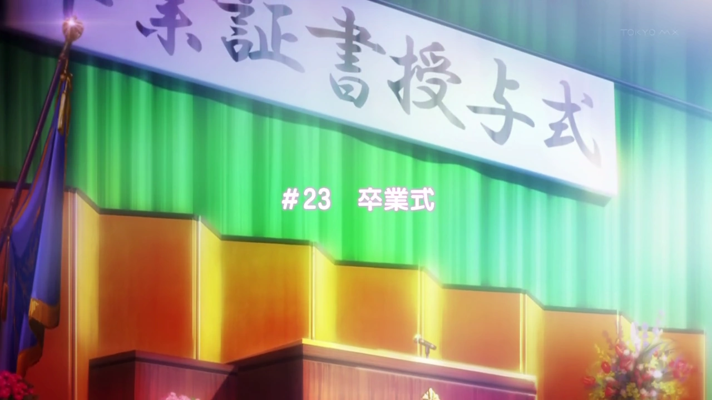
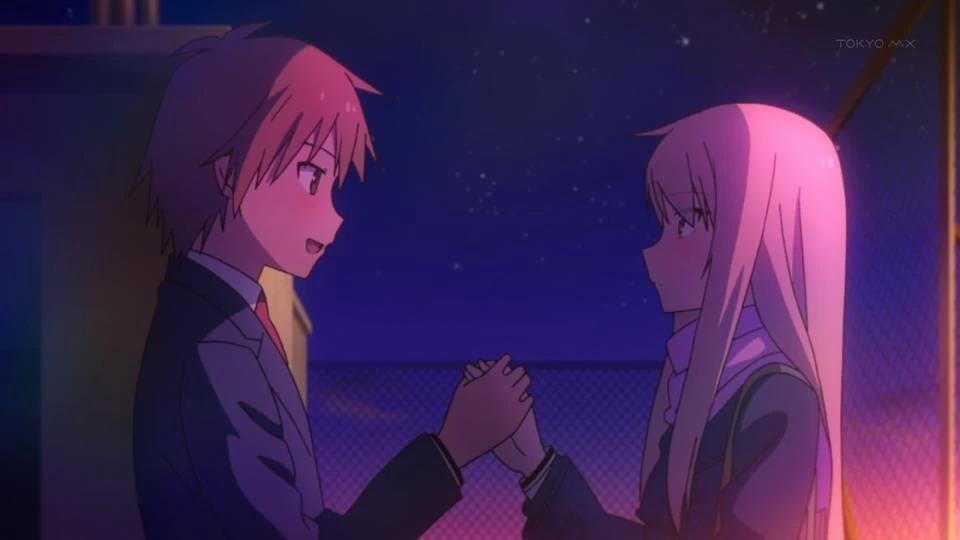
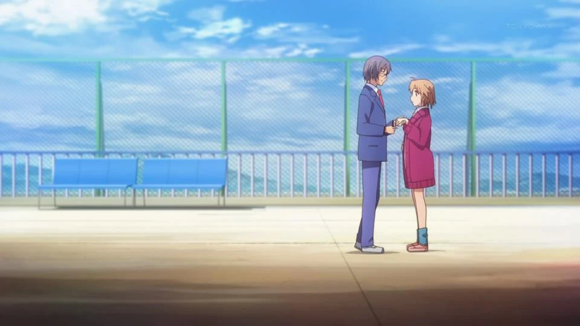
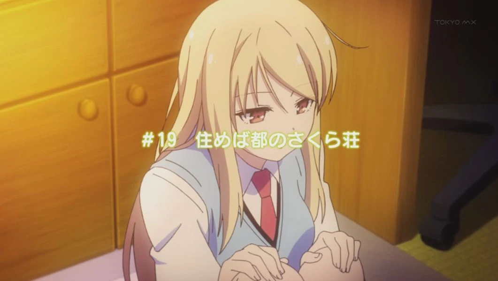
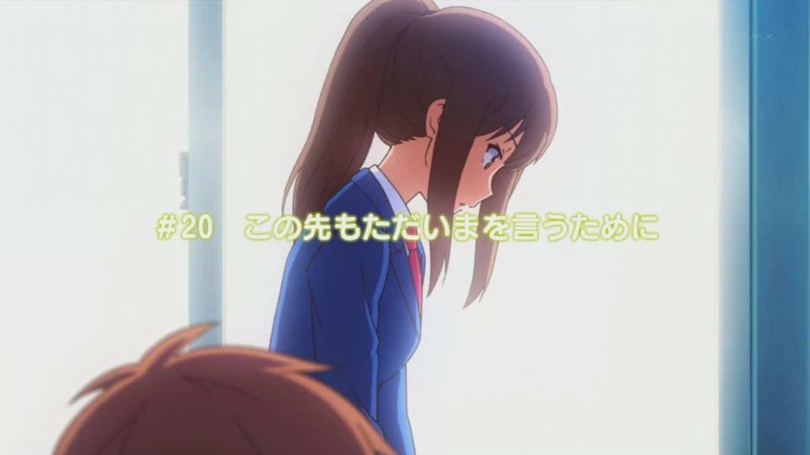
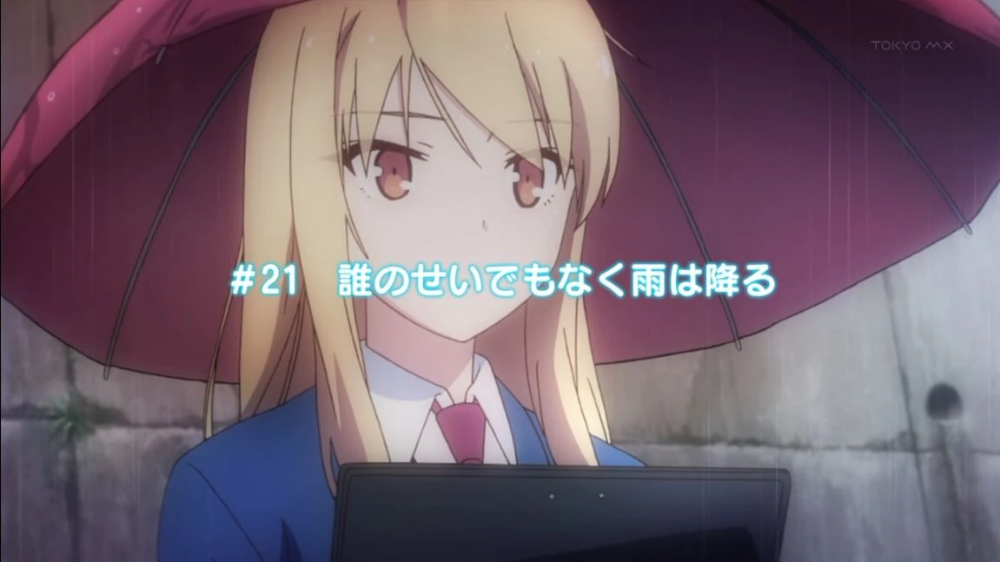
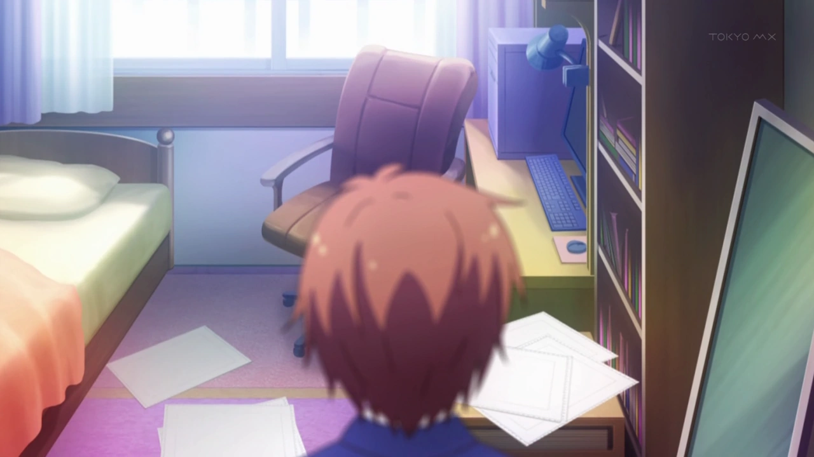
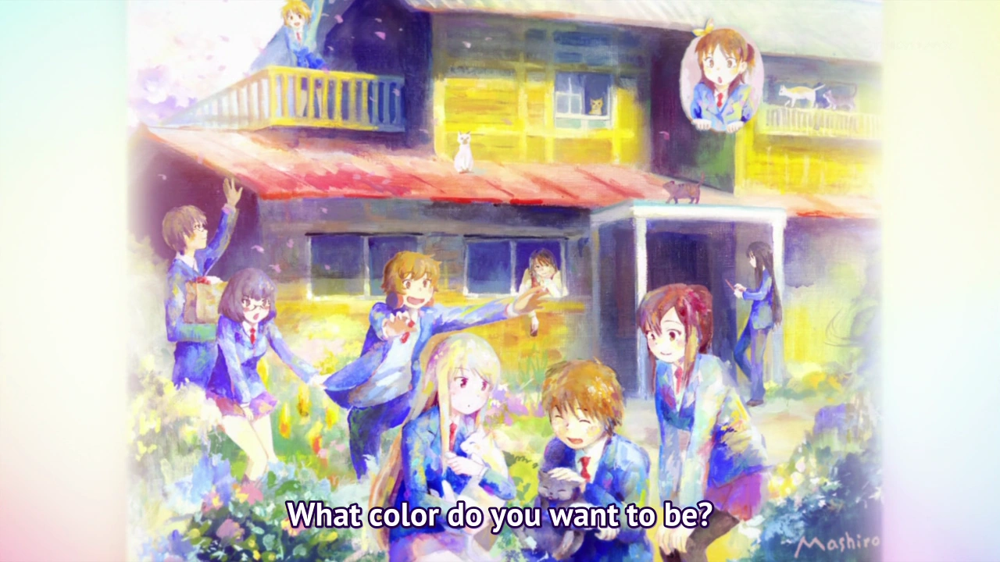

# Sección 02-C: Temporada 1 — episodios 17 a 24 (con spoilers)

> **Biblia del universo de Sakura-sou no Pet na Kanojo (さくら荘のペットな彼女)**
> Documento de referencia para el proyecto de fanfic de este repositorio.
> ⚠️ **Spoilers del final completo de la temporada, incluido el desenlace.**

  

---

## Contexto del tramo

Los últimos ocho episodios son **el invierno y la primavera del segundo año**: San Valentín, el examen de Yuuko, la amenaza de demolición de Sakura-sō y la graduación de Misaki y Jin. Es el tramo donde la serie deja de hablar de talento y empieza a hablar de **justicia**: quién decide qué es valioso, y a qué precio.

Aquí se cierran los arcos de todos los personajes, y también se instala la advertencia que quedará abierta: **el anime termina antes del final de la novela** (no adapta los tomos 9, 10 ni 10.5).

---

## Episodio 17 — バレンタインはチョコの日よ *("San Valentín es el día del chocolate")*

**Ficha:** guion 岡田麿里 · storyboard 玉川真人 · dirección 池端隆史 · 5 de febrero de 2013.

**Lo que pasa.** Sorata alimenta a sus gatos cuando ve a Nanami ya vestida y lista para salir; se queda con las ganas de desearle suerte. En el cuarto de Mashiro, Ayano la llama: **la ilustradora de la portada se enfermó** y tiene que hacerla ella. Mashiro cuelga y se quita la ropa interior porque Ayano le dijo que el amarillo no sirve para la portada, y se pone otra más colorida.

Sorata la llama y se sorprende: **Mashiro se vistió sola**, con algunos errores menores. Mientras revisa que esté lista, entra **Rita**, que volvió de Inglaterra para San Valentín porque considera que es un día de combate entre mujeres. Va "a la batalla" y encuentra a Ryūnosuke; el encuentro es un caos y Sorata y Mashiro escapan.

En la escuela, Sorata se disculpa con Nanami por no haberla animado en la mañana, y ella lo acepta. Nanami le recuerda **la promesa del episodio 14**. Miyahara interviene, le desea suerte y se va.

En clase, la profesora Koharu da una lección sobre el chocolate con amargura, y Sorata recibe un mensaje de Mashiro: **lo espera en la azotea después de clases**.

En el dormitorio, Rita persigue a Ryūnosuke, que se esconde en el baño. Cuando él rechaza sus chocolates con dureza, ella confiesa que **fue muy feliz cuando recibió su correo en Nochebuena**. Él lo despacha diciendo que fue solo una muestra de respeto, y ella se entristece.

Al salir de clases, Nanami va a su audición y Sorata se queda de guardia de limpieza. Al sacar la basura ve a **Misaki y Saori** en una banca: Misaki tiene los chocolates para Jin, y Sorata comenta que son pequeños para todo lo que trabajó la noche anterior, aunque suficientes.

Sorata mira la azotea y espera que Mashiro no lleve mucho esperando. Entonces **Nanami lo llama: los trenes se detuvieron** y no puede llegar a su audición. Sorata va por ella y, con pena, le avisa a Mashiro que va a llegar tarde. En el camino se topa con Miyahara y le pide la bici; al saber que el asunto es de Nanami, Miyahara lo lleva él mismo.

Miyahara pedalea cuesta arriba y, al llegar a la cima, **le cede la bicicleta**: le dice que siga él, porque fue a Sorata a quien Nanami llamó en su peor momento. Sorata llega a la estación.

Nanami está hundida: la situación parece perdida. Sorata le dice que no abandone sus sueños, porque le prometió que los dos iban a esforzarse juntos. Ella se sube a la bici y arrancan.

En Sakura-sō, Ryūnosuke por fin sale del baño y encuentra **los chocolates de Rita con una nota**: se disculpa por no poder verlos, dice que está muy ocupada, y al final confiesa que **el beso del aeropuerto fue su primer beso**.

En la escuela, Saori y Misaki siguen esperando: **Jin no llegó**. Misaki no se desanima y dice que todavía tiene posibilidades. Mashiro, mientras tanto, espera en su salón y luego se va.

En el camino a la audición, Sorata y Nanami repasan una última vez. Cuando Nanami llega a la línea "te quiero", **abraza a Sorata**: la interpretación es real. Él frena la bici en seco. Resulta que era una broma: Nanami le pregunta si le hizo saltar el corazón y sale corriendo hacia la escuela de seiyū, dejándolo plantado a unas cuadras.

**Por qué importa.** El episodio reparte roles con precisión: **Miyahara se sacrifica por Nanami** (y con eso cierra su propio arco), Misaki se queda sola en San Valentín, Ryūnosuke recibe la única prueba de afecto que va a aceptar, y Nanami deja de fingir que su confesión es solo práctica.

**Detalles.**

- El detalle de que Mashiro **se vista sola** es un hito del personaje: desde el episodio 1 no podía hacerlo.
- La nota de Rita aclara retroactivamente la escena del aeropuerto (episodio 12).
- Jin no llega a la cita de San Valentín, y eso se explica en el episodio siguiente: está en los exámenes de Osaka.

---

## Episodio 18 — 宇宙人に初恋 *("Primer amor con una extraterrestre")*

**Ficha:** guion 鴨志田一 · storyboard y dirección 佐藤真人 · 12 de febrero de 2013.

**Lo que pasa.** Misaki trabaja en su anime e ignora la llamada de Jin. En casa de Tatebayashi se revela que **Jin aprobó el examen de la Universidad de las Artes de Osaka**.

Sorata va a su reunión con Fujisawa, que aprueba sus planes, le pide un **documento de diseño final** y le pregunta si puede conseguir que **Mashiro haga el arte**. Sorata dice que se lo pedirá. Ese mismo día salen los resultados del examen de Suikō.

En Sakura-sō, Sorata se cruza con Chihiro, que va a una junta. Nanami le pide acompañarlo, y Mashiro se suma porque, según ella, es importante saber si Yuuko aprobó: si aprobó, aplicará el "plan C" (cortarla); si no aprobó, el "plan B" (empezar a salir con Sorata). Sorata rechaza ambos.

En el semáforo, Sorata le pide a Mashiro que haga más dibujos para su juego; ella acepta de inmediato. Él se desconcierta y se preocupa por su manga; Mashiro interpreta su cara como enojo, y Sorata le aclara que no está enojado, sino **feliz de que le dedique tiempo**.

En la escuela ven los resultados: **Yuuko no aprobó**. Sorata la llama para decírselo. Apenas cuelga, aparecen Saori y Tatebayashi: **el hermano menor de Saori, 姫宮伊織 (Himemiya Iori), aprobó en el departamento de música**. Tatebayashi informa que Jin está en la escuela para avisar que aprobó su universidad, y Sorata, decidido a que Misaki y Jin se vean antes de graduarse, le pide a Nanami que traiga a Misaki.

Sorata y Mashiro corren a buscar a Jin y lo llevan a la azotea, donde hablan de Misaki. Jin insinúa que, como Misaki está trabajando tanto, lo va a olvidar. Sorata le ruega que hable con ella y Jin se niega porque **no puede andar con ella**. Sorata, furioso por el cambio de actitud, lo toma del cuello y **se arma una pelea**. Jin lo tumba; Sorata se levanta y vuelve a rogarle. Mashiro dice que Misaki va a venir, y Jin lo descarta porque lleva tiempo ignorándolo.

Nanami llega al cuarto de Misaki y le pide que la acompañe. Misaki se niega: tiene que terminar el anime. Nanami le recuerda que no guarde sus sentimientos y **no vuelva a correr por la pista del terror**, pero Misaki dice que no es tan fácil.

Empieza un **flashback de la infancia de Misaki**: siempre estuvo con Jin. En la escuela estaba sola y sus compañeros la odiaban; los chicos la veían como un objeto sexual, y **Jin peleó con un grupo que se burlaba de ella**. El director notó su rareza y la orientó hacia Suikō.

Jin, descansando en el patio, es visto por **Fūka**, de quien se revela que también estuvo enamorada de él y que le tenía celos a la atención que recibía Misaki.

En el presente, Misaki concluye que no quiere ver a Jin **porque teme decirle algo cruel**. En la azotea, Mashiro insiste en que Misaki va a venir porque Nanami la va a traer. Jin, contento con esa respuesta, celebra que ambos hayan terminado en Suikō. El flashback sigue: mientras comían juntos, el director le habló a Misaki de Suikō y de un lugar donde podría desarrollar su talento sin la mirada de la sociedad.

**Por qué importa.** El episodio ofrece la explicación que faltaba: **Misaki no es una excéntrica feliz por naturaleza, es una sobreviviente**. Su manera de amar a Jin (intensa, sin filtro) viene de haber sido salvada por él. Y la pelea entre Sorata y Jin marca un punto de no retorno: por primera vez Sorata le exige algo a alguien que no es él mismo.

**Detalles.**

- El título ("primer amor con una extraterreste") es el apodo que Sorata le puso a Misaki desde el episodio 1; aquí se explica por qué se comporta como si fuera de otro planeta.
- El director que le habla a Misaki de Suikō es el mismo que después sostendrá la postura institucional sobre el dormitorio; la serie cuida ese hilo.
- La aprobación simultánea de Jin (Osaka) y de Yuuko (fallida) empaqueta la tensión de toda la temporada en una sola escena de resultados.

---

## Episodio 19 — 住めば都のさくら荘 *("Donde sea que vivas, Sakura-sō")*

**Ficha:** guion 志茂文彦 · storyboard 佐山聖子 · dirección 稲本隆史 · 19 de febrero de 2013.

**Lo que pasa.** Chihiro informa que **Sakura-sō será demolido antes del próximo ciclo**: una constructora revisó el edificio en vacaciones y lo declaró inservible. Al salir, los residentes debaten qué hacer. Misaki propone hablar con el director; Jin lo rechaza porque eso solo lo convencería más. Nanami y Sorata proponen que la junta directiva los escuche, y Jin responde con realismo: mudarse al dormitorio general les daría menos tareas. Ryūnosuke sugiere sopesar pros y contras, que les daría más tiempo.

En el cuarto de Jin, él y Misaki hablan de por qué la administración quiere demolerlo, y coinciden en que **no lo van a permitir**: el edificio tiene valor sentimental.

En el cuarto de Sorata, él le explica a Mashiro qué implica la demolición, y llega a la conclusión de que **no podría seguir cuidando de ella**. Uno de los gatos encuentra una foto: la primera que le tomaron al mudarse. Sorata le cuenta cómo llegó al dormitorio y cómo era su vida antes de que ella apareciera.

El **flashback** muestra su llegada: conoció a los residentes, llamó "extraterrestre" a Misaki y "fantasma" a Ryūnosuke, y Misaki celebró su llegada con un **hot pot**. Después de contarlo, Sorata está más decidido que nunca: aunque el edificio sea viejo y tenga defectos (la cerradura descompuesta, las tablas rotas, las goteras), **los defectos son parte de sus recuerdos** y son lo que los hace pertenecer ahí.

Todos aceptan luchar contra la demolición, incluido Ryūnosuke, decepcionado de que la administración no diera una razón. Se ve que **Jin le pidió hackear los servidores** de la escuela. El voto es unánime: van a proteger el dormitorio.

**Por qué importa.** El episodio instala el conflicto del tramo final sin villanos: **la institución no es malvada, es burocrática**. Y usa el recurso clásico de la serie: un objeto pequeño (la foto) desencadena el recuerdo que justifica la resistencia.

**Detalles.**

- El proverbio 住めば都 significa "donde vives, si te adaptas, se vuelve la mejor ciudad": el título sostiene que Sakura-sō es un lugar que se vuelve hogar **porque uno lo habita**, no por el edificio.
- Aquí empieza la cuenta regresiva: quedan seis episodios y la petición de firmas será el motor de los dos siguientes.

---

## Episodio 20 — この先もただいまを言うために *("Para seguir diciendo 'ya volví'")*

**Ficha:** guion 志茂文彦 · storyboard 宮浦栗生 · dirección 池端隆史 · 26 de febrero de 2013.

**Lo que pasa.** Ryūnosuke hackea la red de la escuela para saber por qué van a demoler el dormitorio. Mientras, Sorata, Nanami y Mashiro piden firmas en la entrada; no consiguen ninguna hasta que **Miyahara llega y firma primero**. Con eso se motivan.

Medio día después solo tienen tres firmas. Ryūnosuke les muestra **las minutas de la junta directiva**: la constructora concluyó que el edificio **no debía demolerse de inmediato, sino en un plazo de cinco años**. Pero la administración quiere algo más: **que Mashiro se mude al dormitorio general para que se concentre en la pintura y no en el manga**, porque su talento es un activo reputacional de la escuela y no quieren que se desperdicie. Sorata sale furioso hacia la dirección.

Nanami y Ryūnosuke lo siguen; Ryūnosuke le recuerda que las minutas se obtuvieron ilegalmente y que el director sospecharía, y le dice lo impensable: **la razón de la demolición es Mashiro**, así que tal vez deberían dejarla ir. También le recuerda que tiene un concurso en el que concentrarse. Mashiro aparece a pedirle instrucciones, y cuando se va, Ryūnosuke insiste en su sugerencia. Sorata contesta que **no va a dejar ir a alguien que es parte de Sakura-sō**. Ryūnosuke le responde con la frase que reordena la serie: **la amistad no está atada al edificio, sino a los recuerdos**. Y le recuerda que Misaki y Jin se van a graduar y que Nanami se irá si aprueba la audición.

En el salón, Nanami promete ayudar con la petición de firmas aunque su situación sea incierta.

En Inglaterra, Rita le escribe a Ryūnosuke sobre el destino del dormitorio. **Maid-chan** responde con grosería que el programador está en la escuela, y Rita le dice que la demolición será una mala noticia para él. Entonces ocurre algo raro: **un fallo de seguridad en el código de Maid-chan** hace que la IA revele el pasado de Ryūnosuke. En la secundaria trabajó con amigos en un videojuego; al principio todo iba bien, pero se volvió cada vez más intolerante con la incompetencia ajena, **sus amigos lo abandonaron** y nunca volvieron. Eso lo marcó y es la razón por la que vive encerrado. Maid-chan se retira tras contarlo.

Sorata y Fujisawa se reúnen por la fase final del concurso. Fujisawa nota su distracción y hacen una pausa. Sorata le explica el problema, y Fujisawa le dice que él también tuvo el mismo conflicto entre el amor de su vida y su trabajo, y le recuerda **el arte de elegir**: si no puedes elegir uno y descartar el otro, **puedes elegir ninguno y hacer que ambos pasen**. Con la cabeza despejada, siguen trabajando.

De camino a casa, Sorata y Nanami hablan de su sueño de ser seiyū. Al llegar al dormitorio ven a Mashiro mirando el edificio; les entrega el **resultado de la audición** de Nanami. Ella saca valor para abrirlo: **no pasó**.

Al día siguiente el plan de las firmas fracasa: se disfrazan y Misaki espanta a los estudiantes. En la azotea, Sorata, Jin y Mashiro concluyen que Nanami se está exigiendo otra vez, pero admiran que **se fuerce a estar feliz por todos**.

Rita llama a Ryūnosuke y le habla de la demolición y de su apatía; le dice que ella se sintió igual con Mashiro, que le parecía ilógico cuadrar un círculo, hasta que todos en Sakura-sō estuvieron de su lado. Y le dice que **Sakura-sō también es importante para él, no solo por el edificio sino por los amigos que nunca lo traicionarían**.

En la escuela, Sorata y Nanami encuentran a dos estudiantes de primero que fueron público de Nyaboron y descubren que **ya firmaron la petición en el laboratorio de cómputo**. Investigan: en el laboratorio hay un cuaderno de firmas y **la página de la escuela fue reemplazada por una explicación del caso**. Solo Ryūnosuke pudo hacerlo. Corren a su salón y **Sorata lo abraza** para agradecerle. La esperanza vuelve.

Esa noche, Sorata ve que llevan **300 firmas**, y Mashiro dice que le gusta Sakura-sō.

**Por qué importa.** Es el episodio donde Ryūnosuke se vuelve persona: **su pasado se revela y elige a los demás de forma pública** (hackeando la web escolar). También es el punto más bajo de Nanami, que fracasa por segunda vez en la audición, y donde la serie dice en voz alta que **nadie va a ganar siempre**.

**Detalles.**

- El título, "para seguir diciendo 'ya volví'", es la definición doméstica de hogar: el lugar al que uno puede volver y anunciarlo en voz alta.
- El fallo de Maid-chan es el único momento en que la IA se sale de su papel; la serie lo usa para justificar la confesión del pasado.
- Las 300 firmas son todavía pocas: el episodio 21 lo confirmará.

---

## Episodio 21 — 誰のせいでもなく雨は降る *("La lluvia cae y no es culpa de nadie")*

**Ficha:** guion 小柳啓伍 · storyboard 細川秀樹 (Hosokawa Hideki) · dirección 高島大輔 · 5 de marzo de 2013.

**Lo que pasa.** La campaña va bien: tienen apoyo de estudiantes y hasta de los comerciantes del mercado, que conocen a Sorata. De camino a casa ven a Ayano, que le entrega a Mashiro la revista del mes: **Mashiro sale en la portada**. Sorata monologa: quedan pocos días.

Después del opening, los vemos pidiendo firmas **bajo la lluvia**. Nanami está sombría. En el salón de Sorata, durante lo que parece un examen, su teléfono vibra: es su compromiso con Kazuki para la revisión final del juego.

Sorata oye caer agua sobre algo, se voltea y ve **a Nanami llorando**, y el resto del salón también lo nota. La lleva a la enfermería; ella le ordena que vuelva a clase. En el camino, Kazuki llama y le informa, con pesar, que **esta vez no pasó el corte**: había otro juego musical como el suyo, pero con una fórmula probada y canciones populares de anime y Vocaloid. Sorata le agradece el tiempo y la oportunidad.

Kazuki le dice algo que duele: **a veces no podemos cambiar nuestro destino por factores fuera de nuestro control; la vida es injusta**. Antes de colgar, le confiesa que le habría gustado que hicieran una demo de su juego para jugarla.

Sorata se arrodilla en el pasillo: no solo perdió, **perdió contra una idea parecida**. Ryūnosuke le escribe preguntando por Nanami; Sorata dice que está bien, y Ryūnosuke lo reprende: alguien que llora así no está bien. Sorata va a la enfermería y no la encuentra. La encuentra afuera, bajo la lluvia.

Lo primero que nota es que Nanami **mira hacia arriba**, para que las lágrimas no caigan. Sorata le dice que pare y le habla de lo mucho que lo conmovió su esfuerzo por Sakura-sō, pero le recuerda que no necesita matarse trabajando. Nanami le responde que **no es así**: le pide que no la trate como una buena persona, porque solo usó a los demás como distracción para no enfrentar sus fracasos, y porque además se va pronto.

Sorata le dice que gracias a ella él se motivó a dar todo. Discuten, y él la abraza y le pide que enfrente sus problemas, que deje de huir, que él va a escuchar todo lo que tenga que decir. Nanami se le acerca y le cuenta sus frustraciones de dos años: **¿para qué fueron todos estos años?** Sorata la abraza con fuerza y le dice lo mucho que se ha esforzado, llorando él también. **Mashiro los ve desde la ventana.**

Vuelven a la enfermería; Chihiro entra y le dice a Nanami que duerma y se prepare para el último día de la petición. Mientras Nanami se duerme, Sorata le cuenta su fracaso y le dice que tome un descanso. Él también se queda dormido.

Despierta de noche. Corre a la entrada y ve a todos pidiendo firmas en una escuela ya vacía, pero **faltan muchas**. Ryūnosuke le recuerda que él y Nanami hicieron lo que pudieron. Se van a buscar a Nanami y dejan a Sorata con Mashiro. Él le dice que no lo lograron.

Al llegar a casa, Sorata ve el correo: **el patrocinador del concurso quiere a Mashiro como diseñadora de personajes**. Frantástico y cruel al mismo tiempo. Sorata estalla: la vida es injusta, el esfuerzo no gana nada frente al talento natural. Mashiro le pregunta **"¿es por mi culpa?"** y entra corriendo a la casa.

En el cierre, **Mashiro aparece con la maleta hecha, saliendo del dormitorio**.

**Por qué importa.** Es el episodio más cruel de la serie y el que justifica su tesis: **la lluvia cae y no es culpa de nadie**. Aquí se juntan las tres derrotas del tramo (Nanami dos veces, Sorata dos veces) con el agravante de que el sistema premia a Mashiro por lo mismo que castiga a Sorata.

**Detalles.**

- El abrazo bajo la lluvia es el momento más explícito de la relación Sorata–Nanami en toda la temporada, y no termina en declaración.
- Kazuki anticipa el dato clave: **el juego rival usaba una fórmula probada**. No es solo injusticia, es mercado.
- La salida de Mashiro al final es la resolución equivocada del conflicto: cree que su talento es el problema, y se va para liberarlos.

---

## Episodio 22 — きらめく日々を駆け抜けろ *("Corre a través de los días radiantes")*

**Ficha:** guion 鴨志田一 · storyboard 佐山聖子 · dirección 黒川智之 · 12 de marzo de 2013.

**Lo que pasa.** Mashiro está en el salón de arte con su maleta, firmando su última pintura. Satisfecha, sonríe.

Sorata reflexiona sobre el final del episodio anterior: el descubrimiento de que pidieron a Mashiro para un equipo mientras rechazaban su propuesta. Aclara que no quería descargar su frustración en ella, pero no pudo evitarlo.

Misaki y un compañero se ven; es el día de la graduación. Jin le recuerda a Sorata que despierte a Mashiro. Cuando va a hacerlo, Nanami sale de su cuarto y hablan de lo del día anterior: ella quisiera que él olvidara que pasó, y él confiesa que quisiera que volviera a pasar, y se disculpa.

Sorata entra al cuarto de Mashiro y lo encuentra **anormalmente vacío**. La busca, avisa a todos y Chihiro confirma la noticia: **se fue**. Sorata se culpa. El grupo sale a buscarla y Chihiro se queda sola: **saca del bolsillo la carta del comité del concurso**, la que provocó todo.

Llegan a la escuela y van al salón de arte: está la bolsa de Mashiro con su teléfono, usado para atraerlos. Sorata ve **la pintura del inicio**: Sakura-sō con todos sus residentes. Observa que ni el mejor pintor podría hacer algo así porque está lleno de pasión y amor, y nota que **Mashiro se dejó fuera del cuadro**. Entiende por qué se fue: **para proteger el dormitorio**, porque ella era la razón de la demolición y nadie se lo había dicho.

Los residentes no aceptan su adiós: es parte de la memoria de Sakura-sō. Sorata se enfurece y Jin le dice que le diga lo mala idea que fue irse así. Se dividen en grupos de búsqueda.

Sorata y Nanami van juntos. Antes de separarse, Nanami le recuerda la promesa de Nochebuena y casi le dice que lo quiere, pero se desvía y **le agradece haberla inspirado**. Cuando él se va, Nanami dice en voz baja que pudo esforzarse porque estaba enamorada de él.

La búsqueda fracasa. Ryūnosuke le pide a Maid-chan que le pregunte a Rita por los lugares adonde Mashiro iría al huir, y recibe una llamada de inmediato: **Rita está en Japón**, justo detrás de él. Le dice que Mashiro **nunca renuncia a lo que quiere**.

En el dormitorio, Chihiro tira la carta y toca el timbre: es **Kazuki**. Chihiro le da una bofetada y él se disculpa por el escándalo: no midió las consecuencias y aclara que **fue otro comité** el que pidió a Mashiro. Ella rechaza su oferta de ayuda para la demolición: "nos las arreglaremos".

En la escuela, Sorata llega a la estación y encuentra a Mashiro. Le dice que no quería que se fuera, y confiesa que la envidiaba: verla crear lo que quería lo hizo sentir inseguro y casi la odió por eso. Pero reconoce que esos sentimientos eran solo una parte, que fue ella quien **le abrió los ojos a lo que quería**, y que fue feliz con todo lo que vivieron. El tren llega. Sorata grita que **la quiere**. El tren se va y ella no está: se queda en shock. Nanami, que lo vio, escuchó la declaración.

Entonces **Mashiro baja las escaleras**: no se fue. Dice que quiere quedarse con él, pero teme que su presencia borre el dormitorio, ponga triste a Sorata y le cause problemas a Nanami. Nanami la regaña: **sus fracasos son suyos**, no de Mashiro, y le agradece que se haya preocupado por ella. Mashiro, sorprendida por ese afecto que no sabía expresar, **se echa a llorar**. Nanami le recuerda a Sorata lo que tiene que decirle.

Sorata le dice la frase que cierra el arco: **Sakura-sō no es el edificio, son los que viven en él**. Mashiro lo entiende y dice que siempre estarán en Sakura-sō. Llegan Ryūnosuke y Rita y les recuerdan que hay una ceremonia. Corren, y Sorata dice que, aunque no sepa de qué color quiere ser, quiere que el día de la ceremonia sea **color de cerezo (sakura)**.

**Por qué importa.** Es el episodio que resuelve el conflicto ideológico de la serie: **el hogar no es un lugar, es un vínculo**. También cierra (casi) la confesión de Sorata, que grita "te quiero" y luego la ve bajar las escaleras: la serie le da la respuesta sin darle la escena.

**Detalles.**

- La pintura de Mashiro es el objeto más importante de toda la serie: aparece al inicio del episodio y vuelve, corregida, en el 24.
- Nanami escucha la declaración de Sorata y **no dice nada**: su renuncia silenciosa es el precio de la escena.
- La bofetada de Chihiro a Kazuki es el único acto de violencia física de un adulto en la serie, y sirve para mostrar que la institución también se equivoca.

---

## Episodio 23 — 卒業式 *("La ceremonia de graduación")*

**Ficha:** guion 岡田麿里 · storyboard いしづかあつこ · dirección 池端隆史 · 19 de marzo de 2013.

**Lo que pasa.** Mashiro, Sorata, Nanami, Ryūnosuke y Rita van a la ceremonia. Rita, con ayuda de Ryūnosuke, hizo **broches de flor de cerezo** para que todo el alumnado los use.

Los graduados entran mientras se canta el **himno de Suikō**. Sorata, Mashiro y Nanami entran justo a tiempo; Ryūnosuke y Rita se quedan afuera porque él no soporta las ceremonias emotivas.

El discurso de despedida del alumnado menor corre a cargo de un estudiante, y luego se descubre que **la representante de los graduados es Misaki**, cuando lo habitual sería el presidente del consejo, Tatebayashi. Se aclara que **la "carta de amor" del episodio anterior era en realidad el discurso** que estaba escribiendo.

Misaki habla de sus inicios y de por qué entró a Suikō: en la secundaria no tenía amigos, y le dijeron que ahí conocería gente. Asocia a sus nuevos amigos con **el dormitorio Sakura**, y la sola mención incomoda a la administración. Cuenta que, a menos de una semana en el dormitorio general, la expulsaron y la mandaron a Sakura-sō, donde la única residente era Chihiro. Habla de su deseo de que se llenaran los cuartos, y revela que **su sueño se cumplió**. Repasa el último año: Mashiro llegando en primavera, la tradición del hot pot, la noche en la piscina de la escuela, el festival cultural, y el invierno, que fueron malos tiempos. Agradece uno por uno a los residentes.

Y entonces, contra la voluntad de la escuela, **habla del plan de demolición** y le pide a toda la sala que apoye la campaña. El director le ordena callar; Jin interviene recordándole que **él aprobó el cambio de discurso**. Furioso, el director manda a la administración a sacarla del escenario. Cuando van por ella, **Sorata toma el micrófono** y desvía a los guardias hacia él. Nanami y Mashiro siguen con sus propias palabras.

**El alumnado se pone de pie** en apoyo de Sakura-sō. Sorata llora y corre hacia Misaki para decirle que no quiere que se vaya todavía; ella lo anima a lograr con los nuevos residentes lo que no lograron con ella.

Un administrador ordena volver a los asientos. Ryūnosuke recuerda que **el público está de su lado**. Tatebayashi se levanta y recuerda al director que **Sakura-sō fue fundado para cultivar el talento de los estudiantes de arte sin la mirada crítica de la sociedad**. Chihiro exige que la escuela **vote el asunto**. Jin toma el micrófono, y Misaki propone que quienes estén contra la demolición **llenen el aire de flores de cerezo**: todos avientan los broches.

La escena pasa a un cielo azul. Sorata y los residentes fueron expulsados del auditorio, pero **lograron revertir la decisión**. Suena 「今日の日はさようなら」 (*Kyō no Hi wa Sayōnara*, canción de graduación de primaria) con piano de Saori, y el grupo se toma de las manos y sale corriendo.

**Por qué importa.** Es el clímax político de la serie, y lo resuelve con dos ideas muy japonesas: **la ceremonia como tribuna** y **la belleza como voto**. La lluvia de broches es la respuesta visual al "lanza un fuego artificial enorme" del episodio 8.

**Detalles.**

- El discurso de Misaki funciona como **resumen de toda la temporada** desde su punto de vista: es la mejor fuente para saber qué considera ella que fue importante.
- El himno de Suikō y 「今日の日はさようなら」 son las dos piezas insertadas de la serie (episodios 23 y 24).
- La intervención de Tatebayashi es su redención: el personaje rígido termina defendiendo a los raros.

---

## Episodio 24 — さくら荘へようこそ *("Bienvenidos a Sakura-sō")*

**Ficha:** guion 岡田麿里 · storyboard 宮浦栗生 · dirección いしづかあつこ · 26 de marzo de 2013.

**Lo que pasa.** El episodio **abre con un calco del primero**: Sorata arreglando la placa de la entrada. Nanami llega y comenta su trabajo. Sorata le pregunta si ya empacó para Osaka; nota que lleva una bolsa pequeña y ella responde que volverá pronto.

Flashback: los dos en el patio de noche. Nanami afirma que quiere ser seiyū. Chihiro irrumpe y le dice que **vuelva a Osaka y convenza a sus padres**; le suelta la frase que resume su personaje adulto: **ser adulto no es decidir por tu cuenta, sino aprender a escuchar a los demás**. Nanami acepta. Antes de irse, Chihiro le dice que **sus dos años en Sakura-sō no fueron en vano**.

En el presente, Misaki llega con una van rentada para llevarlos al aeropuerto. Se despiden del dormitorio, y cuando Chihiro va a entrar, **Kazuki aparece y la invita a salir**.

En el camino a Narita cantan 「今日の日はさようなら」. Despiden primero a **Rita**: le da la mano a Ryūnosuke y lo jala para besarlo; la multitud celebra, él se desmaya y **Maid-chan se enoja**, así que Rita la besa a través de la tablet de su amo.

Siguen **Jin y Nanami**. En la estación, Misaki llora porque no soporta que Jin se vaya; **Jin la besa** y le entrega el **formulario de matrimonio**, diciéndole que lo guarde hasta que él vuelva para presentarlo juntos. Misaki lo abraza llorando.

Nanami le dice a Sorata que ella también se va; él le desea buen viaje y **Mashiro protesta: Sakura-sō es su casa**. Nanami abraza a Mashiro y le promete que volverá.

Misaki es la última. Aclara dos cosas: que estudiará en la Universidad de Suimei, así que no estará lejos, y que **les deja el dormitorio a su cargo**.

Sorata le pregunta a Ryūnosuke si puede hacer juegos por su cuenta; él responde que su programación es limitada pero que **puede usar motores gratuitos**. Luego se va, diciendo que tiene una reunión, y suelta que "a veces" necesita trabajar fuera de su cuarto.

Mashiro va a ver los cerezos y Sorata se da cuenta de que **es el árbol donde se conocieron**. Los dos admiran las flores.

En el tren a Osaka, Jin y Nanami toman café; ella está nerviosa y él la tranquiliza diciéndole que hizo bien en volver a negociar con su padre, y menciona a Sorata, lo que la hace sonrojarse.

Sorata y Mashiro vuelven a casa; él mira los cuartos vacíos y recuerda el discurso de Misaki sobre llenar el lugar. Oye un golpe, sube y encuentra a Mashiro caída: quería colgar **su pintura**. Ahora la pintura incluye a **Mashiro sosteniendo a Hikari**, algo que según Sorata es imposible porque Hikari no se deja. Mashiro le pide un beso con el pretexto de que todos se besaron antes; él entra en pánico y acepta. Justo antes, **Hikari salta y le araña la cara**. Mashiro dice que por ahora no puede besarlo, pero **lo besa en la mejilla**.

Salto a la **ceremonia de entrada**: 長谷栞奈 (Hase Kanna) habla con sus compañeros y dice que se muda a Sakura-sō porque no quiere compañera de cuarto, y menos una tan ruidosa. En la sala de maestros se revela que **fue la mejor puntuación del examen de admisión**. Presentan a **Himemiya Iori**, expulsado del dormitorio general por espiar el baño de las chicas. Chihiro les advierte que quizá no tengan una vida escolar normal, y los recibe.

En el dormitorio, Nanami ya volvió. Sorata prepara atún para la fiesta de bienvenida y hablan de los nuevos. Esperan a que Mashiro baje, y hay una figura desconocida que exige cenar: es **Yuuko**. Explica que **no le avisaron a su hermano para que fuera sorpresa: Sorata consultó el número equivocado** (buscó el 99 cuando el de Yuuko era el 66). Mashiro baja con la pintura y los nuevos se ven retratados, aunque ella no pudo incluir a Yuuko, a quien no conocía como residente.

Suena el timbre: alguien que se mudó al lado. Sorata abre y es **三鷹美咲 (Mitaka Misaki)**, recién casada: no pudo esperar a que Jin se graduara y **presentó ella misma el formulario de matrimonio**.

Sorata reflexiona sobre la estructura de Sakura-sō: está llena de colores, viejos y nuevos, y todos brillan en el lienzo que es el dormitorio. Los flashbacks de toda la serie recorren el cuadro, y al final se ve la pintura completa, con Yuuko añadida a las prisas.

**Por qué importa.** Es un final de temporada que **cierra sin cerrar**: la pareja protagonista no formaliza, Nanami se va con una promesa, Misaki y Jin se casan por trámite, y el dormitorio se renueva con tres residentes nuevos. La serie termina donde empezó (la placa, el árbol, la pintura) y deja explícito que **la historia sigue en las novelas**.

**Detalles.**

- El giro de Yuuko (aprobó, y Sorata leyó mal el número) se preparó en el episodio 18: ahí "no aprobó" porque consultó el listado equivocado.
- **Misaki se casa y se muda al lado**: es la manera que encontró la serie de no separar a la pareja cómica.
- La pintura final, con todos dentro, es la respuesta al cuadro del episodio 22, donde Mashiro se había dejado fuera.
- El anime termina aquí. **Los tomos 9, 10 y 10.5 de la novela continúan la historia** y no fueron adaptados.

---

## Mapa de cierre de la temporada

| Personaje | Estado al final del episodio 24 |
|---|---|
| **Sorata** | Se queda en Sakura-sō, con trabajo conjunto con el equipo de Fujisawa y una relación sin nombre con Mashiro |
| **Mashiro** | Se queda, publica su manga, pinta el mural del dormitorio |
| **Nanami** | Vuelve a Osaka a negociar con sus padres; sigue enamorada de Sorata |
| **Misaki** | Graduada, entra a la Universidad de Suimei, se casa con Jin y se muda al lado |
| **Jin** | Graduado, estudia en la Universidad de las Artes de Osaka, comprometido con Misaki |
| **Ryūnosuke** | Sale de su encierro, con empleo y con Rita a distancia |
| **Rita** | Vuelve a Inglaterra; sigue en contacto con Ryūnosuke |
| **Yuuko** | Entra a Suikō y se muda a Sakura-sō |
| **Kanna e Iori** | Nuevos residentes; su historia sigue en la novela |
| **Chihiro** | Sigue como supervisora; sale con Kazuki |

---

## Verificación de esta sección

- **Títulos, guion, storyboard, dirección y fechas:** tabla 各話リスト de la Wikipedia japonesa y fichas de episodio de la Sakurasou Wiki.
- **Hechos de trama:** reconstruidos de los resúmenes de la Sakurasou Wiki y contrastados con la ficha de personajes de la Wikipedia japonesa, que confirma el desenlace de cada arco (graduación, boda de Misaki, entrada de Yuuko, llegada de Kanna e Iori).
- **Punto crítico verificado:** el anime **no adapta el final de la novela**. Se comprobó por fechas de publicación: el tomo 9 salió en marzo de 2013, el 10 en julio de 2013 y el 10.5 en marzo de 2014, es decir, después o en paralelo al final de la emisión.
- **Punto donde las fuentes no coinciden:** el número exacto de firmas recogidas (300 al final del episodio 20) y el total del 21 no se detallan en las fuentes consultadas; se citan solo las cifras que aparecen en pantalla.

---

## Fuentes de esta sección

1. **Wikipedia en japonés — さくら荘のペットな彼女**: https://ja.wikipedia.org/wiki/さくら荘のペットな彼女 (tabla de episodios, personal, fechas y desenlaces de personajes).
2. **Sakurasou Wiki (Fandom)** — "Episode 17" a "Episode 24": https://sakurasou.fandom.com/wiki/Episode_17 (resúmenes detallados y galerías).
3. **Wikipedia en inglés — *The Pet Girl of Sakurasou***: https://en.wikipedia.org/wiki/The_Pet_Girl_of_Sakurasou
4. **Sitio oficial (Dengeki)**: https://sakurasou.dengeki.com/ — avisos de emisión y de los tomos 9, 10 y 10.5.
5. **Wikipedia en japonés — 青春ブタ野郎シリーズ**: https://ja.wikipedia.org/wiki/青春ブタ野郎シリーズ (para la continuidad de los personajes en la obra posterior del autor).

---

*Documento anterior: [02-B — Episodios 9 a 16](02b-temporada-1-episodios-9-16.md) · Volver al [índice de la biblia](README.md)*
