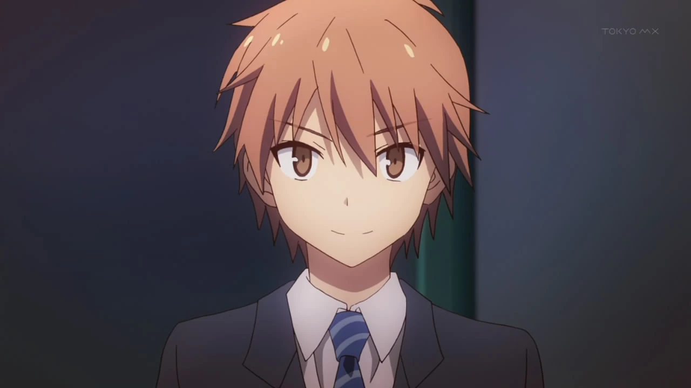
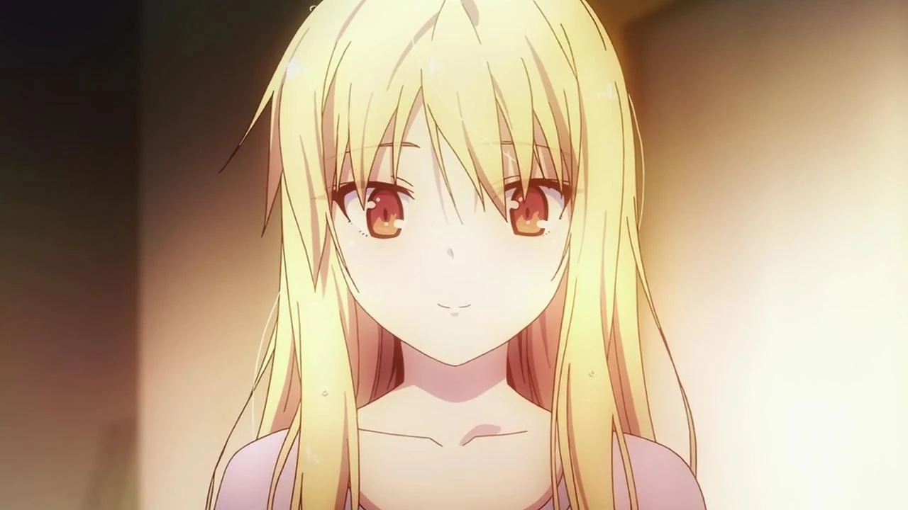

# Sección 03-A: Personajes principales (I) — Sorata Kanda y Mashiro Shiina

> **Biblia del universo de Sakura-sou no Pet na Kanojo (さくら荘のペットな彼女)**
> Documento de referencia para el proyecto de fanfic de este repositorio.
> ⚠️ Contiene spoilers del anime **y de la novela ligera completa**, incluidos los tomos 9, 10 y 10.5 que nunca se adaptaron. Cada spoiler de novela va marcado como tal.

  

---

## Panorama del elenco principal

Los siete residentes de Sakura-sō más la supervisora. Esta tabla sirve para tener los datos duros a mano; las fichas completas van debajo.

| Personaje | Kanji | Seiyū | Cuarto | Edad (inicio) | Cumpleaños | Altura | Sangre |
|---|---|---|---|---|---|---|---|
| **Sorata Kanda** | 神田 空太 | 松岡禎丞 (Matsuoka Yoshitsugu) | 101 | 17 | 9 de mayo | 168 cm (anime) / 170 cm (novela) | AB |
| **Mashiro Shiina** | 椎名 ましろ | 茅野愛衣 (Kayano Ai) | 202 | 17 | 13 de junio | 162 cm | A |
| **Nanami Aoyama** | 青山 七海 | 中津真莉子 (Nakatsu Mariko) | 203 | 16–17 | 6 de septiembre | 158 cm | A |
| **Misaki Kamiigusa** | 上井草 美咲 | 高森奈津美 (Takamori Natsumi) | 201 | 17 | 14 de junio | 156 cm | O |
| **Jin Mitaka** | 三鷹 仁 | 櫻井孝宏 (Sakurai Takahiro) | 103 | 17 | 22 de septiembre | 178 cm | O |
| **Ryūnosuke Akasaka** | 赤坂 龍之介 | 堀江由衣 (Horie Yui) | 102 | 16 | 1 de enero | 165 cm | AB |
| **Chihiro Sengoku** | 千石 千尋 | 豊口めぐみ (Toyoguchi Megumi) | — (supervisora) | 30 (dice 29) | 25 de mayo | 164 cm | O |

> **Nota sobre los datos físicos:** las alturas, pesos y medidas provienen de las fichas de la Sakurasou Wiki (Fandom), que a su vez los toma de los libros y del material promocional. Cuando el anime y la novela difieren, se indica. La estatura de Sorata, por ejemplo, es 168 cm en el anime y 170 cm en la novela: es el tipo de discrepancia que conviene no usar en el texto narrativo.

---

# 1. 神田 空太 — Kanda Sorata

## Ficha

| Campo | Dato |
|---|---|
| **Nombre completo** | 神田 空太 (Kanda Sorata) |
| **Seiyū japonés** | 松岡禎丞 (Matsuoka Yoshitsugu) |
| **Seiyū inglés** | Greg Ayres |
| **Edad** | 17 al inicio · 18 en el tomo 8 · 22 en el 10 · **24 en el 10.5** |
| **Cumpleaños** | 9 de mayo · Tauro |
| **Tipo de sangre** | AB |
| **Altura / complexión** | 168 cm en el anime, 170 cm en la novela; complexión media |
| **Cuarto** | 101 (planta baja, junto a la escalera exterior) |
| **Escuela** | 水明芸術大学附属高等学校 (Suimei Geijutsu Daigaku Fuzoku Kōtōgakkō), "Suikō"; 普通科 (sección general), 2.º año grupo 1 → 3.er año grupo 1 a partir del tomo 7 |
| **Ocupación** | Estudiante · cuidador oficial de Mashiro ("turno Mashiro") · aspirante a diseñador de videojuegos |
| **Familia** | Kanda Yūko (hermana menor), Kanda Akiko (madre), padre sin nombre, y en la novela Mashiro como pareja |
| **Apodos** | "Kouhai-kun" (por Misaki) · "Kanda-kun" (por Nanami) · "Sorata" a secas desde el episodio 4 por Mashiro |
| **Primera aparición** | Novela tomo 1 (prólogo) · Manga capítulo 1 · Anime episodio 1 |

## El nombre

**神田 (Kanda)** es un apellido real y muy común en Tokio: literalmente "campo de los dioses" o "arrozal del santuario". **空太 (Sorata)** se escribe con 空 ("cielo", pero también "vacío", "hueco") y 太 ("grande", "grueso", sufijo habitual de nombres masculinos). La lectura poética es "cielo grande"; la lectura incómoda, y seguramente deliberada, es **"gran vacío"**: el chico que al empezar la serie está literalmente hueco, sin saber qué quiere. Es el tipo de detalle que el autor nunca subraya pero que encaja demasiado bien para ser casualidad.

## Apariencia

Chico de estatura media, complexión corriente, pelo corto castaño claro en puntas levantadas y ojos del mismo tono. Casi siempre va con el uniforme de Suikō (camisa blanca de manga corta, chaleco azul cielo, corbata roja). En casa usa ropa holgada y, en verano, camiseta y shorts. Físicamente no destaca en nada, y eso es el punto: **la serie lo dibuja deliberadamente como "el chico normal" del reparto**, sin rasgos que lo hagan memorable al lado de Mashiro (blanco absoluto), Misaki (movimiento constante) o Ryūnosuke (belleza andrógina). Su cuerpo sí está en forma: jugó futbol en primaria y secundaria, y en el episodio 8 la serie lo muestra nadando sin dificultad.

## Personalidad

**El diagnóstico que hace de sí mismo** es "soy una persona completamente normal, sin nada que destacar". La serie se pasa veinticuatro episodios demostrando que está equivocado: Jin y Nanami se lo dicen en la cara ("no eres nada normal"), y Kanna, un personaje posterior, afirma que su criterio para juzgar cualquier cosa es "lo que haría Sakura-sō", lo cual ya es una forma de anormalidad.

Rasgos concretos:

- **Compulsión por rescatar.** No puede dejar un gato abandonado. Recogió siete: **Hikari** (光, "luz", la blanca), **Nozomi** (望, "deseo"), **Kodama** (木霊, "eco del árbol"), **Tsubasa** (翼, "ala"), **Komachi** (小町, "la pequeña"), **Aoba** (青葉, "hoja verde") y **Asahi** (朝日, "sol del amanecer"). Esa incapacidad de mirar hacia otro lado es lo que lo expulsa del dormitorio general y lo que lo lleva a Sakura-sō. La serie plantea que su virtud y su defecto son la misma cosa.
- **Indecisión crónica.** Al principio no sabe qué quiere. Jin lo hostiga por eso en el episodio 3, su padre se lo dice en el 15 ("deja de ser indeciso y vive como quieras") y su hermana se lo repite en el 16. La indecisión no es un rasgo cómico: es el conflicto central del personaje.
- **Sinceridad torpe.** Cuando intenta consolar, hiere. Le pasa con Mashiro en el episodio 4 (cuando le dice algo sobre su manga y ella se derrumba) y con Nanami en el 21. La serie insiste en que **sus mejores momentos no son discursos, sino actos**: modelar desnudo, correr a la estación, abrazar a alguien bajo la lluvia.
- **Sentido común como función cómica.** En Sakura-sō es el *tsukkomi*: el que grita cuando Misaki entra por la ventana o cuando Ryūnosuke come tomates en clase. Pero esa función tiene un costo: ser el único cuerdo de una casa de genios lo hace sentir mediocre.
- **Orgullo herido y envidia.** No es un santo. En el episodio 21 estalla contra Mashiro porque a ella le ofrecen trabajo y a él lo rechazan otra vez; en el 22 confiesa que llegó a odiarla un poco. Esa honestidad es lo que salva al personaje: **la serie le permite ser mezquino y luego arrepentirse**.

## Historia

**Antes de la serie.** Vivía en el dormitorio general de Suikō con Miyahara como compañero. Jugó futbol de niño y lo dejó cuando perdió la pasión. Recogió gatos hasta que lo expulsaron; llegó a Sakura-sō en el verano de su primer año, y en el episodio 19 la serie muestra ese primer día: Misaki le pareció una extraterrestre, Ryūnosuke un fantasma, y lo recibieron con un hot pot.

**Arco del anime (episodios 1-24).**
1. **Cuidador por accidente** (1-3): Chihiro le endosa a Mashiro, descubre que es incapaz de vestirse sola y asume el "turno Mashiro". La crisis llega cuando Mashiro le dice que él no sabe por qué está ahí, y decide irse del dormitorio.
2. **El primer objetivo** (4-8): al ver la determinación de Mashiro, escribe en su encuesta vocacional "quiero ser desarrollador de videojuegos". Entra a un concurso, pasa la primera ronda y fracasa en la presentación.
3. **Aprendiz de productor** (9-12): produce el corto de Nyaboron con Misaki, Jin y Ryūnosuke; su idea para el clímax (que el público grite lo que siente) salva la función del festival.
4. **Dos fracasos más** (13-21): pierde una segunda vez, recibe una segunda oportunidad de presentación en el episodio 16, y en el 21 le dicen que su juego no se producirá porque el mercado no lo sostiene. En el mismo tramo se enamora de Mashiro y sostiene a Nanami cuando ella se rompe.
5. **El cierre** (22-24): confiesa su amor a gritos en la estación, entiende que "Sakura-sō no es el edificio, son las personas" y se queda como el mayor de la casa cuando los demás se gradúan.

**Lo que la novela añade (spoilers).**
- En el **tomo 3** se da cuenta de que está enamorado de Mashiro; en el **tomo 8** se lo confiesa; en el **tomo 9** son pareja oficial.
- En el **tomo 10** **cortan**: Mashiro siente que la relación los daña porque Sorata no deja de compararse con ella y descarga en ella su frustración. Pasan **cuatro años sin verse**.
- En el **tomo 10**, tras el salto temporal, se reencuentran: Sorata ya es un diseñador de videojuegos con cierto éxito y Mashiro una mangaka consagrada. Retoman la relación.
- En el **10.5**, un año y nueve meses después, Sorata vive prácticamente en el departamento de Mashiro cuidándola, y planea llevarla a Fukuoka a conocer a sus padres; ella responde invitándolo a conocer a los suyos, que volvieron de Inglaterra. La serie insinúa que la relación da un paso más.

> **Esto es oro para el fanfic:** entre el final del anime y el tomo 10 hay un hueco de cuatro años de separación que la novela resuelve en un salto temporal. Ahí cabe cualquier historia.

## Relaciones

- **Mashiro.** Primero cuidador, luego espejo, luego enamorado. La relación se construye sobre una asimetría que la serie nunca resuelve del todo: él la necesita para saber qué quiere ser, ella lo necesita para poder vivir. En el anime termina en un beso en la mejilla; en la novela llega a pareja, se rompe y se reconstruye.
- **Nanami.** Su mejor amiga y compañera de clase desde primero. Se conocieron porque ella lo ayudó a colocar los gatos. Es la persona con la que puede hablar sin actuaciones, y la única que le dice las verdades sin rodeos ("si tú eres idiota, el mundo entero también"). **Él no se da cuenta de que ella está enamorada**, y todos los demás sí.
- **Jin.** El hermano mayor que no es su hermano: consejero, provocador y, en el episodio 18, contrincante a puñetazos. Jin lo llama "mi orgulloso kōhai".
- **Misaki.** Su primera amiga en Sakura-sō y la fuente de casi todo su agobio cómico. Le dice "kouhai-kun" y lo arrastra a cuanto plan se le ocurre. Él la respeta profundamente como creadora.
- **Ryūnosuke.** Su socio técnico. Se comunican por chat, y Ryūnosuke le revisa el proyecto, lo insulta con precisión y termina trabajando con él. Después de graduarse, **viven juntos en una casa cerca de Sakura-sō y montan un estudio de videojuegos** (dato de novela).
- **Chihiro.** Su supervisora, mentora involuntaria y ejemplo negativo. Le da consejos que suenan a broma y resultan ser sabios ("no veas el mundo en blanco y negro, velo en gris").
- **Yūko.** Su hermana pequeña, con un complejo de hermano mayor que roza el absurdo. Él la trata como niña y ella se muere por crecer para estar a su lado.

## Frases

> *"Las oportunidades no esperan a nadie. Si dejas escapar una con la excusa de 'no estaba preparado', no volverás a tener otra como esa. Pero es tu vida. Vívela como quieras."*
> (Cita que abre su ficha en la wiki, traducción propia.)

> 「空太のばか」 — *"Sorata, tonto."* No es suya: es la frase que Mashiro le dedica cuando está enfadada, y él la colecciona sin saber qué hacer con ella.

## Curiosidades y notas de escritura

- **Su cumpleaños, el 9 de mayo**, no se celebra en la serie; el que sí tiene episodio es el de Jin (episodio 2).
- **El nombre de sus gatos forma una lista de sustantivos cotidianos** (luz, deseo, eco, ala, sol). Cuando necesites un detalle doméstico para una escena, ahí hay material.
- **Su sueño no es "ser famoso": es "hacer un juego que la gente juegue".** En el episodio 16 el productor le dice que para recuperar la inversión hacen falta 45 000 copias; en el 21 le explican que el mercado premia fórmulas probadas. Su arco es, en el fondo, el de un creador enfrentado a la industria.
- **Su punto de vista es el del extraño que llega a una casa de genios.** Si escribes desde su cabeza, el registro debe ser el de alguien que admira y envidia a la vez.
- **Nunca dice "te quiero" con calma.** Lo grita, en una estación, cuando el tren ya se va (episodio 22). Cualquier declaración suya posterior debería sentirse distinta a esa.

---

# 2. 椎名 ましろ — Shiina Mashiro

## Ficha

| Campo | Dato |
|---|---|
| **Nombre completo** | 椎名 ましろ (Shiina Mashiro) |
| **Seiyū japonesa** | 茅野愛衣 (Kayano Ai) |
| **Seiyū inglesa** | Caitlynn French |
| **Edad** | 17 al inicio · 18 en el tomo 8 · 22 en el 10 · **24 en el 10.5** |
| **Cumpleaños** | 13 de junio · Géminis |
| **Tipo de sangre** | A |
| **Altura / peso** | 162 cm · 45 kg · medidas 79-55-78 cm |
| **Cuarto** | 202 (planta alta, frente a la escalera) |
| **Escuela** | Suikō, 美術科 (sección de arte), 2.º año → 3.er año |
| **Ocupación** | Pintora de fama mundial · aspirante a mangaka |
| **Familia** | Padre (ingeniero/artista, vive en el extranjero) · Chihiro Sengoku (prima) · Rita Ainsworth (compañera y "cuidadora" en Inglaterra) |
| **Primera aparición** | Novela tomo 1, capítulo 1 · Manga capítulo 1 · Anime episodio 1 |

## El nombre

**椎名 (Shiina)** es un apellido real; el primer kanji, 椎, es el del **shii**, un árbol de la familia de las hayas (y también "vértebra"). **ましろ** está escrito en hiragana, no en kanji: el autor eligió no fijarlo, pero el significado evidente es **真白, "blanco puro"**. De ahí el juego del episodio 1: 猫・白・ましろ — *gato, blanco, Mashiro*. Su nombre es su color, y su color es la ausencia de color, que es exactamente lo que le pasa al principio de la serie: una hoja en blanco emocional.

## Apariencia

Piel muy pálida, ojos ámbar (que en la novela se describen como rojizos), cabello rubio pálido, larguísimo y lacio, que le llega a la cintura y que ella no sabe recoger. Complexión delgada, baja de peso para su estatura. En la escuela usa el uniforme de Suikō; en casa suele ir con ropa cómoda, y **al principio de la serie se la ve literalmente sin ropa interior porque no entiende para qué sirve**. La serie usa esa desnudez como gag y, más adelante, como marca de su evolución: a partir del primer mes le da vergüenza que la vean.

## Personalidad

Es la parte más difícil de escribir de toda la obra, y la que más se malinterpreta.

- **No es fría: es literal.** Mashiro responde exactamente lo que le preguntan, sin filtro social. Cuando dice que Sorata es su "dueño", no está coqueteando: está describiendo un hecho. Casi todos los malentendidos del anime nacen de que los demás proyectan intención donde ella solo pone información.
- **Su incompetencia es total, no selectiva.** No sabe vestirse, ni lavar, ni peinarse, ni despertarse, ni comprar (se come la comida del supermercado antes de pagarla). No es una torpeza graciosa: es dependencia funcional. La serie la trata con humor, pero también con incomodidad, y ahí está el filo.
- **La emoción le llega tarde y le llega mal.** Al principio es prácticamente inexpresiva; con el paso de los episodios empieza a sonreír, a enfadarse y a celarse. Sus celos son los más elementales del reparto: se le nubla la cara cuando ve a Sorata con Nanami o con Rita, sin saber nombrar lo que siente.
- **Es genial y no le importa la fama.** Abandonó una carrera de pintora de éxito internacional para ir a Japón a dibujar manga, sin una sola duda. Cuando le preguntan por qué, la respuesta es del tamaño de una frase: porque quiere.
- **Es incapaz de mentir y de negociar.** Por eso su manga es un fracaso comercial al principio: dibuja lo que quiere que pase, no lo que debería pasar para que la historia funcione. Su editora le dice que si cambia el final puede publicar; ella se niega y redibuja el final que ella quería. Termina publicando igual.

## Historia

**Antes de la serie.** Niña prodigio en el atelier de **Adel Ainsworth** (el abuelo de Rita), en Inglaterra. Los demás alumnos se marcharon uno por uno al no poder alcanzarla. **Rita, que fue su compañera de cuarto y su cuidadora**, le enseñó a usar la computadora y, por celos, le sugirió dibujar manga esperando que la crítica la destrozara. El manga fue un éxito y Mashiro decidió dedicarse a eso.

**Arco del anime.**
1. **La llegada** (1-4): aparece en la estación, la recibe Sorata, y su incapacidad obliga a crear el "turno Mashiro". Su manga es rechazado en un concurso y Sorata la hiere sin querer; ella redibuja el final y le pide que la llame por su nombre.
2. **La normalidad** (5-8): saca cero en todo y 100 en la recuperación gracias a su memoria fotográfica; empieza a investigar el amor literalmente ("enséñame qué es el amor").
3. **El pasado** (9-12): llega Rita a llevársela y se descubre el daño que su talento causó a los demás. Se queda.
4. **El cambio** (13-16): quiere aprender a cocinar para Sorata, se corta un dedo, discute con él y descubre los celos. Su manga debuta y se convierte en la serie favorita de Yūko.
5. **La huida** (17-24): se ofrece como diseñadora de personajes para un juego (lo que desencadena la crisis), se va del dormitorio para "liberarlos" y vuelve cuando Sorata la detiene. Pinta el mural de Sakura-sō y, en el último episodio, le pide un beso y le da uno en la mejilla.

**Lo que la novela añade (spoilers).**
- Su relación con Sorata avanza: pareja en el tomo 9, **ruptura en el 10** (ella siente que la comparación constante los destruye), cuatro años de separación y reencuentro.
- En el **10.5**, ya conviviendo de nuevo, invita a Sorata a conocer a sus padres, que volvieron de Inglaterra. La escena insinúa un compromiso.

## Relaciones

- **Sorata.** Su primera amistad masculina y su cuidador. Al principio lo llama "mi dueño", después "Sorata". Con él aprende el vocabulario básico de las emociones, y por él se queda en Japón. La escena del episodio 12 —"siento algo raro aquí dentro, ¿será amor?"— es el resumen exacto de su arco.
- **Rita.** Amiga, compañera de atelier y rival silenciosa. Se pelean y se reconcilian; Rita es la única persona que le dijo en la cara que su talento lastima.
- **Chihiro.** Primas. Chihiro la trajo a Japón y le consiguió el lugar en Suikō; también es quien le dice a Sorata que la cuide.
- **Nanami.** Empiezan como rivales por Sorata y terminan siendo algo parecido a hermanas: en el episodio 22 Nanami la abraza y le dice que sus fracasos son suyos, no de Mashiro.
- **Ayano Iida.** Su editora. Es la voz del mundo profesional: le exige, la corrige y le dice la verdad sobre su obra.
- **Yūko.** Fan accidental de su manga. Mashiro no entiende por qué la trata distinto hasta que descubre que lee su serie.

## Frases

> *"Esta zona se siente rara. Ha estado palpitando desde aquella vez. Cuando me dijiste que no me fuera. Cuando me abrazaste tan fuerte. No se va. Tu voz sigue en mi oído. ¿Qué me pasó? ¿Esto... es amor?"*
> (Cita que abre su ficha en la wiki, traducción propia: es la escena del episodio 12.)

> 「空太のばか」 — *"Sorata, tonto."*

## Curiosidades y notas de escritura

- **El baumkuchen es su lenguaje.** Es lo único que pide por sí misma y su manera de pedir perdón (episodio 14). Si quieres que Mashiro diga algo sin decirlo, dale comida.
- **Su talento se mide socialmente**: hubo exposiciones grandes y se publicó un libro de arte grueso con su obra. No es "una chica que dibuja bien": es una figura internacional.
- **Su memoria es fotográfica**, no intelectual: memoriza la imagen de las respuestas, no las entiende.
- **Es la única del reparto que no tiene doblaje interno**: su voz es plana, con pausas largas, y casi nunca sube de tono. En japonés usa un registro neutro y educado que la hace sonar más rara, no más adorable.
- **Al escribirla, evita el estereotipo de "chica genio adorable".** Su dependencia es un problema real, y la serie lo muestra; si tu fanfic la vuelve autosuficiente de golpe, se rompe el personaje. Si quieres hacerla crecer, hazlo como en la novela: a golpes y con recaídas.

---

## Cómo funcionan estos dos juntos (guía rápida para el fanfic)

| Eje | Sorata | Mashiro | Qué produce |
|---|---|---|---|
| **Trabajo** | Intenta, fracasa, insiste | Ya llegó a la cima y la dejó | Envidia, admiración y crisis |
| **Cuidado** | Sabe hacer todo lo doméstico | No sabe nada | Dependencia y ternura |
| **Emoción** | La entiende y no se atreve | No la entiende y la siente | Malentendidos constantes |
| **Lenguaje** | Habla de más | Habla de menos | Silencios que dicen más que las escenas |

La pareja funciona porque **los dos son incompletos en direcciones opuestas**: él tiene vida práctica y no tiene rumbo; ella tiene rumbo y no tiene vida práctica. Cualquier escena entre los dos debería tocar al menos uno de esos cuatro ejes.

---

## Verificación de esta sección

- **Datos físicos y personales** (cumpleaños, tipo de sangre, altura, peso, medidas, edad por etapa): fichas de la Sakurasou Wiki (Fandom), que remiten a los tomos de la novela ligera; contrastados con la sección de personajes de la Wikipedia japonesa.
- **Discrepancia detectada y señalada:** la wiki en inglés describe a Chihiro como "tía" (aunt) de Mashiro; la **Wikipedia japonesa dice 従姉妹 (prima)**. Se usa "prima", que es la fuente más cercana al texto original.
- **Discrepancia menor:** la estatura de Sorata es 168 cm en el anime y 170 cm en la novela. Ambas se citan.
- **Spoilers de novela** (ruptura en el tomo 10, reencuentro, escena del 10.5): tomados de la ficha de Sorata y de Mashiro en la Sakurasou Wiki, que documentan los tomos uno por uno. **No están en el anime**; van marcados como tales en todo el documento.
- **Nombres de los siete gatos:** listados en la ficha de Sorata de la Sakurasou Wiki y coherentes con la novela (siete gatos recogidos).

---

## Fuentes de esta sección

1. **Wikipedia en japonés — さくら荘のペットな彼女**, sección 登場人物 (ficha de cada personaje, con datos de familia, historia y personalidad): https://ja.wikipedia.org/wiki/さくら荘のペットな彼女
2. **Sakurasou Wiki (Fandom) — Sorata Kanda**: https://sakurasou.fandom.com/wiki/Sorata_Kanda (infobox, personalidad, relaciones, gatos, novelas)
3. **Sakurasou Wiki (Fandom) — Mashiro Shiina**: https://sakurasou.fandom.com/wiki/Mashiro_Shiina (infobox, apariencia, personalidad, relaciones)
4. **Sitio oficial de la obra (Dengeki/KADOKAWA)**, página de personajes: https://sakurasou.dengeki.com/character/ (arte oficial y perfiles)
5. **Wikipedia en inglés — *The Pet Girl of Sakurasou*** (contexto y reparto de doblaje): https://en.wikipedia.org/wiki/The_Pet_Girl_of_Sakurasou

---

*Siguiente documento: [03-B — Nanami, Misaki y Jin](03b-personajes-nanami-misaki-jin.md)*
