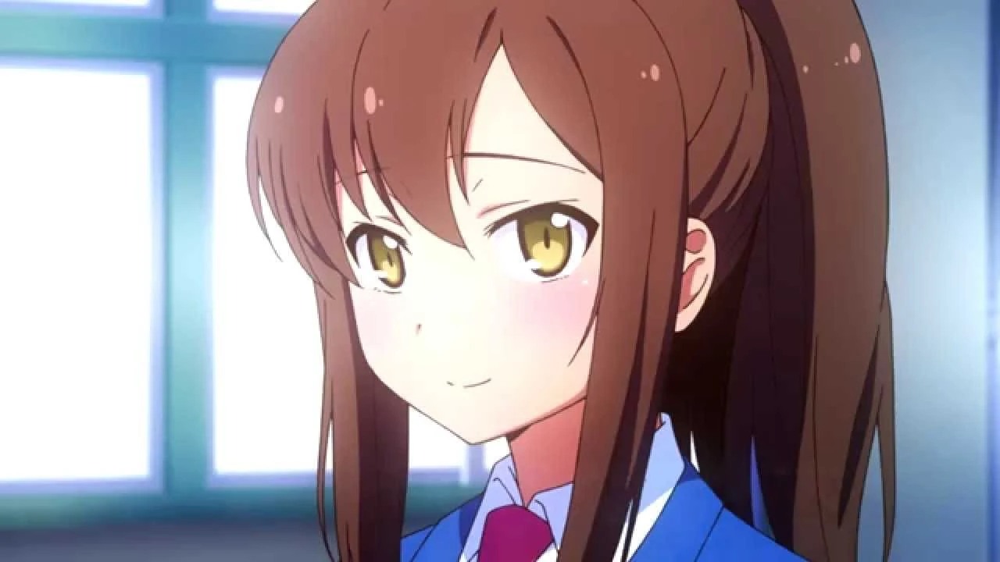
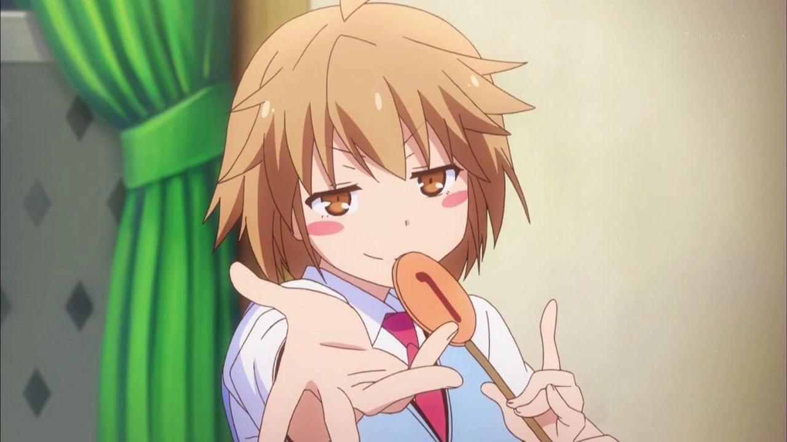
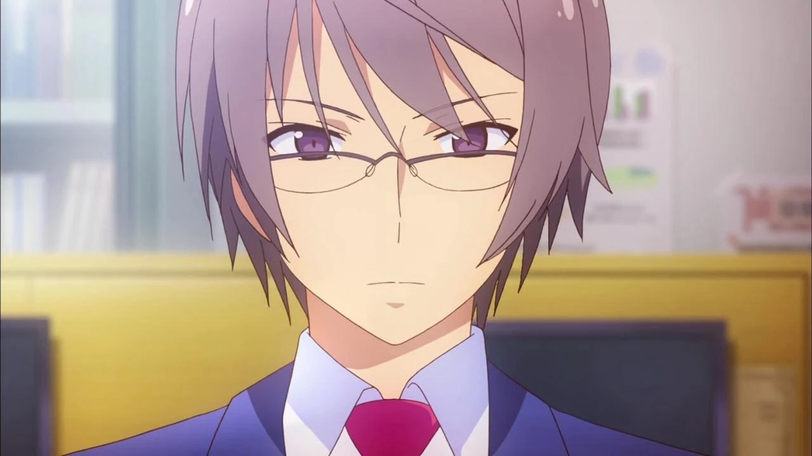

# Sección 03-B: Personajes principales (II) — Nanami Aoyama, Misaki Kamiigusa y Jin Mitaka

> **Biblia del universo de Sakura-sou no Pet na Kanojo (さくら荘のペットな彼女)**
> Documento de referencia para el proyecto de fanfic de este repositorio.
> ⚠️ Spoilers del anime completo y de la novela ligera. Los datos que solo existen en la novela van marcados.

  

---

# 3. 青山 七海 — Aoyama Nanami

## Ficha

| Campo | Dato |
|---|---|
| **Nombre completo** | 青山 七海 (Aoyama Nanami) |
| **Seiyū japonesa** | 中津真莉子 (Nakatsu Mariko) |
| **Seiyū inglesa** | Christina Kelly |
| **Edad** | 16–17 (compañera de clase de Sorata) |
| **Cumpleaños** | 6 de septiembre · Virgo |
| **Tipo de sangre** | A |
| **Altura / medidas** | 158 cm · 81-58-83 cm |
| **Cuarto** | 203 (se muda a mitad de la serie; antes vivía en el dormitorio general) |
| **Escuela** | Suikō, sección general, 2.º año grupo 1 → 3.er año grupo 1. Además asiste a una **escuela de seiyū** (声優養成所) |
| **Ocupación** | Estudiante · empleada de tienda de conveniencia · aspirante a actriz de voz |
| **Origen** | Prefectura de Osaka |
| **Familia** | Padres sin nombre, opuestos a su carrera |
| **Apodos** | "Nanamin" (por Mayu y Yayoi) · "coleta" (por el narrador y por Sorata) |
| **Primera aparición** | Novela tomo 1, capítulo 2 · Manga capítulo 1 · Anime episodio 1 |

## El nombre

**青山 (Aoyama)** significa literalmente "montaña azul" y es un apellido muy común en Japón. **七海 (Nanami)** se escribe con 七 ("siete") y 海 ("mar"): **"siete mares"**. El autor le dio un nombre de océano entero a la chica que no tiene nada de extraordinario, y la serie lo explota en el título del episodio 6, 「雨あがりの青」 (*"el azul después de la lluvia"*): cuando escampa, el cielo se pone del color de su apellido. Nanami es la única del reparto cuyo nombre aparece en un título de episodio como metáfora del ánimo.

## Apariencia

Chica menuda, de complexión media, con el pelo castaño largo y lacio que casi siempre lleva **recogido en una coleta** (de ahí el apodo). Ojos castaño dorado. En la escuela, uniforme de Suikō impecable; en el trabajo, el uniforme de la tienda de conveniencia; en casa, ropa cómoda y un delantal cuando cocina para todos. La serie insiste en que es bonita, y ella lo vive como un problema: cuando se arregla para la "cita" del episodio 14 le da vergüenza que la vean.

## Personalidad

**La chica seria de Sakura-sō**, tal como la define el título del episodio 5. Su rasgo central no es el carácter, es la **ética del esfuerzo**:

- **No soporta la palabra "imposible".** La Wikipedia japonesa lo dice con precisión: "odia decidir sus propios límites con la palabra 'imposible'". Eso la lleva a trabajar, estudiar, ensayar y cuidar de Mashiro al mismo tiempo, y a enfermarse por ello en el episodio 6.
- **Es la única que paga un precio real por su sueño.** Mashiro es genio, Misaki es genio, Ryūnosuke es genio. Nanami trabaja en una tienda de conveniencia para pagar la escuela de seiyū porque **sus padres se oponen** y ella aceptó estudiar en Suikō solo con la condición de no causarles problemas. Es el personaje que representa el esfuerzo sin talento.
- **Tsundere, pero con causa.** Es dura con Sorata porque le gusta y no sabe qué hacer con eso; todos en el dormitorio lo notan menos él. No es un rasgo decorativo: su timidez es la razón por la que no se declara en toda la temporada.
- **Orgullo que se convierte en terquedad.** En el episodio 21 le dice a Sorata que no la trate como buena persona, porque en realidad usó a los demás como distracción para no enfrentar sus fracasos. Es una de las autocríticas más duras de la serie, y viene de la persona más trabajadora.
- **Habla estándar por disciplina.** Practica el acento de Tokio a propósito, porque es actriz de voz; se le escapa el **dialecto de Osaka** cuando entra en pánico o se enfada. Es un detalle caracterizador que conviene usar: es su termómetro emocional.

## Historia

**Antes de la serie.** Salió de Osaka contra la opinión de sus padres. Vivía en el dormitorio general y trabajaba en una tienda de conveniencia. Conoció a Sorata porque lo ayudó a esconder a los gatos que había recogido.

**Arco del anime.**

1. **Amiga y cómplice** (1-4): la primera persona fuera de Sakura-sō que sabe de los gatos. Se molesta cuando cree que Sorata y Mashiro son pareja.
2. **La mudanza** (5-6): entra a Sakura-sō con la excusa de la renta impagada, pero **la razón real es vigilar a Sorata y Mashiro**. Le quita el "turno Mashiro" a Sorata por principios ("una chica debe cuidar de una chica") y el intento le sale mal. Se enferma de agotamiento y **falla su primera audición interna**.
3. **El fracaso y el consuelo** (6): es el episodio que la define. Sorata le dice la frase que la sostiene: "si tú eres idiota, el mundo entero también".
4. **La casi confesión permanente** (13-16): acepta la invitación de Sorata con el boleto que le dio Jin, va arreglada, y descubre que él está pendiente de otra. En el 16 practica una escena de confesión con él y **la interpreta de verdad**.
5. **El desplome** (20-21): falla la audición por segunda vez y llora en clase; Sorata la sostiene bajo la lluvia y ella se rompe. Ahí le dice lo de los dos años perdidos.
6. **La renuncia** (22): escucha la declaración de Sorata a Mashiro y elige no decir nada. Le agradece haberla inspirado, y cuando él se va, confiesa al aire que pudo esforzarse porque estaba enamorada de él.
7. **La partida** (24): vuelve a Osaka a negociar con sus padres, con la promesa de regresar.

**Lo que la novela añade (spoilers).**
- Después de graduarse, **estudia en la Universidad de Suimei** (la misma que Sorata y Misaki), y su relación con Sorata se mantiene como amistad casual: se cruzan en el campus y charlan. No hay final romántico para ella en la obra.
- Su carrera de seiyū queda en un compás de espera: la novela prioriza su reconciliación familiar.

## Relaciones

- **Sorata.** Su amor no correspondido y su mejor amigo. La serie construye la tragedia con precisión: él la quiere como amiga, la necesita como apoyo y no ve lo evidente.
- **Mashiro.** Rival y, con el tiempo, casi hermana. La escena del abrazo en el episodio 22 es el punto más alto de su arco: le dice que sus fracasos son suyos y que no se atreva a cargarlos.
- **Misaki.** Su mentora involuntaria en el arte de declararse. La "pista del terror" del episodio 14 la describe a ella también.
- **Miyahara Daichi.** Le confiesa su amor en el episodio 12 y ella lo rechaza. Es la primera vez que la serie dice en voz alta que Nanami solo tiene ojos para Sorata.
- **Mayu y Yayoi.** Sus compañeras de clase y de la escuela de seiyū; son el coro que la empuja a declararse y el que la consuela cuando fracasa.
- **Momoko.** Compañera de la escuela de seiyū que la reprende por presentarse enferma y perjudicar al grupo (episodio 6). Es la voz crítica del ambiente.

## Frases

> *"Hay cosas que no puedes decirle a alguien, por muy cerca que estés de esa persona."*
> (Cita que abre su ficha en la wiki, traducción propia.)

> "Si tú eres idiota, el mundo entero también." — la frase no es suya, es de Sorata, pero es la que la sostiene (episodio 6).

## Curiosidades y notas de escritura

- **Su coleta es un indicador de estado de ánimo**: cuando está en casa, suelta; cuando va a la escuela o al trabajo, atada; cuando se arregla para el 24 de diciembre, con falda y el pelo distinto.
- **El dinero es un tema real en su vida.** Es la única que habla de renta, de turnos y de sueldos. Si escribes una escena doméstica, ella es quien piensa en el gasto.
- **Su fracaso no es un castigo narrativo:** es la demostración de la tesis de la obra. Si en tu fanfic la haces triunfar, tendrás que decidir si eso contradice el tema (el esfuerzo no garantiza nada) o lo completa (el esfuerzo sostiene a la persona aunque no gane).
- **Nunca se declara.** Ni en el anime ni en la novela. Cualquier confesión suya sería un cambio de canon consciente.

---

# 4. 上井草 美咲 — Kamiigusa Misaki (después 三鷹 美咲, Mitaka Misaki)

## Ficha

| Campo | Dato |
|---|---|
| **Nombre completo** | 上井草 美咲 (Kamiigusa Misaki) → **三鷹 美咲** al casarse |
| **Seiyū japonesa** | 高森奈津美 (Takamori Natsumi) |
| **Seiyū inglesa** | Luci Christian |
| **Edad** | 17 al inicio (3.er año); egresada al final del anime |
| **Cumpleaños** | 14 de junio · Géminis |
| **Tipo de sangre** | O |
| **Altura** | 156 cm |
| **Cuarto** | 201 (planta alta, al fondo) |
| **Escuela** | Suikō, 美術科 (arte), 3.er año → **Universidad de Suimei, Facultad de Imagen y Cine (映像学部)** |
| **Ocupación** | Animadora autodidacta · estudiante universitaria · después, esposa de Jin y vecina de Sakura-sō |
| **Familia** | Kamiigusa Fūka (hermana mayor) · Jin Mitaka (esposo) · padres sin nombre |
| **Apodos** | "Extraterrestre" (por Sorata) · la llaman así también por su energía |
| **Primera aparición** | Novela tomo 1 · Anime episodio 1 |

## El nombre

**上井草 (Kamiigusa)** es un apellido real del área de Tokio (hay un barrio con ese nombre en Suginami). **美咲 (Misaki)** combina 美 ("belleza") y 咲 ("florecer"): **"la que florece hermosa"**. Después de casarse pasa a **三鷹 (Mitaka)**, el apellido de Jin, que es también una ciudad real de Tokio. El detalle no es casual: la serie la hace "florecer" literalmente al final, cuando reparte broches de flor de cerezo en la graduación.

## Apariencia

Baja (156 cm), delgada y con una energía que el dibujo traduce en movimiento constante: pelo castaño claro corto y algo alborotado, ojos grandes. Va siempre con el uniforme de Suikō, pero en casa se la ve con ropa deportiva, sudaderas y, cuando trabaja, con delantales o disfraces improvisados (el traje de oso del episodio 11). **Es la única del reparto que aparece disfrazada con regularidad**, y eso es caracterización: Misaki se pone ropa de otros personajes porque actúa todo el tiempo.

## Personalidad

- **Hiperactiva y sin freno social.** Le pone apodos a todo el mundo ("kouhai-kun" a Sorata, "Iorin" a Iori). Conduce como si el acelerador fuera el único pedal. Viaja ocho horas en auto para comer takoyaki en Osaka y toma un vuelo a Sapporo para comerse un ramen y volver a las pocas horas. Sorata la llama "extraterrestre" en el episodio 1 y la serie nunca lo desmiente.
- **Genio absoluto del dibujo y la animación.** Es la **única estudiante con beca de arte (芸術科特待生) en diez años**, y a la vez perdió ese beneficio por dedicarse al anime. Terminó siendo **la primera de su clase los tres años**. Es, en términos de talento puro, la más dotada del elenco adulto.
- **Fama en internet sin buscarla.** Sus animaciones caseras se consideran obras maestras en la red: la llaman "dios", le llueven ofertas para publicarlas en DVD y el ingreso que genera es considerable.
- **Fragilidad escondida.** Toda esa energía se apaga de golpe cuando Jin la hiere. En el episodio 6 se derrumba al saber que él se va a Osaka, y en el 14 su rechazo la deja en un estado que el resto del dormitorio tiene que levantar. La serie la muestra como la persona más resistente y la más quebradiza al mismo tiempo.
- **No tiene amigos de infancia.** En la secundaria estaba sola; su profesora —a la que ella llamaba "el ermitaño" (仙人)— la recomendó a Suikō. Su intensidad con Jin y con Sorata viene de ahí: **aprendió a querer a la gente de golpe, sin escala**.

## Historia

**Antes de la serie.** Entró a Suikō y en **una semana** ya estaba en Sakura-sō. Cuando llegó, la única residente era Chihiro, y Misaki se dedicó a limpiar y cuidar las habitaciones vacías esperando que llegara gente. Es el dato más triste y más importante de su ficha: **la casa se llena porque ella la espera**.

**Arco del anime.**

1. **La anfitriona** (1-8): recibe a Mashiro con una fiesta, produce su propio anime, persigue a Jin sin pudor y le deja un formulario de matrimonio en el casillero.
2. **El proyecto Nyaboron** (9-12): pone su serie infantil en producción para el festival y arrastra al dormitorio entero. En el clímax del corto grita lo que lleva años callando: "¡Jin, deja de mirar a Fūka y mírame a mí!".
3. **El rechazo** (11-14): descubre que Jin se va a Osaka, se derrumba, y en Navidad se declara con un bentō y recibe un "no" dicho con dulzura. Llora porque habría preferido que la hiriera.
4. **La reconstrucción** (15-18): en Año Nuevo decide volver a ser la de antes y animar el guion que Jin le dejó.
5. **La graduación** (19-24): da el discurso de la generación y lo convierte en mitin por Sakura-sō; después entra a la universidad, se casa con Jin por trámite propio y se muda a la casa de al lado.

**Lo que la novela añade (spoilers).**
- Su boda con Jin se formaliza durante la etapa universitaria; en el **episodio 24** ya aparece como **Mitaka Misaki**, recién casada y vecina, porque presentó ella misma el formulario que él le dio.
- Aparece junto a Jin en la serie posterior del autor, 『青春ブタ野郎はロジカルウィッチの夢を見ない』 (tomo 3), en una sección de noticias de televisión.

## Relaciones

- **Jin.** El amor de su vida desde la infancia. Lo persigue con una intensidad que roza el acoso cómico (formulario de matrimonio en el casillero, cuerpo envuelto en listón) y, al mismo tiempo, es la única persona a la que le tiene miedo.
- **Fūka.** Su hermana mayor y exnovia de Jin. Se parecen físicamente y son opuestas en carácter. Misaki le tiene celos desde antes de saber qué eran los celos.
- **Sorata.** Su "kouhai" favorito. Lo usa de cómplice, de sparring y de paño de lágrimas. En el fondo lo quiere como a un hermano menor.
- **Mashiro.** Su compañera de talento. Trabajan juntas en el corto y en el mural; se pelean por quién dibuja el omelette de Sorata y se respetan como iguales.
- **Chihiro.** Su casera y mentora; Chihiro la recibió cuando la expulsaron del dormitorio general.

## Frases

> *"Nos encontramos en conflicto muchas veces. Hubo momentos duros en los que queríamos huir o rendirnos. Pero fue solo porque cayó esa lluvia, que las semillas de nuestros sentimientos pudieron germinar. Y las flores de una amistad más profunda pudieron abrirse."*
> (Cita que abre su ficha en la wiki, traducción propia; se corresponde con su discurso de graduación.)

## Curiosidades y notas de escritura

- **Es la única que habla en términos de animación todo el tiempo**: tempo, encuadre, colores. Su vocabulario profesional es su forma de pensar.
- **El hot pot** es su ritual de bienvenida: recibe a Sorata con uno y la serie lo repite en cada llegada.
- **Su talento es la contraparte del de Mashiro**: Mashiro abandonó la pintura por el manga; Misaki perdió la beca por el anime. Las dos eligieron el camino "menor" y las dos son las mejores en lo que hacen.
- **Su fragilidad no es un chiste.** Si escribes una escena en la que la hieren, recuerda que su reacción canónica es apagarse por completo, no llorar a gritos.

---

# 5. 三鷹 仁 — Mitaka Jin

## Ficha

| Campo | Dato |
|---|---|
| **Nombre completo** | 三鷹 仁 (Mitaka Jin) |
| **Seiyū japonés** | 櫻井孝宏 (Sakurai Takahiro) · de niño: 田頭里奈 |
| **Seiyū inglés** | Scott Gibbs |
| **Edad** | 17 al inicio (3.er año); egresado al final |
| **Cumpleaños** | 22 de septiembre · Virgo |
| **Tipo de sangre** | O |
| **Altura** | 178 cm (el más alto del reparto) |
| **Cuarto** | 103 (planta baja, junto a Ryūnosuke) |
| **Escuela** | Suikō, sección general, 3.er año → **Universidad de las Artes de Osaka** (en el anime, 大阪総合芸術大学) |
| **Ocupación** | Estudiante · guionista (脚本家) en formación |
| **Familia** | Sin familia directa en pantalla; **Misaki** se convierte en su esposa |
| **Primera aparición** | Novela tomo 1 · Anime episodio 1 |

## El nombre

**三鷹 (Mitaka)** es un apellido real y también el nombre de una ciudad de Tokio (la misma zona que da apellido a la familia del protagonista de *Tonari no Totoro*, por cierto). **仁 (Jin)** significa "benevolencia", "humanidad", y es la virtud central del confucianismo. El nombre le queda grande al principio y le queda justo al final: el personaje es, literalmente, el que tiene que aprender a ser bueno con la persona que quiere.

## Apariencia

El más alto del elenco (178 cm), complexión delgada, pelo castaño oscuro desordenado, mirada tranquila. Se le ve siempre con el uniforme, salvo cuando sale de noche, y con una sonrisa de medio lado que la serie usa como máscara: **casi todas sus escenas serias lo muestran serio de golpe**, sin transición, y eso lo delata.

## Personalidad

- **El adulto del grupo que no lo es.** Es el que da los consejos que Sorata necesita, el que sabe leer a la gente con una mirada ("puedo adivinar cómo es alguien por cómo trabaja") y el que sostiene la producción del corto como guionista.
- **Mujeriego declarado, y por una razón concreta.** Duerme en casa de una mujer distinta cada noche y no lo esconde. La serie revela en el episodio 11 que su primer amor fue **Fūka, la hermana mayor de Misaki**, y que la usó como puente para estar cerca de Misaki. Es su forma de sabotearse: prefiere ser un mujeriego que un cobarde.
- **Cobardía disfrazada de generosidad.** Su lógica es explícita: tiene talento para ver el de Misaki, le duele no estar a su altura, y prefiere mantenerla "pura" y a distancia antes que manchar esa relación con su propia envidia. En el episodio 14 le dice que no puede hacerse cargo de ella en su estado actual.
- **Se enoja rápido.** La ficción lo pinta como el tranquilo, pero cuando lo provocan pelea: en el episodio 18 se agarra a golpes con Sorata en la azotea y gana.
- **Su orgullo es profesional.** No quiere ser "el novio de Misaki": quiere ser reconocido como alguien por derecho propio. En el episodio 14 se lo dice a Tatebayashi: "quiero que Misaki me vea como a alguien, no solo como a alguien a quien quiere".

## Historia

**Antes de la serie.** Amigo de la infancia de Misaki. Eran vecinos y compañeros de escuela; cuando los chicos del colegio la acosaban, él peleaba por ella. Entró a Suikō, acabó viviendo en Sakura-sō y se convirtió en el guionista de las animaciones caseras de Misaki. Su primer amor fue Fūka, la hermana mayor de ella.

**Arco del anime.**

1. **El consejero** (1-8): provoca a Sorata para que se defina; le dice que "primero decidas a dónde perteneces y luego qué quieres hacer".
2. **La revelación** (6): Sorata descubre que quiere irse a Osaka.
3. **La doble verdad** (11): se reencuentra con Fūka y deja claro que no vuelve con ella; Misaki escucha que se va.
4. **El rechazo** (14): se declara a Misaki con todo el corazón y, acto seguido, la rechaza por no poder hacerse cargo de ella.
5. **El combate** (18): aprueba el examen de Osaka y pelea con Sorata, que le exige hablar con Misaki.
6. **El compromiso** (24): le da a Misaki el **formulario de matrimonio firmado** y le pide que lo guarde hasta que vuelva.

**Lo que la novela añade (spoilers).**
- La pareja se formaliza en el **tomo 5**, mucho antes de lo que sugiere el anime; el anime reordena y alarga el conflicto.
- Su boda se consuma porque **Misaki presenta el formulario por su cuenta** el mismo día de su partida.

## Relaciones

- **Misaki.** La persona a la que ama, teme y admira. Su arco entero consiste en dejar de protegerla para poder estar con ella.
- **Fūka.** Su primer amor y la prueba de su cobardía. La relación terminó mal porque Fūka entendió que él estaba mirando a su hermana a través de ella.
- **Sorata.** Su kōhai favorito, al que llama "mi orgulloso kōhai", y su contrincante cuando hace falta.
- **Tatebayashi.** Su mejor amigo y compañero de clase tres años seguidos. Le presta su casa cuando se queda sin dormitorio y es el único que le dice sus verdades de frente.
- **Ryūnosuke.** Compañeros de piso y colaboradores: Jin escribe, Ryūnosuke programa.
- **Chihiro.** Relación de vecindad y complicidad adulta; es el único del dormitorio con quien Chihiro habla de igual a igual.

## Frases

> *"Primero necesitas decidir a dónde perteneces. Si puedes hacer eso, puedes decidir qué quieres hacer."*
> (Cita que abre su ficha en la wiki, traducción propia; se la dice a Sorata.)

## Curiosidades y notas de escritura

- **Su cumpleaños, el 22 de septiembre, sí se celebra** en el episodio 2: Misaki le regala un "paquete" que resulta ser ella misma envuelta en listón.
- **Es el único personaje con una salida del armario emocional explícita**: en el episodio 14 dice en voz alta por qué se ha portado como se ha portado, y la serie lo trata como una confesión, no como una excusa.
- **Fuma y bebe** en la novela en mayor medida que en el anime; el anime limpia esos hábitos para mantener la clasificación PG-12.
- **Si lo escribes, dale siempre una segunda capa.** Sus frases amables casi siempre esconden una retirada.

---

## Cómo se mueven estos tres (guía de dinámica)

| Personaje | Función en el grupo | Qué aporta en una escena |
|---|---|---|
| **Nanami** | La que sostiene | Realismo económico, esfuerzo visible, culpa |
| **Misaki** | La que empuja | Energía, comedia física, sinceridad brutal |
| **Jin** | El que interpreta | Consejo, provocación, información que los demás no ven |

Cuando los tres están en escena, la serie funciona con un patrón fijo: Misaki propone algo absurdo, Nanami señala el costo, Jin traduce lo que nadie se atreve a decir. Si tu fanfic necesita una escena de grupo, ese es el motor.

---

## Verificación de esta sección

- **Datos personales** (cumpleaños, tipo de sangre, altura, medidas): Sakurasou Wiki, contrastados con la sección 登場人物 de la Wikipedia japonesa.
- **Hechos de trama y de personalidad:** Wikipedia japonesa (que detalla el origen de Nanami en Osaka y su condición con los padres, la beca de Misaki y los tres años como primera de su clase, el primer amor de Jin por Fūka y la razón de su conducta) y Sakurasou Wiki (desarrollo por episodios).
- **Dato verificado por doble fuente:** "Nanami es la única del reparto que no se declara en toda la obra" — se comprobó en los resúmenes del anime (episodios 16, 21 y 22) y en la ficha de la novela, donde su relación con Sorata sigue siendo de amistad en la universidad.
- **Punto donde las fuentes divergen:** la edad de Nanami aparece como 16 en la wiki y como 16–17 en la cronología escolar (segundo año). Se indica el rango.
- **Dato de novela marcado:** la formalización de Jin y Misaki en el tomo 5 es información de la novela; el anime la retrasa hasta el 24.

---

## Fuentes de esta sección

1. **Wikipedia en japonés — さくら荘のペットな彼女**, sección 登場人物: https://ja.wikipedia.org/wiki/さくら荘のペットな彼女
2. **Sakurasou Wiki (Fandom) — Nanami Aoyama**: https://sakurasou.fandom.com/wiki/Nanami_Aoyama
3. **Sakurasou Wiki (Fandom) — Misaki Kamiigusa**: https://sakurasou.fandom.com/wiki/Misaki_Kamiigusa
4. **Sakurasou Wiki (Fandom) — Jin Mitaka**: https://sakurasou.fandom.com/wiki/Jin_Mitaka
5. **Sitio oficial de la obra (Dengeki/KADOKAWA)**: https://sakurasou.dengeki.com/character/
6. **Wikipedia en inglés — *The Pet Girl of Sakurasou*** (reparto de doblaje): https://en.wikipedia.org/wiki/The_Pet_Girl_of_Sakurasou

---

*Documento anterior: [03-A — Sorata y Mashiro](03a-personajes-sorata-mashiro.md) · Siguiente: [03-C — Ryūnosuke, Maid-chan y Chihiro](03c-personajes-ryunosuke-chihiro.md)*
