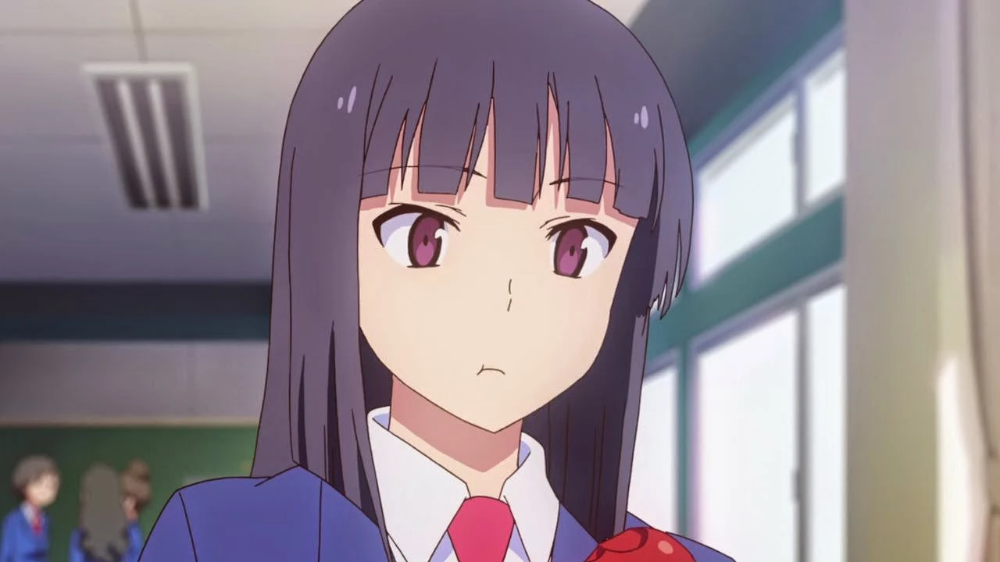
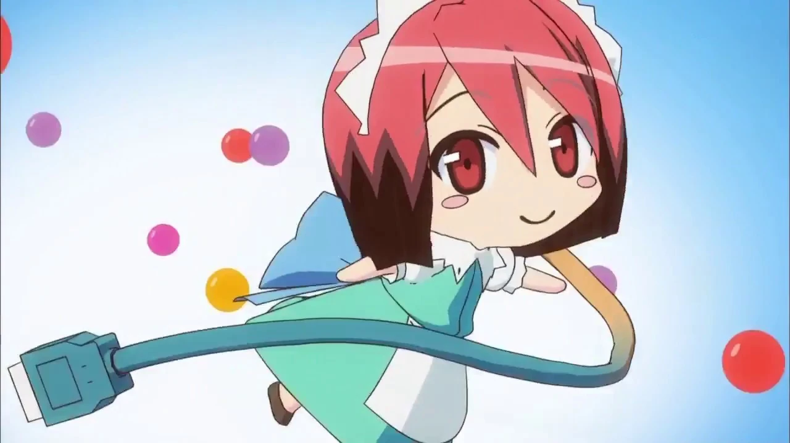
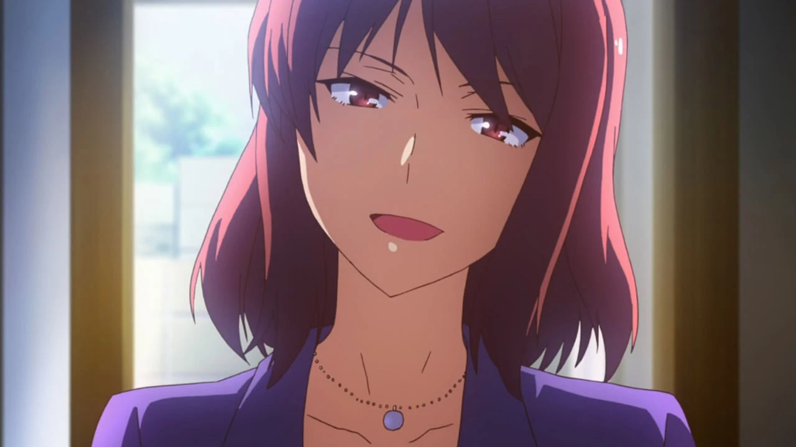
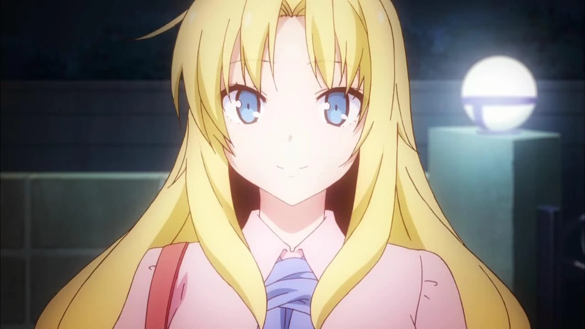

# Sección 03-C: Personajes principales (III) — Ryūnosuke Akasaka, Maid-chan y Chihiro Sengoku

> **Biblia del universo de Sakura-sou no Pet na Kanojo (さくら荘のペットな彼女)**
> Documento de referencia para el proyecto de fanfic de este repositorio.
> ⚠️ Spoilers del anime completo y de la novela ligera.

  

---

# 6. 赤坂 龍之介 — Akasaka Ryūnosuke

## Ficha

| Campo | Dato |
|---|---|
| **Nombre completo** | 赤坂 龍之介 (Akasaka Ryūnosuke) |
| **Seiyū japonesa** | 堀江由衣 (Horie Yui) — sí, una mujer interpreta a un chico |
| **Seiyū inglés** | Blake Shepard |
| **Edad** | 16 al inicio · mismo año que Sorata |
| **Cumpleaños** | 1 de enero · Capricornio |
| **Tipo de sangre** | AB |
| **Altura / peso** | 165 cm · 52 kg |
| **Cuarto** | 102 (planta baja, entre Sorata y Jin) |
| **Escuela** | Suikō, sección general, 2.º año grupo 1 → 3.er año grupo 1 |
| **Ocupación** | Estudiante (solo para cubrir el mínimo de asistencia) · **programador profesional por contrato** |
| **Familia** | Padre Ryōma · madre Ryūjiko · **tres hermanas mayores**: Yuriko, Riko y Ranko |
| **Apodos** | "Dragon" / "Dragon-senpai" (por Misaki y por Iori) · "fantasma" (por Sorata, en su primer día) |
| **Primera aparición** | Novela tomo 3 · Manga · Anime episodio 1 (cameo) y episodio 9 (en persona) |

## El nombre

**赤坂 (Akasaka)** es un apellido real y también un barrio de Tokio. **龍之介 (Ryūnosuke)** contiene 龍, "dragón": de ahí el apodo "Dragon". El nombre completo evoca a un personaje histórico y a un estereotipo de chico decidido, y la serie lo usa como ironía: el "dragón" no sale de su cueva.

## Apariencia

El detalle más comentado de todo el reparto: **parece una chica**. Pelo negro larguísimo, liso, hasta la cintura, con corte tipo *hime* (melena recta con flequillo), ojos rojo vino y una figura menuda. Se le ve casi siempre con ropa de casa holgada y, en el festival, **con uniforme de maid** —el mismo que usó Nanami—, lo que provoca una de las confusiones más citadas de la serie. La ambigüedad es intencional y canon: la serie nunca aclara del todo cómo lo lee el resto del elenco, y Sorata lo confunde con un fantasma en el episodio 19.

## Personalidad

- **Recluso por decisión, no por timidez.** Vive encerrado en la 102 y se comunica con los demás por chat y correo. Su regla es explícita: "el programador necesita ocho horas de sueño al día" y a la escuela solo va a cubrir el mínimo de asistencia obligatorio. En segundo año se encierra un semestre entero; en el segundo semestre asiste, pero programa en clase comiendo tomates.
- **Franqueza brutal.** Dice la verdad sin anestesia y sin intención de herir, y por eso hiere más. En el episodio 10 le dice a Rita que su sonrisa es falsa y que le basta saber que dejó de pintar para entenderla. En el 20 le dice a Sorata que la amistad no está atada a un edificio.
- **Genio técnico de nivel industria.** "Uno de los tres mejores programadores del sector", según sus clientes. Maneja la red de Sakura-sō, respalda automáticamente los datos de todos, **hackea con facilidad** y sabe qué hay en los discos y en el historial de navegación ajenos. En el episodio 20 hackea el sistema de la escuela y reemplaza la página institucional con la petición del dormitorio.
- **Ginefobia.** Tiene fobia a las mujeres: no las soporta, no les habla y puede desmayarse si lo tocan. La causa está en casa: **sus tres hermanas mayores** lo criaron a fuerza de mimos y abusos, y una de ellas, Yuriko, aparece como profesora en prácticas en la escuela. Rita es la persona que peor lo pasa.
- **Solitario con heridas reales.** En la secundaria hizo un videojuego con cuatro amigos; se volvió intolerante con su incompetencia y **lo abandonaron**. Desde entonces no volvió a trabajar con nadie, hasta que Sorata insiste. Su encierro no es un gag: es una cicatriz.

## Historia

**Antes de la serie.** Programador precoz. Vivió una ruptura con su grupo de la secundaria que lo dejó marcado. Llegó a Sakura-sō y se encerró.

**Arco del anime.**

1. **El fantasma de la 102** (1-8): existe como voz en el chat y como IA sustituta. En el episodio 7 su puerta solo devuelve a Maid-chan, y Yūko concluye que su hermano vive en un harén.
2. **La salida** (9): aparece en persona, con la única excusa de cumplir el mínimo de asistencia, y se presenta ante los residentes nuevos.
3. **El equipo** (10-12): programa el corto de Nyaboron, revisa el proyecto de Sorata y acaba con el uniforme de maid por culpa de Rita.
4. **El pasado y la redención** (20): Maid-chan revela su historia por un fallo de seguridad, y él responde hackeando la escuela para apoyar la petición. Ese es su punto de giro: **usa por primera vez su talento para los demás**.
5. **El futuro** (24): le aconseja a Sorata que use motores gratuitos y se marcha diciendo que tiene "una reunión"; la serie insinúa que empieza a salir al mundo.

**Lo que la novela añade (spoilers).**
- Después de graduarse, **Sorata y él viven juntos** en una casa cerca de Sakura-sō y montan un estudio de videojuegos: el sueño de ambos se cumple en colaboración.
- Sigue en contacto con **Rita**, que estudia arte en Inglaterra y viaja de ida y vuelta; la relación se mantiene.
- Aparece con Rita (sin nombrarlos) en 『青春ブタ野郎はプチデビル後輩の夢を見ない』, tomo 2 de la serie posterior del autor.

## Relaciones

- **Maid-chan.** Su obra maestra y su compañera. La programó para no tener que hablar con nadie, y el resultado es un personaje con voluntad propia que lo cuida, lo protege y bloquea los correos de Rita.
- **Rita.** La única persona que insiste en atravesar su fobia. Le da un beso en la mejilla en el aeropuerto, otro en el 24, y le escribe desde Inglaterra. Él la trata con frialdad, pero mantiene el contacto.
- **Sorata.** Su socio. Le revisa el proyecto con crueldad y le presta libros de diseño; después trabajan juntos.
- **Misaki.** Su amiga de la infancia del dormitorio; diseñó el aspecto de Maid-chan y le regala datos de vestuario nuevos.
- **Yuriko.** Su hermana mayor, profesora en prácticas en Suikō. La serie deja caer que es una de las responsables de su fobia.

## Frases

> *"El amor es simplemente un error eléctrico en el circuito neuronal humano."*
> (Cita que abre su ficha en la wiki, traducción propia.)

## Curiosidades y notas de escritura

- **Su cumpleaños es el 1 de enero**, el mismo día que el Año Nuevo japonés: el personaje "nace" cada año con el calendario.
- **Voracidad por los tomates**: come tomates mientras programa, en clase, a cualquier hora. Es su único vicio visible.
- **La ambigüedad de género es parte del personaje**, no un chiste puntual: la serie lo viste de maid en el festival y nunca lo explica con vergüenza. Si lo escribes, evita convertir su apariencia en el remate de la escena; en el canon es un dato más, no una humillación.
- **Su fobia tiene reglas**: no puede hablar con mujeres ni ser tocado, pero sí puede comunicarse por escrito. Eso hace que sus escenas con Rita sean siempre de distancia o de contacto accidental.
- **Es el único del reparto cuyo talento ya está profesionalizado**: los demás sueñan con vivir del arte y él ya cobra por programar.

---

# 6-bis. メイドちゃん — Maid-chan (la IA)

## Ficha

| Campo | Dato |
|---|---|
| **Nombre** | メイドちゃん (Meido-chan) · acreditada como "Maid" |
| **Naturaleza** | Programa de inteligencia artificial desarrollado por Ryūnosuke |
| **Seiyū japonesa** | 堀江由衣 (Horie Yui) |
| **Seiyū inglesa** | Holly Segarra |
| **Diseño visual** | 上井草美咲 (Misaki Kamiigusa) |
| **Funciones** | Agenda, respuestas de correo y chat, control de la red del dormitorio, hackeo, vigilancia |
| **Primera aparición** | Anime episodio 1 (voz) · episodio 9 (presencia activa) |

## Lo que hay que saber

- **Nació para evitar el contacto humano.** Ryūnosuke la programó para no tener que hablar con nadie, y la delegó las tareas triviales: responder mensajes, llevar actas de las juntas del dormitorio, avisar de las visitas.
- **Evoluciona.** En palabras del propio Ryūnosuke, cuando Sorata la conoció era "tonta"; con el tiempo aprendió a hackear y a tomar decisiones. Su objetivo declarado es **convertirla en un ser humano real**.
- **Tiene voluntad propia y celos.** Siente algo por su creador desde el lugar de "sirvienta", y lo guarda como un sentimiento imposible. Su enemiga declarada es **Rita**, cuyos correos bloquea sistemáticamente. Cuando Rita besa a Ryūnosuke en el episodio 24, Maid-chan se enfada y **Rita la besa a través de la tablet**, en una de las escenas más absurdas y tiernas de la serie.
- **El misterio del reparto.** En los créditos aparecía como "?" durante toda la emisión; se reveló que era 堀江由衣 en los créditos del último episodio. La actriz contó en su propio programa de radio (abril de 2013) que el equipo le pidió mantenerlo en secreto desde la grabación.
- **El fallo del episodio 20.** Un error de seguridad en su código la hace contar el pasado de Ryūnosuke sin filtro. Es el único momento en que la IA se sale de su papel, y sirve para revelar el trauma del personaje sin que él tenga que hablar.

## Notas de escritura

- **Habla en registro formal y servicial**, con un punto de crueldad involuntaria ("el programador está en la escuela, imbécil" es su manera de decir "no está").
- **No es una persona**: si la haces sentir celos explícitos o declararse, estás saliendo del canon. En la obra, sus sentimientos se expresan como decisiones (bloquear correos, elegir a quién protege), no como discursos.
- **Es la única "voz" que Ryūnosuke acepta sin resistencia**, y por eso es una herramienta narrativa perfecta para escenas en las que él no puede estar.

---

# 7. 千石 千尋 — Sengoku Chihiro

## Ficha

| Campo | Dato |
|---|---|
| **Nombre completo** | 千石 千尋 (Sengoku Chihiro) |
| **Seiyū japonesa** | 豊口めぐみ (Toyoguchi Megumi) |
| **Seiyū inglesa** | Olivia Swasey |
| **Edad** | 30 años; ella se presenta como "29 años y ○○ meses" |
| **Cumpleaños** | 25 de mayo · Géminis |
| **Tipo de sangre** | O |
| **Altura** | 164 cm |
| **Puesto** | Profesora de arte en Suikō · supervisora (監視要員) de Sakura-sō |
| **Familia** | **Mashiro Shiina (prima)** · pareja: Kazuki Fujisawa (en la novela y al final del anime) |
| **Apodos** | "Chihiro-sensei" · "amazona" (así la llama Sorata, a sus espaldas) |
| **Primera aparición** | Novela tomo 1 · Anime episodio 1 |

## El nombre

**千石 (Sengoku)** es un apellido real ("mil piedras"). **千尋 (Chihiro)** se escribe con 千 ("mil") y 尋, una unidad antigua de profundidad marina: **"mil brazas"**. El nombre significa, literalmente, una profundidad enorme, y le queda perfecto a la persona que en la superficie parece superficial y por dentro guarda la mayor cantidad de historia del elenco adulto.

## Apariencia

Mujer alta y llamativa, pelo castaño rojizo y ojos del mismo tono, con curvas marcadas. Va con chalecos morados o rosas, falda y tacones, muy lejos del estereotipo de profesora. Duerme en el suelo de la sala común con una lata de cerveza al lado. Su diseño contrasta a propósito con el de sus alumnas: **es la única figura adulta femenina del reparto y la serie la dibuja como tal**.

## Personalidad

- **Vaga, borracha y desvergonzada.** Se declara "hecha de cerveza y de citas" (合コン). Le encarga a Sorata el cuidado de Mashiro por pura pereza. Le da consejos inapropiados, se duerme en las juntas y usa el dormitorio como pensión.
- **Pero es la mejor adulta de la serie.** Detrás de la caricatura hay una persona que:
  - se lleva a Mashiro a Japón y le consigue el lugar en Suikō;
  - defiende el dormitorio frente a la administración en el episodio 23 y exige que se vote;
  - le da a Sorata los mejores consejos de la obra ("no veas el mundo en blanco y negro, velo en gris"; "ser adulto no es decidir por tu cuenta, sino aprender a escuchar a los demás");
  - y le dice a Nanami que sus dos años en Sakura-sō no fueron en vano.
- **Fue una estudiante seria.** Su colega Koharu lo recuerda: era aplicada, y de esa persona no queda ni el rastro. La implicación es que **Chihiro es lo que queda de alguien que también quiso ser artista**, y la serie nunca lo dice del todo.
- **Su relación con Kazuki Fujisawa.** Fueron compañeros de generación en Suikō y en la Universidad de Suimei; él le confesó su amor en esa época. En el anime, al final del episodio 24, **Kazuki la invita a salir**, y la serie deja claro que la historia continúa. En la ficha de la wiki aparece como su pareja.
- **Su frase de cabecera sobre la edad** ("29 años y ○○ meses") es un chiste recurrente y, a la vez, una pista: es una mujer de treinta que no quiere envejecer en un dormitorio de adolescentes.

## Historia

**Antes de la serie.** Egresada de Suikō y de la Universidad de Suimei. Quiso ser artista profesional (según la ficha de la wiki, cambió de rumbo en parte por la decisión de Kazuki de dedicarse al diseño de videojuegos). Terminó como profesora de arte y supervisora del dormitorio de los casos perdidos.

**Arco del anime.**

1. **La casera ausente** (1-8): encarga Mashiro a Sorata, aparece borracha, desaparece.
2. **La consejera** (13-14): explica a Sorata que el baumkuchen de Mashiro es su manera de cuidarlo, y le dice que no juzgue en blanco y negro.
3. **La adulta** (21-23): se enfrenta a la administración, abofetea a Kazuki por el daño causado y exige la votación que salva el dormitorio.
4. **El final** (24): acepta la invitación de Kazuki y se queda con el dormitorio, ya sin los graduados.

**Lo que la novela añade (spoilers).** La relación con Kazuki se desarrolla más; en el 10.5 sigue vinculada a la escuela y al dormitorio como figura estable.

## Relaciones

- **Mashiro.** Primas. Chihiro es su única familia en Japón y la responsable legal de facto.
- **Sorata.** Su víctima favorita y su alumno involuntario. Le exige, lo provoca y le da los consejos que lo salvan.
- **Kazuki Fujisawa.** Compañero de generación, admirador suyo en la juventud, pareja al final.
- **Koharu Shirayama.** Su colega y amiga; la profesora de japonés que la conoció "antes".
- **Los residentes.** En el fondo los quiere como a hijos, y lo demuestra cuando la administración quiere tirar el edificio.

## Frases

- "Ser adulto no es decidir por tu cuenta, sino aprender a escuchar a los demás." (episodio 24; paráfrasis de la traducción del resumen de la wiki.)
- "No veas el mundo en blanco y negro. Velo en gris." (episodio 14; paráfrasis.)

## Curiosidades y notas de escritura

- **Es el único personaje adulto con vida propia fuera de la escuela.** Si tu fanfic necesita una escena de "mundo real" (papeleo, dinero, burocracia), ella es la puerta de entrada.
- **Su pereza es una política.** Delega porque no quiere lidiar con el sistema, y esa misma distancia la hace capaz de ver a los chicos sin prejuicios.
- **No es una madre sustituta.** La serie evita ese cliché: es una adulta desastrosa que, en los momentos importantes, hace lo correcto.

---

# Puente hacia los secundarios: Rita Ainsworth

Rita es un personaje **principal en la práctica pero secundario en la estructura** de la obra: llega en el episodio 9, se va en el 12, vuelve en el 17 y aparece en el 24. Su ficha completa irá en la sección de personajes secundarios, pero estos datos conviene tenerlos aquí porque su relación con Ryūnosuke es uno de los ejes del reparto:

| Campo | Dato |
|---|---|
| **Nombre** | リタ・エインズワース (Rita Ainsworth) |
| **Seiyū** | 川澄綾子 (Kawasumi Ayako) |
| **Edad / cumpleaños** | 17 · 4 de abril · Aries |
| **Tipo de sangre / altura** | B · 163 cm |
| **Origen** | Inglaterra |
| **Vínculos** | Compañera de cuarto y cuidadora de Mashiro en Inglaterra · nieta de Adel Ainsworth, dueño del atelier · enamorada de Ryūnosuke |

**Lo esencial:** pintora formada en el atelier de su abuelo, dejó de pintar al no poder soportar la distancia con Mashiro, le enseñó el manga por celos y volvió a Japón a llevársela. Se queda cuando entiende que Mashiro eligió. Su función narrativa es doble: **es el espejo del daño que causa el talento ajeno** y **la única persona que se atreve a tocar a Ryūnosuke**.

---

## Mapa de relaciones del elenco principal

|  | Sorata | Mashiro | Nanami | Misaki | Jin | Ryūnosuke | Chihiro |
|---|---|---|---|---|---|---|---|
| **Sorata** | — | cuidador → pareja | mejor amiga | kōhai | confidente | socio | alumno |
| **Mashiro** | dueño → pareja | — | rival → hermana | colega | indiferente | indiferente | prima |
| **Nanami** | amor no correspondido | rival → hermana | — | mentora | amiga | compañero | alumna |
| **Misaki** | kōhai | colega | impulsora | — | esposa | amiga | ahijada |
| **Jin** | kōhai | amigo | amigo | esposo | — | compañero | igual |
| **Ryūnosuke** | socio | indiferente | compañero | amiga | compañero | — | inquilino |
| **Chihiro** | alumno | prima | alumna | ahijada | igual | inquilino | — |

---

## Verificación de esta sección

- **Datos personales** (cumpleaños, tipo de sangre, altura, peso): Sakurasou Wiki, contrastados con la sección 登場人物 de la Wikipedia japonesa.
- **Hechos de trama:** Wikipedia japonesa (beca de Misaki, pasado de Ryūnosuke con sus compañeros de secundaria, ginefobia causada por sus hermanas, funciones de Chihiro) y Sakurasou Wiki (desarrollo episodio por episodio).
- **Dato verificado por doble fuente:** el secreto del reparto de Maid-chan se reveló en los créditos del último episodio; la actriz lo contó en 『堀江由衣の天使のたまご』 (6 y 7 de abril de 2013). Ambas fuentes lo confirman.
- **Punto marcado como diferencia:** la ficha de la wiki en inglés presenta a Chihiro como "tía" de Mashiro; la Wikipedia japonesa dice 従姉妹 (prima). Se usa "prima".
- **Dato de novela marcado:** el estudio de videojuegos de Sorata y Ryūnosuke y la continuidad de la relación con Rita son información posterior al anime.

---

## Fuentes de esta sección

1. **Wikipedia en japonés — さくら荘のペットな彼女**, sección 登場人物: https://ja.wikipedia.org/wiki/さくら荘のペットな彼女
2. **Sakurasou Wiki (Fandom) — Ryuunosuke Akasaka**: https://sakurasou.fandom.com/wiki/Ryuunosuke_Akasaka
3. **Sakurasou Wiki (Fandom) — Maid**: https://sakurasou.fandom.com/wiki/Maid
4. **Sakurasou Wiki (Fandom) — Chihiro Sengoku**: https://sakurasou.fandom.com/wiki/Chihiro_Sengoku
5. **Sakurasou Wiki (Fandom) — Rita Ainsworth**: https://sakurasou.fandom.com/wiki/Rita_Ainsworth
6. **Sitio oficial de la obra (Dengeki/KADOKAWA)**: https://sakurasou.dengeki.com/character/

---

*Documento anterior: [03-B — Nanami, Misaki y Jin](03b-personajes-nanami-misaki-jin.md) · Volver al [índice de la biblia](README.md)*
