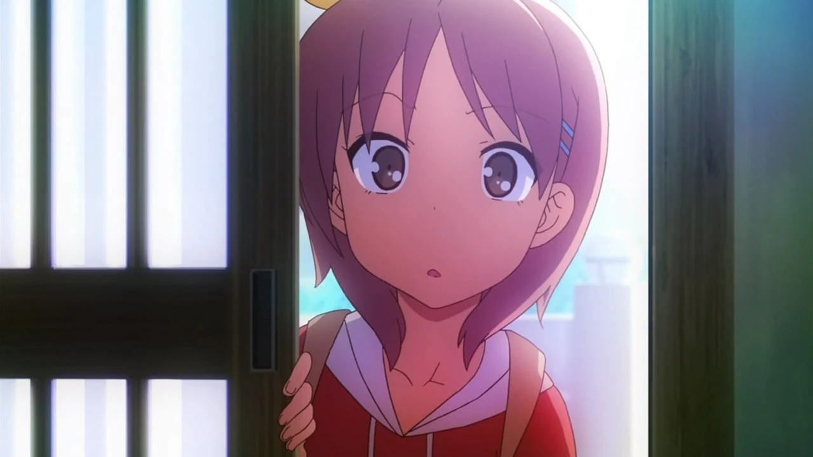
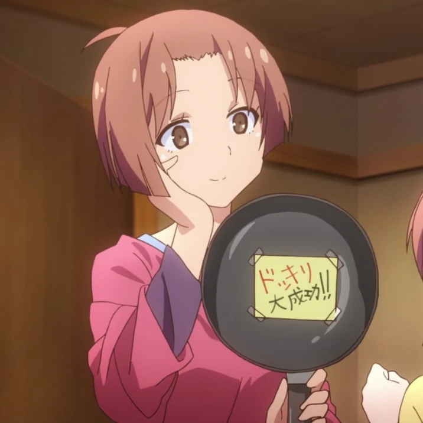
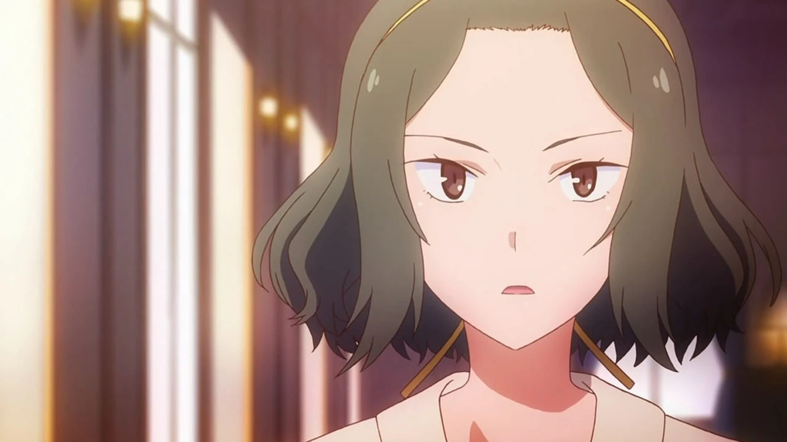
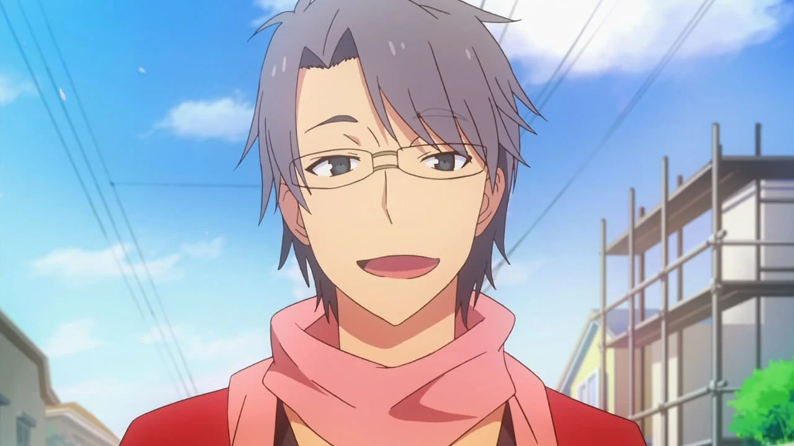
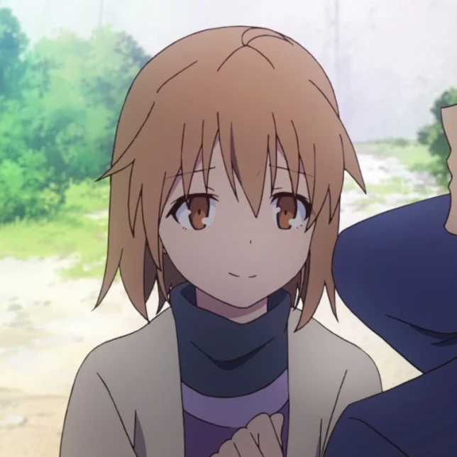

# Sección 04-A: Personajes secundarios (I) — La familia Kanda y los adultos del mundo creativo

> **Biblia del universo de Sakura-sou no Pet na Kanojo (さくら荘のペットな彼女)**
> Documento de referencia para el proyecto de fanfic de este repositorio.
> ⚠️ Spoilers del anime y de la novela ligera.

  

---

## Cómo se organizó esta sección

Los secundarios de esta obra se dividen en cuatro círculos, y los repartimos en tres documentos:

| Documento | Círculo | Personajes |
|---|---|---|
| **04-A** (este) | Familia y mundo profesional | Yūko, Akiko, el padre Kanda, Ayano Iida, Kazuki Fujisawa, Fūka Kamiigusa |
| 04-B | Escuela y vida cotidiana | Daichi Miyahara, Mayu Takasaki, Yayoi Honjō, Sōichirō Tatebayashi, Saori Himemiya, Shiho Fukaya, Koharu Shirayama, Shiori Nanba, Momoko, Noriko |
| 04-C | Residentes nuevos y familia Akasaka | Kanna Hase, Iori Himemiya, Rita Ainsworth, Yuriko Akasaka, Otoha Nakano, Maya Ikejiri y Takumi Komazawa |

**Criterio de selección:** aparece quien tiene nombre en pantalla y al menos una escena con función narrativa. No incluimos extras sin nombre ni personajes que solo existen en los videojuegos y nunca aparecen en el anime.

---

# 1. 神田 優子 — Kanda Yūko

## Ficha

| Campo | Dato |
|---|---|
| **Nombre** | 神田 優子 (Kanda Yūko) |
| **Seiyū** | 小倉唯 (Ogura Yui) · inglés: Brittney Karbowski |
| **Edad** | 13-14 años (tercero de secundaria) |
| **Cumpleaños** | 1 de julio · Cáncer |
| **Tipo de sangre** | B |
| **Familia** | Sorata (hermano mayor), Akiko (madre), padre sin nombre |
| **Escuela** | Secundaria → **Suikō, sección general, 1.er año grupo 3** |
| **Primera aparición** | Anime episodio 7 · Novela tomo 3 |
| **Papel** | Hermana menor de Sorata; comic relief familiar y espejo de la inmadurez del protagonista |

## Quién es

Yūko es la hermana pequeña de Sorata y la única persona de la serie que lo trata sin ningún respeto. Llega a Sakura-sō en el episodio 7 diciendo que viene a pedir consejo sobre la preparatoria; la verdad —que confiesa a media conversación— es que **solo quería ver a su hermano**. La serie la presenta en la peor escena posible: abre la puerta y ve a Sorata persiguiendo a Mashiro desnuda por el pasillo, con la explicación más absurda posible (resbaló con una cáscara de plátano "puesta por los dioses").

## Personalidad

- **Complejo de hermano mayor en versión adolescente.** Es un *brocon* de manual: celosa, possessiva y incapable de aceptar que su hermano haga su vida. Cuando Mashiro dice que Sorata es su "dueño", Yūko no pregunta, deduce lo peor. Cuando Nanami dice que Sorata "la ayuda mucho", deduce lo peor otra vez.
- **Complejo físico declarado.** Su cuerpo parece el de una niña de primaria; Mashiro la llama **"enana" (ドワーフ, *dwarf*)** y ella se ofende como si le hubieran insultado a la familia. En el episodio 7, en el baño público, la serie hace comedia con su comparación con Mashiro y Nanami, y con su intento de compensar.
- **Es mucho más lista de lo que aparenta.** El "consejo sobre la preparatoria" era una excusa, y cuando decide algo lo persigue en serio: estudia, se presenta al examen de Suikō y vuelve con una meta.
- **Fan accidental de la manga de Mashiro.** Lee la serie sin saber quién la escribe, y cuando lo descubre pasa de tratarla como una intrusa a pedirle un autógrafo en el mismo minuto. Es la primera prueba pública de que la obra de Mashiro funciona.
- **La más honesta del elenco familiar.** Le dice a Sorata en el episodio 16 que debería haberse fijado en Nanami y no en Mashiro. Nadie más se atreve a decírselo.

## Arco

1. **Episodio 7:** llega de Fukuoka, provoca el caos y anuncia que quiere estudiar en Suikō.
2. **Episodio 15:** recibe a Sorata y a las tres chicas en casa de los Kanda con horror; se entera de que sus padres ya sabían. Declara que quien quiera casarse con Sorata tendrá que derrotarla primero, y **Mashiro se lo toma literal**.
3. **Episodio 16:** se va después del examen, le regala chocolates a Sorata y le recuerda que no sea indeciso.
4. **Episodio 18:** Sorata consulta los resultados y **lee el número equivocado** (busca el 99 cuando el de su hermana es el 66), así que todos creen que reprobó.
5. **Episodio 24:** aparece como **nueva residente de Sakura-sō**. Sí aprobó, y fue la sorpresa que le preparó a su hermano.

## Relaciones

- **Sorata:** el centro de su universo. Lo trata como a un niño grande y lo defiende de cualquiera, incluso de sí mismo.
- **Mashiro:** empieza odiándola por instinto y termina admirándola como autora.
- **Nanami:** la única a la que **no** reconoce como rival, aunque sea la verdadera competencia.
- **Akiko (madre):** su cómplice y su opresora; la madre la adora y la hija lo sabe.

## Notas de escritura

- **Su voz es rápida, aguda y quejumbrosa.** Interrumpe, grita, se indigna. Si la haces reflexiva, deja de ser Yūko.
- **El detalle del examen (99/66)** es el mejor ejemplo del método de Kamoshida: un chiste sobre números que se convierte en un giro emocional en el último episodio.

---

# 2. 神田 明子 — Kanda Akiko

## Ficha

| Campo | Dato |
|---|---|
| **Nombre** | 神田 明子 (Kanda Akiko) |
| **Seiyū** | 新井里美 (Arai Satomi) · inglés: Nastasia Marquez |
| **Edad** | 38 |
| **Cumpleaños** | 13 de mayo · Tauro |
| **Tipo de sangre** | A |
| **Ocupación** | Ama de casa |
| **Familia** | Esposo (el señor Kanda), Sorata, Yūko |
| **Primera aparición** | Episodio 7 (solo voz) · episodio 15 (en pantalla) |

## Quién es

La madre de Sorata. Aparece por teléfono en el episodio 7 y en persona en el 15, cuando el dormitorio cierra por Año Nuevo y los cuatro chicos se instalan en su casa de Fukuoka. Su función narrativa es doble: **es el contrapunto doméstico del caos de Sakura-sō** y **la que suelta las verdades incómodas con una sonrisa**.

## Personalidad

- **Siempre sonríe.** Sorata dice que nunca le ha visto cara de enojo, y también recuerda haber visto a su padre haciendo *dogeza* (arrodillarse en el suelo) frente a ella mientras sonreía. La serie Codifica el arquetipo de "madre peligrosa por amable".
- **Habla de más, en el mejor sentido.** Frente a Mashiro, Yūko y Sorata suelta que **"encontró una buena futura esposa"** señalando a Nanami, y deja a los tres petrificados. No es maldad: es la falta de filtro de quien ya no tiene nada que perder.
- **Tiene el pelo a lo *bob* (おかっぱ)**, un detalle que la dibuja como mujer práctica, alejada de cualquier coquetería.

## Detalles y curiosidades

- **Su aparición en el episodio 7 es solo de voz**: Sorata la llama y habla con ella por teléfono. Ese tipo de economías (presentar a un personaje por audio antes de mostrarlo) es habitual en la serie.
- **Reconoce el mérito de Nanami al instante.** Es la primera adulta que ve la química entre los dos, mucho antes de que Sorata se entere.

---

# 3. 神田の父 — El padre de Sorata (sin nombre)

## Ficha

| Campo | Dato |
|---|---|
| **Nombre** | Nunca se dice en la obra; los créditos lo llaman 空太の父 ("el padre de Sorata") |
| **Seiyū** | 大川透 (Ōkawa Tōru) |
| **Familia** | Akiko (esposa), Sorata, Yūko |
| **Primera aparición** | Episodio 15 |
| **Papel** | La autoridad paterna y el único adulto que le dice a Sorata la verdad sin adornos |

## Quién es

Un hombre de mediana edad, de pocas palabras y muchas convicciones, que aparece en el episodio 15 en la escena del baño: uno de los momentos más citados de la serie y **el más honesto que Sorata recibe de un adulto**.

## Personalidad y función

- **Es terco en cosas pequeñas y comprensivo en las grandes.** Se niega a dejar que Yūko se vaya a estudiar a Suikō... hasta que ella aprueba. Con Sorata hace lo contrario: lo dejó irse a Tokio porque "estuviera o no estuviera, su soledad no cambiaba".
- **Rechaza la poligamia**, dice en la cena, en referencia a que su hijo llegó con tres chicas. Es el gag que rompe el hielo y, a la vez, la primera vez que un adulto le pone a Sorata un espejo delante.
- **La escena del baño.** Le dice a Sorata que **deje de ser indeciso y viva como quiera**, y que él permitirá que Yūko se presente al examen si aprueba, aunque ninguno de los dos cree que lo logre. Es la frase que Sorata necesita oír y la que sostiene su decisión de seguir en Sakura-sō.

## Notas de escritura

- **Es el modelo de padre japonés clásico**: proveedor, distante y tierno en privado. La serie lo usa para una sola escena, y es suficiente.
- **El baño (ofuro)** es un lugar de confesiones en la ficción japonesa: úsalo si necesitas una conversación sincera entre dos hombres.

---

# 4. 飯田 綾乃 — Iida Ayano

## Ficha

| Campo | Dato |
|---|---|
| **Nombre** | 飯田 綾乃 (Iida Ayano) |
| **Seiyū** | 浅野真澄 (Asano Masumi) · inglés: Shelley Calene-Black |
| **Edad** | 35 |
| **Altura** | 164 cm |
| **Ocupación** | Editora de manga profesional, a cargo de Mashiro |
| **Familia** | Esposo sin nombre |
| **Vínculos** | Amiga de Rita Ainsworth |
| **Primera aparición** | Anime episodio 2 · Novela tomo 1 |

## Quién es

La editora que le consigue a Mashiro su debut como mangaka. Aparece en el episodio 2 esperando a Mashiro en la puerta de la escuela, y desde ahí se convierte en **la voz del mundo profesional dentro de la serie**: la que habla de fechas de entrega, de premios, de cambios y de ventas.

## Personalidad

- **Enérgica, ruidosa y profesional.** Habla rápido, se entusiasma y no tiene ningún problema en decir las cosas como son. Es el tipo de adulto que la serie usa para bajar a los personajes a la tierra.
- **Extremadamente golosa.** Su rasgo más citado: le encanta lo dulce, pero **le pone sal a los postres antes de comerlos** ("le gusta lo dulce y lo salado a la vez", según la Wikipedia japonesa). En el episodio 2 aparece comprando dos baumkuchen sabiendo que Mashiro muere por uno.
- **Sabe separar la obra de la persona.** En el episodio 4 le dice a Sorata, sin rodeos, que la manga de Mashiro es excelente pero **el final no funciona**, y que si lo cambia podría publicarse. No la consuela: le da información.
- **Es quien explica el contexto de Mashiro.** En el episodio 13 le dice a Sorata que Mashiro está pasando de chica "genio" a chica "normal", y le pregunta cuál prefiere, advirtiendo que **en cualquier caso sigue siendo Mashiro**.

## Función narrativa

Ayano es el **termómetro del talento de Mashiro**: cada vez que aparece, la serie actualiza el estado de su carrera (concurso perdido, correcciones, debut, portada, serialización). Si tu fanfic necesita que Mashiro reciba noticias profesionales, ella es la mensajera natural.

## Notas de escritura

- **No es una antagonista.** Su dureza es profesional, no personal; la serie nunca la convierte en villana.
- **Su relación con Rita** se menciona en la ficha oficial: son amigas, lo que explica que Rita conozca los entresijos de la carrera de Mashiro.

---

# 5. 藤沢 和希 — Fujisawa Kazuki

## Ficha

| Campo | Dato |
|---|---|
| **Nombre** | 藤沢 和希 (Fujisawa Kazuki) |
| **Seiyū** | 浅沼晋太郎 (Asanuma Shintarō) · inglés: Heath Morrow |
| **Edad** | 33 |
| **Ocupación** | Diseñador de videojuegos y presidente de su propia empresa |
| **Vínculos** | Ex residente de Sakura-sō · compañero de generación de Chihiro Sengoku · **pareja de Chihiro** |
| **Primera aparición** | Episodio 2 (cameo) · episodio 8 (en persona) |

## Quién es

El único adulto del reparto que ya **hizo** lo que Sorata quiere hacer. En su época de estudiante creó un videojuego que fue un éxito enorme, fundó una compañía y hoy es uno de los jueces del concurso al que Sorata se presenta. También vivió en Sakura-sō, y se revela en el episodio 16 que **fue compañero de clase de Chihiro** (y que ella le gustaba).

## Personalidad

- **Sincero hasta la crueldad.** En el episodio 8, en plena presentación de Sorata, le hace la pregunta que el chico no puede contestar y con eso lo elimina. En el 16 le explica, con números, por qué su juego no se puede producir: 100 millones de yenes de inversión, 45 000 copias para recuperar, y una previsión de 10 000 ventas.
- **No es un ogro: es un realista que ayuda.** Lo rechaza dos veces y las dos veces le ofrece algo: primero una reunión para pulir el concepto, después una charla de mentor. Su frase clave, que la wiki recoge como cita del personaje: *"A veces tu futuro ya está decidido y no puedes hacer nada. Hay cosas que no puedes cambiar por mucho que te esfuerces. Es injusto, ¿no? No es fácil aceptarlo, y no te digo que lo aceptes, pero así es la vida. Injusta."*
- **Da el mejor consejo técnico de la serie.** En el episodio 20, cuando Sorata no sabe si elegir a Mashiro o su carrera, Kazuki le dice que **si no puede elegir entre dos cosas, puede no elegir ninguna y hacer que ambas pasen**. Es la frase que desbloquea el final.
- **Su historia con Chihiro.** Fueron compañeros, él le confesó su amor en la época escolar y la relación quedó en pausa durante años. En el episodio 24, **la invita a salir** y Chihiro acepta.

## Función narrativa

Es el **espejo adulto de Sorata**: lo que le pasa si persevera, y también lo que le costó (Chihiro, Sakura-sō, los años). Y es el puente entre el mundo escolar y la industria.

## Notas de escritura

- **Su tono es tranquilo y algo cansado**, como el de alguien que ya perdió varias veces y aprendió a decirlo sin drama.
- **No miente sobre el mercado.** Si tu fanfic le hace prometer a Sorata que triunfará, estarás contradiciendo su función.

---

# 6. 上井草 風香 — Kamiigusa Fūka

## Ficha

| Campo | Dato |
|---|---|
| **Nombre** | 上井草 風香 (Kamiigusa Fūka) |
| **Seiyū** | 早見沙織 (Hayami Saori) · inglés: Kira Vincent-Davis |
| **Edad** | 24 |
| **Cumpleaños** | 8 de agosto · Leo |
| **Tipo de sangre** | A |
| **Altura** | 164 cm |
| **Ocupación** | Estudiante universitaria · artista |
| **Familia** | **Misaki (hermana menor)** |
| **Vínculos** | Primer amor y exnovia de Jin Mitaka |
| **Primera aparición** | Episodio 11 |

## Quién es

La hermana mayor de Misaki y el primer amor de Jin. Aparece un solo episodio, y basta para explicar **toda la conducta de Jin durante la serie**.

## Personalidad y papel

- **Es el reverso exacto de su hermana.** Se parecen físicamente (la serie lo subraya: "una Misaki un poco mayor"), pero Fūka es tranquila, contenida y educada. Donde Misaki grita, Fūka mide las palabras.
- **Fue la novia que Jin usó sin querer.** Él la quiso de verdad, pero sobre todo la usó como puente para estar cerca de Misaki. Cuando Fūka lo entendió, la ruptura fue dura. En el episodio 11 le pide una segunda oportunidad, Jin dice que no le interesa, y ella responde **"era broma"**, con una sonrisa que no le llega a los ojos.
- **Su función es cerrar un hilo y abrir otro.** Con su aparición, la serie explica por qué Jin no puede estar con Misaki (miedo, culpa, comparación) y por qué Misaki siente celos de alguien que ya no está en la ecuación.
- **Es la que informa sin querer.** Es en esa conversación donde **Misaki escucha que Jin se va a Osaka**, el detonante emocional del episodio.

## Notas de escritura

- **No es una villana**: es la prueba de que Jin también fue un cobarde con otras personas.
- **Su edad (24) la sitúa fuera del mundo escolar**, así que sus escenas tienen otro registro: más pausado, más adulto.

---

## Mapa de este círculo

| Personaje | Función | Qué aporta al universo |
|---|---|---|
| **Yūko** | Hermana | Comedia familiar y prueba de que Sorata tiene raíces |
| **Akiko** | Madre | Verdad doméstica sin filtro |
| **Padre Kanda** | Autoridad | El consejo que desbloquea al protagonista |
| **Ayano** | Editora | El mundo profesional del manga |
| **Kazuki** | Mentor/juez | El mundo profesional del videojuego |
| **Fūka** | Ex | El pasado que explica a Jin |

---

## Verificación de esta sección

- **Datos personales** (cumpleaños, tipo de sangre, edades, alturas): fichas de la Sakurasou Wiki, contrastadas con la sección 登場人物 de la Wikipedia japonesa.
- **Hechos de trama:** Wikipedia japonesa (relación de Chihiro con Kazuki, la afición de Ayano por lo dulce y salado, la familia Kanda) y Sakurasou Wiki (apariciones por episodio).
- **Dato comprobado doblemente:** el punto del examen de Yūko. La Wikipedia japonesa sitúa a Yūko en 1.er año grupo 3 y la wiki en inglés documenta que Sorata consultó el número equivocado (99 en lugar de 66), que es lo que se ve en el episodio 24.
- **Punto marcado como dato de fandom secundario:** la ficha de Kazuki en la wiki en inglés menciona que tras el anime se muda a California. Ese dato **no está en el anime** y no se ha podido verificar en la Wikipedia japonesa, así que no se usa en el cuerpo del documento.
- **Nombre del padre de Sorata:** la obra no lo da. Se indica expresamente para que no se invente uno.

---

## Fuentes de esta sección

1. **Wikipedia en japonés — さくら荘のペットな彼女**, sección 登場人物 (神田家, 飯田綾乃, 藤沢和希, 上井草風香): https://ja.wikipedia.org/wiki/さくら荘のペットな彼女
2. **Sakurasou Wiki (Fandom) — Yuuko Kanda**: https://sakurasou.fandom.com/wiki/Yuuko_Kanda
3. **Sakurasou Wiki (Fandom) — Akiko Kanda**: https://sakurasou.fandom.com/wiki/Akiko_Kanda
4. **Sakurasou Wiki (Fandom) — Ayano Iida**: https://sakurasou.fandom.com/wiki/Ayano_Iida
5. **Sakurasou Wiki (Fandom) — Kazuki Fujisawa**: https://sakurasou.fandom.com/wiki/Kazuki_Fujisawa
6. **Sakurasou Wiki (Fandom) — Fuuka Kamiigusa**: https://sakurasou.fandom.com/wiki/Fuuka_Kamiigusa
7. **Sitio oficial (Dengeki/KADOKAWA)**: https://sakurasou.dengeki.com/character/

---

*Siguiente documento: [04-B — Compañeros de escuela y vida cotidiana](04b-secundarios-escuela.md)*
