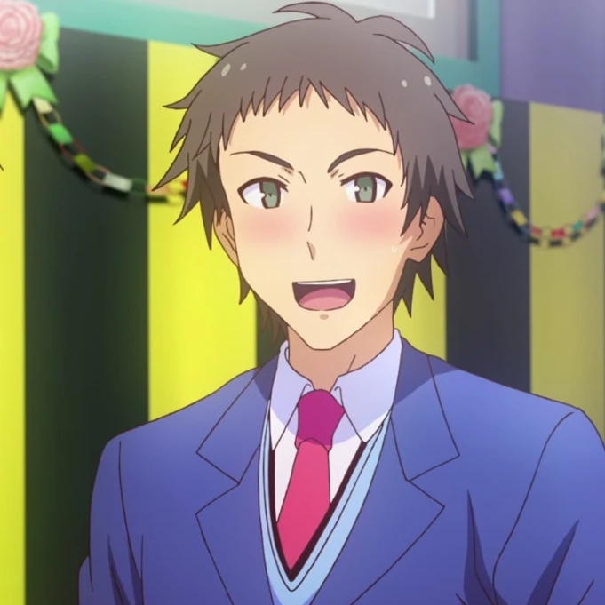
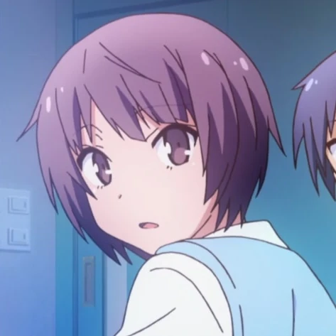
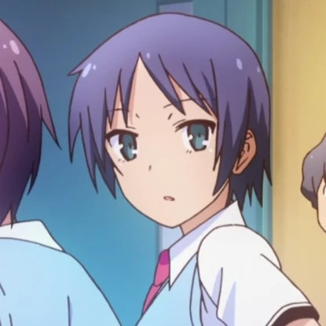
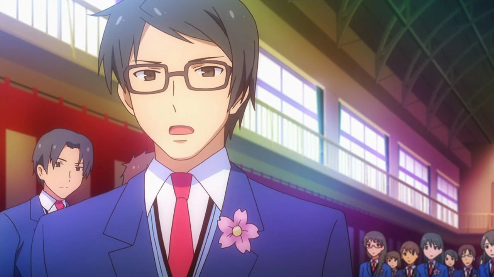
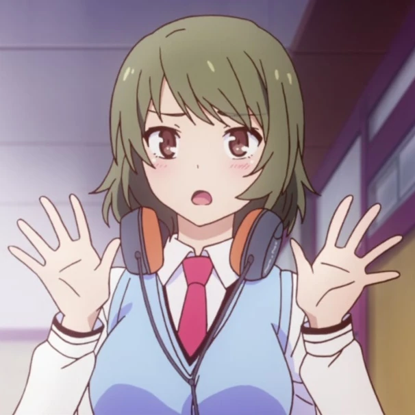
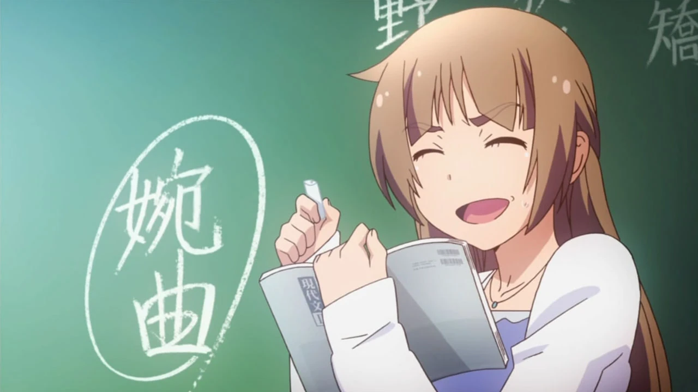
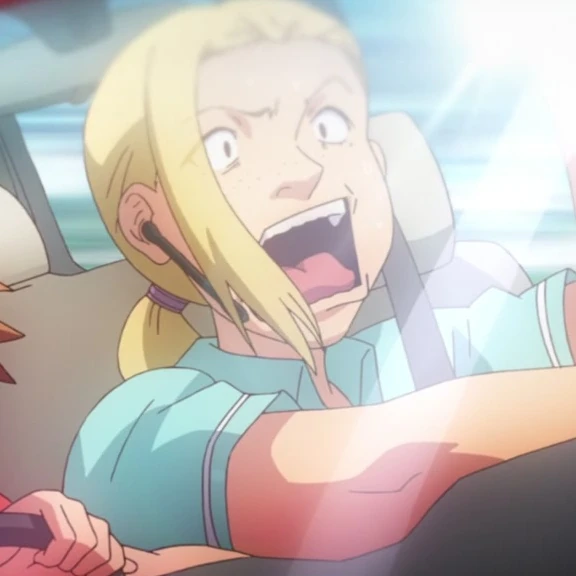
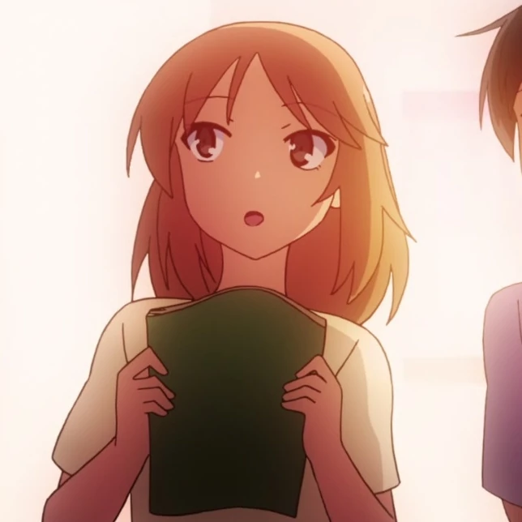

# Sección 04-B: Personajes secundarios (II) — Escuela, aula y vida cotidiana

> **Biblia del universo de Sakura-sou no Pet na Kanojo (さくら荘のペットな彼女)**
> Documento de referencia para el proyecto de fanfic de este repositorio.
> ⚠️ Spoilers del anime y de la novela ligera.

  

---

## Lo que representa este círculo

Los personajes de este documento son **el mundo "normal"** contra el que se mide Sakura-sō: compañeros de clase, el consejo estudiantil, profesores y gente de la calle. Su función no es tener arcos propios, sino **poner a prueba la normalidad del protagonista** y dar textura al día a día de Suikō.

---

# 1. 宮原 大地 — Miyahara Daichi

## Ficha

| Campo | Dato |
|---|---|
| **Nombre** | 宮原 大地 (Miyahara Daichi) |
| **Seiyū** | 村田太志 (Murata Taishi) · inglés: Adam Gibbs |
| **Edad** | 18 |
| **Escuela** | Suikō, sección general · después, **Universidad de Suimei** (comité del festival cultural) |
| **Ocupación** | Estudiante · miembro del club de natación |
| **Primera aparición** | Anime episodio 1 · Novela tomo 1 |
| **Papel** | Mejor amigo de Sorata, excompañero de cuarto, rival silencioso en el amor |

## Quién es

El amigo de la infancia escolar de Sorata y su compañero de cuarto en el dormitorio general, antes del exilio a Sakura-sō. Es el típico amigo leal que la serie usa para dos cosas: **normalizar a Sorata** (si él lo considera normal, es que lo es) y **demostrar que el amor no correspondido no vuelve mezquina a la gente**.

**Un detalle de continuidad:** en la novela, Miyahara está en la clase de al lado; en el anime, los guionistas lo pusieron **en la misma clase** de Sorata y Nanami. Es uno de los cambios de adaptación más citados, y sirve para tenerlo siempre en pantalla.

## Personalidad

- **Físico imponente, interior infantil.** La Wikipedia japonesa lo describe como delgado, musculoso y alto, con una presencia que impone, y a la vez **con un carácter infantil**. La serie explota ese contraste: es el que se ofrece a cargar cosas, el que se emociona con nada y el que se queda mirando cuando hay conflicto.
- **Fue cómplice del delito fundacional.** Él y Nanami escondieron a los gatos que Sorata recogió. Es decir: **sin Miyahara, Sorata no habría acabado en Sakura-sō**. Ese detalle lo convierte en co-responsable del inicio de toda la historia.
- **Le gusta Nanami y lo dice cuando toca.** No lo insinúa durante veinte episodios: se le declara en el episodio 12, en pleno festival cultural, y **ella lo rechaza**. Él no se victimiza, no se aleja y sigue siendo el mismo amigo hasta el final.
- **Generosidad en el episodio 17.** Cuando Sorata necesita llegar a la estación para alcanzar a Nanami, Miyahara le presta la bicicleta y **pedalea él cuesta arriba** para llevarlo. Al llegar arriba se la cede: "sigue tú, porque a ti te llamó". Es la forma más limpia de cerrar su personaje.

## Función narrativa

Es el **barómetro de lo que Sorata podría haber sido**: un chico normal, con amigos normales, sin genios alrededor. Y es la prueba de que la serie no castiga a los personajes secundarios por no ser genios: Miyahara termina siendo una buena persona, sin más.

## Notas de escritura

- **Su lenguaje es directo y algo torpe.** No usa metáforas.
- **Es el único del reparto que confiesa y es rechazado sin drama.** Si necesitas una escena de amistad sin segundas intenciones, es él.

---

# 2. 高崎 繭 — Takasaki Mayu

## Ficha

| Campo | Dato |
|---|---|
| **Nombre** | 高崎 繭 (Takasaki Mayu) |
| **Seiyū** | 久保ユリカ (Kubo Yurika) · inglés: Avery Smithhart |
| **Escuela** | Suikō, sección general, 2.º año grupo 1 → 3.er año grupo 1 (la clase de Sorata y Nanami) |
| **Primera aparición** | Anime episodio 1 · Novela tomo 1 |

## Quién es

Compañera de clase de Sorata y Nanami, y una de las dos amigas de Nanami en el aula. Es menuda, con cara de niña y pelo a la altura de la barbilla, y **vive acomplejada por parecer más chica de lo que es**.

## Personalidad

- **Mitad amiga, mitad casamentera.** Es la que anima a Nanami a declararse "por diversión" y la que comenta en voz alta cada vez que Sorata y Nanami están juntos. Su motivación es la curiosidad, no la maldad.
- **Coqueta y algo metiche.** La Wikipedia japonesa la describe como presumida y aficionada al chisme (見栄っ張りで野次馬っぽい性格). Es la que pone el comentario incómodo en la mesa y luego se hace la inocente.
- **Su complejo la hace vulnerable.** Igual que Yūko, se compara con las demás por su cuerpo y su altura; la diferencia es que Mayu lo esconde con humor y ropa.

## Función narrativa

Es la **voz del grupo social** que rodea a Nanami: la que convierte el silencio de su amiga en tema de conversación. Sin Mayu y Yayoi, la timidez de Nanami no tendría testigos.

---

# 3. 本庄 やよい — Honjō Yayoi

## Ficha

| Campo | Dato |
|---|---|
| **Nombre** | 本庄 やよい (Honjō Yayoi) |
| **Seiyū** | 内山夕実 (Uchiyama Yumi) · inglés: Kira Vincent-Davis |
| **Altura** | **175 cm** (la más alta del reparto femenino) |
| **Escuela** | Suikō, sección general, la clase de Sorata y Nanami |
| **Ocupación** | Estudiante · club de softbol |
| **Primera aparición** | Anime episodio 1 |

## Quién es

La otra amiga de Nanami. Alta, deportista y con novio, es la contraparte serena de Mayu.

## Personalidad

- **Es la que hace los *tsukkomi* tranquilos.** Mientras Mayu se emociona, Yayoi pone el comentario seco y exacto. La serie la usa como válvula de humor inteligente dentro del aula.
- **Le encantan los carbohidratos** y no engorda: la Wikipedia japonesa lo apunta como su rasgo gastronómico ("le gusta comer carbohidratos, pero no está gorda"). Es el tipo de detalle que solo sirve para hacer verosímil a un personaje de fondo.
- **Tiene novio**, y eso la convierte en la única del grupo de Nanami con experiencia romántica, lo que la faculta para opinar sobre el tema.

## Notas de escritura

- **Su altura (175 cm) es un dato de caracterización**: la serie la dibuja al lado de Mashiro (162) y Nanami (158), y la diferencia es visible en los planos de grupo del aula.

---

# 4. 舘林 総一郎 — Tatebayashi Sōichirō

## Ficha

| Campo | Dato |
|---|---|
| **Nombre** | 舘林 総一郎 (Tatebayashi Sōichirō) |
| **Seiyū** | 日野聡 (Hino Satoshi) · inglés: Mike Haimoto |
| **Cumpleaños** | 27 de junio · Cáncer |
| **Escuela** | Suikō, 3.er año → **Universidad de Suimei, Facultad de Radiodifusión (放送学部)** |
| **Puesto** | Presidente del consejo estudiantil de Suikō |
| **Pareja** | Saori Himemiya |
| **Primera aparición** | Anime episodio 10 |

## Quién es

El presidente del consejo estudiantil y, durante tres años consecutivos, compañero de clase de Jin. La serie lo presenta como el adversario burocrático de Sakura-sō y lo convierte, sin avisar, en su aliado más útil.

## Personalidad

- **Rígido, formal y fundamentalmente honesto.** Es el que exige una presentación al dormitorio para autorizar su proyección en el festival (episodio 10) y el que, en el 23, recuerda al director que **Sakura-sō fue fundado para cultivar el talento artístico sin la mirada crítica de la sociedad**.
- **Su tensión con Jin es afecto mal expresado.** Le dice cosas duras sobre irse a Osaka y dejar a Misaki, y lo hace porque le importa. La Wikipedia japonesa lo dice sin rodeos: es torpe y serio, lo contrario de Jin, y en el fondo **envidia a los residentes de Sakura-sō**; por eso los apoya en los momentos decisivos.
- **Es el novio romántico del elenco adulto.** Se enamoró de Saori al escucharla tocar el piano en el festival de primer año, tardó **un año y medio** en confesarse y al final le propuso matrimonio. (Ese último dato pertenece a la serie posterior del autor, 『青春ブタ野郎』 tomo 4, donde aparece aceptando la propuesta.)

## Función narrativa

Es la **institución humanizada**: el obstáculo que resulta ser una persona. Cuando la serie necesita que el sistema se comporte con decencia, lo pone a él en el micrófono.

## Notas de escritura

- **Habla en registro formal incluso cuando está incómodo.** Si lo escribes relajado, pierde el personaje.
- **Es el único personaje que cambia de bando con argumentos**, no por una revelación emocional.

---

# 5. 姫宮 沙織 — Himemiya Saori

## Ficha

| Campo | Dato |
|---|---|
| **Nombre** | 姫宮 沙織 (Himemiya Saori) |
| **Seiyū** | 藤村歩 (Fujimura Ayumi) · inglés: Mai Le |
| **Edad** | 19 |
| **Cumpleaños** | 7 de enero · Capricornio |
| **Tipo de sangre** | B |
| **Escuela** | Suikō, 音楽科 (música), 3.er año → estudios en **Austria** |
| **Ocupación** | Pianista · responsable de sonido en las producciones de Misaki |
| **Familia** | **Iori (hermano menor)** |
| **Pareja** | Tatebayashi Sōichirō |
| **Primera aparición** | Anime episodio 10 |

## Quién es

La novia del presidente del consejo, pianista de la sección de música y colaboradora musical de los proyectos de Misaki. Aparece por primera vez en el episodio 10, presentada junto a Tatebayashi, y su aporte real llega en el 23, cuando toca el piano de 「今日の日はさようなら」 en la graduación.

## Personalidad y detalles

- **Su apodo nace de unos audífonos.** Misaki la llama **"Hau-nyan" / "Hauhau"** por la marca impresa en sus audífonos (HAUHAU), apodo que Saori detesta y que la lleva a cambiarse a otra marca. Es uno de los chistes más tontos y más citados de la serie.
- **Es la adulta joven del grupo.** Con 19 años está un curso por encima de los protagonistas, y su relación con Tatebayashi es la única pareja consolidada del elenco escolar.
- **Su futuro está fuera de Japón.** La Wikipedia japonesa confirma que **decide estudiar en Austria** tras graduarse, y que incluso vuelve brevemente para ver el concurso de piano de su hermano.
- **Su relación con Iori** explica media ficha del chico: el complejo de hermano menor frente a una hermana brillante, y los audífonos que él lleva con orgullo porque se los regaló ella.

## Notas de escritura

- **Habla poco y con educación.** Su presencia es musical, no verbal: cuando aparece, suele haber un piano cerca.

---

# 6. 深谷 志穂 — Fukaya Shiho

## Ficha

| Campo | Dato |
|---|---|
| **Nombre** | 深谷 志穂 (Fukaya Shiho) |
| **Seiyū** | 大西沙織 (Ōnishi Saori) |
| **Escuela** | Suikō, 美術科 (arte), 2.º año → 3.er año (compañera de Mashiro) |
| **Primera aparición** | Novela; en el anime tiene apariciones breves en el entorno de la clase de arte |
| **Nota** | No tiene ficha propia en la Sakurasou Wiki en inglés; su perfil proviene de la Wikipedia japonesa |

## Quién es

Compañera de la sección de arte de Mashiro. Es el ejemplo perfecto de un personaje que existe para **decir en voz alta lo que siente toda una generación de estudiantes de arte**: que hay alguien mejor y que, aun así, uno sigue.

## Personalidad

- **Asume su lugar sin amargura.** La Wikipedia japonesa la describe así: aunque siente que no puede ganarle a Mashiro, mantiene una actitud positiva y decide seguir su propio camino. Es la antítesis de Rita: misma situación, distinta respuesta.
- **Se reinventa.** Impresionada por Misaki y por Nyaboron, **aprende CG por su cuenta** y le pide a Sorata que la invite al equipo de desarrollo del juego. Es la única secundaria que busca entrar al proyecto.
- **Es la que molesta con cariño.** La Wikipedia japonesa apunta que Sorata la considera "un poco tonta" (アホの子) y que suele bromear con la relación entre Sorata y Mashiro. Es la voz que pone en ridículo al protagonista delante de la clase.

## Función narrativa

Es **la perspectiva del talento medio**: la que no gana premios, la que no sale en la portada, la que estudia arte porque le gusta. Sin ella, la serie solo tendría genios y fracasados.

---

# 7. 白山 小春 — Shirayama Koharu

## Ficha

| Campo | Dato |
|---|---|
| **Nombre** | 白山 小春 (Shirayama Koharu) |
| **Seiyū** | 高橋美佳子 (Takahashi Mikako) · inglés: Patricia Duran |
| **Ocupación** | Profesora de lengua moderna (現代国語) · tutora del grupo 2-1 |
| **Vínculos** | Colega de Chihiro; exalumna de Suikō y de la Universidad de Suimei; conoce a Kazuki de la época escolar |
| **Primera aparición** | Anime episodio 9 |

## Quién es

La profesora de la clase de Sorata, Nanami y Ryūnosuke. Su función es doble: **docente** y **testigo del pasado de Chihiro**.

## Personalidad

- **Estricta, gritona y fácil de provocar.** Su escena más famosa es la del episodio 9, cuando Ryūnosuke teclea a todo volumen y come tomates en clase; ella le exige atención y él le responde que **solo va a cubrir el mínimo de asistencia** y que, si quiere que le preste atención, le enseñe algo interesante. Es el gag que define la relación entre ambos: la profesora y su "enemigo natural" (天敵).
- **Guarda la memoria del pasado.** Según ella, Chihiro era **una estudiante seria** en su época, y de esa persona ya no queda ni el rastro. Es el único personaje que da esa información, y sirve para humanizar a la supervisora del dormitorio.
- **Conoce a Kazuki** de los años de escuela, lo que la conecta con el círculo profesional de la serie.

## Notas de escritura

- **Su voz es alta y acelerada.** Es una profesora de secundaria japonesa de manual, y la serie la usa como contrapunto cómico del silencio de Ryūnosuke.

---

# 8. 難波 しおり — Nanba Shiori ("Nancy")

## Ficha

| Campo | Dato |
|---|---|
| **Nombre** | 難波 しおり (Nanba Shiori) |
| **Seiyū** | 小島幸子 (Kojima Sachiko) |
| **Ocupación** | Instructora de autoescuela |
| **Primera aparición** | Anime episodio 7 · **No aparece en la novela original** |

## Quién es

La instructora que sufre las clases de manejo de Misaki. Es un personaje **creado para el anime**, y su única razón de existir es hacer reír con el contraste entre la conducción temeraria de Misaki y su cara de pánico.

## Detalles

- **Se le describe como una mujer rubia de mediana edad.** Misaki la llama **"Nancy"**, un apodo que ella detesta y que nunca consigue quitarse.
- **Su función es medir el peligro.** Cada escena de autoescuela confirma lo mismo: Misaki es un peligro público, y aun así **aprueba el examen y saca la licencia** en el episodio 7, con la instructora al borde del colapso.
- **Ese permiso de conducir importa:** gracias a él, Misaki puede llevar a todos al aeropuerto en el episodio 24 (llega con una van rentada). Un gag se convierte en herramienta de trama.

---

# 9. 桃子 — Momoko

## Ficha

| Campo | Dato |
|---|---|
| **Nombre** | 桃子 (Momoko) — solo nombre de pila |
| **Seiyū** | 東山奈央 (Tōyama Nao) · inglés: Julia Traber |
| **Altura** | 155 cm |
| **Ocupación** | Estudiante de la escuela de seiyū, misma clase que Nanami |
| **Primera aparición** | Anime episodio 6 |

## Quién es

Compañera de Nanami en la escuela de actuación de voz. Aparece en el episodio 6, el del primer fracaso de Nanami, y su papel es **el de la crítica justa**.

## Personalidad y función

- **Es dura porque es responsable.** Cuando Nanami se presenta al ensayo con fiebre y con ello perjudica al grupo, Momoko se lo reprocha. No es crueldad: es la ética de una escuela de artes escénicas, donde el trabajo es colectivo.
- **Representa el ambiente real de la profesión.** Frente a la solidaridad incondicional de Sakura-sō, el aula de seiyū ofrece la versión fría: competencia, jerarquía y reputación.
- **Su nombre ("melocotón") y su estatura** la hacen uno de los diseños más "normales" del reparto, lo que refuerza su función de contraste.

---

# 10. 紀子 — Noriko

## Ficha

| Campo | Dato |
|---|---|
| **Nombre** | 紀子 (Noriko) |
| **Seiyū** | 櫻井浩美 (Sakurai Hiromi) |
| **Ocupación** | Enfermera |
| **Vínculo** | Una de las novias de Jin durante su época de "Maharaja" (cuando salía con seis a la vez) |
| **Primera aparición** | Anime episodio 2 · Novela |

## Quién es

Una de las seis mujeres con las que Jin salía simultáneamente. Aparece brevemente en el episodio 2, y su existencia es importante porque **contextualiza el mujeriego**: no es una leyenda, tiene nombres y oficios.

## Detalles

- **Su oficio (enfermera) y su nombre aparecen en la Wikipedia japonesa**, que es la única fuente que la documenta con detalle. La ficha del personaje en la wiki en inglés apenas la menciona.
- **Su función es retrospectiva.** Cuando en el episodio 14 Jin dice que cortó con todas sus novias, el espectador ya sabe a quiénes se refiere.

---

## Mapa de este círculo

| Personaje | Círculo | Función |
|---|---|---|
| **Miyahara Daichi** | Aula / amistad | Amigo leal, rival rechazado, apoyo físico |
| **Mayu Takasaki** | Aula | Casamentera y voz del grupo |
| **Yayoi Honjō** | Aula | *Tsukkomi* sereno, altura y experiencia |
| **Tatebayashi Sōichirō** | Institución | El obstáculo que se vuelve aliado |
| **Saori Himemiya** | Música | Sonido, piano y futuro en Austria |
| **Shiho Fukaya** | Arte | El talento medio que no se rinde |
| **Koharu Shirayama** | Docencia | Memoria del pasado de Chihiro |
| **Shiori Nanba** | Calle | Gag del coche y llave logística del final |
| **Momoko** | Seiyū | La crítica justa del oficio |
| **Noriko** | Pasado de Jin | Prueba del mujeriego |

---

## Verificación de esta sección

- **Datos personales** (cumpleaños, tipo de sangre, alturas, edades): Sakurasou Wiki y Wikipedia japonesa; cuando una de las dos no tiene el dato, se indica.
- **Diferencia novela/anime señalada:** Miyahara está en la clase de al lado en la novela y en la misma clase en el anime; Shiori Nanba no existe en la novela.
- **Personajes sin ficha propia en la wiki en inglés:** Shiho Fukaya y Noriko. Sus perfiles provienen solo de la Wikipedia japonesa, y así se indica en el texto.
- **Dato de otra obra:** la propuesta de matrimonio de Tatebayashi a Saori aparece en 『青春ブタ野郎はシスコンアイドルの夢を見ない』 (tomo 4 de la serie posterior del autor), no en esta serie. Se marca como tal.
- **Sin verificar / no usado:** el "traslado permanente a California" de Kazuki que menciona la wiki en inglés aparece en el documento 04-A con la advertencia correspondiente.

---

## Fuentes de esta sección

1. **Wikipedia en japonés — さくら荘のペットな彼女**, sección 登場人物: https://ja.wikipedia.org/wiki/さくら荘のペットな彼女
2. **Sakurasou Wiki (Fandom) — Daichi Miyahara**: https://sakurasou.fandom.com/wiki/Daichi_Miyahara
3. **Sakurasou Wiki (Fandom) — Mayu Takasaki**: https://sakurasou.fandom.com/wiki/Mayu_Takasaki
4. **Sakurasou Wiki (Fandom) — Yayoi Honjou**: https://sakurasou.fandom.com/wiki/Yayoi_Honjou
5. **Sakurasou Wiki (Fandom) — Souichirou Tatebayashi**: https://sakurasou.fandom.com/wiki/Souichirou_Tatebayashi
6. **Sakurasou Wiki (Fandom) — Saori Himemiya**: https://sakurasou.fandom.com/wiki/Saori_Himemiya
7. **Sakurasou Wiki (Fandom) — Koharu Shirayama**: https://sakurasou.fandom.com/wiki/Koharu_Shirayama
8. **Sakurasou Wiki (Fandom) — Momoko / Shiori Nanba**: https://sakurasou.fandom.com/wiki/Momoko

---

*Documento anterior: [04-A — Familia Kanda y adultos del mundo creativo](04a-secundarios-familia-kanda.md) · Siguiente: [04-C — Residentes nuevos y familia Akasaka](04c-secundarios-nuevos-residentes.md)*
