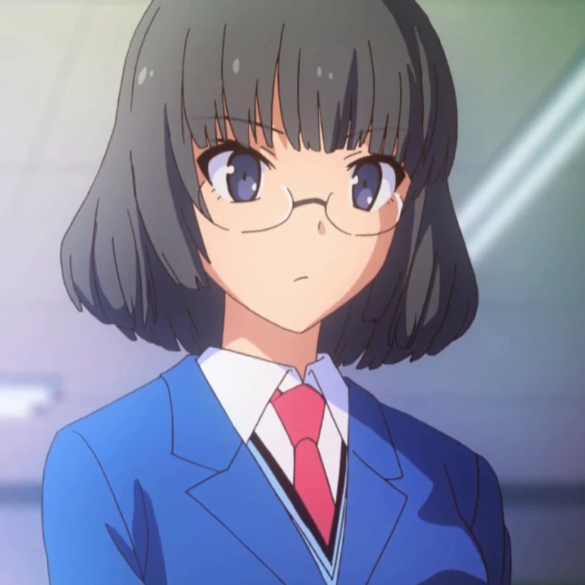
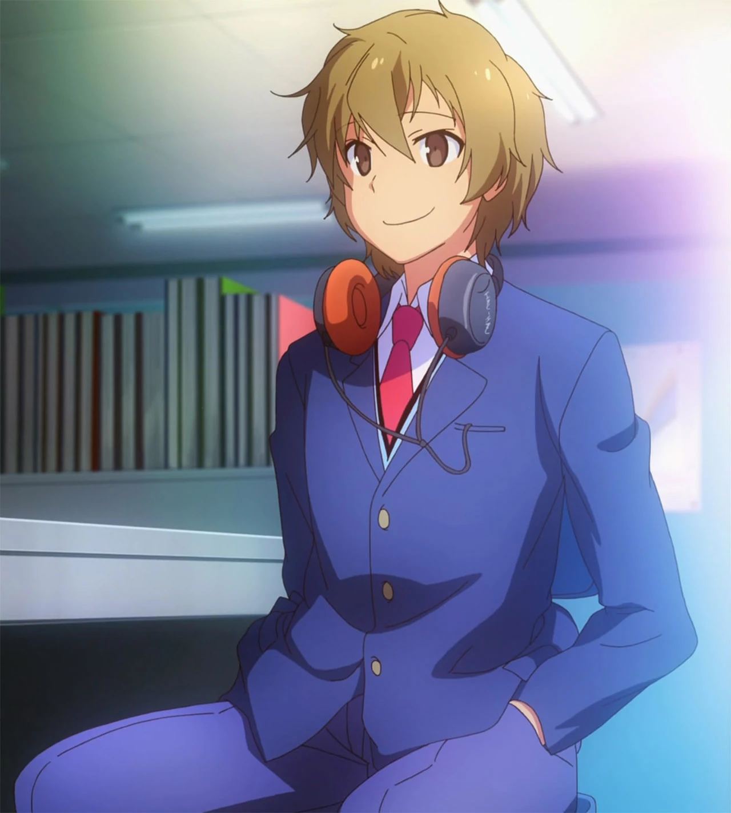
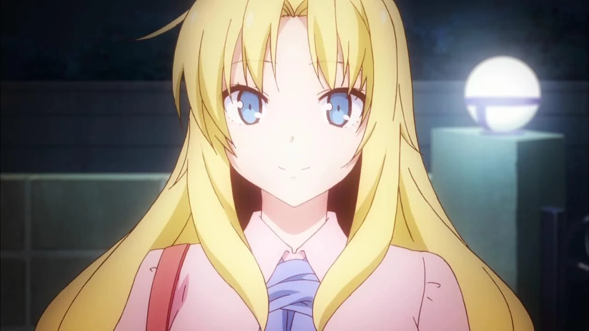
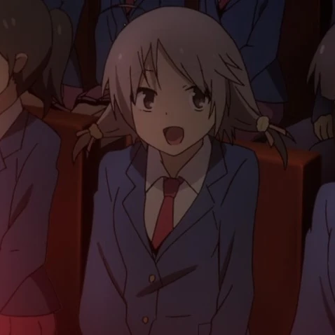

# Sección 04-C: Personajes secundarios (III) — Residentes nuevos, Rita y la familia Akasaka

> **Biblia del universo de Sakura-sou no Pet na Kanojo (さくら荘のペットな彼女)**
> Documento de referencia para el proyecto de fanfic de este repositorio.
> ⚠️ Spoilers del anime completo y de la novela ligera. Este documento contiene **la ficha completa de Rita Ainsworth**, adelantada desde la sección de personajes principales.

  

---

## Por qué este documento existe

Hay tres grupos de secundarios que no encajan en los dos anteriores: **los residentes que llegan cuando los mayores se gradúan** (Kanna e Iori), **Rita**, que es principal de facto pero no vive en el dormitorio hasta más tarde, y **el círculo de Ryūnosuke**, que explica su character y cierra su arco.

Son, además, los personajes que más peso tienen en el material **posterior al anime**. Si tu fanfic se sitúa después del episodio 24, este es tu reparto.

---

# 1. 長谷 栞奈 — Hase Kanna

## Ficha

| Campo | Dato |
|---|---|
| **Nombre** | 長谷 栞奈 (Hase Kanna) |
| **Seiyū** | 山崎はるか (Yamazaki Haruka) · inglés: Hilary Haag |
| **Edad** | 15-16 (recién ingresada a Suikō) |
| **Escuela** | Suikō, sección general, **1.er año grupo 3** |
| **Cuarto** | **201** (el que deja libre Misaki) |
| **Ocupación** | Estudiante · **novelista publicada** · guionista del equipo de videojuegos |
| **Familia** | No se detalla en la obra |
| **Primera aparición** | Anime episodio 24 · Novela (a partir del arco de la graduación) |

## Quién es

La primera de los tres residentes nuevos. Aparece en los últimos minutos del anime y es, en muchos sentidos, **la versión "siguiente generación" de Mashiro**: una chica con un talento extraordinario ya reconocido y una incapacidad igual de grande para lo demás.

## El nombre

**長谷 (Hase)** es un apellido real (hay una ciudad y un templo famosos con ese nombre en Kamakura). **栞奈 (Kanna)** se escribe con 栞, "marcapáginas". El detalle es perfecto para una escritora: alguien que señala dónde se quedó la lectura.

## Apariencia y personalidad

- **Parece la estudiante modelo perfecta**: gafas, melena recogida, uniforme impecable, expresión tranquila. Y lo es: **fue la mejor puntuación del examen de admisión** y dio el discurso de la nueva generación en la ceremonia de entrada.
- **Es escritora publicada desde los 14 años.** Con el seudónimo **由比ヶ浜かんな (Yuigahama Kanna)** escribió 『シンデレラの日曜日』 (*El domingo de Cenicienta*), basada en su diario y sus fantasías, y **ganó el premio de nuevos autores**.
- **El bloqueo la está destrozando.** La segunda obra no avanza, y esa presión se convierte en estrés, y el estrés se convierte en su problema: **exhibicionismo**. La serie lo trata como síntoma, no como chiste: empezó con conductas raras en el dormitorio, siguió con cosas más evidentes y llegó al punto de andar sin ropa interior bajo la falda.
- **Es una buena persona incómoda.** No es malvada ni provocadora: es una adolescente que no sabe gestionar la fama y la presión, y a la que nadie ha enseñado a pedir ayuda.

## Historia

1. **La expulsión.** Compartía cuarto con **Yūko** en el dormitorio general. A los tres días de entrar, la supervisora detectó su conducta y Chihiro se la llevó a Sakura-sō. Así **se vuelven a llenar los cuartos** que dejaron Jin y Misaki.
2. **El turno Iori.** Tras la salida de Sorata y Mashiro, Iori se rompe un hueso intentando ayudarla, y ella queda a su cuidado ("伊織当番"), espejo exacto del "turno Mashiro" original.
3. **La producción del juego.** Jin le recomienda entrar al equipo de Sorata y Ryūnosuke, y ella se encarga del **guion**. Su talento narrativo se pone al servicio del proyecto.
4. **Lo que la novela añade (spoilers):** en 『青春ブタ野郎』 (tomo 1) se insinúa que su relación con Iori es cercana; en el tomo 3 vuelve a aparecer como autora de una obra nueva.

## Relaciones

- **Iori Himemiya:** el chico al que cuida; la pareja implícita del futuro.
- **Yūko Kanda:** su compañera de cuarto en el dormitorio general, antes de la expulsión.
- **Sorata y Ryūnosuke:** sus jefes en el proyecto del juego.
- **Mashiro:** su espejo. Las dos son genios precoces con problemas para vivir.

## Notas de escritura

- **Su voz es formal, precisa y algo antinatural para su edad**: habla como escribe.
- **No la reduzcas a su "problema".** En el canon es una profesional de 14 años con bloqueo creativo, no un gag erótico.

---

# 2. 姫宮 伊織 — Himemiya Iori

## Ficha

| Campo | Dato |
|---|---|
| **Nombre** | 姫宮 伊織 (Himemiya Iori) |
| **Seiyū** | 島﨑信長 (Shimazaki Nobunaga) |
| **Edad** | 15 |
| **Cumpleaños** | 17 de mayo · Tauro |
| **Tipo de sangre** | B |
| **Escuela** | Suikō, 音楽科 (música) → transferido a otra sección |
| **Cuarto** | **103** (el que deja libre Jin) |
| **Familia** | **Saori (hermana mayor)** |
| **Primera aparición** | Anime episodio 18 (mencionado) · episodio 24 (en pantalla) |

## Quién es

El chico que hereda el cuarto de Jin. Su presentación en el episodio 24 es una de las escenas más cómicas de la serie: ingresó a la sección de música, **presentó su solicitud de cambio de sección el primer día**, y esa misma jornada se metió al dormitorio de chicas para espiar el baño, por lo que **fue enviado a Sakura-sō el día de la ceremonia de entrada**.

## Personalidad

- **Quiere vivir un simulador de citas.** Su sueño declarado es tener "una juventud como la de un juego de citas" (恋愛シミュレーションゲームのような青春). Es el único personaje que dice en voz alta lo que muchos protagonistas de novela ligera piensan.
- **Es un adolescente descarado y sincero.** Evalúa a las chicas por el tamaño del pecho y lo comenta sin filtro; la serie lo usa como contrapunto vulgar de Sorata.
- **Pero es músico de verdad.** Toca el piano a nivel de concurso y ha ganado premios. Su problema no es la falta de talento: es que **todo lo que logra se compara con lo de su hermana Saori**.
- **Su rebeldía es una huida.** Dice que, si va a dedicar horas al piano para que lo comparen con su hermana, prefiere dejarlo y dedicar ese tiempo a "disfrutar la juventud". Pero **sigue practicando todos los días**, porque en el fondo ama la música. Ese detalle lo redime.
- **Los audífonos son de Saori**, con el logo "HAUHAU", y los lleva con orgullo.

## Historia

- **Episodio 18:** se revela que aprobó el examen de música, en la misma escena en que se sabe que Yūko reprobó y que Jin entró a la universidad de Osaka.
- **Episodio 24:** llega a Sakura-sō expulsado del dormitorio general y se convierte en el nuevo vecino de Sorata.
- **Después del anime (novela):** protagoniza el arco del "turno Iori", se rompe un hueso ayudando a Kanna y queda al cuidado de ella. En 『青春ブタ野郎』 su cercanía con Kanna se da por hecha.

## Notas de escritura

- **Es el único personaje abiertamente vulgar del reparto**, y la serie lo equilibra con su talento y su vulnerabilidad. Si lo escribes solo como "el pervertido", pierdes la mitad.
- **Su relación con la música es la de un heredero**: la quiere y la odia al mismo tiempo.

---

# 3. リタ・エインズワース — Rita Ainsworth

## Ficha

| Campo | Dato |
|---|---|
| **Nombre** | リタ・エインズワース (Rita Ainsworth) |
| **Seiyū** | 川澄綾子 (Kawasumi Ayako) · inglés: Skyler Sinclair |
| **Edad** | 17 |
| **Cumpleaños** | 4 de abril · Aries |
| **Tipo de sangre** | B |
| **Altura** | 163 cm |
| **Origen** | Inglaterra |
| **Ocupación** | Pintora (en pausa) → estudiante de arte |
| **Familia** | **Adel Ainsworth** (abuelo, dueño del atelier donde estudió Mashiro) |
| **Vínculos** | Excompañera de cuarto y cuidadora de Mashiro · enamorada de Ryūnosuke |
| **Primera aparición** | Anime episodio 9 · Novela tomo 3 |

## Quién es

La chica que llega de Inglaterra a llevarse a Mashiro y termina quedándose, en el sentido más amplio de la palabra. Es **el personaje que mejor explica el precio del talento ajeno**, y la única persona del reparto que se atreve a tocar a Ryūnosuke.

## Apariencia

Rubia de melena larga, ojos azules, rasgos de muñeca y una expresión siempre amable. Viste con ropa elegante y algo formal (heredera de la educación inglesa que la serie le atribuye). La serie la dibuja con una sonrisa permanente que Ryūnosuke desmonta en una sola frase: **"tu sonrisa es falsa"**.

## Personalidad

- **Caballeresca y directa.** Su educación inglesa la lleva a un sentido del honor muy marcado: en Japón actúa como una extraña que exige a los hombres del dormitorio comportarse. Es persistente hasta el agotamiento.
- **Sabe exactamente lo que le pasa y lo odia.** Sabe que es buena pintora y sabe que Mashiro es mejor; sabe que eso no es culpa de nadie y aun así le duele. Esa lucidez la hace más trágica, no menos.
- **Su crueldad fue un acto de desesperación.** Le enseñó el manga a Mashiro **esperando que la crítica la destrozara**. Cuando el manga se volvió un éxito, se rompió del todo.
- **Es la única que no se rinde con Ryūnosuke.** Ni la frialdad, ni el silencio, ni los correos bloqueados por Maid-chan la detienen.

## Historia

**Antes de la serie.** Estudió pintura en el atelier de su abuelo, Adel Ainsworth, junto a Mashiro. Vio marcharse a todos los demás alumnos, uno por uno, incapaces de competir. Ella fue **la última que quedó**, y la que se ocupó de la vida diaria de Mashiro (le enseñó a usar la computadora, la peinaba, la cuidaba). Cuando ya no pudo sostenerlo, dejó de pintar y le sugirió el manga.

**En el anime.**

1. **Episodio 9:** llega a Sakura-sō a llevarse a Mashiro. Mashiro la empuja fuera de la casa.
2. **Episodio 10:** confiesa su pasado al grupo, sale corriendo bajo la lluvia y Ryūnosuke la confronta con una crueldad que la hiere más. Sorata la busca y le dice lo que necesita oír: que fue la única que se quedó. **Decide volver a pintar** y ayuda con los fondos del corto.
3. **Episodio 12:** se despide en el aeropuerto con un beso en la mejilla a Ryūnosuke, que se desmaya. Se revela después (episodio 17) que **era su primer beso**.
4. **Episodio 17:** vuelve por San Valentín, le da chocolates a Ryūnosuke y una carta en la que confiesa lo del primer beso.
5. **Episodio 24:** regresa para la despedida final y le da un beso a Ryūnosuke delante de todos; después besa a Maid-chan **a través de la tablet**, en una de las escenas más absurdas de la serie.

**Lo que la novela añade (spoilers).**

- Vuelve a Japón y **hace una estancia de lengua en Suikō** como paso previo a estudiar en la Universidad de Suimei; cuando Nanami deja el dormitorio, **se muda a Sakura-sō** y ocupa la 203.
- Después de la universidad **alterna entre Inglaterra y Japón**, y mantiene una relación con Ryūnosuke.
- Aparece junto a él en 『青春ブタ野郎はプチデビル後輩の夢を見ない』 (tomo 2 de la serie posterior).

## Relaciones

- **Mashiro:** amiga, cuidadora y rival. La relación más compleja del reparto.
- **Ryūnosuke:** el amor de su vida y la persona que no puede tocar sin que se desmaye.
- **Maid-chan:** enemiga declarada. La IA bloquea sus correos y las dos se insultan por escrito.
- **Adel Ainsworth:** su abuelo y maestro.
- **Ayano Iida:** su amiga, la editora de Mashiro.

## Notas de escritura

- **Habla japonés con fluidez y cierto acento.** La serie la hace decir cosas demasiado directas para el registro japonés, y eso es caracterización.
- **Es el personaje más "internacional"** de la obra: si tu fanfic necesita una perspectiva extranjera sobre Japón, ella es la puerta.
- **Su arco no es "superar a Mashiro"**: es aceptar que no la superará y pintar de todos modos.

---

# 4. 赤坂 ゆり子 — Akasaka Yuriko

## Ficha

| Campo | Dato |
|---|---|
| **Nombre** | 赤坂 ゆり子 (Akasaka Yuriko) |
| **Ocupación** | Profesora en prácticas (教育実習生) de lengua japonesa en Suikō |
| **Familia** | Hermana mayor de Ryūnosuke (una de tres) |
| **Primera aparición** | Novela; el anime solo la menciona indirectamente |
| **Nota** | Sin imagen oficial disponible en las fuentes consultadas: se documenta por texto |

## Quién es

Una de las tres hermanas mayores de Ryūnosuke y, según la Wikipedia japonesa, **una de las responsables de su ginefobia**. Llega a Suikō como profesora en prácticas y su sola presencia sirve para explicar por qué Ryūnosuke no soporta a las mujeres.

## Detalles

- **La familia Akasaka está formada por el padre Ryōma, la madre Ryūjiko y tres hermanas: Yuriko, Riko y Ranko.** En una casa con tres hermanas mayores y una madre, Ryūnosuke creció literalmente rodeado de mujeres, y la serie insinúa que el exceso de mimos y de abusos acabó generando su fobia.
- **Su asignatura es lengua japonesa**, lo que la pone en el mismo departamento que Koharu Shirayama y Chihiro Sengoku.
- **Es el único miembro de la familia Akasaka que aparece en pantalla** (en la novela), y su función es cerrar el círculo: el trauma tiene nombre y apellido.

## Notas de escritura

- **Es material sensible.** La serie trata la ginefobia de Ryūnosuke como condición cómica y dolorosa a la vez; si escribes a Yuriko, ten en cuenta que para su hermano es una figura de amenaza, no una simple broma.

---

# 5. 中野 乙羽 — Nakano Otoha

## Ficha

| Campo | Dato |
|---|---|
| **Nombre** | 中野 乙羽 (Nakano Otoha) |
| **Seiyū** | 大坪由佳 (Ōtsubo Yuka) |
| **Ocupación** | Estudiante de 1.er año de Suikō |
| **Origen** | **Personaje original del videojuego de PSP/PS Vita** |
| **Aparición en el anime** | Episodio 12 (entre el público que ve Nyaboron) y episodio 23 (en la graduación) |

## Quién es

La prueba de que el anime y el juego comparten universo: Otoha nació en la **novela visual de PSP y PS Vita** (2013) y los animadores la colaron como extra en dos escenas multitudinarias. Es un *easter egg* para los jugadores.

## Detalles

- **Aparece entre el público del festival** en el episodio 12, es decir, es una de las personas que grita lo que siente en el clímax del corto.
- **Vuelve en la graduación** del episodio 23, en la escena del lanzamiento de broches.
- **Su existencia confirma que el reparto del juego se considera canónico** dentro del universo de la serie, aunque no tenga líneas de diálogo en el anime.

---

# 6. 池尻 麻耶 y 駒沢 拓実 — Ikejiri Maya y Komazawa Takumi

## Ficha

| Campo | Dato |
|---|---|
| **Nombres** | 池尻 麻耶 (Ikejiri Maya) · 駒沢 拓実 (Komazawa Takumi) |
| **Vínculo** | Amigos de Ryūnosuke en la secundaria |
| **Grupo** | Un equipo de **cinco personas** que hacía videojuegos |
| **Mencionados en** | Novela; en el anime se alude a ellos en el episodio 20 |

## Quiénes son

Los dos únicos miembros del viejo equipo de Ryūnosuke que tienen nombre. Son, literalmente, **el origen del trauma** que explica por qué vive encerrado.

## Lo que pasó

- En la secundaria, Ryūnosuke y cuatro compañeros hacían videojuegos juntos. Al principio todo iba bien.
- Conforme el proyecto creció, Ryūnosuke se volvió **cada vez más intolerante con la incompetencia ajena**.
- Sus amigos lo abandonaron y **no volvieron**. Él se quedó solo con el proyecto y con la certeza de que el problema era él.
- Hoy los cuatro estudian en otras preparatorias y no tienen contacto con él.

## Función narrativa

Su ausencia es más importante que su presencia: **son el motivo por el que Ryūnosuke no quiere volver a trabajar con nadie**, y por eso su decisión de unirse al equipo de Sorata (y después montar un estudio con él) tiene tanto peso.

---

## Cierre de la sección: quién queda en Sakura-sō después del anime

| Cuarto | Antes (episodio 1) | Después (episodio 24 en adelante, con novela) |
|---|---|---|
| **101** | Sorata | Sorata |
| **102** | Ryūnosuke | Ryūnosuke (hasta que se muda con Sorata) |
| **103** | Jin | **Iori** |
| **201** | Misaki | **Kanna** |
| **202** | Mashiro | Mashiro |
| **203** | Nanami (desde el episodio 5) | **Rita** (tras la salida de Nanami) |

**Lectura de la serie:** Sakura-sō es un lugar que se vacía y se vuelve a llenar. El último episodio lo dice explícitamente: los colores viejos y los nuevos brillan en el mismo lienzo. Ese es el hueco natural donde empieza cualquier continuación.

---

## Verificación de esta sección

- **Datos personales de Kanna e Iori** (edad, cumpleaños, tipo de sangre): Sakurasou Wiki. Se advierte que la ficha de Kanna en la wiki en inglés consigna "20 años", dato que **no corresponde a su ingreso a Suikō** (donde es estudiante de primer año) y que probablemente se refiere a apariciones posteriores en otra serie; en este documento se usa 15-16 y se señala la discrepancia.
- **Datos de Rita** (cumpleaños, altura, tipo de sangre, familia): Sakurasou Wiki y Wikipedia japonesa, que además detalla su estancia posterior en Suikō y su traslado al cuarto 203.
- **Hechos de la novela posteriores al anime** (Kanna guionista del juego, "turno Iori", Rita en la 203, relación con Ryūnosuke): Wikipedia japonesa, sección 登場人物.
- **Otoha Nakano:** la Wikipedia japonesa la identifica explícitamente como personaje original del juego de PSP/Vita con cameos en los episodios 12 y 23.
- **Punto sin imagen:** Yuriko Akasaka no tiene ilustración oficial localizable en las fuentes consultadas; se documenta solo con texto y así se indica.

---

## Fuentes de esta sección

1. **Wikipedia en japonés — さくら荘のペットな彼女**, sección 登場人物 (長谷栞奈, 姫宮伊織, リタ・エインズワース, 赤坂ゆり子, 中野乙羽, 池尻麻耶・駒沢拓実): https://ja.wikipedia.org/wiki/さくら荘のペットな彼女
2. **Sakurasou Wiki (Fandom) — Kanna Hase**: https://sakurasou.fandom.com/wiki/Kanna_Hase
3. **Sakurasou Wiki (Fandom) — Iori Himemiya**: https://sakurasou.fandom.com/wiki/Iori_Himemiya
4. **Sakurasou Wiki (Fandom) — Rita Ainsworth**: https://sakurasou.fandom.com/wiki/Rita_Ainsworth
5. **Sakurasou Wiki (Fandom) — Otoha Nakano**: https://sakurasou.fandom.com/wiki/Otoha_Nakano
6. **Wikipedia en japonés — 青春ブタ野郎シリーズ** (para los cruces de personajes): https://ja.wikipedia.org/wiki/青春ブタ野郎シリーズ
7. **Sitio oficial (Dengeki/KADOKAWA), página del juego de PSP/Vita**: https://sakurasou.dengeki.com/

---

*Documento anterior: [04-B — Compañeros de escuela y vida cotidiana](04b-secundarios-escuela.md) · Volver al [índice de la biblia](README.md)*
