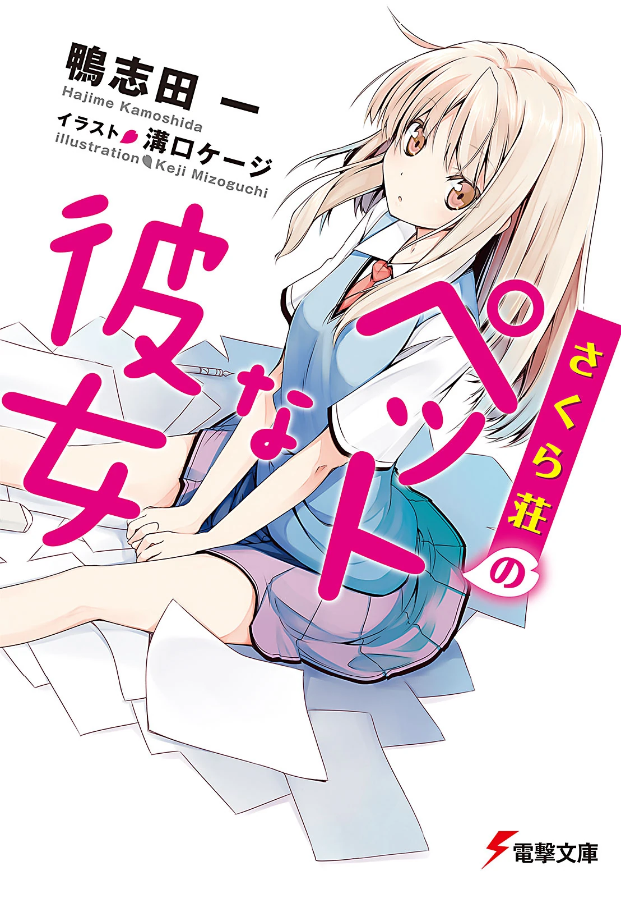
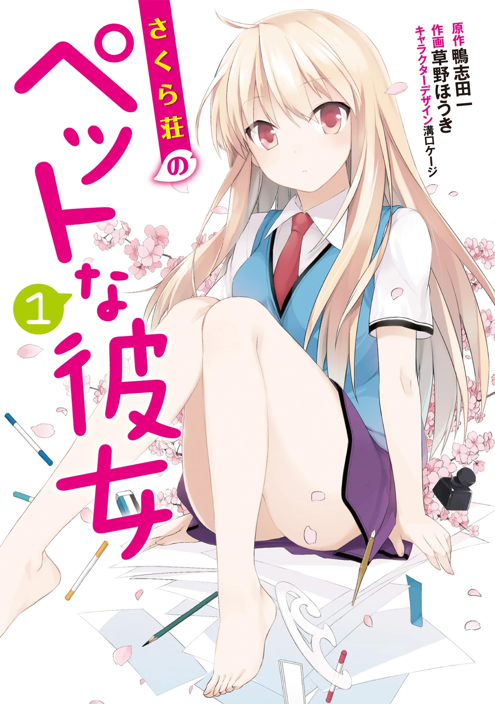
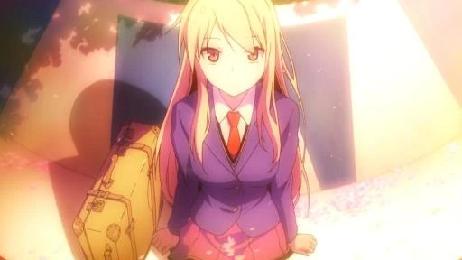

# Sección 05-A: Diferencias entre medios (I) — Cobertura y estructura: qué cuenta cada versión

> **Biblia del universo de Sakura-sou no Pet na Kanojo (さくら荘のペットな彼女)**
> Documento de referencia para el proyecto de fanfic de este repositorio.
> ⚠️ Spoilers totales, incluidos los de las novelas no adaptadas.

  
  
  

---

## La pregunta que resuelve esta sección

*Sakura-sou no Pet na Kanojo* existe en tres formas narrativas y **las tres cuentan historias distintas**, no solo con distinto nivel de detalle. Un fanfic puede apoyarse en cualquiera de las tres, pero necesita saber cuál está usando. Este documento establece el mapa; los dos siguientes entran en los cambios concretos y en el manga.

| Medio | Extensión | Periodo | Estado |
|---|---|---|---|
| **Novela ligera** (原作) | 13 tomos: 10 del cuerpo principal + 3 volúmenes cortos (5.5, 7.5, 10.5) | enero de 2010 – marzo de 2014 | **Obra completa y canónica** |
| **Manga** (作画: 草野ほうき) | 8 tomos | octubre de 2011 – junio de 2015 | Adaptación con **final propio** |
| **Anime** (J.C.Staff) | 24 episodios | octubre de 2012 – marzo de 2013 | Adaptación **parcial** |

> **Dato clave:** la novela terminó **después** del anime. El último tomo del cuerpo principal (el 10) salió el 10 de julio de 2013, tres meses después de la emisión del episodio 24 (26 de marzo de 2013), y el volumen final corto (10.5) salió en marzo de 2014. Es decir: el anime no "cortó" la historia, se hizo mientras la historia todavía se estaba escribiendo, y por eso no pudo adaptar el final.

---

## 1. La novela: 13 volúmenes y una estructura clara

| Tomo | Fecha | Contenido principal | ¿Adaptado? (correspondencia aproximada) |
|---|---|---|---|
| **1** | 10/01/2010 | Llegada de Mashiro, el "turno Mashiro", primer concurso, Nanami se muda | Sí (ep. 1-5) |
| **2** | 10/04/2010 | Verano, Yuuko, primer fracaso de Sorata | Sí (ep. 6-8) |
| **3** | 10/08/2010 | Rita, Nyaboron, festival cultural | Sí (ep. 9-12) |
| **4** | 10/12/2010 | Navidad, Misaki rechazada | Sí (ep. 13-14) |
| **5** | 10/05/2011 | Año Nuevo en Fukuoka, presentación, San Valentín | Sí (ep. 15-17) |
| **5.5** | 10/09/2011 | Volumen corto de historias paralelas | **No** |
| **6** | 10/12/2011 | Exámenes, demolición, graduación, despedidas | Sí (ep. 18-24) |
| **7** | 10/04/2012 | Tercer año, Kanna e Iori, **la doble declaración** | Solo la apertura (final del ep. 24) |
| **7.5** | 10/08/2012 | Volumen corto | **No** |
| **8** | 10/10/2012 | **Viaje a Hokkaido y la respuesta de Sorata** | **No** |
| **9** | 09/03/2013 | La pareja, la convivencia, el trabajo | **No** |
| **10** | 10/07/2013 | Ruptura, salto de cuatro años, reencuentro | **No** |
| **10.5** | 08/03/2014 | Epílogo: la vida adulta de todos | **No** |

**Conclusión práctica:** el anime adapta **los seis primeros tomos y el arranque del séptimo**. El reparto de episodios por tomo de la tabla es aproximado (el anime funde capítulos y no siempre respeta los límites del libro); la correspondencia exacta solo está documentada para los episodios cuyos títulos coinciden con capítulos, que son los de la sección 2. Todo lo que ocurre desde la mitad del tomo 7 hasta el 10.5 **solo existe en papel**. Son cinco tomos y medio de historia virgen para un fanfic.

---

## 2. Los títulos de los episodios son títulos de capítulos

Este es el hallazgo más útil de toda la sección y sirve para mapear con precisión. Varios episodios del anime **conservan literalmente el título del capítulo de novela** que adaptan:

| Episodio | Título japonés | Capítulo de novela |
|---|---|---|
| **8** | どでかい花火をあげてみろ | Tomo 2, cap. 4: *"Let's set off some huge fireworks"* |
| **9** | 秋の嵐がやってきた | Tomo 3, cap. 1: *"The Autumn Storm has arrived"* |
| **20** | この先もただいまを言うために | Tomo 6, cap. 1: *"So We Can Keep Calling It Home"* |
| **21** | 誰のせいでもなく雨は降る | Tomo 6, cap. 3: *"It's Nobody's Fault That It's Raining"* |
| **22** | きらめく日々を駆け抜けろ | Tomo 6, cap. 2: *"Dashing Through Those Brilliant Days"* |
| **23** | 卒業式 | Tomo 6, cap. 4: *"Graduation Ceremony"* |

Y un detalle de composición que vale oro: **el último episodio se titula 「さくら荘へようこそ」 ("Bienvenidos a Sakura-sō"), que es exactamente el título del primer capítulo del tomo 1**. La serie cierra con el mismo rótulo con que abrió.

> **Ojo con esto al escribir:** el anime **reordena** material dentro del tomo 6 (el capítulo del título del episodio 21 es posterior en la numeración al del episodio 22), así que la correspondencia por títulos es fiable pero **no implica el mismo orden interno**.

---

## 3. Lo que el anime cuenta y la novela no: el efecto de compresión

Conviene tenerlo claro porque afecta a la hora de escribir continuaciones.

**Densidad.** El anime mete seis tomos en 24 episodios: **cuatro episodios por tomo de media**, es decir, un episodio por cada dos o tres capítulos. Un tomo de 350 a 400 páginas se convierte en 80 minutos de animación. El resultado: escenas fusionadas, personajes secundarios reducidos a una línea y tramas internas eliminadas.

**Lo que se pierde en el camino** (categorías verificables):

1. **Monólogos internos.** La novela es de primera persona desde Sorata. El anime los sustituye por gestos y silencios, y por eso los personajes parecen más opacos.
2. **Subtramas de secundarios.** Miyahara, Mayu, Yayoi, Shiho y Koharu existen en la novela con más cuerpo; en el anime son apoyo.
3. **La vida doméstica.** La novela dedica páginas a la rutina del dormitorio, a las comidas, al dinero, a los gatos. El anime selecciona solo lo que hace avanzar la trama.
4. **El material posterior al tomo 6**: la doble declaración del tomo 7, el viaje a Hokkaido del 8, la relación de pareja del 9, la ruptura del 10 y la vida adulta del 10.5. Es el bloque más importante y **no está en el anime**.

---

## 4. La cronología de publicación explica las decisiones del anime

| Fecha | Hecho |
|---|---|
| Abril de 2012 | Se anuncia el anime |
| Abril de 2012 | Sale el **tomo 7** de la novela (tercer año, Kanna e Iori) |
| Octubre de 2012 | Arranca el anime; **sale el tomo 8** (viaje a Hokkaido) |
| Marzo de 2013 | **Termina el anime** con el episodio 24 |
| Marzo de 2013 | Sale el **tomo 9** |
| Julio de 2013 | Sale el **tomo 10**, final del cuerpo principal |
| Marzo de 2014 | Sale el **tomo 10.5** |

El equipo del anime empezó a trabajar con los tomos 1 a 7 sobre la mesa y **sin saber cómo terminaría la historia**. De ahí tres consecuencias:

- **El final del anime no puede ser el final de la novela**, porque el autor todavía no lo había escrito.
- El episodio 24 usa material del **arranque del tomo 7** (la llegada de Kanna e Iori) para dar una sensación de continuidad y de "la vida sigue", en lugar de cerrar la trama romántica.
- La película posterior del autor (『青春ブタ野郎』) recoge a estos personajes como cameos, lo que confirma que la historia de Sakura-sō continuó en papel, no en pantalla.

---

## 5. Comparación de las tres versiones en una tabla

| Aspecto | Novela | Manga | Anime |
|---|---|---|---|
| **Año de inicio** | 2010 | 2011 | 2012 |
| **Extensión** | 13 tomos | 8 tomos | 24 episodios |
| **Punto de vista** | Primera persona (Sorata) | Tercera persona gráfica | Tercera persona |
| **Final** | Ruptura, salto de 4 años y reencuentro (tomo 10); epílogo en el 10.5 | **Los padres de Mashiro vienen a llevársela** | **Graduación, dormitorio salvado y nuevos residentes** |
| **¿Hay declaración de Nanami?** | **Sí**, al final del tomo 7 | Adapta hasta el tomo 4 aprox. | **No**, nunca se declara |
| **¿Hay beso Sorata–Mashiro?** | Sí, y son pareja | No llega | Solo en la mejilla (ep. 24) |
| **Kanna e Iori** | Protagonizan sus propios arcos | No aparecen | Solo en el ep. 24 |
| **Rita** | Regresa y vive en Sakura-sō (tomo 203) | Aparece en el tomo 7 | Aparece, se va y vuelve |
| **Tono** | Más adulto; hay sexo, alcohol y violencia verbal | Intermedio | El más suave |

---

## 6. Qué versión usar según lo que quieras escribir

- **Si tu fanfic continúa el anime:** el punto de partida natural es el episodio 24 — Misaki y Jin graduados, Nanami en Osaka, Kanna e Iori recién llegados, Sorata y Mashiro sin formalizar. Es el escenario más "abierto" de las tres versiones.
- **Si quieres romance resuelto:** usa la novela. Ahí hay pareja oficial, crisis, ruptura, cuatro años de separación y reencuentro. Es el material con más desarrollo sentimental de la obra.
- **Si quieres un conflicto externo limpio:** el manga ofrece el arma más directa — **los padres de Mashiro vienen a llevársela a Inglaterra**. Es un detonante que el anime nunca usó y que se puede injertar en cualquier cronología.

---

## Verificación de esta sección

- **Fechas, tomos y ISBN:** sección 既刊一覧 de la Wikipedia japonesa, que cita la ficha de cada volumen en KADOKAWA. Contrastadas con la lista de la Sakurasou Wiki (Fandom) y con la ficha de la serie en J-Novel Club.
- **Títulos de capítulos de la novela:** fichas "Light Novel Volume" 1 a 7 de la Sakurasou Wiki, que transcriben los índices de cada tomo. Se compararon uno a uno con la lista de episodios de la Wikipedia japonesa.
- **Qué adapta el anime:** se verificó por dos vías independientes. (a) La lista de capítulos del tomo 6 coincide con los episodios 20 a 23. (b) Una respuesta de Yahoo!知恵袋 de 2015 afirma que el anime toma como base "hasta el tomo 6", lo que coincide con el reparto de capítulos. **Se descarta la idea, muy repetida en foros, de que el anime llega al tomo 8.**
- **El contenido del tomo 8** (viaje a Hokkaido, decisión de Sorata tras la doble declaración) está documentado en una reseña contemporánea de 4Gamer (20/10/2012), que además recoge la nota del autor: la historia terminaría dos tomos después.
- **Punto no verificado:** no se pudo confirmar si el arco de los padres de Mashiro del manga proviene de la novela o es original del manga. Se presenta en el documento 05-C como **final propio del manga**, sin atribuirlo a la novela.

---

## Fuentes de esta sección

1. **Wikipedia en japonés — さくら荘のペットな彼女**: https://ja.wikipedia.org/wiki/さくら荘のペットな彼女 (fechas de publicación, listas de episodios, personal)
2. **Sakurasou Wiki (Fandom) — lista de tomos de la novela ligera**: https://sakurasou.fandom.com/wiki/Sakurasou_no_Pet_na_Kanojo_(Light_Novel) y fichas "Light Novel Volume 1" a "Volume 10.5"
3. **4Gamer, "放課後ライトノベル" nº 114** (20/10/2012), reseña del tomo 8: https://www.4gamer.net/games/115/G011590/20121018106/
4. **Yahoo!知恵袋**, respuesta sobre hasta qué tomo llega el anime: https://detail.chiebukuro.yahoo.co.jp/qa/question_detail/q13143227908
5. **J-Novel Club**, ficha oficial de la edición en inglés: https://j-novel.club/series/the-pet-girl-of-sakurasou

---

*Siguiente documento: [05-B — Los cambios concretos del anime](05b-diferencias-cambios-anime.md)*
