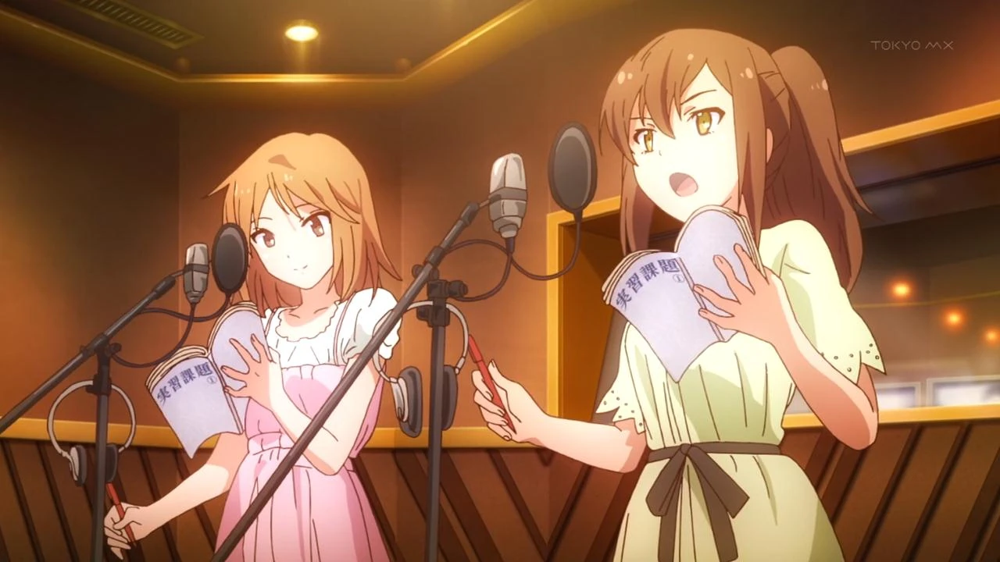
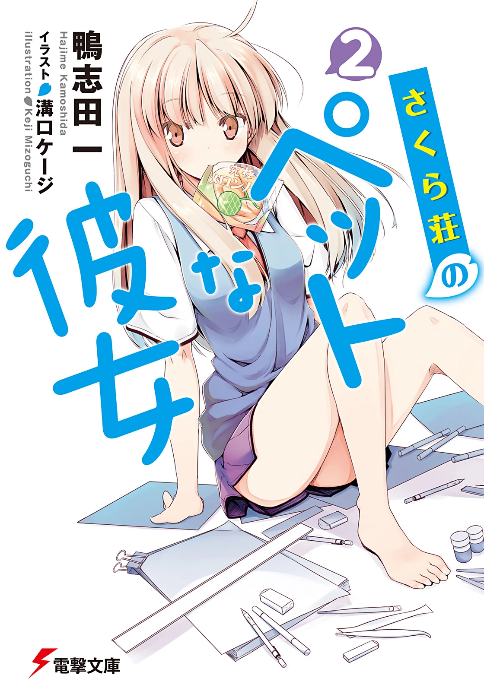

# Sección 05-B: Diferencias entre medios (II) — Los cambios concretos del anime

> **Biblia del universo de Sakura-sou no Pet na Kanojo (さくら荘のペットな彼女)**
> Documento de referencia para el proyecto de fanfic de este repositorio.
> ⚠️ Spoilers del anime y de la novela.

  
  

---

## Cómo está organizado este documento

Cada diferencia va clasificada, porque no todas pesan igual:

- **[CAMBIO]** el anime sustituyó algo que la novela dice de otra manera.
- **[OMISIÓN]** la novela tiene algo que el anime decidió no contar.
- **[REORDEN]** el anime movió material de sitio.
- **[PRODUCCIÓN]** la diferencia no está en la historia, sino en cómo se cuenta (audio, imagen, formato).
- **[POLÉMICA]** el cambio generó conflicto público documentado.

---

# 1. [CAMBIO][POLÉMICA] El caso del *samgyetang*: el cambio más famoso de la serie

Es, con diferencia, la diferencia más documentada entre la novela y el anime, y la única que provocó un incidente público con cobertura de prensa nacional.

## Qué dice la novela

En el tomo 3, cuando Nanami cae enferma por agotamiento, **Jin le prepara un plato sencillo**: la novela lo describe como **«un simple plato de gachas de arroz»** (お粥, *okayu*). Nada más. Es un gesto doméstico, sobrio y algo torpe: el mujeriego del dormitorio cocinando arroz hervido para la chica que se ha desmayado.

## Qué hizo el anime

En el **episodio 6** («雨あがりの青», *El azul después de la lluvia*), ese mismo plato **se convirtió en *samgyetang*** (サムゲタン): sopa coreana de pollo relleno de ginseng, jujube y arroz glutinoso. Es decir: el anime sustituyó un plato japonés genérico por un **plato coreano con nombre propio**.

La escena, tal como la recoge la prensa de la época, incluye el intercambio:

> —Te preparé samgyetang, llévale.
> —¿Y por qué samgyetang?

Ese «¿y por qué samgyetang?» es exactamente lo que se preguntó media internet japonesa en noviembre de 2012.

## La reacción

- **13 de noviembre de 2012:** livedoor News publica «En el anime *Sakura-sō no Pet na Kanojo* aparece de repente cocina coreana y causa polémica».
- **15 de noviembre de 2012:** J-CAST News titula «Cambian el "okayu" del original por "samgyetang": un gran escándalo de críticas por una serie popular».
- **17 de noviembre de 2012:** el *Chunichi Shimbun* dedica su columna semanal de internet al asunto con el título «Qué pasó en la red esta semana: el escándalo del samgyetang en un anime».
- Una parte del público concluyó que **la producción tenía la intención de difundir cultura coreana**, y las críticas llegaron a los canales de emisión. El asunto se bautizó en Nico Nico Douga como **「サムゲ荘のキムチな彼女」** («Samgye-sō no Kimuchi na Kanojo», parodia del título), etiqueta que sigue viva en la cultura de internet japonesa más de una década después.

## Lo que dijeron los responsables

- **Un animador de otro estudio** (no del equipo de la serie) explicó en Twitter que el motivo era puramente visual: **«en texto se puede describir un okayu que se ve delicioso, pero en animación un arroz blanco y simple es dificilísimo de dibujar apetitoso»**, y añadió que **«la "traducción" como expresión audiovisual es el orgullo del lado de la producción»**. La cuenta fue borrada hacia el 18 de noviembre de 2012. El mismo usuario descartó la teoría de una campaña encubierta con el argumento de que el marketing real se hace «con más habilidad y de forma más eficaz».
- **Media Factory** (en el comité de producción) declaró: **«no podemos responder sobre la intención de producción»**.
- **Animax** (que participaba en el comité y emitía la serie) declaró: **«no existe en absoluto ninguna intención de promover Corea»**.

## La defensa artística

Hubo análisis que justificaron el cambio por razones narrativas, no de mercado:

- **El motivo de la olla.** La serie asocia la olla (鍋, *nabe*) con **recibir a alguien**: hay nabe en el episodio 1 para recibir a Mashiro, otro en el episodio 4 cuando Sorata decide quedarse, y el plato del episodio 6 sería el equivalente para "recibir" a Nanami en el dormitorio en un momento de crisis. El okayu no es una olla; el samgyetang sí. *(Análisis publicado en el blog 『藤四郎のひつまぶし』 y recogido por Gadget Tsūshin.)*
- **El personaje de Jin.** Un crítico argumentó en Gadget Tsūshin que Jin no es un personaje "de línea recta": que preparar un okayu habría sido demasiado obvio y que el guion prefiere "lanzar una bola curva" para que la escena no resulte empalagosa.
- **La serie de Okada Mari.** El mismo texto señala que la guionista principal (岡田麿里) trabaja obsesivamente el concepto de "vergüenza" y que **un gesto demasiado directo en un personaje que no es directo habría roto la escena**.

## El detalle irónico

En la tabla de emisión de la Wikipedia japonesa consta que la serie **se emitió en Corea del Sur, en ANIPLUS, con subtítulos en coreano**. La producción que, según algunos fans, "promovía Corea" estaba emitiéndose allí con normalidad, y el escándalo fue estrictamente japonés.

## Cómo usarlo en el fanfic

- **Para quien escribe:** es el ejemplo perfecto de que **la adaptación "traduce" y al traducir cambia el sentido**. Si tu historia adapta o continúa el anime, el samgyetang es canon visual; si sigue la novela, no existe.
- **Para una escena:** la broma interna ("¿y por qué samgyetang?") es un guiño que cualquier lector de la franquicia reconocerá.

---

# 2. [CAMBIO] Miyahara Daichi cambia de clase

Un cambio pequeño, verificado y muy útil para entender cómo trabaja el equipo de guion.

- **Novela:** Miyahara pertenece a **la clase de al lado** de Sorata.
- **Anime:** los guionistas lo colocan **en la misma clase** que Sorata y Nanami.

**Efecto narrativo:** al tenerlo en el aula, Miyahara puede participar en el día a día, comentar, aparecer en el fondo de las escenas de clase y protagonizar la confesión del episodio 12 sin necesidad de justificar su presencia. Es un cambio de logística que **lo promociona de secundario a habitual**.

*Dato citado explícitamente en las notas de la Wikipedia japonesa, que marca la diferencia con la etiqueta 「アニメ版では同じクラス」 ("en la versión animada, la misma clase").*

---

# 3. [OMISIÓN] La declaración de Nanami

Este es el cambio de fondo más importante de la serie y del que menos se habla.

- **Novela (tomo 7):** al final del volumen, **Nanami y Mashiro se declaran a Sorata al mismo tiempo**. Sorata pide tiempo para responder y la fecha límite queda fijada para el final del viaje escolar.
- **Anime:** Nanami **nunca se declara**. Lo más cerca que llega es el episodio 22, cuando empieza la frase, se desvía a mitad y termina agradeciéndole haberla inspirado. Después, a solas, dice en voz alta que pudo esforzarse porque estaba enamorada de él.

**Por qué importa:** el anime convierte una **decisión** en una **renuncia**. En la novela, Nanami obliga a Sorata a elegir; en el anime, se aparta para que él no tenga que elegir. Es un cambio de carácter, no de trama: la Nanami del anime es más generosa y más triste que la de la novela, y su derrota es más silenciosa.

Si escribes una continuación del anime, **la declaración pendiente es la mejor arma dramática que tienes**: la novela te dice exactamente cómo la haría.

---

# 4. [OMISIÓN] Los cinco tomos y medio que no existen en pantalla

| Material | Contenido | Por qué se nota su ausencia |
|---|---|---|
| **Tomo 7 (resto)** | Tercer año, los arcos de Kanna e Iori, la doble declaración | El anime los presenta en el ep. 24 como recién llegados y no los desarrolla |
| **Tomo 8** | Viaje escolar a Hokkaido, la duda de Sorata ("¿lo mío es amor o admiración?"), la respuesta | Es el nudo romántico de toda la obra |
| **Tomo 9** | La vida de pareja, el trabajo, los celos, la convivencia | El anime termina justo antes |
| **Tomo 10** | La ruptura, cuatro años de separación, el reencuentro | Es el final real de la historia |
| **Tomo 10.5** | Epílogo adulto: trabajos, parejas, la visita a los padres | Es el "cómo terminaron todos" |

**Para el fanfic:** esta tabla es, literalmente, el hueco donde cabe una temporada 2 entera.

---

# 5. [REORDEN] El final de la temporada: qué se movió y qué se inventó

El anime no adapta un tomo entero al pie de la letra en su tramo final. Lo que hace es:

- **Comprimir el tomo 6 en siete episodios** (del 18 al 24), con un episodio por capítulo largo en el último tramo: el 20, el 21, el 22 y el 23 corresponden a cuatro capítulos distintos del mismo volumen. Cuando un tomo se convierte en siete episodios, el anime necesariamente **fusiona escenas y recorta personajes**.
- **Reordenar los capítulos del tomo 6.** El capítulo cuyo título corresponde al episodio 21 (*"It's Nobody's Fault That It's Raining"*, el de la lluvia y el abrazo) es posterior en la numeración del libro al capítulo que corresponde al episodio 22 (*"Dashing Through Those Brilliant Days"*). El anime altera el orden interno para que la temporada termine con la carrera y la graduación.
- **Usar el arranque del tomo 7 como epílogo.** El episodio 24 introduce a **Kanna e Iori** (personajes que en la novela llegan con el tercer año y tienen arcos propios) y los deja instalados en el dormitorio, con las habitaciones 103 y 201 recién ocupadas. Es un final **de apertura**, no de cierre: la serie termina como si empezara otra.
- **Titular el último episodio con el título del primer capítulo de la novela** (「さくら荘へようこそ」, *Bienvenidos a Sakura-sō*), un broche circular que el libro no hace.

---

# 6. [PRODUCCIÓN] Diferencias que no son de guion pero cambian la experiencia

## El opening y el ending no son constantes

- **Episodio 1:** sin opening. La serie arranca en frío.
- **Episodios 11 y 12:** tampoco hay opening, para no romper el arco del festival.
- **Opening 1** (「君が夢を連れてきた」, *Kimi ga Yume wo Tsuretekita*, de "Pet na Kanojo-tachi"): episodios 2 al 10.
- **Opening 2** (「夢の続き」, *Yume no Tsuzuki*, de Suzuki Konomi): episodios 13, 16 al 22 y 24.
- **Ending 1** (「DAYS of DASH」, Suzuki Konomi): episodios 1 al 12 y **también el 24** — el último episodio recupera el primer ending, otro cierre circular.
- **Ending 2** (「Prime number 〜君と出会える日〜」): episodios 13 al 22.
- **Episodio 14:** ending especial, 「I call your name again」, **cantado por Nanami (Nakatsu Mariko)**. La serie le da a su personaje más sufridor el cierre musical de la Nochebuena.
- **Episodio 11:** el opening se usa como **canción insertada**.
- **Episodio 23:** el opening también se usa como inserto, y se añade el **himno del colegio Suikō**.

## La música como marcador emocional

En los episodios 23 y 24 aparece 「今日の日はさようなら」 (*Kyō no Hi wa Sayōnara*), canción de graduación de primaria japonesa. En el 24 la cantan **todos los residentes** camino del aeropuerto. La novela no puede hacer eso: **la música es el recurso exclusivo del anime**, y es la razón por la que mucha gente recuerda el final con más emoción de la que el texto justifica.

## Escenas y personajes creados para el anime

- **Nanba Shiori ("Nancy")**, la instructora de autoescuela de Misaki, **no existe en la novela**. Es un personaje inventado para animar el entrenamiento de conducción de Misaki y justificar que al final tenga licencia y pueda llevar a todos al aeropuerto.
- **Otoha Nakano**, al contrario, es un personaje del videojuego que el anime **importó como extra** en el público del festival (episodio 12) y en la graduación (episodio 23). Es el intercambio inverso: el anime toma del juego.
- La escena de **Nyaboron** en el salón de arte, con el público gritando lo que siente, está construida como **clímax audiovisual** (grito coral, música, montaje), algo que en la novela es una decisión de guion dentro de la cabeza de Sorata.

---

# 7. Lo que el anime hace MEJOR que la novela (y al revés)

No es solo una cuestión de fidelidad; las dos versiones tienen virtudes distintas.

**El anime gana en:**

- **Presencia física.** Mashiro arrastrando la maleta, los gatos, el baumkuchen partido en dos, el pelo mojado bajo la lluvia. La novela los describe; el anime los hace.
- **Ritmo de comedia.** Los tiempos de Misaki entrando por la ventana o de Ryūnosuke comiendo tomates solo funcionan con imagen y sonido.
- **La graduación.** El discurso de Misaki con los broches de cerezo volando es el mejor ejemplo de una escena que **supera a su versión escrita**.
- **El silencio.** Hay planos de Mashiro que dicen lo que la novela necesita párrafos para explicar.

**La novela gana en:**

- **Interioridad.** Sorata piensa con una precisión que la animación no puede reproducir, y ahí están sus peores pensamientos (la envidia, el deseo de que Mashiro fracase, el miedo a ser mediocre).
- **Los secundarios.** Miyahara, Mayu, Yayoi, Shiho y Koharu tienen vida propia.
- **El romance.** Todo lo que ocurre después del episodio 24: la relación, la crisis y la ruptura.
- **La crudeza.** La novela permite que los personajes sean menos simpáticos, y eso los hace más reales.

---

## Tabla resumen de esta sección

| # | Tipo | Diferencia | Verificado en |
|---|---|---|---|
| 1 | Cambio + polémica | Okayu → samgyetang (ep. 6) | Wikipedia japonesa, J-CAST, livedoor, Chunichi |
| 2 | Cambio | Miyahara pasa a la misma clase | Nota de la Wikipedia japonesa |
| 3 | Omisión | Nanami nunca se declara | Capítulos del tomo 7 + resumen del tomo 8 en 4Gamer |
| 4 | Omisión | Cinco tomos y medio sin adaptar | Lista de tomos y fechas |
| 5 | Reorden | Tomo 6 comprimido y reordenado; tomo 7 como epílogo | Títulos de capítulos vs títulos de episodios |
| 6 | Producción | Openings, endings e insertos variables | Tabla 主題歌 de la Wikipedia japonesa |
| 7 | Producción | Nanba Shiori es original del anime; Otoha viene del juego | Wikipedia japonesa |

---

## Verificación de esta sección

- **El caso samgyetang** está documentado con tres fuentes periodísticas contemporáneas citadas por la Wikipedia japonesa (livedoor, J-CAST, *Chunichi Shimbun*) y con las declaraciones textuales de Media Factory y Animax recogidas por J-CAST. Los nombres y fechas se transcriben tal como aparecen en esas fuentes.
- **La explicación técnica del animador** proviene de la nota de la Wikipedia japonesa que cita el *Chunichi Shimbun* y J-CAST, incluida la aclaración de que la cuenta fue borrada y que el usuario descartó la teoría de una campaña encubierta.
- **El análisis del motivo de la olla** no es una afirmación oficial: se presenta como análisis publicado (blog 『藤四郎のひつまぶし』, difundido por Gadget Tsūshin) y así se marca en el texto.
- **La omisión de la declaración de Nanami** se verificó por dos vías: los títulos de capítulo del tomo 7 y la reseña del tomo 8 en 4Gamer (20/10/2012), que describe explícitamente la doble declaración al final del tomo 7 y la duda de Sorata en el 8.
- **Datos de openings, endings e insertos:** tabla 主題歌 de la Wikipedia japonesa, episodio por episodio.
- **Nanba Shiori:** la Wikipedia japonesa indica expresamente 「原作には未登場」 ("no aparece en el original").
- **Punto no verificado y por tanto no afirmado:** no se afirma que el anime haya suavizado el consumo de tabaco o alcohol de Jin, porque no se encontró una fuente que lo documente.

---

## Fuentes de esta sección

1. **Wikipedia en japonés — さくら荘のペットな彼女**, sección 「原作からの改変点」 y tabla de temas musicales: https://ja.wikipedia.org/wiki/さくら荘のペットな彼女
2. **J-CAST News** (15/11/2012), «原作では「おかゆ」を「サムゲタン」に改変 人気アニメ巡り「なぜだ」と大炎上騒ぎ»: https://www.j-cast.com/2012/11/15154155.html
3. **livedoor News** (13/11/2012), «アニメ「さくら荘のペットな彼女」で、突然朝鮮料理が登場し物議醸す»: https://news.livedoor.com/article/detail/7136105/
4. **中日新聞** (17/11/2012), columna «週刊ネットで何が… アニメでサムゲタン騒動», por Nakayama Jun'ichirō
5. **Gadget Tsūshin** (23/11/2012), «サムゲタンにもちゃんとした演出意図があるという話»: https://getnews.jp/archives/274582
6. **4Gamer** (20/10/2012), reseña del tomo 8: https://www.4gamer.net/games/115/G011590/20121018106/
7. **Sakurasou Wiki (Fandom)** — índices de los tomos 1 a 7: https://sakurasou.fandom.com/wiki/Sakurasou_no_Pet_na_Kanojo_(Light_Novel)

---

*Documento anterior: [05-A — Cobertura y estructura](05a-diferencias-cobertura.md) · Siguiente: [05-C — El manga y las tres versiones](05c-diferencias-manga.md)*
