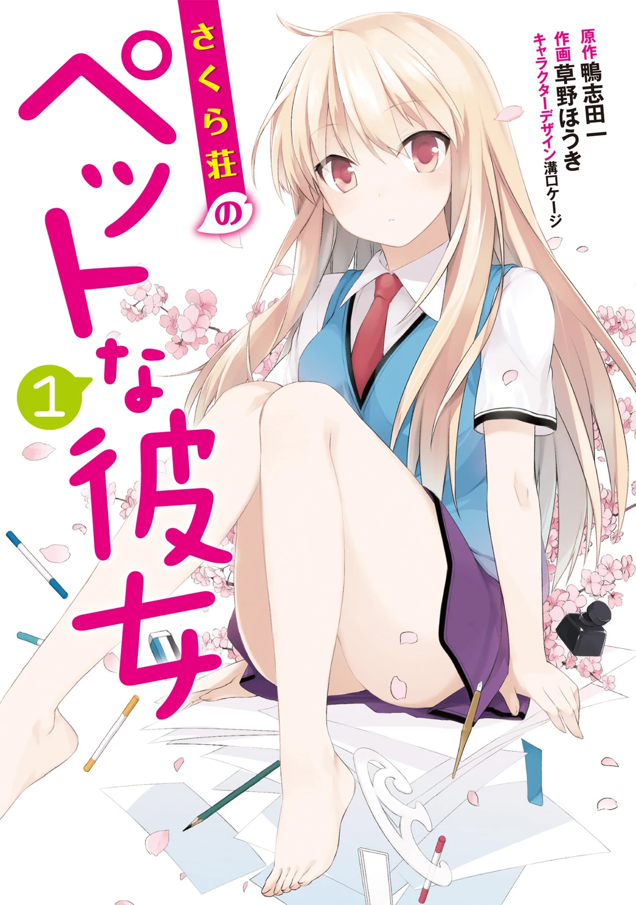
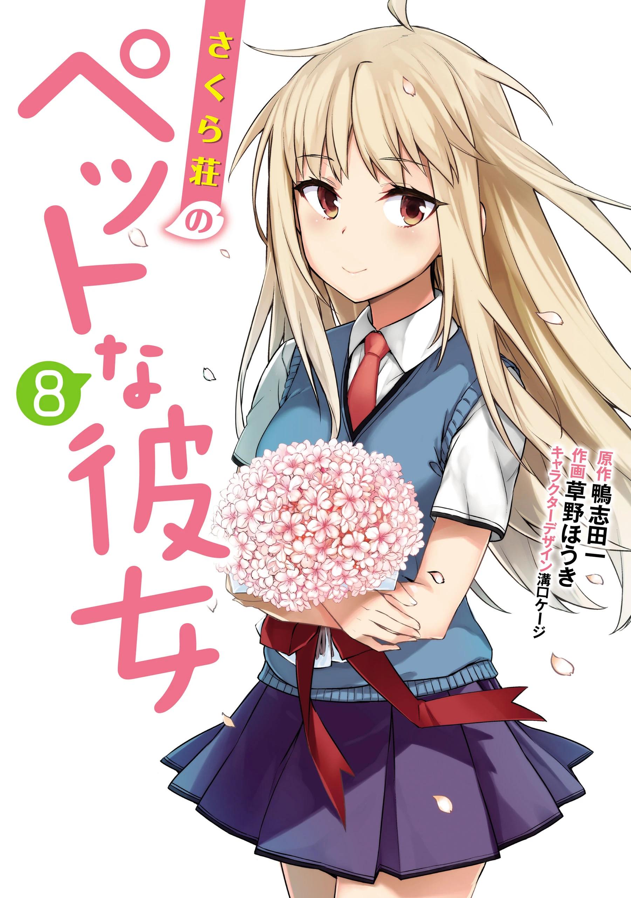

# Sección 05-C: Diferencias entre medios (III) — El manga y las tres versiones de la historia

> **Biblia del universo de Sakura-sou no Pet na Kanojo (さくら荘のペットな彼女)**
> Documento de referencia para el proyecto de fanfic de este repositorio.
> ⚠️ Spoilers de las tres versiones, finales incluidos.

  
  

---

## El manga: la versión que casi nadie menciona y que tiene su propio final

Cuando se habla de "diferencias entre el anime y el original" casi siempre se compara el anime con la novela. Pero existe una tercera versión, **con ocho tomos y un desenlace distinto**, y es la que menos se documenta en español. Aquí va completa.

## Ficha del manga

| Campo | Dato |
|---|---|
| **Título** | さくら荘のペットな彼女 |
| **Original** | 鴨志田一 (Kamoshida Hajime) |
| **Diseño de personajes** | 溝口ケージ (Mizoguchi Kēji) |
| **Dibujo** | **草野ほうき (Kusano Hōki)** |
| **Revista** | 『電撃G's magazine』 (Dengeki G's Magazine), desde el número de **abril de 2011**; después se traslada a 『電撃G'sコミック』 (Dengeki G's Comic) hasta el **volumen 14** |
| **Editorial / sello** | ASCII Media Works → KADOKAWA, sello **電撃コミックス (Dengeki Comics)** |
| **Volúmenes** | **8**, completos |
| **Periodo** | octubre de 2011 – junio de 2015 |

## Los ocho tomos

| Tomo | Fecha de publicación | Páginas | ISBN |
|---|---|---|---|
| **1** | 27 de octubre de 2011 | 194 | 978-4-04-870986-6 |
| **2** | 26 de mayo de 2012 | 194 | 978-4-04-886508-1 |
| **3** | 27 de octubre de 2012 | 162 | 978-4-04-891026-2 |
| **4** | 27 de marzo de 2013 | 162 | 978-4-04-891460-4 |
| **5** | 27 de septiembre de 2013 | 162 | 978-4-04-891921-0 |
| **6** | 27 de marzo de 2014 | 162 | 978-4-04-866387-8 |
| **7** | 27 de octubre de 2014 | 162 | 978-4-04-866941-2 |
| **8** | 27 de junio de 2015 | 162 | 978-4-04-865083-0 |

**Observación cronológica:** el manga arranca **antes** que el anime (2011) y termina **dos años después** (2015). Es decir, el manga vivió las tres etapas: empezó como adaptación de una novela en curso, convivió con el anime y **siguió publicándose después de que el anime terminara**, con lo que tuvo tiempo de llegar a un final propio.

## Qué cubre cada tramo

- **Tomos 1 a 6:** la adaptación de la primera etapa de la novela (llegada de Mashiro, el turno Mashiro, Nanami, el primer concurso, Yuuko, el verano).
- **Tomo 7:** la llegada de **Rita** desde Inglaterra y el camino al **festival cultural**. La sinopsis oficial lo describe así: «Rita viene desde Inglaterra para llevarse a Mashiro, y eso le hace comprender a Sorata la abrumadora magnitud del talento de Mashiro como pintora, y entra en conflicto. Mientras tanto, para el número del festival cultural…». En términos del anime, ese tomo equivale a los **episodios 9 a 12**.
- **Tomo 8 (final):** **los padres de Mashiro vienen a Japón a llevársela de vuelta**. La sinopsis oficial plantea la pregunta: «Sorata se inquieta al saber que los padres de Mashiro vienen a llevarse a su hija. ¿Mashiro dejará Sakura-sō y volverá a Inglaterra? ¿Qué harán entonces los habitantes de Sakura-sō?».

## Por qué el final del manga es distinto

Comparado con las otras dos versiones:

| Versión | Detonante del final | Cómo se resuelve | Qué deja abierto |
|---|---|---|---|
| **Anime (ep. 24)** | La graduación de Misaki y Jin | El dormitorio se salva en el episodio 23; los mayores se van; llegan Kanna e Iori | La relación Sorata–Mashiro (solo un beso en la mejilla) y la declaración de Nanami |
| **Manga (tomo 8)** | **Los padres de Mashiro quieren llevársela a Inglaterra** | La sinopsis oficial la presenta como «tomo final» de una «comedia romántica juvenil emotiva», con Sorata y el dormitorio actuando para impedirlo | El futuro profesional de los personajes |
| **Novela (tomos 9-10 y 10.5)** | La relación mismo (celos, comparación, inseguridad de Sorata) | **Ruptura**, cuatro años de separación, reencuentro y vida adulta | Prácticamente nada: el 10.5 cierra a todos |

> **Nota de honestidad documental:** no se pudo confirmar si el arco de los padres de Mashiro proviene de algún tomo de la novela o si es **una invención del manga** para cerrar su serialización. Se presenta aquí como **el final propio del manga**, sin atribuirlo al autor de la novela.

---

## El anime frente al manga: diferencias de forma

Aunque ambos adaptan el mismo material, no se parecen en cómo lo cuentan:

| Aspecto | Manga | Anime |
|---|---|---|
| **Ritmo** | Más lento; se permite capítulos de pura comedia doméstica | Cuatro episodios por tomo: ritmo alto, sin respiros |
| **Gags** | Recurso al *chibi* y a la deformación cómica de los cuerpos | Comedia de situación y de interpretación (voces, tiempos) |
| **Mashiro** | Más expresiva desde el principio, con caras cómicas | Más contenida; el humor nace de la literalidad |
| **Fanservice** | Más explícito en los desnudos cómicos | Más contenido, pero presente |
| **El dormitorio** | Se dibuja con mucho detalle de arquitectura y desorden | Se prioriza la iluminación y el color |
| **El final** | Los padres de Mashiro | La graduación y los nuevos residentes |

Y hay un detalle de formato que importa: **el manga dibuja a los personajes con la edad que tienen**, mientras que el anime los dibuja ligeramente estilizados hacia arriba (Mashiro mide 162 cm en la ficha, pero en pantalla se la percibe más pequeña por la composición). Es la clase de diferencia que no cambia la historia y sí cambia la lectura.

---

## Un cuarto medio con material original: los drama CD

Entre los medios hay uno que suele olvidarse y que contiene **historias que no existen ni en el anime ni en la novela**:

| Drama CD | Fecha | Contenido |
|---|---|---|
| 『椎名ましろのはじめてのお世話』 (*Los primeros cuidados de Mashiro*) | 28 de junio de 2012 | Historia original escrita por el autor; se publicó junto al lanzamiento del sitio oficial |
| Drama CD del anime, vol. 1 | 30 de enero de 2013 | "Episodios originales no dibujados en el anime" (guion: Nakase Rika) |
| Drama CD del anime, vol. 2 | 27 de febrero de 2013 | Guion: Nishito Ōnuki, con colaboración de Takaoka Hiroaki |
| Drama CD del anime, vol. 3 | 24 de abril de 2013 | Guion: Nakase Rika |

Los tres del anime están concebidos explícitamente como **historia adicional**: la propia ficha de la Wikipedia japonesa los describe como "episodios originales que no se dibujaron en el anime". Para un fanfic, son material canónico de relleno: escenas cotidianas sin consecuencias argumentales.

Existe además un **4-koma oficial de antología** (『4コマ公式アンソロジー さくら荘のペットな彼女』, 27 de febrero de 2013), que no es canon narrativo sino una colección de tiras humorísticas de varios autores.

---

## Las tres versiones, escena por escena: dónde divergen de verdad

| Escena | Novela | Anime | Manga |
|---|---|---|---|
| **La comida para Nanami enferma** | Okayu (gachas de arroz) | **Samgyetang** | Okayu |
| **Clase de Miyahara** | Clase de al lado | **Misma clase** | Clase de al lado |
| **Declaración de Nanami** | **Sí** (final del tomo 7) | **No** | No llega |
| **Declaración de Mashiro** | Sí | Indirecta (ep. 12: "¿esto es amor?") | Sí, en su forma literal |
| **Relación de pareja** | Sí (tomo 9) | No | No |
| **Ruptura** | **Sí** (tomo 10) | No | No |
| **Salto de cuatro años** | **Sí** (tomo 10) | No | No |
| **Boda de Misaki y Jin** | Sí | Sí, por trámite propio (ep. 24) | No llega |
| **Kanna e Iori** | Arcos completos | Solo presentación (ep. 24) | No aparecen |
| **Rita viviendo en Sakura-sō** | Sí (cuarto 203) | No | No |
| **El dormitorio, demolido** | **Sí**, cuando se gradúan los siguientes | No: se salva | No se plantea |

---

## Cuál es "la verdadera" historia

Las tres son oficiales, pero no pesan igual:

1. **La novela es la obra original.** La escribió Kamoshida Hajime, es la única que llega al final del autor y la que se cita como referencia canónica en las wikis. **Si tu fanfic necesita un canon duro, es esta.**
2. **El anime es la versión más conocida** y la que define el imaginario visual de la franquicia (los diseños, las voces, la música). Millones de personas conocen la historia **solo** por los 24 episodios.
3. **El manga es una adaptación con final propio**, útil sobre todo por la idea de los padres de Mashiro, que es un detonante perfecto y que **no está en las otras dos**.

**Recomendación práctica para escribir:**

- **Continuar el anime:** parte del episodio 24 y usa la novela como "mapa de lo que pudo pasar después", aunque la novela no coincida exactamente.
- **Reescribir el final:** el manga te da una alternativa que el anime nunca usó (los padres), y la novela te da otra (la ruptura).
- **Hacer un "what if" de Nanami:** el tomo 7 de la novela es tu documento fuente; ahí ella sí se declara y Sorata queda obligado a responder.

---

## Datos de la franquicia que ayudan a situarse

- **Novela:** 13 tomos (10 principales + 5.5, 7.5 y 10.5), Dengeki Bunko, enero de 2010 a marzo de 2014.
- **Manga:** 8 tomos, Dengeki Comics, octubre de 2011 a junio de 2015.
- **Anime:** 24 episodios, J.C.Staff, octubre de 2012 a marzo de 2013.
- **Juego:** PSP y PS Vita, 14 de febrero de 2013, simulación de producción de juegos + aventura romántica (Kadokawa Games).
- **Drama CD:** 1 original + 3 del anime.
- **4-koma de antología:** 1 tomo.
- **Serie posterior del autor:** 『青春ブタ野郎』 (*Rascal Does Not Dream*), donde aparecen cameos de estos personajes y se menciona la obra de Kanna (Yuigahama Kanna).

---

## Verificación de esta sección

- **Datos del manga** (revista, traslado, 8 tomos, fechas, ISBN, páginas): sección 漫画 de la Wikipedia japonesa y lista de tomos de la Sakurasou Wiki. Ambas coinciden en fechas e ISBN; las páginas provienen de la ficha de cada tomo en Fandom.
- **Contenido del tomo 7:** sinopsis oficial del producto recogida en la ficha de Amazon Japón del tomo (Rita llega desde Inglaterra, el conflicto de Sorata, el festival cultural).
- **Contenido del tomo 8 y su carácter de tomo final:** sinopsis oficial de ebookjapan, que lo etiqueta como 「【最終巻】」(tomo final) y lo describe como «tomo final de una comedia romántica juvenil emotiva» con la llegada de los padres de Mashiro. Se corroboró con la etiqueta 「8巻 完結」 de otro distribuidor.
- **Origen del arco de los padres:** **no verificado**. No se encontró fuente que lo atribuya a la novela; se presenta como final propio del manga y así queda advertido en el texto.
- **Drama CDs:** listado, fechas, guionistas y la descripción 「アニメでは描かれていないオリジナルエピソード」 de la Wikipedia japonesa.
- **4-koma:** ficha del producto en KADOKAWA citada por la Wikipedia japonesa (27/02/2013, ISBN 978-4-04-891409-3).
- **Punto donde las fuentes difieren:** la fecha del tomo 8 del manga es 27 de junio de 2015 según KADOKAWA y la Wikipedia japonesa, mientras ebookjapan registra la fecha de disponibilidad digital como 30 de julio de 2015. Se usa la de papel y se señala la otra.

---

## Fuentes de esta sección

1. **Wikipedia en japonés — さくら荘のペットな彼女**, secciones 漫画, ドラマCD e 既刊一覧: https://ja.wikipedia.org/wiki/さくら荘のペットな彼女
2. **Sakurasou Wiki (Fandom) — Sakurasou no Pet na Kanojo (Manga)** y lista de tomos: https://sakurasou.fandom.com/wiki/Sakurasou_no_Pet_na_Kanojo_(Manga)
3. **ebookjapan** — ficha del tomo 8 del manga (sinopsis oficial y etiqueta de tomo final): https://ebookjapan.yahoo.co.jp/books/201813/A001548305/
4. **Amazon Japón** — ficha del tomo 7 del manga (sinopsis oficial): https://www.amazon.co.jp/dp/B00PFMHCLI
5. **KADOKAWA** — fichas de producto de los tomos del manga y del 4-koma de antología: https://www.kadokawa.co.jp/
6. **J-Novel Club** — edición oficial en inglés de la novela: https://j-novel.club/series/the-pet-girl-of-sakurasou

---

*Documento anterior: [05-B — Los cambios concretos del anime](05b-diferencias-cambios-anime.md) · Volver al [índice de la biblia](README.md)*
