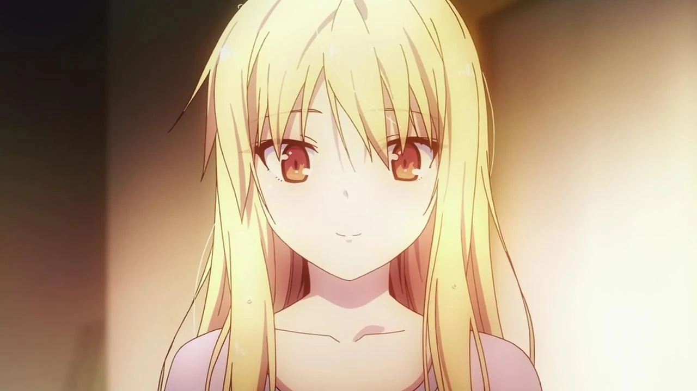
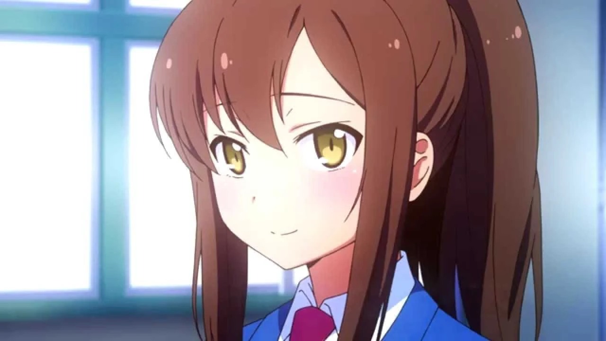
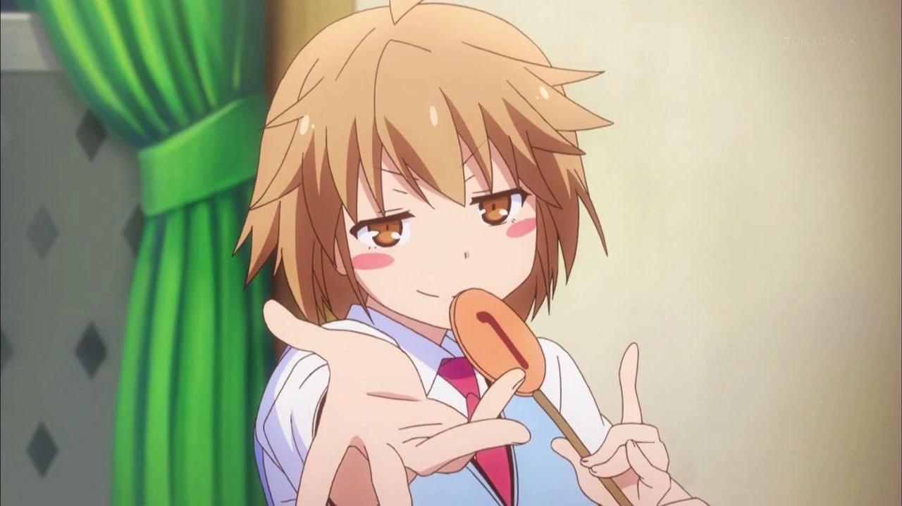
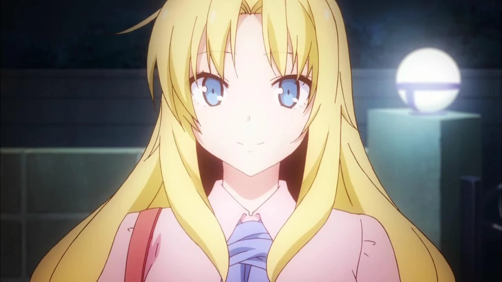
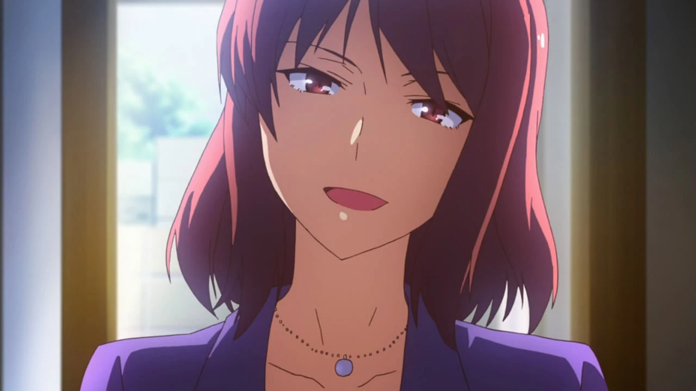

# Sección 06-A: Lista de waifus (I) — Metodología y el ranking

> **Biblia del universo de Sakura-sou no Pet na Kanojo (さくら荘のペットな彼女)**
> Documento de referencia para el proyecto de fanfic de este repositorio.
> ⚠️ Contiene spoilers de todo el anime y de la novela.

  
  
  

---

## Antes de empezar: cómo se hizo este ranking

Una lista de waifus no es una investigación académica, pero tampoco tiene por qué ser un capricho. Aquí se mezclan **tres tipos de dato** y cada uno va etiquetado:

1. **Datos duros de popularidad.** El número de **favoritos** que cada personaje tiene registrados hoy en AniList, la base de datos internacional de anime más usada después de MyAnimeList. Son cifras reales, consultadas el **2 de noviembre de 2026**, y sirven como termómetro de la comunidad global.
2. **Datos oficiales de la franquicia.** Qué personajes recibieron tarjeta en **嫁コレ (Yome Collection)**, la aplicación de "colección de esposas" de KADOKAWA que certificaba con voz y ficha a las heroínas, y en qué orden salieron.
3. **Análisis propio de la biblia.** Puntuaciones sobre arquetipo, arco y química con el protagonista. Van marcadas como **criterio editorial** y no como hecho.

> **Nota de criterio:** el reparto de esta obra es de secundaria, así que este documento evalúa **personaje, arquetipo y función narrativa** (lo que la comunidad llama "waifu" en el sentido de *personaje femenino favorito*), no anatomía. Por eso **Yūko Kanda**, que tiene 13-14 años y es la hermana del protagonista, queda **fuera del ranking** y se trata en el apartado de "categorías especiales" con la etiqueta que le da el propio fandom: *imōto*, no *waifu*.

---

## El dato que ordena todo: los favoritos reales

Estos son los números de **AniList** (favoritos acumulados por personaje, consultados el 2/11/2026):

| Puesto | Personaje | Favoritos | % del total femenino |
|---|---|---|---|
| 1 | **Mashiro Shiina** | **4 515** | 60,8 % |
| 2 | **Nanami Aoyama** | **2 174** | 29,3 % |
| 3 | **Misaki Kamiigusa** | **535** | 7,2 % |
| 4 | **Rita Ainsworth** | **154** | 2,1 % |
| 5 | **Chihiro Sengoku** | **91** | 1,2 % |
| 6 | Yuuko Kanda | 34 | 0,5 % |
| 7 | Saori Himemiya | 8 | 0,1 % |
| 8 | Kanna Hase | 5 | 0,07 % |
| 9 | Akiko Kanda | 4 | 0,05 % |
| 10 | Yayoi Honjō | 2 | 0,03 % |
| 11 | Mayu Takasaki | 1 | 0,01 % |
| 11 | Fūka Kamiigusa | 1 | 0,01 % |
| 11 | Shiho Fukaya | 1 | 0,01 % |
| 11 | Otoha Nakano | 1 | 0,01 % |
| 15 | Shiori Nanba | 0 | 0 % |

**Y para comparar con los chicos** (mismo día, misma fuente):

| Personaje | Favoritos |
|---|---|
| Sorata Kanda | 571 |
| Ryūnosuke Akasaka | 523 |
| Jin Mitaka | 201 |

### Lo que revelan estos números

- **Mashiro duplica a Nanami** (4 515 contra 2 174). La heroína oficial gana, y con margen.
- **Nanami concentra casi un tercio del total femenino** sin ser la protagonista. Es una cifra altísima para una "perdedora" y explica por qué su fandom es el más ruidoso de la franquicia.
- **El tercer puesto es de Misaki, pero por poco**: 535 contra los **523 de Ryūnosuke**. Es decir, el "chico trampa" de la 102 está prácticamente empatado con la tercera chica más querida. Es uno de los datos más curiosos de la serie.
- **Sorata (571) tiene más favoritos que Misaki (535).** El protagonista, al que la serie llama "normal", es más popular que una de sus heroínas.
- **Rita cuadruplica a Chihiro** (154 contra 91), pese a aparecer en menos episodios. La extranjera con pasado trágico rinde mucho por minuto en pantalla.
- **Del sexto puesto hacia abajo, los números se desploman.** Confirma que esta serie tiene **cinco personajes femeninos con presencia real** y el resto es reparto de apoyo.

---

## El ranking de la biblia: el top 5 de waifus

Con los números arriba y el análisis narrativo debajo, este es el podio. **Las puntuaciones son criterio editorial de esta biblia**, no una encuesta.

| # | Personaje | Arquetipo | Puntuación /50 |
|---|---|---|---|
| **1** | **Mashiro Shiina** | *kuudere* genio, "la que hay que cuidar" | **45** |
| **2** | **Nanami Aoyama** | *tsundere* suave, la chica normal que se esfuerza | **44** |
| **3** | **Rita Ainsworth** | *ojōsama* deredere, rival-domesticada | **38** |
| **4** | **Misaki Kamiigusa** | *genki* *onee-san*, genio inestable | **37** |
| **5** | **Chihiro Sengoku** | *onee-san* adulta, profesora desastrosa | **34** |

---

## 1. Mashiro Shiina — la que ganó

| Aspecto | Dato |
|---|---|
| **Favoritos (AniList)** | **4 515** (1.ª del reparto, 60,8 % del total femenino) |
| **Tarjeta en 嫁コレ** | Sí, la primera de las tres: **5 de julio de 2013** |
| **Arquetipo** | *Kuudere* + *genio* + *deredere* tardía |
| **Edad / cumpleaños** | 17 · 13 de junio (Géminis) · sangre A |
| **Altura / medidas** | 162 cm · 79-55-78 cm |
| **Seiyū** | 茅野愛衣 (Kayano Ai) |

**Por qué está en el primer puesto.** Porque es la única del reparto cuyo arco consiste enteramente en **aprender a querer**, y el espectador aprende con ella. La serie la construye como un ser incompleto: no sabe vestirse, no sabe comer, no entiende la vergüenza, no reconoce los celos. Cuando en el episodio 12 dice *"esta zona se siente rara… ¿esto es amor?"*, lo que se celebra no es una declaración: es **una persona entera naciendo delante de la cámara**.

Es, además, el personaje visualmente más reconocible de la franquicia: blanca de piel, de pelo, de ropa y de nombre. **Su diseño es su tesis.**

---

## 2. Nanami Aoyama — la que perdió y aun así ganó

| Aspecto | Dato |
|---|---|
| **Favoritos (AniList)** | **2 174** (2.ª, 29,3 % del total femenino) |
| **Tarjeta en 嫁コレ** | Sí, la segunda: **19 de julio de 2013** |
| **Arquetipo** | *Tsundere* suave + *ganbatte* (la que se esfuerza) |
| **Edad / cumpleaños** | 16-17 · 6 de septiembre (Virgo) · sangre A |
| **Altura / medidas** | 158 cm · 81-58-83 cm |
| **Seiyū** | 中津真莉子 (Nakatsu Mariko) |

**Por qué es la favorita de media fandom.** Porque es **la única persona de la serie que paga un precio real por su sueño**. Trabaja en una tienda de conveniencia, estudia en una escuela de actuación de voz, cocina para todos y aun así fracasa dos veces. No es genio: es la prueba de que el esfuerzo no garantiza nada, y por eso su derrota duele más que cualquier victoria ajena.

**El detalle que la corona:** nunca se declara. En la novela sí lo hace (final del tomo 7); en el anime elige callarse para que Sorata no tenga que decidir. Ese silencio es, probablemente, la decisión más generosa de toda la obra, y explica por qué hay gente que **la considera la verdadera protagonista emocional de la serie**.

---

## 3. Rita Ainsworth — la rival que se quedó

| Aspecto | Dato |
|---|---|
| **Favoritos (AniList)** | **154** (4.ª, 2,1 %) |
| **Tarjeta en 嫁コレ** | **No** |
| **Arquetipo** | *Ojōsama* extranjera + *deredere* persistente |
| **Edad / cumpleaños** | 17 · 4 de abril (Aries) · sangre B |
| **Altura** | 163 cm |
| **Seiyū** | 川澄綾子 (Kawasumi Ayako) |

**Por qué entra en el podio pese a sus números.** Porque su arco es el más corto y el más completo de toda la serie: llega a llevarse a Mashiro, se enfrenta a ella, se derrumba, confiesa por qué lo hizo y **vuelve a pintar**. Todo en tres episodios.

Y por el detalle que la vuelve inolvidable: **es la única persona capaz de tocar a Ryūnosuke** sin que él salga corriendo, y la que bloquea sistemáticamente Maid-chan para poder escribirle. La pareja imposible más divertida de la obra.

---

## 4. Misaki Kamiigusa — la tormenta

| Aspecto | Dato |
|---|---|
| **Favoritos (AniList)** | **535** (3.ª, 7,2 %) |
| **Tarjeta en 嫁コレ** | Sí, la tercera: **13 de agosto de 2013** |
| **Arquetipo** | *Genki* + *onee-san* + genio inestable |
| **Edad / cumpleaños** | 17 (al inicio) · 14 de junio (Géminis) · sangre O |
| **Altura** | 156 cm |
| **Seiyū** | 高森奈津美 (Takamori Natsumi) |

**Por qué no está más arriba, y por qué merece estar.** Misaki entra por la ventana, grita, conduce como una criminal y se declara con un bentō. Es el personaje más agotador del reparto y, a la vez, el más generoso: **llenó Sakura-sō de gente** antes de que llegara nadie, y sostiene el ánimo de la casa cuando todo se cae.

Su escena decisiva no es cómica: es la del episodio 14, cuando acepta el rechazo de Jin y llora porque **habría preferido que la hiriera**. Ahí la serie demuestra que la *genki* también se rompe.

---

## 5. Chihiro Sengoku — la adulta

| Aspecto | Dato |
|---|---|
| **Favoritos (AniList)** | **91** (5.ª, 1,2 %) |
| **Tarjeta en 嫁コレ** | **No** |
| **Arquetipo** | *Onee-san* desastrosa + mentora |
| **Edad / cumpleaños** | 30 años (dice 29 y unos meses) · 25 de mayo (Géminis) · sangre O |
| **Altura** | 164 cm |
| **Seiyū** | 豊口めぐみ (Toyoguchi Megumi) |

**Por qué cierra el top 5.** Porque es **la única adulta femenina del reparto** y eso la convierte en una categoría aparte: la profesora que bebe cerveza en el suelo de la sala común, se declara "de 29 años" y, cuando la administración quiere tirar el edificio, es la primera que se planta.

Para quien busca el arquetipo *onee-san* en esta franquicia, **Chihiro es la única opción real**, y su encanto no está en el físico sino en la mezcla de pereza y lucidez.

---

## El ranking de apoyo: del 6 al 15

No son "waifus" en sentido estricto, pero completan la lista y tienen su propio público.

| Puesto | Personaje | Favoritos | Qué es |
|---|---|---|---|
| **6** | **Yuuko Kanda** | 34 | La hermana. *Imōto* con complejo de hermano mayor. **Fuera del ranking por edad y por parentesco** |
| **7** | **Saori Himemiya** | 8 | La pianista serena, novia del presidente del consejo |
| **8** | **Kanna Hase** | 5 | La *kōhai* novelista premiada a los 14 |
| **9** | **Akiko Kanda** | 4 | La madre de Sorata. Categoría *mother*, no *waifu* |
| **10** | **Yayoi Honjō** | 2 | La deportista alta, 175 cm, novia de alguien |
| **11** | **Mayu Takasaki** | 1 | La amiga casamentera de Nanami |
| **11** | **Fūka Kamiigusa** | 1 | La hermana de Misaki, ex de Jin |
| **11** | **Shiho Fukaya** | 1 | La compañera de arte que se reinventa |
| **11** | **Otoha Nakano** | 1 | La chica del videojuego con cameo |
| **15** | **Shiori Nanba** | 0 | La instructora "Nancy". Nadie la ha marcado como favorita |

---

## Criterios usados para el podio (y cómo cambiaría si cambiaran)

Cada personaje se puntuó sobre 10 en cinco ejes. Total sobre 50.

| Eje | Qué mide | Peso |
|---|---|---|
| **Presencia visual** | Qué tan reconocible es su diseño de un vistazo | 10 |
| **Arco** | Cuánto cambia y cuánto cuesta su cambio | 10 |
| **Química con Sorata** | Si la escena funciona cuando están juntos | 10 |
| **Factor cuidado** | El "alguien a quien proteger / que te cuide" | 10 |
| **Versatilidad narrativa** | Cuántas historias distintas admite el personaje | 10 |

| Personaje | Presencia | Arco | Química | Cuidado | Versatilidad | **Total** |
|---|---|---|---|---|---|---|
| Mashiro | 10 | 9 | 9 | 8 | 9 | **45** |
| Nanami | 8 | 10 | 9 | 8 | 9 | **44** |
| Rita | 8 | 8 | 6 | 7 | 9 | **38** |
| Misaki | 9 | 8 | 6 | 6 | 8 | **37** |
| Chihiro | 7 | 6 | 5 | 6 | 10 | **34** |

> **Si tu fanfic prioriza otra cosa, el orden cambia.** Para una historia de romance puro, Nanami empata con Mashiro. Para una comedia coral, Misaki sube al segundo puesto. Para una trama de adultos, Chihiro gana por goleada porque es la única que tiene vida fuera del instituto.

---

## Verificación de esta sección

- **Todos los números de favoritos** son consultas directas a la API pública de **AniList** (GraphQL, campo `favourites`), realizadas el **2 de noviembre de 2026**. Son cifras vivas: cambian a diario, así que se citan con fecha.
- **Los porcentajes** son cálculo propio sobre la suma de los 15 personajes femeninos listados (7 423 favoritos en total), y así se indica.
- **Las tarjetas de 嫁コレ** y sus fechas (Mashiro 5/07/2013, Nanami 19/07/2013, Misaki 13/08/2013) provienen de la sección ゲーム de la Wikipedia japonesa.
- **Los datos físicos** (cumpleaños, altura, medidas, sangre) provienen de las fichas de la Sakurasou Wiki y de la Wikipedia japonesa, y coinciden con los publicados en la sección 03 de esta biblia.
- **Las puntuaciones y el podio son criterio editorial** de esta biblia. No se presentan como encuesta ni como dato oficial, y por eso se explican los cinco ejes con sus pesos.
- **No existe una encuesta oficial de popularidad** de la franquicia localizada para esta investigación. Se intentó y no se encontró: los resultados de búsqueda en japonés devuelven listas de fans y foros, no votaciones de la editorial o del estudio. Por eso el ranking se apoya en favoritos medibles y no en "encuestas" no verificables.

---

## Fuentes de esta sección

1. **AniList API (GraphQL)**, campo `favourites` por personaje — consulta del 2 de noviembre de 2026: https://anilist.co
2. **Wikipedia en japonés — さくら荘のペットな彼女**, sección ゲーム (嫁コレ): https://ja.wikipedia.org/wiki/さくら荘のペットな彼女
3. **Sakurasou Wiki (Fandom)** — fichas de Mashiro Shiina, Nanami Aoyama, Misaki Kamiigusa, Rita Ainsworth y Chihiro Sengoku: https://sakurasou.fandom.com
4. **Baidu Baike — さくら荘のペットな彼女 / 樱花庄的宠物女孩** (datos físicos de Nanami): https://baike.baidu.com
5. **キャラ属性王国 (chara-zokusei.jp)** — etiquetas de atributos y arquetipos de los personajes: https://www.chara-zokusei.jp/search?series_id=123

---

*Siguiente documento: [06-B — Las fichas de waifu, una por una](06b-waifus-fichas.md)*
