# Sección 06-B: Lista de waifus (II) — Las fichas, una por una

> **Biblia del universo de Sakura-sou no Pet na Kanojo (さくら荘のペットな彼女)**
> Documento de referencia para el proyecto de fanfic de este repositorio.
> ⚠️ Spoilers del anime y de la novela.

  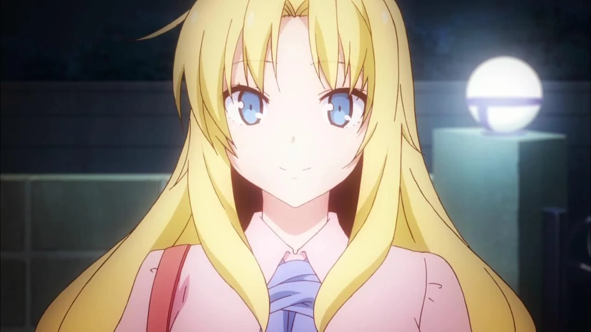
  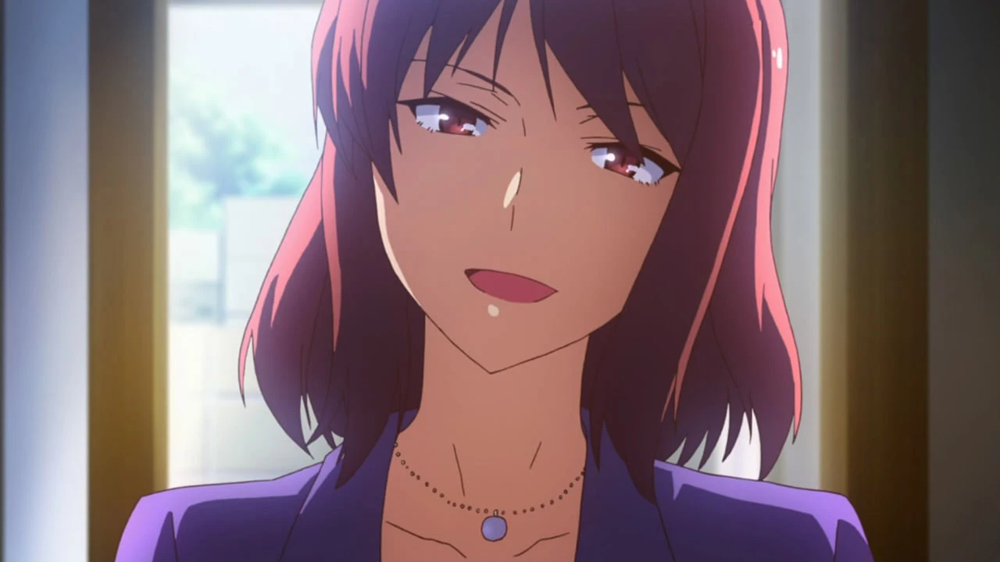
  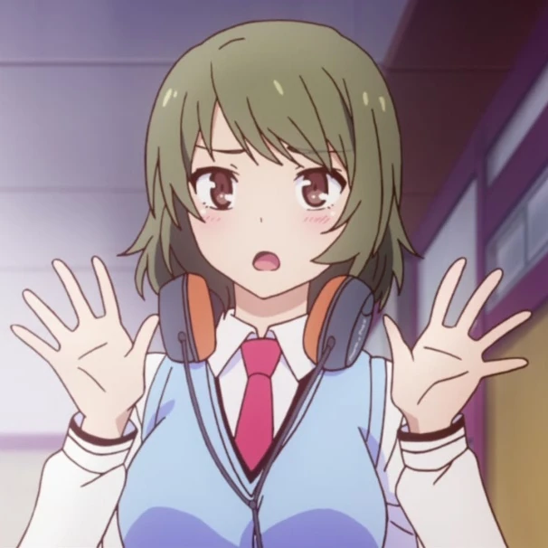

---

## Cómo leer estas fichas

Cada entrada sigue la misma estructura, porque el objetivo no es decir "me gusta" sino **poder escribirla**:

- **Arquetipo** en terminología otaku, más su traducción.
- **Qué la hace querible**: el mecanismo concreto, no el adjetivo.
- **Escena decisiva**: el momento que la define y el episodio exacto.
- **Cita**.
- **Defecto humanizador**: lo que la hace imperfecta y por eso creíble.
- **Cómo escribirla en romance**: una guía práctica para el fanfic.
- **Qué tipo de historia le va** y qué tipo la rompe.

---

# 1. Mashiro Shiina

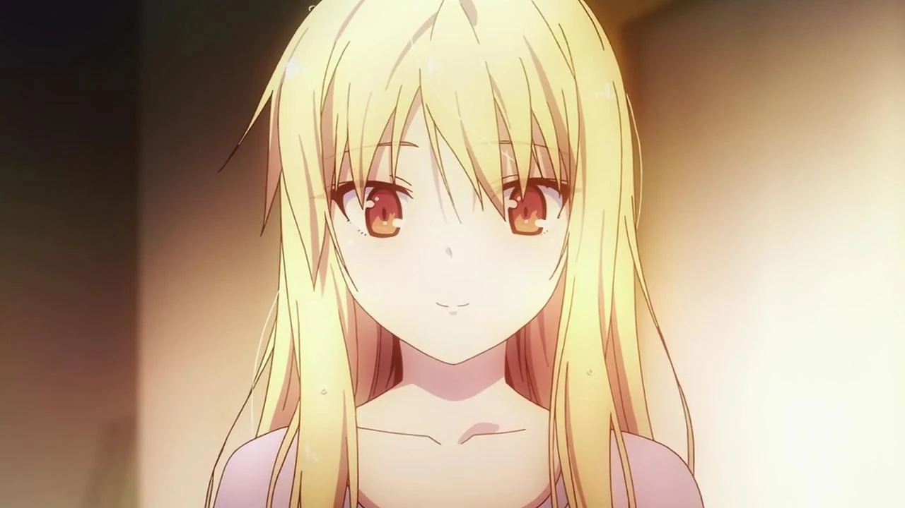

## Arquetipo

***Kuudere*** (クーデレ): la chica que no expresa emoción y que, cuando la expresa, ya no hay vuelta atrás. Cruzada con ***tensai*** (天才, genio) y con una variante poco común: **no es fría por elección, es literal por construcción**. La diferencia importa muchísimo a la hora de escribirla.

## Qué la hace querible (el mecanismo)

La serie usa un truco muy eficaz: **te la presenta como un problema y te la convierte en una persona**. Al principio el chiste es que no sabe vestirse; al final, la escena en la que se viste sola es un acontecimiento emocional. El espectador se da cuenta de que lleva doce episodios celebrando microprogresos, y ahí ya está enamorado.

A eso se suma el **contraste**: es la mejor del mundo en una cosa (pintar) y la peor del mundo en todas las demás. Esa asimetría la vuelve inofensiva y, a la vez, imposible de ignorar.

## Escena decisiva

**Episodio 12.** Después de toda la primera mitad de la serie comportándose como un objeto en movimiento, Mashiro se queda quieta y dice que siente algo raro en el pecho. No sabe nombrarlo. Pregunta si eso es amor. Es la primera vez que la serie le da **una pregunta interna**, y con eso la convierte en protagonista.

La segunda escena clave es el **episodio 4**, cuando Sorata la hiere sin querer con un comentario sobre su manga y ella se derrumba: ahí se descubre que su aparente frialdad no era ausencia de sentimientos, sino incapacidad de mostrarlos.

## Cita

> 「空太のばか」 — *"Sorata, tonto."*
> Su única forma de decir "me importas" cuando no sabe decir nada.

## Defecto humanizador

**Es una carga.** Y la serie no lo disimula: depende de otros para comer, vestirse, llegar a casa y no ser estafada. Cualquier historia que la vuelva autosuficiente de golpe la traiciona. Su encanto incluye el precio.

## Cómo escribirla en romance

1. **Nada de indirectas.** Mashiro no las entiende. Si le dices "hace frío", no se abriga: te pregunta si es una observación meteorológica. Todo lo que sientas tienes que decirlo con palabras exactas.
2. **Su amor es atención.** No sabe dar discursos, pero recuerda el sabor exacto del baumkuchen que le compraste, y se lo pide a los tres meses.
3. **Su celo es silencioso.** No grita: se queda mirando, con la cara nublada, y no sabe por qué. Escribe eso, no una escena de celos de telenovela.
4. **El avance romántico se mide en actos permitidos.** Que le tome la mano, que la llame por su nombre, que se deje ver sin ropa: cada uno es un hito, no un chiste.
5. **Cuidado con el "yo la arreglo".** Su arco no es que alguien la haga normal; es que alguien la acompañe mientras aprende.

## Qué historia le va / qué la rompe

- **Le va:** romance de cuidado mutuo, historias de descubrimiento sensorial, tramas donde el conflicto es interno.
- **La rompe:** la comedia de acoso, el protagonista que se aprovecha de su ignorancia, la trama en la que "aprende a ser mujer" de la mano de un hombre.

---

# 2. Nanami Aoyama

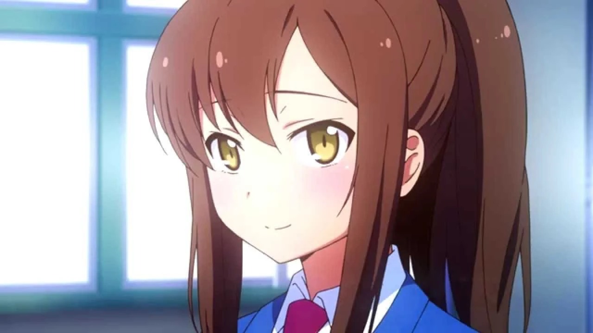

## Arquetipo

***Tsundere*** en su versión más suave y más realista, cruzada con ***ganbaru ko*** (頑張る子, la chica que se esfuerza) y con un toque de ***boku-kko*** de clase trabajadora. No es una *tsundere* de gritos y golpes: es una chica educada que se pone rígida cuando le hablan de sentimientos.

## Qué la hace querible (el mecanismo)

**Es la única que no tiene talento.** En una casa de genios, Nanami es la que trabaja en una tienda de conveniencia para pagarse la escuela de actuación de voz, la que cocina para cinco personas, la que cuida a Mashiro por principios y la que fracasa dos veces seguidas.

El público no se enamora de su destreza, sino de su **desventaja**. Cuando Sorata le dice "si tú eres idiota, el mundo entero también", lo que la serie hace es absolverla, y el espectador siente que lo absuelven a él.

## Escena decisiva

**Episodio 21.** Después de suspender la segunda audición, Nanami se derrumba en clase y Sorata la sostiene bajo la lluvia. Ahí dice lo que llevaba dos años callando: que usó a los demás como distracción para no enfrentar sus fracasos. Es una autocrítica brutal, del personaje más trabajador de la serie.

La otra es el **episodio 22**: empieza a declararse, se desvía a medio camino y termina dándole las gracias. Cuando él se va, confiesa al aire que pudo esforzarse porque estaba enamorada de él.

## Cita

> *"Hay cosas que no puedes decirle a alguien, por muy cerca que estés de esa persona."*

## Defecto humanizador

**Se sabotea.** Trabaja hasta enfermar, acepta más de lo que puede y, cuando está a punto de conseguir algo, se aparta. Su virtud (no rendirse) y su defecto (no saber parar) son la misma cosa.

## Cómo escribirla en romance

1. **El acento es su termómetro.** Habla japonés estándar por disciplina; cuando se enfada o entra en pánico **se le escapa el dialecto de Osaka**. Úsalo como indicador de emoción, no como chiste.
2. **No sabe recibir.** Aceptar un cumplido le cuesta más que suspender un examen. Si le dices algo bonito, responderá con una molestia fingida y luego lo repetirá en voz baja.
3. **El pelo.** La coleta atada es su armadura; el pelo suelto, su intimidad. Es un detalle gratuito y eficacísimo.
4. **Su amor es práctico.** No escribe cartas: aparece con comida. Si quieres que demuestre cariño, haz que cocine para alguien sin que se lo pidan.
5. **Su final feliz no es ganar.** Es reconciliarse con su familia (los padres que se oponían) y atreverse a intentarlo otra vez. Si tu historia la hace famosa de la noche a la mañana, la estás recompensando por lo que la serie dice que no basta.

## Qué historia le va / qué la rompe

- **Le va:** historias de esfuerzo y derrota, romance con malentendidos, tramas familiares, el "casi" permanente.
- **La rompe:** convertirla en la chica perfecta que gana siempre, o hacerla declararse sin consecuencias.

---

# 3. Rita Ainsworth

## Arquetipo

***Ojōsama*** (お嬢様, señorita de buena familia) extranjera, cruzada con ***deredere*** (la que se derrite sin disimulo) y con un fondo de **rival herida**. Es la villana de tres episodios que termina siendo la más leal.

## Qué la hace querible (el mecanismo)

Porque **su derrota es la misma que la de cualquier persona con un amigo más talentoso**. Rita no es mala: es la única que se atreve a decir en voz alta lo que todos callan, que el talento de Mashiro dejó un cementerio de compañeros a su alrededor.

Y porque su villanía tiene una explicación **vergonzosa para ella misma**: le enseñó el manga a Mashiro deseando que fracasara. Cuando Mashiro triunfa, Rita no puede ni odiarla bien.

## Escena decisiva

**Episodio 10.** Confiesa su pasado al grupo, sale corriendo bajo la lluvia y Ryūnosuke la destroza con una frase. Después, Sorata la encuentra y le dice lo único que necesita oír: **que fue la única que se quedó**, cuando todos los demás alumnos se marcharon del atelier. Rita llora, y al día siguiente vuelve a pintar.

En el **episodio 12** se despide en el aeropuerto con un beso en la mejilla que hace que Ryūnosuke se desmaye; en el **24** vuelve y repite el gesto delante de todos, incluida una Maid-chan que recibe un beso a través de la tablet.

## Cita

*(No tiene una cita canónica recogida por las wikis; su discurso del episodio 10 es la clave: "yo dejé de pintar porque no podía alcanzarte".)*

## Defecto humanizador

**Es rencorosa y lo sabe.** Su amabilidad es una armadura y su crueldad, una confesión. Ryūnosuke se lo dice sin anestesia: "tu sonrisa es falsa".

## Cómo escribirla en romance

1. **Es la única que da el primer paso**, siempre. Le da igual el ridículo: si quiere algo, lo dice, lo pide y lo intenta otra vez.
2. **Su educación la hace exagerada.** Abre puertas, pide permiso, se disculpa demasiado: y en el momento clave suelta la frase más directa de la escena.
3. **Con Ryūnosuke, la distancia física es obligatoria.** No puede tocarlo sin que él se desmaye. Todo contacto es un evento. Escríbelo con esa tensión.
4. **Su arco no es superar a Mashiro**, es **pintar sin ganar**. Ese es su verdadero final feliz.

## Qué historia le va / qué la rompe

- **Le va:** rivalidades femeninas bien escritas, romance a distancia, tramas de superación profesional, el "enemigo que se queda a vivir en casa".
- **La rompe:** la trama en la que "es mala porque sí", o en la que se vuelve sumisa de golpe.

---

# 4. Misaki Kamiigusa

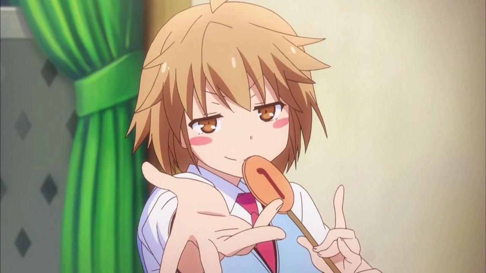

## Arquetipo

***Genki*** (元気, la hiperactiva) + ***onee-san*** (la mayor que cuidan a todos) + **genio** con crisis. Es el arquetipo que suele ser solo ruido y que aquí tiene un fondo trágico muy bien construido.

## Qué la hace querible (el mecanismo)

Porque **es la que llena la casa**. Antes de que llegara nadie, Misaki limpiaba y cuidaba las habitaciones vacías de Sakura-sō esperando que llegara gente. Toda su energía no es felicidad: es **espera**.

Y porque es la única del reparto que ya perdió lo que quería (la beca de arte, por dedicarse al anime) y aun así sigue dibujando todos los días.

## Escena decisiva

**Episodio 14 (Nochebuena).** Se declara con un bentō, Jin la rechaza con toda la delicadeza del mundo y ella llora diciendo que **habría preferido que la hiriera**. En tres minutos, la serie desmonta su personaje y lo reconstruye.

Y el **episodio 23**: su discurso de graduación se convierte en un mitin para salvar el dormitorio, con los broches de flor de cerezo volando por el patio. Es la mejor escena del anime.

## Cita

> *"Nos encontramos en conflicto muchas veces. Hubo momentos duros en los que queríamos huir o rendirnos. Pero fue solo porque cayó esa lluvia, que las semillas de nuestros sentimientos pudieron germinar."*
> (Su discurso de graduación.)

## Defecto humanizador

**No tiene escala.** Ama, trabaja y se derrumba al máximo volumen. Es incapaz de dosificar nada, y eso la vuelve agotadora para quien la rodea.

## Cómo escribirla en romance

1. **Todo lo hace en público.** No hay gesto privado: se declara con formulario de matrimonio en el casillero y con ella misma envuelta en un listón.
2. **Su forma de amar es producir.** Le escribe guiones a Jin, le anima el proyecto a Sorata, le hace un traje a Mashiro. Si quieres que demuestre cariño, haz que haga algo con las manos.
3. **Cuando la hieren, no grita: se apaga.** Es el detalle más importante para escribirla bien. Su caída es silencio, no drama.
4. **Su relación con Jin es de espejo.** Él la admira y le duele; ella no lo entiende. La tensión no es "¿la quiere?", es "¿puede estar a su altura?".

## Qué historia le va / qué la rompe

- **Le va:** comedia coral, historias de artistas, romance unilateral que se resuelve tarde, "la que sostiene a todos".
- **La rompe:** reducirla a gag de gritos, o darle una escena de llanto sin consecuencias.

---

# 5. Chihiro Sengoku

## Arquetipo

***Onee-san*** adulta en su versión más honesta: no la mujer fatal, sino la profesora de treinta años que duerme en el suelo con una lata de cerveza. Es el arquetipo *sensei perezosa* con fondo de mentora.

## Qué la hace querible (el mecanismo)

Porque **es la única adulta que no da lecciones**. Todos los consejos que suelta parecen bromas y resultan ser ciertos ("no veas el mundo en blanco y negro, velo en gris"). Y porque cuando llega el momento importante —la administración quiere tirar el edificio— es la primera que se planta.

Su encanto es el del **adulto desastrado que, en realidad, sostiene la casa**.

## Escena decisiva

**Episodio 14.** En el bar, le explica a Sorata que Mashiro está aprendiendo a través de él, y le avisa de lo que va a costar. Es la única que habla de la relación como un adulto, sin romanticismo.

Y el **episodio 23**, cuando abofetea a Kazuki y exige la votación: la pereza se cae de golpe y aparece la profesora.

## Cita

- *"Ser adulto no es decidir por tu cuenta, sino aprender a escuchar a los demás."* (episodio 24, paráfrasis de la traducción del resumen de la wiki.)
- *"No veas el mundo en blanco y negro. Velo en gris."* (episodio 14, paráfrasis.)

## Defecto humanizador

**Está estancada.** Treinta años, un trabajo que no eligió, un dormitorio de adolescentes como casa y un chiste recurrente sobre su edad que es, en realidad, un lamento. La serie nunca la compadece, y ahí está su dignidad.

## Cómo escribirla en romance

1. **Es la única del reparto con vida adulta**: trabajo, burocracia, dinero, resaca. Úsala para escenas de mundo real.
2. **Coquetea sin intención**, y si le responden, se asusta. Es un arquetipo, no una depredadora.
3. **Su romance es de reparación.** Con Kazuki, la historia es de dos personas que se eligieron tarde.
4. **No la hagas madre sustituta.** La serie evita ese cliché y ahí está su fuerza: cuida sin maternalizar.

## Qué historia le va / qué la rompe

- **Le va:** tramas de adultos, romance tardío, conflictos institucionales, comedia de oficina docente.
- **La rompe:** la escena en la que da un discurso solemne. Nunca lo hace; siempre lo dice borracha o de lado.

---

# 6. Yuuko Kanda — categoría *imōto* (fuera del ranking)

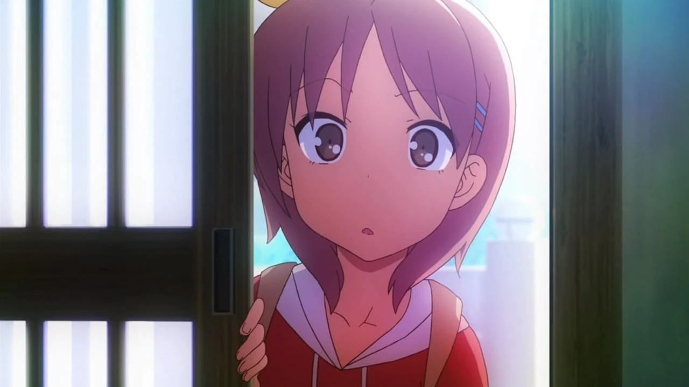

**Por qué no está en la lista.** Tiene **13-14 años**, es la hermana del protagonista y su rasgo definitorio es el complejo de hermano mayor. El fandom la clasifica como *imōto* (妹, hermanita), no como waifu, y esta biblia respeta esa distinción.

**Aun así, es un personaje excelente:** es la única persona de la serie que le dice a Sorata en la cara lo que nadie más se atreve ("deberías haberte fijado en Nanami"), y su aparición en el episodio 24 —la sorpresa de que sí aprobó el examen— es uno de los mejores chistes construidos de la serie.

---

# 7. El resto del reparto femenino, en breve

## Saori Himemiya

**Arquetipo:** la *ojōsama* silenciosa, pianista. Novia de Tatebayashi, hermana de Iori, futura estudiante en Austria.
**Aporte:** es la única presencia musical del reparto y la que hace sonar el piano en la graduación. Su apodo "Hau-nyan" (por la marca de sus audífonos) es el chiste más tonto y más recordado de la serie.
**Para el fanfic:** perfecta como personaje de fondo elegante, o como puente entre el mundo escolar y el artístico.

## Kanna Hase

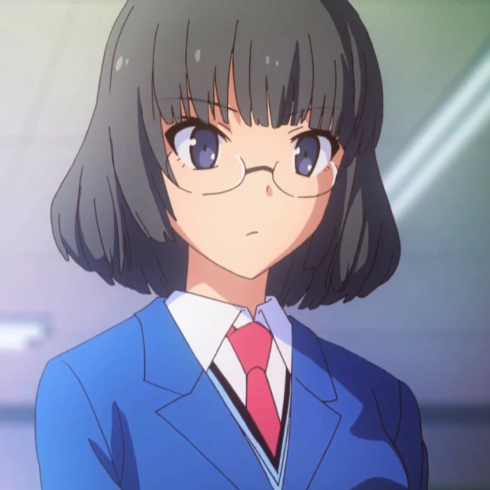

**Arquetipo:** la *kōhai* prodigio con un secreto vergonzoso. Novelista premiada a los 14 con el seudónimo **Yuigahama Kanna**, bloqueada con su segunda obra, y con un problema de exhibicionismo que la serie trata como síntoma del estrés.
**Aporte:** es la "Mashiro de la siguiente generación" y la guionista del equipo de videojuegos de Sorata.
**Para el fanfic:** material de primera para una temporada 3; su bloqueo creativo es un conflicto listo para usar.

## Mayu Takasaki y Yayoi Honjō

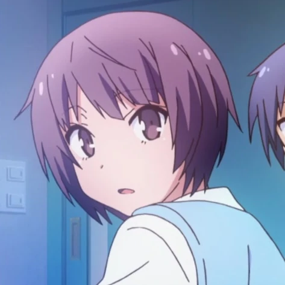
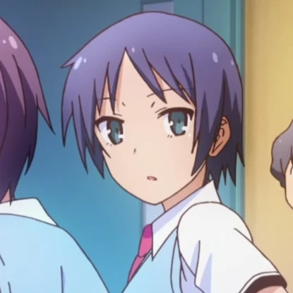

**Arquetipos:** la amiga casamentera y menuda (Mayu) y la deportista alta y serena (Yayoi, 175 cm, con novio).
**Aporte:** son el coro del aula. Sin ellas, la timidez de Nanami no tendría testigos.
**Para el fanfic:** si necesitas que alguien comente lo que está pasando en la clase, son ellas.

## Fūka Kamiigusa

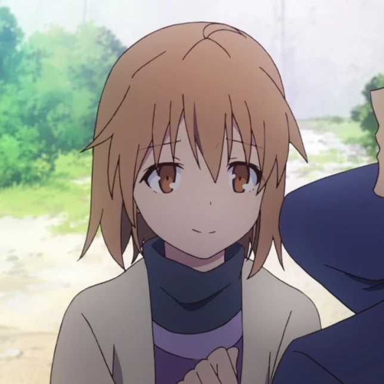

**Arquetipo:** la hermana mayor serena, primer amor del protagonista masculino secundario. El reverso exacto de Misaki.
**Aporte:** aparece un episodio y explica toda la conducta de Jin.
**Para el fanfic:** el personaje ideal para una escena de "el pasado vuelve", porque se fue sin cerrar nada.

## Akiko Kanda

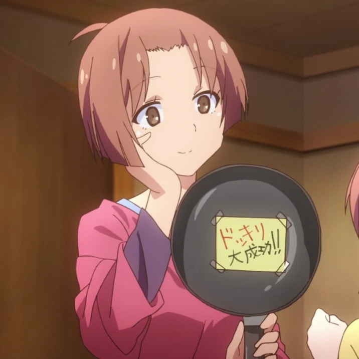

**Arquetipo:** la madre. Categoría *mother*, no *waifu*, y así se hace constar.
**Aporte:** una sola escena y una frase ("encontró una buena futura esposa") que vale por tres episodios de tensión romántica.

## Shiho Fukaya, Momoko, Otoha Nakano y Shiori Nanba

- **Shiho Fukaya:** la compañera de arte que asume que no puede ganarle a Mashiro y decide seguir igual. Aprende CG por su cuenta. **El mejor personaje secundario para reivindicar.**
- **Momoko:** la compañera de la escuela de seiyū que le reprocha a Nanami presentarse enferma. La ética del oficio en una sola escena.
- **Otoha Nakano:** personaje del videojuego con dos cameos en el anime. Curiosidad para coleccionistas.
- **Shiori Nanba ("Nancy"):** la instructora de autoescuela. **Cero favoritos en AniList**, el dato más cruel y más divertido de esta sección.

---

## Tabla comparativa final

| Personaje | Arquetipo | Favoritos | Episodios con peso | Su mejor escena |
|---|---|---|---|---|
| **Mashiro** | *kuudere* genio | 4 515 | ~24 | Ep. 12 (la pregunta) |
| **Nanami** | *tsundere* ganbatte | 2 174 | ~22 | Ep. 21 (la lluvia) |
| **Misaki** | *genki onee-san* | 535 | ~18 | Ep. 23 (el discurso) |
| **Rita** | *ojōsama deredere* | 154 | 6 | Ep. 10 (la lluvia) |
| **Chihiro** | *onee-san* adulta | 91 | ~12 | Ep. 14 (el bar) |
| **Saori** | *ojōsama* pianista | 8 | 3 | Ep. 23 (el piano) |
| **Kanna** | *kōhai* prodigio | 5 | 2 | Ep. 24 (la llegada) |
| **Fūka** | hermana serena | 1 | 1 | Ep. 11 (la conversación) |

---

## Verificación de esta sección

- **Los arquetipos** (*kuudere*, *tsundere*, *genki*, *onee-san*, *ojōsama*, *deredere*, *imōto*) se asignan según los rasgos descritos en las fichas oficiales de la Sakurasou Wiki y en las etiquetas de atributos del sitio japonés キャラ属性王国, que clasifica a Mashiro como 「クール目・無欲な求道者」 ("mirada fría, asceta sin deseos"), a Nanami como 「料理が上手目・自分に自信が無い努力家」 ("cocina bien, luchadora sin confianza en sí misma") y a Ryūnosuke como 「遠慮がち目・気風の良い求道者」.
- **Las escenas decisivas** se citan por episodio y se corresponden con los resúmenes de la lista de episodios de la Wikipedia japonesa y de la Sakurasou Wiki.
- **Los favoritos** son la consulta a AniList del 2 de noviembre de 2026 descrita en el documento 06-A.
- **Las citas de Chihiro** son paráfrasis de la traducción al inglés del resumen de la wiki, y así se marca; no son transcripción literal del japonés.
- **La cita de Misaki** es la que la wiki atribuye a su discurso de graduación.
- **Datos físicos y de familia:** Sakurasou Wiki, coincidentes con la sección 03 y 04 de esta biblia.
- **Criterio editorial:** las recomendaciones de "cómo escribirla" son análisis de esta biblia, no declaraciones del autor ni de la producción.

---

## Fuentes de esta sección

1. **AniList API** — favoritos por personaje, consulta del 2/11/2026: https://anilist.co
2. **Sakurasou Wiki (Fandom)** — fichas y resúmenes de episodios: https://sakurasou.fandom.com
3. **Wikipedia en japonés — さくら荘のペットな彼女** (lista de episodios y sección de personajes): https://ja.wikipedia.org/wiki/さくら荘のペットな彼女
4. **キャラ属性王国** — clasificación por atributos: https://www.chara-zokusei.jp/search?series_id=123
5. **Baidu Baike** — ficha de la serie y datos de personajes: https://baike.baidu.com

---

*Documento anterior: [06-A — Metodología y ranking](06a-waifus-ranking.md) · Siguiente: [06-C — Cultura waifu y recepción](06c-waifus-cultura.md)*
