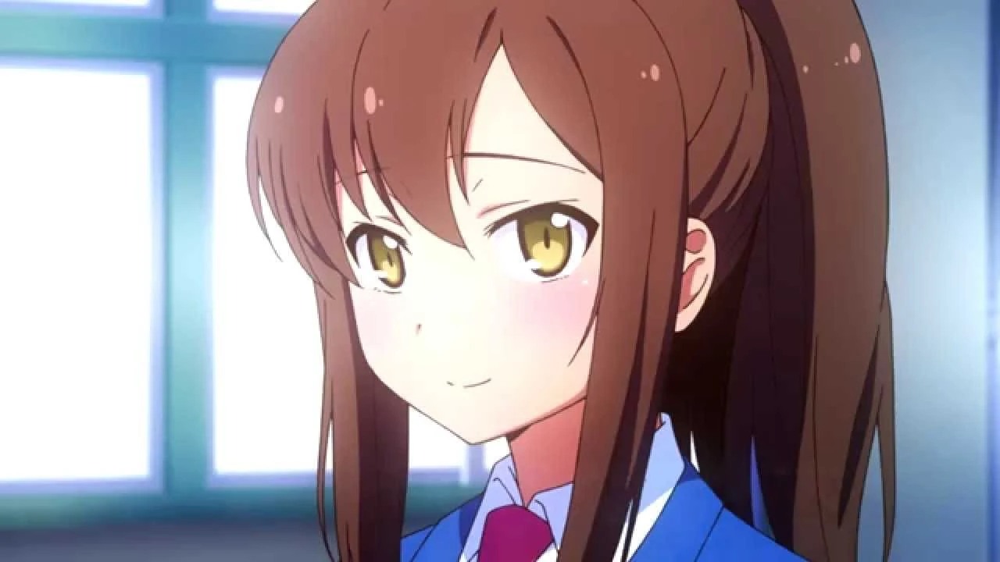
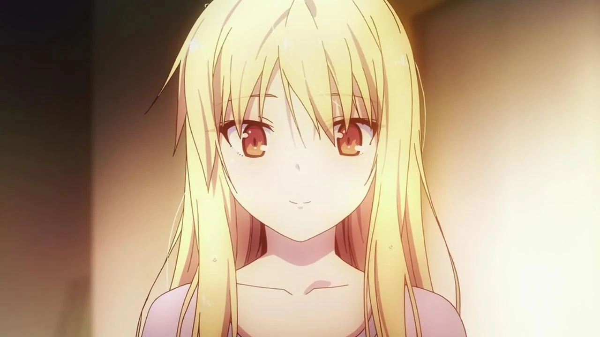
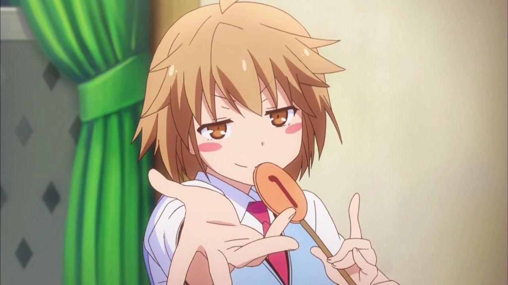

# Sección 06-C: Lista de waifus (III) — La cultura waifu alrededor de la serie

> **Biblia del universo de Sakura-sou no Pet na Kanojo (さくら荘のペットな彼女)**
> Documento de referencia para el proyecto de fanfic de este repositorio.
> ⚠️ Spoilers del anime y de la novela.

  
  
  

---

## Por qué este documento existe

Un ranking dice *quién* gusta. Este documento dice **por qué la franquicia está construida para que alguien guste**: qué hizo la producción para vender a sus heroínas, qué terminología usa el fandom para clasificarlas, cuál es la discusión eterna de la serie y cómo se elige una waifu cuando se va a escribir una historia.

---

# 1. 嫁コレ: la certificación oficial de "waifu"

La franquicia no dejó el asunto del "best girl" en manos de los foros. En 2013, tres personajes recibieron **tarjeta oficial en 嫁コレ (Yome Collection)**, una aplicación japonesa de coleccionismo de personajes femeninos con voz, ficha y galería. La app funcionaba como un catálogo: elegías a tu "esposa" y desbloqueabas sus cartas, sus frases y sus ilustraciones.

**El orden de lanzamiento es el que más dice:**

| Fecha | Personaje |
|---|---|
| **5 de julio de 2013** | **Shiina Mashiro** |
| **19 de julio de 2013** | **Aoyama Nanami** |
| **13 de agosto de 2013** | **Kamiigusa Misaki** |

Tres. No cuatro, no cinco. **La franquicia reconoció como waifus comercializables a las tres heroínas del reparto y a nadie más.** Rita Ainsworth, que es un personaje enorme en términos narrativos, **no tuvo tarjeta**; Chihiro tampoco.

Y hay una coincidencia que no es casualidad: **esas tres actrices son exactamente las que cantan el primer opening**. 「君が夢を連れてきた」 está acreditada a **「ペットな彼女たち」** ("las chicas de Pet na Kanojo"), formado por **Kayano Ai (Mashiro), Nakatsu Mariko (Nanami) y Takamori Natsumi (Misaki)**. La producción escogió a tres voces femeninas, las puso a cantar el tema de apertura y después les dio tarjeta de waifu a las tres.

> **Lectura de mercado:** la jerarquía comercial de la serie es Mashiro > Nanami > Misaki, en ese orden, y coincide con el orden de lanzamiento en 嫁コレ. Los números de AniList de hoy (4 515 / 2 174 / 535) **reproducen el mismo escalón doce años después**. La apuesta de marketing acertó.

---

# 2. El reparto de arquetipos: la serie como catálogo

*Sakura-sou* funciona, entre otras cosas, como un **muestrario de arquetipos**: cada residente femenino cubre una casilla distinta, y eso explica por qué tanta gente encuentra "la suya".

| Personaje | Arquetipo japonés | Traducción | Función en el catálogo |
|---|---|---|---|
| **Mashiro** | クーデレ (*kuudere*) | Fría por fuera, tierna por dentro | La que hay que proteger |
| **Nanami** | ツンデレ (*tsundere*) + 頑張る子 | Borde por vergüenza + la que se esfuerza | La chica real |
| **Misaki** | 元気娘 (*genki*) + お姉さん | Hiperactiva + hermana mayor | La que anima la casa |
| **Rita** | お嬢様 (*ojōsama*) + デレデレ | Señorita de buena familia + derretida | La rival que se queda |
| **Chihiro** | お姉さん + ダメ教師 | *Onee-san* + profesora desastrosa | La adulta |
| **Yūko** | 妹 (*imōto*) | Hermanita | La que quiere ser la número uno |
| **Saori** | お嬢様 (variante callada) | Señorita discreta | La elegante de fondo |
| **Kanna** | 後輩 (*kōhai*) + 天才 | La menor + genio | La nueva generación |
| **Fūka** | 年上のお姉さん | Hermana mayor serena | El pasado |

**Lo interesante:** ninguna es una caricatura pura. Mashiro no es *kuudere* por elegancia, sino por incapacidad; Nanami no es *tsundere* por carácter, sino por timidez; Misaki no es *genki* por alegría, sino por desesperación. **La serie le da a cada arquetipo una causa psicológica**, y ahí está su calidad de escritura.

El sitio japonés **キャラ属性王国** (un diccionario de atributos de personajes) las clasifica con etiquetas todavía más finas: a Mashiro como 「クール目 無欲な求道者」 ("mirada fría, asceta sin deseos") y a Nanami como 「自分に自信が無い努力家」 ("luchadora sin confianza en sí misma"). Es decir: incluso un sitio de catalogación por atributos detecta que **el motor de estos personajes es la carencia, no el adorno**.

---

# 3. El debate eterno: Mashiro contra Nanami

Es la discusión más repetida de la franquicia, y tiene argumentos de verdad en los dos lados.

## Los argumentos de Mashiro

1. **Es la protagonista.** La serie se llama *La chica mascota de Sakura-sō*: el título es ella. Quien gana el título gana la historia.
2. **Su arco es el más grande.** Pasa de no saber vestirse a elegir a una persona. Nanami, en cambio, termina donde empezó, con el fracaso a cuestas.
3. **La química es de dependencia mutua**, y eso es más difícil de escribir que la de dos personas que se entienden.
4. **Es la favorita por dos a uno** también en los datos: 4 515 contra 2 174.

## Los argumentos de Nanami

1. **Es la única realista.** El resto del reparto está formado por genios; ella trabaja en una tienda de conveniencia. Cualquier espectador con un trabajo precario se reconoce en ella.
2. **La serie la trata con crueldad**, y esa injusticia genera un afecto que la heroína oficial no necesita. En foros chinos (Bahamut, Gamer.com.tw) hay hilos enteros que sostienen que **el gran defecto de la obra es lo dura que es con Nanami**, frente al contraste con Mashiro.
3. **Se sacrifica dos veces**: fracasa en sus audiciones y además renuncia a declararse para no poner a Sorata en un compromiso.
4. **Su derrota no es narrativa, es estructural.** El autor decide que pierda. Quien ve la serie siente que la perdedora es la mejor persona, y eso no se olvida.

## El término que lo explica todo

En Japón, este tipo de personaje tiene nombre propio: **負けヒロイン (make-heroine)**, "la heroína que pierde". No es un insulto: es una **categoría de prestigio** en la ficción romántica japonesa. Las *make-heroine* suelen generar más fanatismo que las ganadoras, porque el público puede imaginar un final alternativo para ellas, mientras que la ganadora ya tiene su final escrito.

> **Esto es oro para un fanfic:** escribir la ruta de Nanami es, literalmente, el ejercicio más común de la franquicia. El tomo 7 de la novela te da la declaración que el anime le negó; a partir de ahí, todo es cancha libre.

---

# 4. Cómo la producción trata a cada una (sin decir nada)

Un detalle de puesta en escena que explica el cariño del público por cada personaje:

- **A Mashiro se la filma en blanco.** Su paleta, su pelo, su ropa, su nombre. Cuando el color entra en su vida (el mural del episodio 24), es un acontecimiento visual.
- **A Nanami se la filma trabajando.** La cámara la busca cocinando, cargando bolsas, con el uniforme de la tienda. Incluso sus escenas bonitas ocurren después de una jornada.
- **A Misaki se la filma en movimiento.** Casi nunca está quieta en un plano: entra, sale, corre. Su lenguaje es el del montaje.
- **A Rita se la filma desde fuera.** Llega en coche, se va en avión, mira desde la ventana. Es la extranjera que siempre está a punto de irse.
- **A Chihiro se la filma en el suelo.** Literalmente: acostada, con la lata, en el encuadre bajo. Es la única que no necesita estar de pie para tener autoridad.

Y un gesto de guion que vale por un tratado: **el episodio 14 le da a Nanami su propio ending**, 「I call your name again」, cantado por su actriz. La heroína que pierde es la única que tiene una canción propia en el momento más importante de la temporada. **La producción sabe perfectamente a quién está haciendo sufrir.**

---

# 5. La franquicia más allá de la pantalla

- **嫁コレ** (2013): tarjetas de Mashiro, Nanami y Misaki, en ese orden.
- **Videojuego de PSP y Vita** (14 de febrero de 2013): simulación de producción de videojuegos con componente de aventura romántica, es decir, con **rutas**. Es el único producto de la franquicia donde el espectador *elige* con quién quedarse.
- **『電撃文庫 FIGHTING CLIMAX』** (2014): juego de lucha de todo el sello Dengeki Bunko; **Mashiro aparece como personaje de apoyo**. Otra certificación de que ella es la cara de la marca.
- **Juego de cartas coleccionables**: existe una línea de cartas de la serie; por ejemplo, la carta promocional **「椎名ましろ＆青山七海」**, que abarata el coste de invocar a cualquiera de las dos.
- **Figuras y mercancía**: la serie tuvo línea de figuras de escala y de premio; las tres protagonistas son las que más producto generaron, con diferencia.
- **Drama CD** (2012-2013): cuatro, con historias originales. Algunos incluyen escenas domésticas de las heroínas que no aparecen en el anime.

---

# 6. Cómo elegir la waifu de tu fanfic

Esta es la parte práctica, y va con criterio: **la elección cambia el género de la historia**, no solo la pareja.

| Si quieres escribir… | Elige a… | Porque… |
|---|---|---|
| Romance de cuidado y descubrimiento | **Mashiro** | Cada avance es un hito verificable; el conflicto es interno |
| Romance de esfuerzo y injusticia | **Nanami** | Su derrota canónica pide a gritos una segunda oportunidad |
| Comedia romántica de altísima energía | **Misaki** | Su forma de amar es producir cosas y hacer ruido |
| Romance con conflicto cultural | **Rita** | Es extranjera, es rival y su relación exige distancia física |
| Historia de adultos | **Chihiro** | Es la única con vida fuera del instituto |
| Triángulo con tres finales posibles | **Las tres** | El videojuego ya demostró que el formato lo aguanta |

**Tres advertencias de escritura:**

1. **Mashiro no se conquista: se acompaña.** Si tu protagonista la "despierta" con un beso, estás escribiendo otro personaje.
2. **Nanami no se rinde ante un discurso.** Si la convences con palabras bonitas, la estás ablandando. Necesita hechos: alguien que le sostenga la vida mientras ella intenta.
3. **Misaki no baja el volumen.** Si en tu historia empieza a hablar en voz baja de repente, tiene que ser porque algo se rompió, y eso hay que mostrarlo.

---

# 7. Ficha de "best girl" por tipo de lector

| Perfil de lector | Su favorita suele ser | Motivo documentado |
|---|---|---|
| Quien valora el talento y el misterio | Mashiro | Es la que más favoritos acumula en todas las bases de datos |
| Quien valora el esfuerzo y la justicia | Nanami | La *make-heroine* genera el fandom más vocal |
| Quien valora la energía y el humor | Misaki | Única con tarjeta de waifu además de las otras dos |
| Quien valora el drama breve e intenso | Rita | Cuadruplica en favoritos a Chihiro con la mitad de escenas |
| Quien ya pasó la adolescencia | Chihiro | La única con problemas de adultos |

---

## Verificación de esta sección

- **Las tres tarjetas de 嫁コレ** y sus fechas exactas (5/07, 19/07 y 13/08 de 2013) provienen de la sección ゲーム de la Wikipedia japonesa.
- **La composición del grupo 「ペットな彼女たち」** (Kayano Ai, Nakatsu Mariko, Takamori Natsumi) está en la tabla 主題歌 de la Wikipedia japonesa, junto con el detalle de en qué episodios sonó cada tema.
- **El videojuego de PSP/Vita** (14/02/2013, simulación de producción + aventura romántica, Kadokawa Games) está documentado en la sección ゲーム de la Wikipedia japonesa.
- **Mashiro como personaje de apoyo en 『電撃文庫 FIGHTING CLIMAX』** aparece en la misma sección, con fecha de inicio de operación (18/03/2014).
- **La carta 「椎名ましろ＆青山七海」** se verificó en el catálogo de un distribuidor de cartas japonés (Yuyu-tei), que reproduce el texto y el efecto de la carta.
- **El término 負けヒロイン** es terminología estándar del fandom japonés, no una invención de esta biblia.
- **Los argumentos del debate Mashiro/Nanami** están marcados como posturas de fandom. Se apoya en hilos de foros (Gamer.com.tw, Reddit) consultados durante la investigación. **No se presenta como consenso crítico ni como declaración de la producción.**
- **Lectura de puesta en escena** (cómo se filma a cada una): análisis propio de esta biblia a partir del visionado y de los resúmenes por episodio. Va marcada como interpretación.
- **No verificado y por tanto omitido:** el editor de 嫁コレ. La ficha de la Wikipedia japonesa documenta la existencia y las fechas de las tarjetas, pero no la empresa responsable de la aplicación.

---

## Fuentes de esta sección

1. **Wikipedia en japonés — さくら荘のペットな彼女**, secciones ゲーム y 主題歌: https://ja.wikipedia.org/wiki/さくら荘のペットな彼女
2. **AniList API** — favoritos por personaje (2/11/2026): https://anilist.co
3. **キャラ属性王国** — atributos y arquetipos: https://www.chara-zokusei.jp/search?series_id=123
4. **Sakurasou Wiki (Fandom)** — fichas y episodios: https://sakurasou.fandom.com
5. **Yuyu-tei** — catálogo de cartas de la serie: https://yuyu-tei.jp/sell/pm/card/sakurasou1.0/10186
6. **Baidu Baike** — ficha de la serie: https://baike.baidu.com
7. **Foro Bahamut / Gamer.com.tw** — hilo de opinión sobre el trato a Nanami: https://forum.gamer.com.tw/Co.php?bsn=60037&sn=731187

---

*Documento anterior: [06-B — Las fichas, una por una](06b-waifus-fichas.md) · Volver al [índice de la biblia](README.md)*
