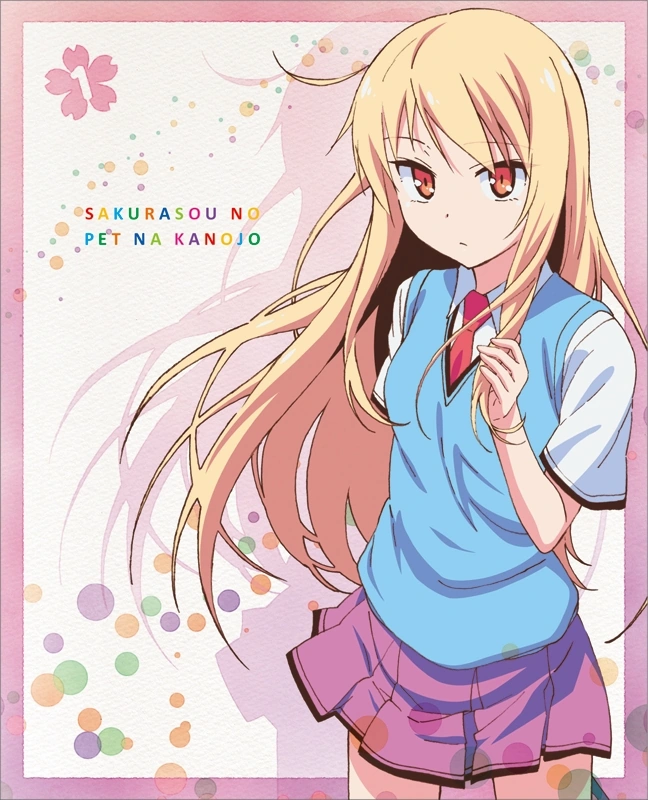
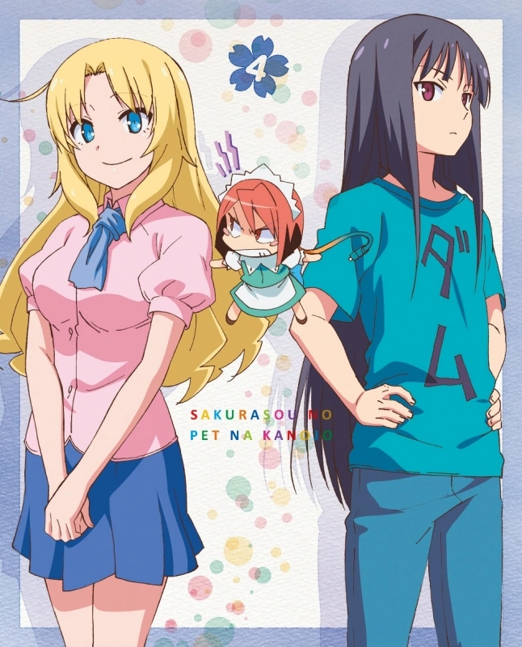
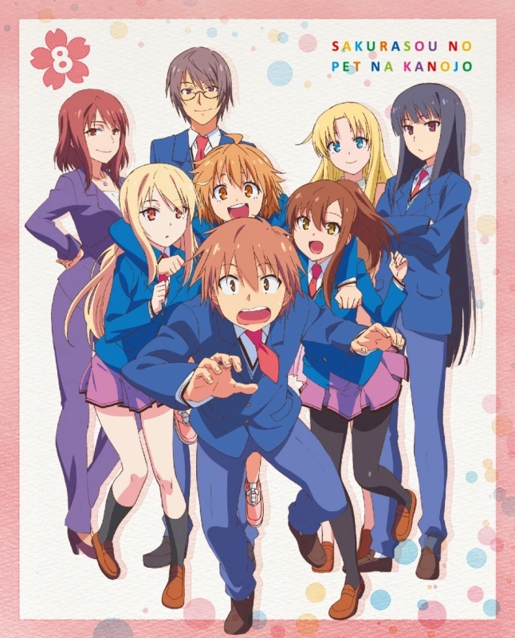

# Sección 07-A: Datos curiosos y cabos sueltos (I) — Cifras, mundo y producción

> **Biblia del universo de Sakura-sou no Pet na Kanojo (さくら荘のペットな彼女)**
> Documento de referencia para el proyecto de fanfic de este repositorio.
> ⚠️ Spoilers del anime y de la novela.

  
  
  

---

## Lo que esta sección viene a hacer

Las secciones anteriores ordenaron la obra. Esta última recoge lo que sobra y aun así importa: **las cifras, los detalles del mundo que la serie explica una sola vez, las curiosidades de producción y los hilos que la historia dejó colgando**. Es la sección que un escritor consulta cuando necesita un dato raro para dar textura a una escena.

---

# 1. Cifras verificadas

| Dato | Cifra | Fecha / fuente |
|---|---|---|
| **Ejemplares de la serie acumulados** | **1 800 000** | octubre de 2013 (ラノベニュースオンライン) |
| Volúmenes de la novela | 13 (10 cuerpo + 5.5, 7.5, 10.5) | enero de 2010 – marzo de 2014 |
| Tomos del manga | 8 | octubre de 2011 – junio de 2015 |
| Episodios del anime | 24 | octubre de 2012 – marzo de 2013 |
| Clasificación del anime | **PG-12** | ficha oficial |
| Puesto en 「みんなで選ぶベストラノベ2011」 | **6.º** (categoría de impresiones, 感想部門) | ln-news, feb. 2012 |
| Puesto en 「電子書籍アワード2013」 (libro electrónico), categoría novela ligera | **10.º** | Da Vinci News, mar. 2013 |
| Nota de Famitsu al juego de PSP/Vita | **31/40** (Silver Hall) | クロスレビュー |
| Volúmenes de Blu-ray | **8** (3 episodios cada uno) | 2013 |

> **Contexto de la cifra de 1,8 millones:** es el dato que la propia editorial publicó **a mitad de emisión del anime**, cuando la serie todavía no había terminado. Sirve como referencia de época, no como cifra final de la franquicia. No se ha localizado una cifra oficial posterior, así que esta biblia **no inventa una**.

---

# 2. La serie salió del país (y casi nadie lo sabe)

La novela se licenció en tres territorios además de Japón:

| País / región | Editorial |
|---|---|
| **Corea del Sur** | 鶴山文化社 (Haksan Munhwasa) |
| **Taiwán** | 台湾国際角川書店 (Kadokawa Taiwan) |
| **China continental** | 広州天聞角川動漫 (Guangzhou Tianwen Kadokawa) |

Y el anime **se emitió en Corea del Sur**, en el canal **ANIPLUS**, con subtítulos en coreano, mientras se estrenaba en Japón. Es el detalle más irónico de toda la franquicia a la luz del escándalo del samgyetang que se documenta en la sección 05-B: la serie que fue acusada de "promover Corea" **ya se estaba emitiendo legalmente en Corea**.

En inglés llegó mucho después, de la mano de **J-Novel Club**, que publicó la novela completa años más tarde.

---

# 3. El mundo según la propia wiki japonesa

La sección 「用語」 ("términos") de la Wikipedia japonesa recoge datos que el anime muestra pero nunca explica. Son los que dan textura a una escena.

## 水明芸術大学附属高等学校 ("Suikō")

- **Tres secciones**: 普通科 (general), 美術科 (arte) y 音楽科 (música).
- **Arte y música son élite pura**: pese a tener un cupo de **solo 10 alumnos por promoción**, reciben solicitudes de todo el país. O sea: Mashiro, Misaki, Saori, Iori, Shiho y Rita entraron a la sección más difícil de Japón en su especialidad.
- La **Universidad de Suimei** está pegada al instituto y comparte campus.

## El edificio de Sakura-sō

- **Un edificio de madera de dos plantas**, viejo, con un **cerezo en el jardín** (de ahí el nombre).
- **No tiene encargada de dormitorio.** Los residentes hacen su propia comida y su propia limpieza.
- **Están obligados a participar una vez al mes en la limpieza fuera del recinto**, lo que suena a castigo y en la práctica es la única norma que cumplen.
- **Durante diez años participaron en el festival cultural sin permiso del comité organizador.** El año en que Sorata está en tercero **no participaron**: es el detalle que marca el final de una era.
- Oficialmente no es un "dormitorio para problemáticos": se fundó para que los estudiantes de arte y música pudieran desarrollar su talento **con libertad**, sin la mirada crítica de la sociedad. Ese es el argumento que Tatebayashi usa en el episodio 23 para salvarlo.

## El verdadero motivo de la demolición (spoiler de novela)

Este es uno de los mejores datos de toda la obra y explica media trama de la segunda mitad.

- La versión oficial: **"dudas sobre la resistencia sísmica"**.
- La realidad, según la ficha: **la escuela tenía cinco años de margen** y el problema no era el edificio. Era que **Mashiro Shiina**, una pintora con prestigio mundial, estuviera gastando su talento en dibujar **manga** dentro de Sakura-sō. A la institución no le gustaba nada.
- Y el detalle clave: **si Mashiro se iba, la demolición se cancelaba**. Mashiro lo entendió y por eso intentó irse por su cuenta; Sorata y los demás la convencieron de quedarse.
- Aun así, **la demolición acabó ocurriendo**: el plan quedó en suspenso tras las protestas de los residentes, pero se ejecutó **cuando se graduaron Iori y los suyos**, es decir, después del final del anime.

> **Para el fanfic:** esto significa que **Sakura-sō desaparece**. Cualquier historia posterior al anime que quiera usar el edificio tiene que resolver ese hecho: o la historia ocurre antes, o el edificio ya no está.

## El teatro y el salón de música

- **Teatro de la Universidad de Suimei:** equipado con lo último en proyección, **capacidad para unas 300 personas**. Allí se estrenó 『銀河猫にゃぼろん』 (Nyaboron) en el festival… y allí también **Nanami se declaró a Sorata**, según la novela.
- **Sala de música:** **600 localidades** y uno de los mejores equipamientos acústicos del país. Es el escenario de los concursos de Iori y Saori, y donde Saori dio varios recitales como solista.

**Dato para escribir:** el mismo espacio donde una chica declara su amor es el que proyecta la película que hizo su rival. La serie no lo subraya, pero está ahí.

---

# 4. Los gatos: un chiste que atraviesa dos obras

Sorata cría dos gatos en su cuarto:

| Gato | Nombre | Referencia |
|---|---|---|
| Blanco | **ひかり (Hikari)** | El *Hikari*, tren bala de la serie 500 de JR Central |
| Negro | **のぞみ (Nozomi)** | El *Nozomi*, el servicio más rápido del Tokaido Shinkansen |

Y cuando Kamoshida cambió de serie, **repitió el criterio**: los gatos de la familia Azusagawa en 『青春ブタ野郎』 se llaman **なすの (Nasuno)** y **はやて (Hayate)**, también trenes bala (el *Nasuno* y el *Hayate*).

**Es la firma del autor.** Si escribes una escena con mascotas en este universo, el nombre tiene que ser una línea de tren.

---

# 5. Los nombres son mapas

Esta es una observación de esta biblia, no un dato oficial, pero se sostiene sola: **casi todos los apellidos del reparto son topónimos reales de Japón**.

| Personaje | Apellido | Lugar real |
|---|---|---|
| **Kamiigusa** Misaki / Fūka | 上井草 | Barrio de Suginami, Tokio; estación de la línea Seibu Shinjuku |
| **Ikejiri** Maya | 池尻 | Barrio de Setagaya, Tokio |
| **Komazawa** Takumi | 駒沢 | Barrio de Setagaya, Tokio |
| **Akasaka** Ryūnosuke | 赤坂 | Barrio de Minato, Tokio |
| **Shirayama** Koharu | 白山 | Barrio de Bunkyō, Tokio |
| **Himemiya** Saori / Iori | 姫宮 | Localidad de Miyashiro, Saitama |
| **Kanda** Sorata | 神田 | Barrio de Chiyoda, Tokio |
| **Mitaka** Jin | 三鷹 | Ciudad de Tokio |
| **Takasaki** Mayu | 高崎 | Ciudad de Gunma |
| **Honjō** Yayoi | 本庄 | Ciudad de Saitama |
| **Tatebayashi** Sōichirō | 舘林 | Ciudad de Gunma |
| **Nanba** Shiori | 難波 | Barrio de Osaka |
| **Sengoku** Chihiro | 千石 | Barrio de Bunkyō, Tokio |
| **Aoyama** Nanami | 青山 | Barrio de Minato / zona de Shibuya |

**Consecuencia práctica:** si necesitas inventar un personaje coherente con el mundo, **ponle apellido de estación o de barrio**. Encaja al cien por cien con el método del autor.

---

# 6. Curiosidades de producción y reparto

## Horie Yui hace dos personajes a la vez

**堀江由衣 (Horie Yui)** interpreta a **Ryūnosuke Akasaka** *y* a **Maid-chan**, su asistente de inteligencia artificial. Son dos voces completamente distintas del mismo cuerpo. Y hay un detalle delicioso: en los créditos de cierre, Maid-chan aparecía acreditada como **「?」** (interrogación) **hasta el último episodio**, cuando se reveló el nombre.

## El opening lo cantan las tres heroínas

「君が夢を連れてきた」 está acreditado al grupo **「ペットな彼女たち」** ("las chicas de Pet na Kanojo"), formado por **Kayano Ai (Mashiro), Nakatsu Mariko (Nanami) y Takamori Natsumi (Misaki)**. Las tres protagonistas cantando juntas el tema de apertura. Y son exactamente las tres que después recibieron tarjeta en 嫁コレ (ver sección 06-C).

## El ending de la heroína que pierde

El episodio 14 no usa el ending habitual: suena 「I call your name again」 **cantado por Nakatsu Mariko, la voz de Nanami**. En el episodio de la Nochebuena, la producción le da a la chica que va a perder **una canción propia**.

## La radio que duró lo que duró el anime

『さくら荘のペットなラジオ』 se emitió del **29 de septiembre de 2012 al 23 de marzo de 2013**, cada dos sábados, en **超!A&G+** y **Animate TV**. Locutoras: **Kayano Ai (Mashiro)** y **Takamori Natsumi (Misaki)**. Empezó una semana antes del anime y terminó tres días antes del último episodio.

## Los openings que no existen

La serie decide **quitar el opening** en tres episodios: el 1 (arranque en frío), y el 11 y el 12 (para no romper el arco del festival). Además, en el 11 y en el 23 el opening se usa **como canción dentro de la historia**.

## El juego y su nota

El juego de **PSP y PS Vita** (14 de febrero de 2013) mezcla **simulación de producción de videojuegos** con **aventura romántica**. Lo desarrolló **熱中日和**, lo publicó **Kadokawa Games** y Famitsu le dio **31 sobre 40**, que en la revista equivale a entrar en el **Salón de Plata**.

## El dato del doblaje que nadie espera

El anime se emitió en **ANIPLUS (Corea del Sur)** con subtítulos en coreano durante su emisión original, y llegó a **Animax** en Japón en dos franjas distintas (viernes 22:00 y sábado 22:30), una de pago y otra abierta.

---

# 7. El detalle del título

**さくら荘 (Sakura-sō)** significa literalmente "la casa del cerezo". El kanji 荘 (sō) se usa para casas de campo o albergues, y da al nombre un aire de lugar antiguo y algo destartalado: no es un dormitorio, es **una casa**.

**さくら (sakura)** es el cerezo, la flor que en Japón marca el final del año escolar. Por eso el título de la serie y el de su último episodio (「さくら荘へようこそ」, que es también el del primer capítulo de la novela) funcionan como un círculo: **se entra y se sale de la misma casa por la misma puerta**.

---

## Verificación de esta sección

- **Cifra de 1,8 millones:** citada por la Wikipedia japonesa con enlace a ラノベニュースオンライン, con fecha de octubre de 2013. Es la única cifra de circulación localizada; **no se ha encontrado una cifra oficial posterior** y así se advierte en el texto.
- **Premios y rankings** (6.º en みんなで選ぶベストラノベ2011; 10.º en 電子書籍アワード2013): ambos con enlace a la fuente original en la Wikipedia japonesa (ln-news y Da Vinci News).
- **Ediciones extranjeras** (Haksan Munhwasa, Kadokawa Taiwan, Guangzhou Tianwen Kadokawa): campo 「他出版社」 del infobox de la Wikipedia japonesa.
- **Emisión en Corea (ANIPLUS) con subtítulos en coreano:** tabla de emisoras de la Wikipedia japonesa, donde figura con esa nota explícita.
- **Datos de スイコー y de Sakura-sō** (tres secciones, cupo de 10 alumnos, edificio de madera de dos plantas, cerezo, ausencia de encargada, limpieza mensual, diez años de festival sin permiso): sección 「用語」 de la Wikipedia japonesa.
- **El motivo real de la demolición** (no era la resistencia sísmica; cinco años de margen; el disgusto por el manga de Mashiro; cancelación si ella se iba; ejecución tras la graduación de Iori): nota al pie de la sección 「用語」. Es un dato de novela, no del anime.
- **Teatro de 300 y sala de música de 600**, y la declaración de Nanami en el teatro: sección 「用語」.
- **Los gatos Hikari y Nozomi** y su equivalencia con Nasuno y Hayate: sección de personajes de la Wikipedia japonesa (para Sakurasou) y sección de personajes de 『青春ブタ野郎シリーズ』, que explica que "los nombres de los gatos de Azusagawa, igual que los que cuidaba Sorata en la obra anterior, vienen de apodos de trenes bala".
- **Horie Yui doblando a Ryūnosuke y Maid-chan, y el crédito 「?」:** ficha de reparto y nota al pie de la Wikipedia japonesa.
- **El grupo 「ペットな彼女たち」** y el ending especial del episodio 14: tabla 主題歌.
- **Radio, juego y nota de Famitsu:** secciones テレビアニメ, Webラジオ y ゲーム de la Wikipedia japonesa.
- **Topónimos de los apellidos:** verificación propia contrastando cada apellido con localidades y estaciones reales. **Se presenta como observación de esta biblia**, no como declaración de la obra.
- **No verificado y por tanto no afirmado:** no se encontró un modelo real documentado (聖地) para el edificio de Sakura-sō ni para Suikō. Las búsquedas en japonés sobre "モデル" y "聖地" no devolvieron fuente fiable, así que esta biblia **no inventa una ubicación real**.

---

## Fuentes de esta sección

1. **Wikipedia en japonés — さくら荘のペットな彼女**, secciones 用語, ゲーム, Webラジオ y tabla 主題歌, e infobox (他出版社): https://ja.wikipedia.org/wiki/さくら荘のペットな彼女
2. **Wikipedia en japonés — 青春ブタ野郎シリーズ** (nombres de los gatos y cameos): https://ja.wikipedia.org/wiki/青春ブタ野郎シリーズ
3. **ラノベニュースオンライン** — ranking de circulación citado por la Wikipedia: https://ln-news.com/page/circulation
4. **Da Vinci News** — 電子書籍アワード2013: https://ddnavi.com/award2013/lightnovel/
5. **Sakurasou Wiki (Fandom)** — fichas de personajes y de episodios: https://sakurasou.fandom.com
6. **J-Novel Club** — edición oficial en inglés: https://j-novel.club/series/the-pet-girl-of-sakurasou

---

*Siguiente documento: [07-B — Los cabos sueltos](07b-cabos-sueltos.md)*
