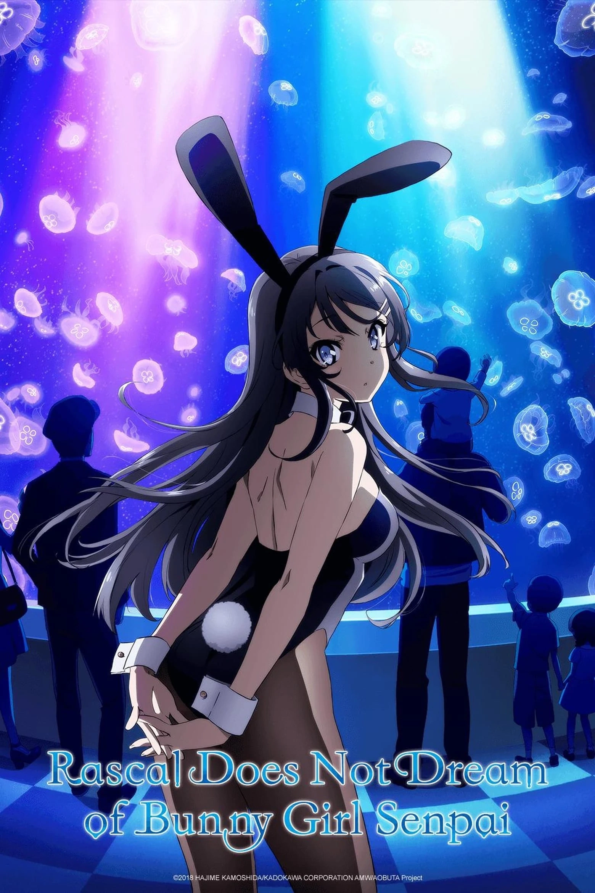
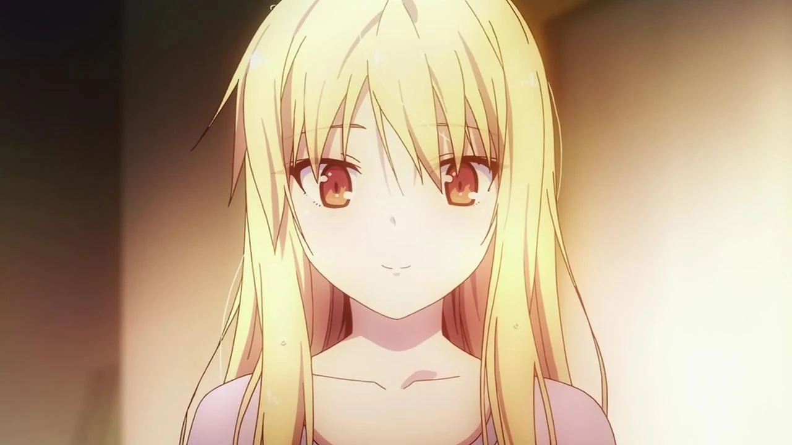

# Sección 07-B: Datos curiosos y cabos sueltos (II) — Los hilos que quedaron colgando

> **Biblia del universo de Sakura-sou no Pet na Kanojo (さくら荘のペットな彼女)**
> Documento de referencia para el proyecto de fanfic de este repositorio.
> ⚠️ Spoilers masivos, incluidos los del final de la novela y los cruces con 『青春ブタ野郎』.

  
  

---

## Qué es un "cabo suelto" en esta obra

Conviene distinguir tres cosas, porque se confunden todo el tiempo:

- **Cabo cerrado fuera de la obra.** La serie no lo resuelve, pero el autor lo resolvió **en otra parte**: en otra novela, en un audio drama, en un cameo. Es el caso más interesante, y de esos hay muchos.
- **Cabo ambiguo a propósito.** La obra decide no cerrarlo porque **el tema es justamente la incertidumbre** (¿qué pasa con el talento? ¿qué pasa con los que no ganan?).
- **Cabo abandonado.** Se plantó y nunca se recogió. Aquí están los que la serie olvidó de verdad.

Empecemos por el primer grupo, que es el gran secreto de esta franquicia.

---

# 1. El gran hallazgo: la secuela resuelve los cabos por cameo

**Hajime Kamoshida** escribió después 『青春ブタ野郎』 (*Rascal Does Not Dream of Bunny Girl Senpai*), con **el mismo ilustrador, Mizoguchi Kēji**. Y en esa serie, **los personajes de Sakura-sō aparecen como invitados**, volumen por volumen.

**El detalle importante:** no se les nombra directamente (salvo una excepción). Aparecen, se les reconoce por contexto, y el lector que ha leído *Sakurasou* los identifica. La propia Wikipedia japonesa lo dice así: *"aunque básicamente no se dicen sus nombres de forma directa, los personajes de 『さくら荘のペットな彼女』 hacen apariciones como invitados"*.

| Volumen de 『青春ブタ野郎』 | Invitado 1 | Invitado 2 | Invitado 3 |
|---|---|---|---|
| **1** | **Iori Himemiya** | **Kanna Hase** | — |
| **2** | **Ryūnosuke Akasaka** | **Rita Ainsworth** | — |
| **3** | **Jin Mitaka** | **三鷹美咲 (Misaki Mitaka)**, es decir, **Misaki ya casada** | — |
| **4** | **Tatebayashi Sōichirō** | **Saori Himemiya** | — |
| **5** | **Sorata Kanda** | **Yuuko Kanda** | **Mashiro Shiina** (perdida en un zoo) |
| **6** | **Kazuki Fujisawa** | **Chihiro Sengoku** | — |
| **7** | **Mashiro Shiina** (como autora del manga que tiene Shoko) | — | — |

## Lo que esta tabla resuelve de un golpe

1. **Misaki se casó con Jin.** El nombre que aparece es **三鷹美咲**, con el apellido del marido. La nota de la Wikipedia japonesa lo aclara: *"como es una historia posterior en el tiempo a 『さくら荘』, aparece después de casarse"*.
2. **Kanna e Iori siguen juntos** (aparecen emparejados en el volumen 1, y el volumen 10 de *Sakurasou* ya insinuaba la cercanía).
3. **Rita y Ryūnosuke están juntos** (volumen 2).
4. **Chihiro y Kazuki están juntos** (volumen 6), lo que confirma que la cita del episodio 24 prosperó.
5. **Tatebayashi y Saori siguen juntos** (volumen 4), coherente con la propuesta de matrimonio del volumen 4 de *Rascal*.
6. **Sorata sigue en la vida de Mashiro y de su hermana** (volumen 5), y en una escena absolutamente ridícula: **Mashiro perdida en un zoo**.
7. **Mashiro se convirtió en autora de manga de verdad** (volumen 7): su obra aparece en manos de una chica y **Sakuta reconoce el nombre** de la mujer que conoció en el festival cultural.

> **Para el fanfic:** estos cameos son la prueba documental de que **el final feliz ocurrió**. No hace falta inventarlo: está escrito, solo que en otra serie y sin decirlo en voz alta.

---

# 2. El cruce que casi nadie conoce: el "drama por votación mayoritaria" de 2016

En 2016, tres años después de que terminara el anime, Kadokawa y niconico hicieron un experimento llamado **多数決ドラマ ("drama por votación mayoritaria")**: un audio drama en el que **el público votaba en directo** qué ruta continuaba la historia.

La segunda entrega fue un **crossover**:

> **『青春ブタ野郎は文化祭ヒロインの夢を見ない』**
> *"Rascal Does Not Dream of a Culture Festival Heroine"*
> **『青春ブタ野郎はバニーガール先輩の夢を見ない』 with 『さくら荘のペットな彼女』**

## Los datos

| Campo | Dato |
|---|---|
| **Inicio** | **5 de febrero de 2016** |
| **Plataforma** | ニコニコ生放送 (Nico Nico Live) |
| **Guion** | **鴨志田一 (Kamoshida Hajime)**, el autor de las dos series |
| **Ilustración del key visual y SD** | **溝口ケージ (Mizoguchi Kēji)** |
| **Premisa** | Sakuta Azusagawa tiene que hacer que la heroína elegida por el público **gane el concurso de belleza del festival cultural** de su instituto |
| **Lema** | 「君の選択が未来を決める！」 ("tu elección decide el futuro") |
| **Escenario temporal** | **Después del final de la novela de *Sakurasou*** |

## El reparto

**Sakuta Azusagawa** (Ishikawa Kaito) · **Mai Sakurajima** (Seto Asami) · **Mashiro Shiina (Kayano Ai)** · **Tomoe Koga** (Tōyama Nao) · **Shōko Makinohara** (Minase Inori) · **Yūma Kunimi** (Uchida Yūma) · **Kaede Azusagawa** (Kubo Yurika).

## Las votaciones

| Emisión | Ruta ganadora |
|---|---|
| **1.ª — 5 de febrero de 2016** | **椎名ましろ (Mashiro Shiina)** ✅ |
| 2.ª — 20 de febrero de 2016 | Sakurajima Mai |
| 3.ª — 5 de marzo de 2016 | Makinohara Shōko |
| 4.ª — 18 de marzo de 2016 | Koga Tomoe |

**Mashiro ganó la primera votación.** El público, tres años después del anime, eligió a la chica de Sakura-sō por encima de la heroína de la serie nueva.

Y esto quedó **grabado en la novela**: en el **volumen 7** de 『青春ブタ野郎』, Mashiro aparece mencionada como autora del manga que tiene Shōko, y Sakuta la reconoce **como la mujer del festival**, enlazando explícitamente con la trama de este audio drama.

> **Traducción:** Mashiro Shiina es el único personaje de *Sakurasou* que **tiene una escena romántica con el protagonista de otra serie**, decidida por votación popular.

---

# 3. Cabos que la obra SÍ cierra (y dónde)

| Cabo | Dónde se cierra |
|---|---|
| ¿Misaki y Jin terminan juntos? | Sí. Se casan; ella aparece como **三鷹美咲** en el vol. 3 de *Rascal* |
| ¿Rita y Ryūnosuke? | Sí, aparecen juntos en el vol. 2 de *Rascal* |
| ¿Chihiro y Kazuki? | Sí, vol. 6 de *Rascal* (y la cita del ep. 24) |
| ¿Kanna e Iori? | Sí, vol. 1 de *Rascal*, emparejados |
| ¿Tatebayashi y Saori? | Sí; propuesta de matrimonio en el vol. 4 de *Rascal* |
| ¿Mashiro se vuelve mangaka profesional? | Sí: serializada, con entrevista y ejemplares agotados en el vol. 10 de *Sakurasou* |
| ¿Sorata hace videojuegos? | Sí: equipo con Ryūnosuke, Iori (música), Kanna (guion) y Rita; en el vol. 10 trabaja en su propio juego |
| ¿Ryūnosuke supera su fobia? | Parcialmente: Rita lo entrena para que pueda tratar con su hermana Yuriko y obtener el permiso de su padre para el proyecto |
| ¿Qué fue de la familia de Ryūnosuke? | Se explica entera en el vol. 10: padre **Ryōma** (programador), madre **Ryūjiko**, y cuatro hijos: **Riko, Ranko, Yuriko y Ryūnosuke** |
| ¿Sakura-sō sobrevive? | **No.** Se salva en el anime, pero se demuele cuando se gradúan Iori y los suyos |

**El dato más cruel y más bonito de esta lista:** la casa que da título a la obra **deja de existir**. El autor lo decidió así.

---

# 4. Cabos que quedan ABIERTOS de verdad

## El final de Sorata y Mashiro

El tomo 10 cierra el cuerpo principal con la pareja separándose y **cuatro años de distancia** antes del reencuentro (dato verificado en la sección 03 de esta biblia). El autor no escribe el "y vivieron felices": escribe el reencuentro. **Lo que pasa después queda fuera de la obra.**

Los cameos de *Rascal* confirman que están juntos, pero **no cuentan cómo volvieron** ni cómo se resolvió la distancia. Ese es, probablemente, el cabo más grande de la franquicia.

## Nanami: el cabo más doloroso

- **En el anime:** se va a **Osaka** a estudiar actuación de voz y se despide sin declararse.
- **En la novela:** el tomo 10 la sitúa **aceptada en la Universidad de Suimei junto a Sorata**. Es decir, **se queda**.
- **Lo que nunca se cuenta:** si algún día le dice a Sorata lo que siente, y qué pasa con su carrera después de dos fracasos.

**Sobre su declaración:** en el tomo 7 **sí se declara**, junto con Mashiro. Pero la novela tampoco cierra del todo esa conversación: el peso del relato se va hacia Mashiro. Nanami queda en el limbo del "casi".

## Kanna: la segunda generación abandonada

Kanna Hase es un personaje con **tres tramas abiertas** y ninguna resuelta dentro de la obra:

1. Su **bloqueo de escritora** (la segunda novela no avanza).
2. Su **exhibicionismo** como síntoma del estrés: la serie lo trata, lo usa para un arco y **no lo resuelve**.
3. Su relación con **Iori**, que en *Sakurasou* solo se insinúa y en *Rascal* se da por hecha.

Es, con diferencia, el personaje con más potencial desaprovechado de la franquicia.

## Iori: el músico que se rompió

En el tomo 10 se establece que **sus manos siguen sin estar bien** y que recuperar el piano "va a tomar tiempo". Ese hilo **no se cierra**: no sabemos si vuelve a tocar, si abandona la música o si gana un concurso. Para un personaje cuyo conflicto entero es "odié la música porque mi hermana era mejor", es una ausencia notable.

## La demolición, contada a medias

La novela dice que Sakura-sō se demolió tras la graduación de Iori, pero **no describe la escena**. No hay despedida del edificio, no hay última fiesta, no hay llanto en el jardín del cerezo. Es uno de los huecos emocionales más grandes de la obra, y material perfecto para un fanfic.

## El padre de Mashiro (solo en el manga)

El manga cierra con los **padres de Mashiro viniendo desde Inglaterra a llevársela**. En el anime no existe; en la novela no se ha podido verificar. Ese hilo se quedó **exclusivamente** en la versión de Kusano Hōki.

## El "después" de Chihiro

Chihiro tiene treinta años, un trabajo que no eligió y una relación que empieza justo al final. **La obra no cuenta qué hace con su vida.** Ni si sigue siendo profesora, ni si se va, ni si el dormitorio cerrado la deja sin casa.

## La promesa del título

El tema central de la serie es **"el genio y el que no lo es"**. La obra **no da una respuesta**: Sorata no se vuelve genio, Nanami no gana, Mashiro no deja de serlo. Lo único que ofrece es una postura: *"aunque no puedas alcanzar a alguien, puedes seguir caminando a su lado"*. **Ese es el cabo que el autor deja abierto a propósito**, porque cerrarlo sería traicionar el tema.

---

# 5. Los cabos que dejó el ANIME (y no la novela)

Si tu fanfic continúa el anime y no la novela, estos son los hilos que quedan literalmente colgando en pantalla:

| Cabo | Última imagen en pantalla |
|---|---|
| **La declaración de Nanami** | Empieza la frase en el ep. 22, se desvía, se despide en el 24 |
| **El beso de Sorata y Mashiro** | Solo en la mejilla |
| **Kanna e Iori** | Llegan al dormitorio en el ep. 24 y no vuelven a aparecer |
| **La carta del resultado de Yuuko** | Se resuelve en chiste (99/66), sin escena de reencuentro |
| **La beca de Misaki** | Se menciona su talento, nunca su futuro académico |
| **El permiso de conducir de Misaki** | Se saca la licencia y se usa una vez; el gag queda cerrado, el personaje no |
| **La fobia de Ryūnosuke** | Sin resolver: sigue sin poder tocar a una mujer |
| **Maid-chan** | Su desarrollo no llega a nada; sigue siendo una IA con voz |
| **La demolición** | Se cancela por votación y ahí termina el tema |
| **El juego de Sorata** | Sigue sin publicarse |

---

# 6. Las preguntas que la obra deja (y las respuestas que el canon permite)

| Pregunta | Lo que el canon dice |
|---|---|
| ¿Sorata y Mashiro terminan juntos? | **Sí.** Ruptura, cuatro años y reencuentro (tomo 10), confirmado por los cameos |
| ¿Nanami se declara alguna vez? | **Sí, en el tomo 7 de la novela.** En el anime, nunca |
| ¿Mashiro deja de dibujar manga y vuelve a la pintura? | No se resuelve; en el tomo 10 sigue con el manga y con éxito |
| ¿Sakura-sō sigue en pie? | No. Se demuele tras la graduación de la siguiente generación |
| ¿Rita se queda en Japón? | Sí: estudia lengua en Suikō, luego en Suimei, y alterna con Inglaterra |
| ¿Ryūnosuke sale de su cuarto? | Sí, empieza a trabajar con Sorata y a tratar a Rita |
| ¿Kanna publica su segunda novela? | **No se cuenta.** Se sabe que sigue yendo a reuniones editoriales |
| ¿Iori vuelve al piano? | **No se cuenta.** Sus manos mejoran, no se confirma el regreso |

---

## Verificación de esta sección

- **La tabla de cameos por volumen** está transcrita de la sección de personajes de 『青春ブタ野郎シリーズ』 en la Wikipedia japonesa, que la presenta como tabla oficial (巻 / ゲスト1 / ゲスト2 / ゲスト3) y advierte que **los nombres no se dicen de forma directa**. La nota sobre Misaki como 三鷹美咲 y sobre su boda aparece como nota al pie en esa misma tabla.
- **El dato de Mashiro perdida en un zoo** (vol. 5) y **Mashiro como autora del manga en el vol. 7** son notas al pie de esa tabla; la segunda remite explícitamente al audio drama de votación mayoritaria.
- **El audio drama de 2016** (fechas, reparto, guion, lema, escenario posterior al final de *Sakurasou*, y las cuatro rutas votadas) está documentado en la Wikipedia japonesa, en el artículo 多数決ドラマ (sección 第2弾) y en la sección ラジオドラマ del artículo de 『青春ブタ野郎シリーズ』.
- **La familia de Ryūnosuke** (padre Ryōma, madre Ryūjiko, hijos Riko, Ranko, Yuriko y Ryūnosuke; la condición del padre de encargarse de las tareas del hogar; el origen de la ginefobia) está tomada del resumen del **tomo 10** recogido por la Sakurasou Wiki, capítulo 1.
- **Las tramas abiertas de Kanna, Iori y Chihiro** se verifican por ausencia: se comprobó en el resumen del tomo 10 y en las fichas de personaje que **no existe escena de resolución** para ellas. Se presentan como cabos abiertos y así se razona en el texto.
- **La ruptura y los cuatro años de separación** están verificados en la sección 03 de esta biblia. Aquí **no se detalla el mecanismo** de la ruptura porque el resumen disponible del tomo 10 en la wiki en inglés **solo cubre el capítulo 1 y el 2**; se indica para no dar por cierto lo que no se ha podido leer.
- **Nanami en Osaka (anime) frente a Nanami en Suimei (novela):** el destino en Osaka es el del episodio 24; la admisión en la Universidad de Suimei aparece en el resumen del tomo 10 ("both have been accepted to Suimei University of Arts"). Se presentan ambos datos con su fuente, sin fusionarlos.
- **El final del manga (los padres de Mashiro)** remite al documento 05-C, donde ya se advirtió que **no se ha podido verificar** si proviene de la novela.

---

## Fuentes de esta sección

1. **Wikipedia en japonés — 青春ブタ野郎シリーズ**, sección de personajes (tabla de invitados), sección ラジオドラマ: https://ja.wikipedia.org/wiki/青春ブタ野郎シリーズ
2. **Wikipedia en japonés — 多数決ドラマ**, sección 第2弾: https://ja.wikipedia.org/wiki/多数決ドラマ
3. **電撃文庫 公式サイト** — página del segundo drama por votación mayoritaria: https://dengekibunko.jp/title/niconico-drama/second/
4. **Sakurasou Wiki (Fandom) — Light Novel Volume 10** (resumen del capítulo 1 y 2): https://sakurasou.fandom.com/wiki/Light_Novel_Volume_10
5. **Wikipedia en japonés — さくら荘のペットな彼女**, sección 用語 (demolición de Sakura-sō): https://ja.wikipedia.org/wiki/さくら荘のペットな彼女
6. **Sakurasou Wiki (Fandom)** — fichas de Kanna Hase, Iori Himemiya, Chihiro Sengoku: https://sakurasou.fandom.com

---

*Documento anterior: [07-A — Cifras, mundo y producción](07a-curiosidades-datos.md) · Siguiente: [07-C — Legado y cierre de la biblia](07c-legado-cierre.md)*
