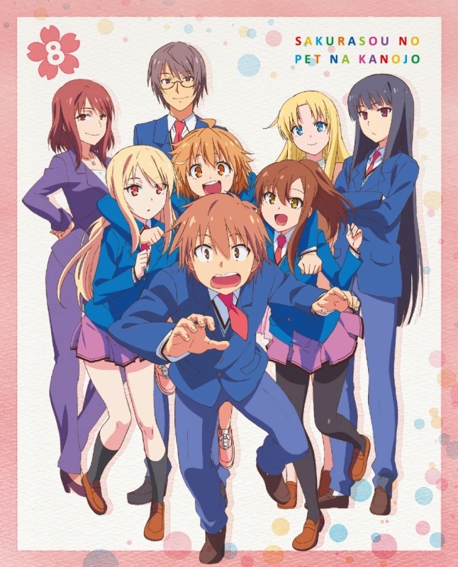
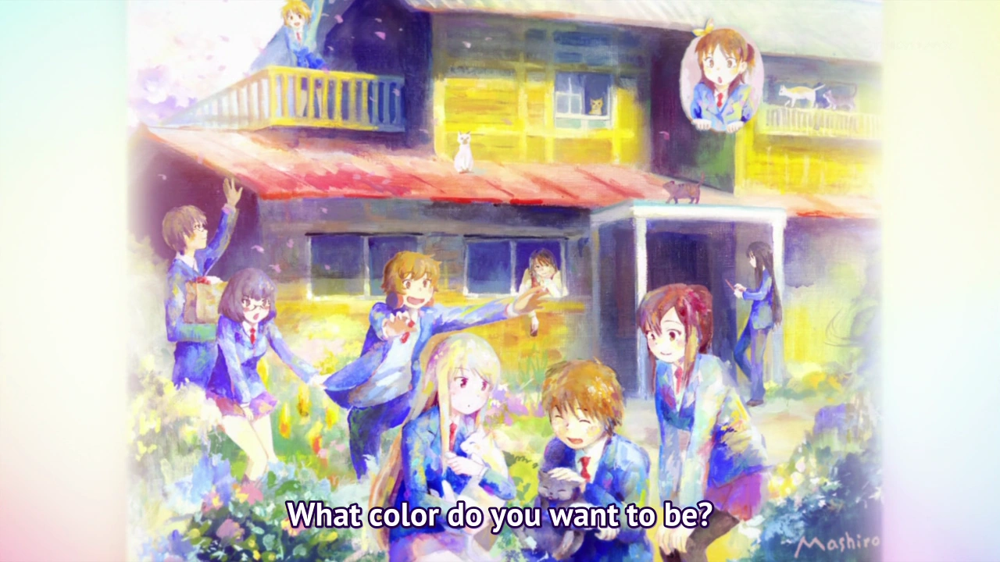

# Sección 07-C: Datos curiosos y cabos sueltos (III) — Legado y cierre de la biblia

> **Biblia del universo de Sakura-sou no Pet na Kanojo (さくら荘のペットな彼女)**
> Documento final. Referencia para el proyecto de fanfic de este repositorio.
> ⚠️ Spoilers de toda la franquicia.

  
  

---

# 1. Por qué esta serie sigue viva trece años después

*Sakura-sō* terminó en marzo de 2013. No tuvo segunda temporada, ni remake, ni película. Y sin embargo:

- **1 800 000 ejemplares** vendidos ya en octubre de 2013.
- **Mashiro Shiina** sigue acumulando favoritos en las bases de datos internacionales: **4 515** en AniList a noviembre de 2026, más que muchos personajes de series que se emiten hoy.
- **La discusión "Mashiro o Nanami"** se sigue abriendo en foros cada vez que alguien la recomienda.
- **El meme del samgyetang** tiene más de una década y sigue apareciendo en hilos sobre "polémicas absurdas del anime".
- **El personaje sigue apareciendo en obras nuevas**: Mashiro es invitada en el audio drama de 2016 y mencionada en el tomo 7 de *Rascal*.

**Las razones, en orden de peso:**

1. **El tema no caduca.** La serie habla de algo que no se resuelve con la edad: ver a alguien mejor que tú y decidir qué hacer con eso. Eso le pasa a un estudiante de 17 y a un adulto de 40.
2. **La derrota está bien escrita.** Nanami pierde dos veces, y la serie no la consuela con un premio de consolación. Esa honestidad genera fidelidad.
3. **El cierre es de apertura, no de clausura.** El episodio 24 termina con gente nueva entrando a la casa. Deja al espectador con la sensación de que la vida sigue sin él, que es exactamente lo que hace un buen final.
4. **La casa.** Sakura-sō es un personaje más: un edificio viejo de madera con un cerezo en el jardín, sin encargada, donde nadie te dice cómo vivir. Es el objeto de deseo de toda la serie y de todo el público.

---

# 2. El autor y su segunda serie: el universo Kamoshida

**Hajime Kamoshida** no abandonó este mundo: lo continuó en otra serie, con las mismas reglas.

| Elemento | *Sakurasou* (2010-2014) | 『青春ブタ野郎』 (2014-2025) |
|---|---|---|
| **Autor** | 鴨志田一 | 鴨志田一 |
| **Ilustrador** | 溝口ケージ | 溝口ケージ (continuidad explícita) |
| **Gatos con nombre de tren bala** | Hikari y Nozomi | Nasuno y Hayate |
| **Ciudad** | Tokio (Suginami) | Kamakura / Fujisawa |
| **Tema** | El talento y la mediocridad | El síndrome de la adolescencia |
| **Protagonista** | Sorata Kanda, "normal" | Sakuta Azusagawa, **diseñado como su contrapunto** |

## La declaración que lo explica todo

Según la Wikipedia japonesa, Kamoshida explicó que el protagonista de *Rascal*, **Sakuta Azusagawa, nació como contraposición a Sorata Kanda**: como los lectores habían sentido a Sorata como **un personaje con el que era fácil identificarse**, el nuevo protagonista se diseñó con el concepto de ser **alguien que los lectores encontraran atractivo y cool**.

> **Traducción libre:** Sorata es el chico con el que te identificas; Sakuta es el chico que te gustaría ser. **Es el mismo autor corrigiendo su propio protagonista.**

## Y los cameos, que ya están documentados

Siete volúmenes de *Rascal* con invitados de Sakura-sō (ver la tabla completa en el documento **07-B**). El más importante: en el volumen 3, Misaki aparece como **三鷹美咲**, es decir, **casada con Jin**. El autor cerró la historia de amor más larga de su primera serie **en una línea de otra novela**.

---

# 3. Veinte datos rápidos para tener a mano

1. **El anime no tiene segunda temporada** y no la va a tener: el estudio nunca la anunció y la novela ya está completa desde 2014.
2. **El episodio 24 se titula igual que el capítulo 1 de la novela**: 「さくら荘へようこそ」.
3. **Sorata cría dos gatos** llamados **Hikari** y **Nozomi**, como dos trenes bala.
4. **Mashiro mide 162 cm** y no sabe atarse los zapatos.
5. **Nanami mide 158 cm** y habla en dialecto de Osaka cuando se altera.
6. **Misaki mide 156 cm** y conduce tan mal que la instructora palidece.
7. **Yayoi mide 175 cm**, la más alta del reparto femenino.
8. **Chihiro dice tener 29 años** y en realidad tiene 30. Es su único chiste recurrente y también su única herida.
9. **Horie Yui dobla a Ryūnosuke y a Maid-chan**, y Maid-chan aparecía acreditada como **「?」** hasta el último episodio.
10. **El opening lo cantan las tres protagonistas** bajo el nombre 「ペットな彼女たち」.
11. **El episodio 14 tiene un ending propio** cantado por la actriz de Nanami.
12. **No hay opening** en los episodios 1, 11 y 12.
13. **El edificio de Sakura-sō no tiene encargada** y sus residentes están obligados a una limpieza externa mensual.
14. **Durante diez años** entraron al festival cultural **sin permiso**.
15. **El motivo real de la demolición** no era el edificio: era que la escuela no quería que Mashiro gastara su talento en manga.
16. **Sakura-sō acaba demolida** cuando se gradúan Iori y los suyos, aunque el anime la salve.
17. **El anime se emitió en Corea del Sur** mientras en Japón se le acusaba de promover Corea.
18. **El juego de PSP/Vita sacó 31/40 en Famitsu** (Salón de Plata).
19. **Kanna Hase ganó un premio literario a los 14 años** con el seudónimo **Yuigahama Kanna**, y su libro aparece en otra serie del autor.
20. **Mashiro ganó una votación popular en 2016** para tener su propia ruta romántica… con el protagonista de otra franquicia.

---

# 4. Las diez reglas para escribir en este universo

Estas diez reglas salen de todo lo documentado en la biblia. Sirven como lista de verificación antes de dar por bueno un capítulo.

1. **Nadie es genio y persona a la vez al principio.** El talento de esta obra siempre viene con una carencia: Mashiro no sabe vivir, Misaki no sabe parar, Ryūnosuke no sabe salir.
2. **El que no tiene talento no recibe premio.** Si tu historia recompensa a Nanami con fama repentina, estás traicionando la tesis.
3. **Las declaraciones se dicen con palabras exactas o no se dicen.** Mashiro no entiende indirectas; Nanami se atraganta a medio camino.
4. **Sakura-sō es un personaje.** Dale espacio: la escalera, la sala común, el cerezo, la puerta que no cierra.
5. **Los apellidos son lugares.** Si inventas personajes, usa topónimos japoneses.
6. **Los gatos se llaman como trenes.** Sin excepciones.
7. **El humor va antes que el drama.** La serie siempre hace un chiste justo antes de romperte el corazón. Copia ese ritmo.
8. **Los adultos están cansados.** Chihiro, Kazuki y el padre de Sorata dan consejos desde el agotamiento, no desde la sabiduría.
9. **La comida es lenguaje.** El baumkuchen partido en dos, la olla de bienvenida, el bentō de la declaración, el arroz de la enferma. Si dos personajes se quieren, se dan de comer.
10. **No cierres el final.** Deja que entre alguien nuevo por la puerta.

---

# 5. La biblia completa: índice general

| Sección | Documentos | Contenido |
|---|---|---|
| **01 · Ficha técnica** | 01-A, 01-B, 01-C | Autor, ilustrador, 13 volúmenes con ISBN, equipo del anime, reparto, 24 episodios, franquicia completa |
| **02 · Temporada 1** | 02-A, 02-B, 02-C | Los 24 episodios uno por uno, con spoilers y continuidad |
| **03 · Personajes principales** | 03-A, 03-B, 03-C | Sorata, Mashiro, Nanami, Misaki, Jin, Ryūnosuke, Maid-chan, Chihiro |
| **04 · Personajes secundarios** | 04-A, 04-B, 04-C | Familia Kanda, escuela, nuevos residentes, Rita, familia Akasaka |
| **05 · Anime vs manga/novela** | 05-A, 05-B, 05-C | Cobertura, cambios documentados (samgyetang), final del manga |
| **06 · Lista de waifus** | 06-A, 06-B, 06-C | Ranking con datos reales, fichas por arquetipo, cultura waifu |
| **07 · Curiosidades y cabos** | 07-A, 07-B, 07-C | Cifras, mundo, producción, cabos sueltos, legado |

**Total: 21 documentos** (además de este índice), más de 60 imágenes en `imagenes/`.

---

# 6. Cómo usar esta biblia para el fanfic

## Ruta rápida según lo que necesites

| Necesito… | Voy a… |
|---|---|
| Escribir un capítulo que siga el anime | **02** (qué pasó) + **03/04** (quién es quién) + **07-B** (qué quedó abierto) |
| Inventar una trama nueva sin contradecir nada | **05** (qué es canon en cada medio) + **07-A** (reglas del mundo) |
| Escribir romance | **06-B** (cómo se comporta cada una) + **03** (arcos) |
| Un dato raro para dar textura | **07-A** (cifras, edificio, teatro, gatos, nombres) |
| Continuar después del final | **07-B** (los cabos) + **05-A** (qué tomos existen) |
| Resolver qué pasó con los personajes | **07-B** (tabla de cameos de *Rascal*) |

## Las tres decisiones que hay que tomar antes de escribir

1. **¿Sobre qué versión escribes?** Anime (termina en la graduación), novela (ruptura y reencuentro) o manga (los padres de Mashiro). La biblia cubre las tres, pero **no son compatibles entre sí**.
2. **¿Quién es el protagonista?** Si es Sorata, heredas su voz en primera persona y su autoestima frágil. Si es un personaje original, necesitas decidir qué lugar ocupa en la jerarquía de talento, porque **ese es el eje de todo el universo**.
3. **¿La casa existe?** Es la pregunta que decide la época: con Sakura-sō (antes de la graduación de Iori) o sin ella (después).

---

# 7. Cierre

Esta biblia empezó con una ficha técnica y termina con una casa demolida. Entre una cosa y otra quedaron veintiún documentos, veinticuatro episodios desmontados, ocho tomos de manga, trece volúmenes de novela, un escándalo por una sopa de pollo, un ranking de waifus medido con datos reales y siete cameos escondidos en otra serie.

Si algo deja claro este repaso es que *Sakura-sō no Pet na Kanojo* **no es la historia de un chico que consigue a la chica más guapa**. Es la historia de un chico que aprende a vivir con no ser el mejor, en una casa llena de gente que tampoco lo es. La chica más guapa es lo de menos, y por eso funciona.

**La casa ya no está. Los personajes siguen ahí, escondidos en los márgenes de otra novela.** Ese es el hueco exacto donde empieza un fanfic.

🌸

---

## Verificación de esta sección

- **Cifra de 1,8 millones:** Wikipedia japonesa con enlace a ラノベニュースオンライン (octubre de 2013), ya documentada en 07-A.
- **Los 4 515 favoritos de Mashiro:** consulta directa a la API de AniList el **2 de noviembre de 2026**, como en la sección 06.
- **La continuidad del ilustrador y la relación entre las dos series:** la Wikipedia japonesa indica expresamente que 溝口ケージ viene de la obra anterior («前作『さくら荘のペットな彼女』からの引き続き»).
- **El origen de Sakuta Azusagawa como contrapunto de Sorata:** la Wikipedia japonesa de 『青春ブタ野郎シリーズ』 recoge la declaración del autor: el protagonista nació como contraposición a Kanda Sorata, a quien los lectores sentían cercano, con el concepto de crear a alguien que resultara atractivo y cool.
- **Los gatos Hikari y Nozomi y su equivalencia con Nasuno y Hayate:** sección de personajes de ambas obras en la Wikipedia japonesa.
- **Misaki como 三鷹美咲:** tabla de invitados de 『青春ブタ野郎シリーズ』 con nota al pie sobre la boda.
- **Los veinte datos rápidos** remiten, uno por uno, a los documentos donde están verificados (01, 02, 04, 05, 06 y 07-A/B). No se introduce ningún dato nuevo que no esté ya sustentado en la biblia.
- **Las diez reglas de escritura** son criterio editorial de esta biblia, derivado del análisis de la obra. **No son declaraciones del autor.**
- **Punto no verificado:** la afirmación de que no habrá segunda temporada se basa en la ausencia de anuncio oficial desde 2013 y en que la novela está completa. **No existe una declaración del estudio** que lo confirme, y así se matiza en el texto.

---

## Fuentes de esta sección

1. **Wikipedia en japonés — さくら荘のペットな彼女**: https://ja.wikipedia.org/wiki/さくら荘のペットな彼女
2. **Wikipedia en japonés — 青春ブタ野郎シリーズ** (continuidad, declaraciones del autor, tabla de invitados, gatos): https://ja.wikipedia.org/wiki/青春ブタ野郎シリーズ
3. **AniList API** — favoritos por personaje, consulta del 2/11/2026: https://anilist.co
4. **ラノベニュースオンライン** — cifras de circulación: https://ln-news.com/page/circulation
5. **Sakurasou Wiki (Fandom)**: https://sakurasou.fandom.com
6. **電撃文庫 公式サイト — さくら荘のペットな彼女**: https://sakurasou.dengeki.com/
7. **Sitio oficial del anime**: https://sakurasou.tv/

---

*Documento anterior: [07-B — Los cabos sueltos](07b-cabos-sueltos.md) · Volver al [índice de la biblia](README.md)*
