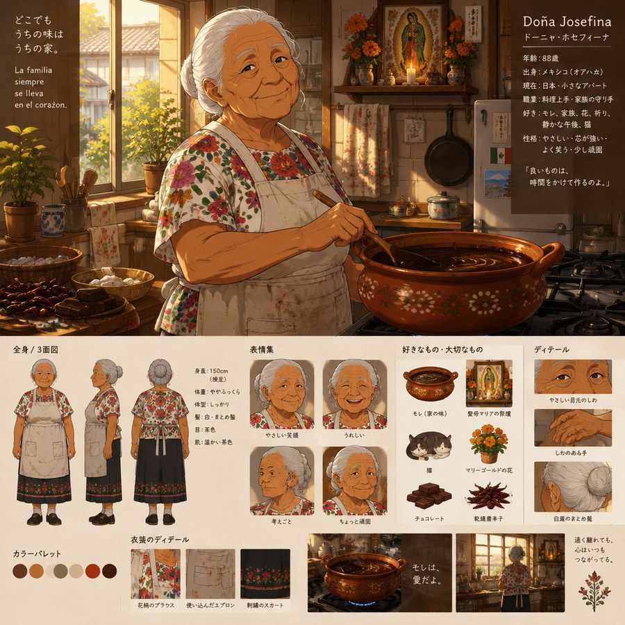
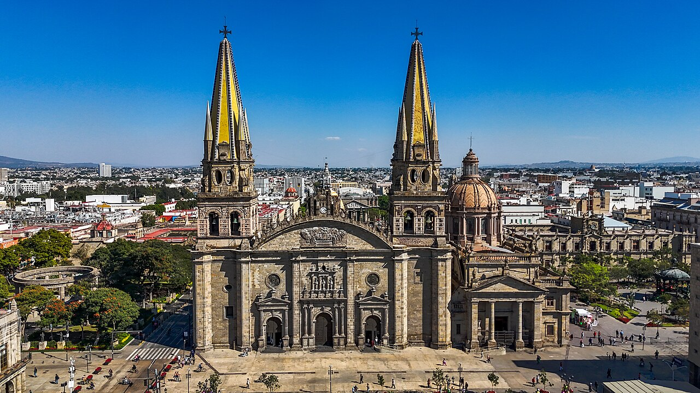

# Sección 08-B: La familia del OC (II) — Cuatro generaciones

> **Biblia del universo de Sakura-sou no Pet na Kanojo (さくら荘のペットな彼女)**
> Documento de creación original para el fanfic de este repositorio.
> Personajes originales: la familia **Fujioka / Zamora / Hernández**

<p align="center">
  
  
</p>

---

## Aviso de método

Igual que en el documento anterior: la **historia de la migración japonesa a México es real y está citada** al final. La familia Fujioka es ficción construida encima de esa historia, y las fechas de sus miembros son invención de este proyecto.

---

# 1. El árbol completo

```
                    JAPÓN                      MÉXICO
                       │
        ┌──────────────┴──────────────┐
        │   藤岡 勘次郎 Kanjirō        │   1876 (Japón) — 1951 (Guadalajara)
        │   llega a México en 1897    │
        └──────────────┬──────────────┘
                       │
                 (generación 2)
                       │
        ┌──────────────┴──────────────┐
        │   藤岡 勇 Isamu              │   1932 (Guadalajara) — 2004 (Tokio)
        │   papel y cartón            │
        └──────────────┬──────────────┘
                       │   ✕   Dolores «Lola» Zamora Vargas
                       │       1938 (Guadalajara) — viva, 88 años, Japón
                       │
                 (generación 3)
                       │
        ┌──────────────┴──────────────┐
        │   藤岡 誠 Makoto             │   1975 (Tokio) — vivo, 51 años
        │   FJ Holdings (envases)     │
        └──────────────┬──────────────┘
                       │   ✕ (divorcio 2018)
                       │   María de la Luz «Luz» Hernández Robles
                       │       1988 (Guadalajara) — viva, 38 años, México
                       │
                 (generación 4)
                       │
        ┌──────────────┴──────────────┐
        │  藤岡 慈 / Jesús Fujioka     │   nace en Japón · 16-17 años
        │  Hernández                  │   el OC del fanfic
        └─────────────────────────────┘
```

**Cuatro generaciones en cinco países de distancia.** Y una sola regla que atraviesa a todas: **el que se va, se borra.**

| Generación | Nombre completo | Nace | Muere | Lo que representa |
|---|---|---|---|---|
| 1 | 藤岡 勘次郎 (Fujioka Kanjirō) | 1876, Japón | 1951, Guadalajara | **El que se quedó** |
| 2 | 藤岡 勇 (Fujioka Isamu) | 1932, Guadalajara | 2004, Tokio | **El que volvió** |
| 2 | Dolores «Lola» Zamora Vargas | 1938, Guadalajara | — | **La que nunca se movió de sí misma** |
| 3 | 藤岡 誠 (Fujioka Makoto) | 1975, Tokio | — | **El que se borró** |
| 3 | María de la Luz «Luz» Hernández Robles | 1988, Guadalajara | — | **La que fue borrada** |
| 4 | 藤岡 慈 / Jesús Fujioka Hernández | Japón | — | **El que no piensa borrarse** |

---

# 2. Las tres fechas que sostienen toda la historia familiar

Este fanfic se apoya en tres hechos reales. Conviene tenerlos porque el padre los usa como coartada y el hijo los puede usar como arma.

## 1614 · La primera vez que Japón pisó México

La **embajada Keichō** (慶長遣欧使節), encabezada por **Hasekura Tsunenaga**, cruzó el Pacífico y llegó a **Acapulco** en 1614 antes de seguir a Europa. Fue el primer contacto diplomático formal entre los dos países, y ocurrió **cuatrocientos doce años antes** de que existiera cualquiera de los personajes de este fanfic.

> **Uso narrativo:** cuando el padre necesite justificar su "japonesidad" en público, hablará de 1614. Es su escudo histórico favorito.

## 1888 · El tratado que abrió la puerta

El **Tratado de Amistad, Comercio y Navegación entre Japón y México** (日墨修好通商条約) se firmó el **30 de noviembre de 1888** entre **Mutsu Munemitsu** y **Matías Romero**.

Lo que lo hace extraordinario, y esto es un dato que sorprende a casi todo el mundo:

- Fue **el primer tratado igualitario** que Japón firmó con un país no asiático: **sin extraterritorialidad** y **con autonomía arancelaria**. Es decir, México fue el primer país occidental que trató a Japón como igual.
- Fue **el primer tratado** que México firmó con un país de Asia.
- Como agradecimiento, el gobierno japonés **donó a México el terreno de su embajada en Nagatachō** en 1898. Por eso la embajada de México en Tokio es **una casa sola**, algo único en el barrio de los edificios oficiales.

> **Uso narrativo:** la familia Fujioka no llegó a México "de invitada". Llegó **a un país que había sido el primero en reconocer a Japón como igual.** Cuando el padre diga que "México no tiene nada que ver con él", estará negando un tratado firmado por su propio país. Eso es material para un capítulo.

## 1897 · La colonia que fracasó

En **1897**, la sociedad colonizadora fundada por **Enomoto Takeaki** (榎本武揚) llevó a México a un grupo reducido de japoneses —las cifras varían según la fuente; la Wikipedia japonesa habla de **28 personas**— para establecerse como colonos. **El proyecto fracasó económicamente.**

Pero fracasó de una manera muy productiva: fue **el origen de la comunidad japonesa en México**. Hoy hay alrededor de **17 753 descendientes nikkei** en el país, y los asentamientos originales se recuerdan en lugares como **Acacoyagua, Chiapas**, reconocido como uno de los puntos donde se establecieron los primeros colonos.

**La familia Fujioka entra por ahí.** Son de los que **no se fueron cuando todos se fueron.**

---

# 3. Generación 1 — 藤岡 勘次郎, el que se quedó

- **1876-1951.** Nace en Japón, en la prefectura de Gunma, y llega a México con **21 años** en la colonia de 1897.
- Trabaja en el campo en Chiapas, aguanta dos años, se va a Guadalajara en 1905 y nunca vuelve a explicar por qué.
- Pone una **papelería** en el centro. Vende papel, cuadernos, sobres. Le va bien.
- Se casa con **Concepción Robles** (mexicana) en 1910. Tienen cuatro hijos.
- **Nunca aprendió a escribir bien el español.** Firmaba con un sello.
- Murió en 1951 sin haber regresado nunca a Japón y sin haber pedido perdón por quedarse.

**Lo que dejó:** una papelería, un apellido difícil de pronunciar y una frase que su hijo repetiría toda la vida:

> *"Aquí el que no trabaja, no come. Y el que se va, no vuelve."*

---

# 4. Generación 2 — 藤岡 勇, el que volvió

- **1932-2004.** Nace en Guadalajara. Es el tercer hijo. **Es mexicano**, con todo lo que eso significa: misa, futbol, español como primera lengua.
- A los 16 entra a trabajar con su padre. A los 24 ya lleva las compras.
- **1962:** el negocio familiar recibe una oferta de un proveedor japonés de papel. Isamu viaja a Japón tres meses. Se queda tres años.
- **1965:** se casa con **Dolores Zamora**, una mujer de Guadalajara que había ido a Japón a trabajar en la casa de unos parientes. Se casan en Tokio, en una ceremonia mínima, con un traductor como testigo.
- **1966:** funda **藤岡紙業 (Fujioka Paper)**, importación de papel y cartón. El negocio crece con la posguerra japonesa.
- **1975:** nace Makoto. Es el único hijo.
- Muere en 2004, en Tokio, **hablando español en el hospital** con su mujer, y en japonés con el médico.

**El detalle que define a esta generación:** Isamu se pasó la vida haciendo trámites en japonés para un negocio que existía porque **su padre había fracasado en México**. Nunca dijo esta frase, pero la pensó todos los días: *"volví porque no me quedó de otra".*

---

# 5. Generación 2 bis — Dolores «Lola» Zamora Vargas

<p align="center">
  
</p>

Esta mujer es, en términos narrativos, **el arma secreta de todo el fanfic**. Vale la pena tenerla completa.

| Campo | Dato |
|---|---|
| **Nombre** | Dolores Zamora Vargas |
| **Apodo** | **Lola**. Nadie la llama Dolores. Su hijo le dice 母さん; su nieto, "Lola" |
| **Nacimiento** | 1938, Guadalajara, Jalisco |
| **Edad en el relato** | 88 años |
| **Domicilio** | Una casa de dos plantas en **Fuchū, Tokio**, a cuarenta minutos de Sakura-sō |
| **Idioma** | Español de Jalisco y japonés funcional, con acento de barrio y errores de partícula |
| **Religión** | Católica practicante. Tiene una virgen de Guadalupe en la cocina y un butsudan en la sala, y a nadie le parece contradictorio |
| **Ocupación** | Jubilada. Fue costurera y después cocinera en un restaurante de Shibuya |
| **Estado** | Viuda desde 2004. Vive sola. **No quiere vivir con su hijo** |

**Quién es.** Una mujer que llegó a Japón en 1965 a limpiar casas ajenas, se casó con un hombre que hablaba tres idiomas y murió hablándole en el suyo, y **se quedó en un país que nunca la dejó de mirar raro**. Lleva sesenta años diciendo "buenos días" en japonés con una entonación que delata dónde nació.

**Su casa.** Es el único lugar del mundo donde Jesús come sin pedir permiso. Huele a mole, a tortilla y a incienso. En la sala hay un butsudan con la foto de Isamu. En la cocina hay un comal que ha cruzado el océano dos veces.

**Su relación con Makoto.** Es el punto ciego de la armadura del padre. Él la visita **todos los domingos a las diez de la mañana**, puntual como un empleado, y siempre lleva algo que ella no le pidió. Se quedan una hora. Hablan de la empresa. **Nunca hablan de México.** Ella nunca le reclama nada, y ese silencio es el mismo que le puso a los nueve años cuando él le pidió que no fuera a la escuela.

> **Escena que hay que escribir alguna vez:** Lola sabe perfectamente por qué su hijo es así. Lo sabe desde 1984. Y ha decidido, durante cuarenta y dos años, **no decírselo**, porque sabe que a su hijo lo único que lo rompería sería que su madre le dijera la verdad en voz alta.

**Su relación con Jesús.** Le habla **siempre en español**, incluso cuando él contesta en japonés. Le da dinero a escondidas. Le dice "mijo". Le tiene una foto de cuando tenía siete años en la playa de Enoshima, con la playera de las Chivas, y es la única foto de la casa en la que no están todos serios.

**Su comida.** Mole, pozole, huevos con chorizo, arroz rojo. Y una vez al año, el 2 de noviembre, **pan de muerto** que hornea ella misma. Nadie más en Japón lo sabe hacer en esa casa.

---

# 6. Generación 3 — La madre ausente: Luz

<p align="center">
  
</p>

| Campo | Dato |
|---|---|
| **Nombre** | **María de la Luz Hernández Robles** · «**Luz**» |
| **Nacimiento** | 1988, Guadalajara, Jalisco |
| **Edad en el relato** | 38 años |
| **Domicilio** | Colonia Santa Tere, Guadalajara |
| **Ocupación** | Administradora. Trabajó en la planta de FJ en Jalisco. Hoy lleva la contabilidad de una ferretería familiar |
| **Idioma** | Español. **Cero japonés** después de ocho años de matrimonio |
| **Vínculo con Jesús** | Custodia perdida en 2018. Llamada fija **todos los domingos a las 9:00 (hora de Japón)** |

## Cómo se enamoró

En 2007, en la boda de un proveedor de la planta. Él tenía 32, traje oscuro, cero español de fiesta, cero ganas de bailar. Ella tenía 19, trabajaba recepcionando y sabía perfectamente quién era el japonés del traje.

Bailaron. Él habló en español con un acento que a ella le pareció encantador y que después entendió que era **un secreto**. Se casaron en 2008, once meses después.

## Lo que le pasó

Aquí hay que ser exacto, porque este es el punto donde un fanfic mal escrito se vuelve melodrama. Todo esto es **procesal**, silencioso y terrible:

1. **El apellido.** En Japón, los cónyuges deben compartir un solo apellido (民法750条). En 2023, el **94,5 %** de los matrimonios registrados adoptó el apellido del marido. Luz se convirtió legalmente en **藤岡 ルス** y, en su vida cotidiana, en *"la señora Fujioka"*. **Su nombre mexicano desapareció en el registro**.
2. **El idioma.** En Tokio, sin japonés, se quedó sin amigos, sin trabajo y sin la posibilidad de discutir con un médico o un abogado. La única persona con quien podía hablar español **era la madre de su marido**, que vivía a cuarenta minutos y que la quería, pero que también tenía sesenta años de costumbre de no meterse.
3. **La casa.** En una casa donde nadie habla su idioma, el silencio se convierte en la norma, y la depresión en un problema de conducta.
4. **El divorcio.** 2018. Él tiene a los mejores abogados de Tokio. Ella a uno de oficio.
5. **La custodia.** Japón tiene **custodia exclusiva** (単独親権): en el divorcio, **uno solo** de los padres obtiene la patria potestad, y el otro queda sin nada. En la enorme mayoría de los casos la obtiene la madre. En este caso la obtuvo el padre, y no hace falta imaginar el motivo: dinero, nacionalidad, estabilidad acreditada, una casa en Setagaya contra una mujer extranjera sin trabajo.
6. **El tratado.** Si el divorcio hubiese sido antes de 2014, ella no habría tenido **ningún** mecanismo internacional, porque Japón solo se incorporó al **Convenio de La Haya de 1980 sobre sustracción internacional de menores el 1 de abril de 2014**. Y aun así: ese convenio **no decide la custodia**, solo ordena la devolución del menor a su país de residencia habitual. **No era la herramienta.**
7. **Lo único que se llevó.** El derecho a una llamada semanal. Y el jersey.

## La llamada de los domingos

Todos los domingos, a las nueve de la mañana hora de Japón (seis de la tarde del sábado en Guadalajara), suena el teléfono fijo del pasillo.

- Dura **entre cuatro y doce minutos**, nunca más, porque el padre lo considera "suficiente".
- **Empieza siempre igual:** "¿Ya comiste?"
- **Termina siempre igual:** "No le hagas caso a tu papá. Bueno, sí, en lo del estudio."
- Ella **no pregunta por Makoto**. Nunca. En dieciocho años, ni una sola vez.

**El dato que hay que guardar para el final del fanfic:** ella **nunca ha visto a su hijo en persona desde 2018**. Ni una foto reciente. Solo la voz.

---

# 7. Generación 4 — El nombre doble

Aquí está el invento que sostiene el personaje entero, y es legalmente plausible.

**Jesús tiene dos nombres porque tiene dos países.**

| Documento | Nombre | Idioma |
|---|---|---|
| **Koseki** (戸籍, registro familiar japonés) | **藤岡 慈** (Fujioka Ji) | Japonés. 慈 = **compasión, misericordia** |
| **Registro civil mexicano** (levantado por la vía consular) | **Jesús Fujioka Hernández** | Español |
| **Cómo lo llama su padre** | 慈 | Japonés |
| **Cómo lo llama su madre** | Jesús, *"mijo"* | Español |
| **Cómo lo llaman en la escuela** | 藤岡 | El apellido, como a todos |
| **Cómo lo llaman en Sakura-sō** | Jesús | Porque alguien preguntó cómo se llamaba de verdad |

**La regla de oro del personaje, y la mejor herramienta de escritura de todo este fanfic:**

> **Quien lo llama "Jesús" lo quiere. Quien lo llama "Fujioka" lo respeta. Quien lo llama "慈" lo posee.**

Y hay algo más: **el padre eligió el kanji**. 慈, "misericordia". Un hombre que nunca ha perdonado nada le puso a su hijo el nombre de la compasión, y es la única prueba documental de que alguna vez quiso ser otro.

---

# 8. La nacionalidad: el formulario sin firmar

Y aquí está el arma legal del tercer acto.

- **Japón no reconoce la doble nacionalidad.** Quien la tiene por nacimiento (por ejemplo, hijo de padre japonés y madre mexicana) debe **elegir una**.
- El plazo: **hasta los 20 años** si la doble nacionalidad se adquirió antes de los 18, o **dos años** si se adquirió después.
- **Elegir la japonesa implica renunciar a la mexicana.** Y hay un detalle burocrático que lo cambia todo: **no presentar el trámite no tiene sanción prevista**. Millones de personas simplemente **no eligen**.
- México, por su parte, es un país de **ius soli**: es mexicano quien nace en territorio mexicano. Jesús nació en Japón, así que su mexicanidad depende del registro consular y de su madre.

**Traducción para el fanfic:** la guerra entre padre e hijo no es una discusión. Es **un formulario en un cajón**. El padre ya firmó el suyo hace treinta años. El hijo no ha firmado el suyo, y mientras no lo firme, sigue siendo las dos cosas.

---

# 9. Los rituales de la familia

Los rituales son donde se ve el conflicto sin que nadie lo explique. Estos son los seis que conviene usar.

| Fecha | En casa del padre | En casa de Lola |
|---|---|---|
| **1 de enero** | おせち料理, saludos formales al butsudan, tarjetas de año nuevo | Tamales y champurrado. Lola pone la virgen junto al butsudan |
| **2 de noviembre** | Makoto va solo al templo. No dice a quién visita | **Pan de muerto**, ofrenda con la foto de Isamu y **una foto de Luz** que Makoto nunca ve |
| **24 de diciembre** | Cena en un restaurante, con reservación | Cena en casa, con pozole y doce personas que no son parientes |
| **Cumpleaños de Jesús** | Un sobre con dinero y una tarjeta impresa | Un pastel de tres leches y una llamada de Luz a las 9:00 |
| **Golden Week** | Viaje de negocios | Nada. Lola dice que los viajes son para la gente que no tiene casa |
| **Domingo** | Visita de una hora, puntual | Comida a las dos, sin hora de salida |

**El detalle que vale por diez escenas:** en la casa de Lola **hay dos altares**. Uno sintoísta-budista, con la foto de su marido. Y uno católico, con la Virgen. Y a nadie en esa casa le parece contradictorio, porque así es México. **En la casa del padre no hay ningún altar.**

---

# 10. Quién sabe qué

Control de información, importantísimo para escribir sin contradicciones.

| Personaje | Sabe que… |
|---|---|
| **Lola** | Todo. Absolutamente todo. Desde 1984. Y ha decidido callarlo |
| **Makoto** | Todo, y lo niega. Es su forma de saberlo |
| **Jesús** | Sabe que su madre vive en Guadalajara y que la llamada es a las 9:00. **No sabe por qué perdió la custodia.** Ese es su gran hueco |
| **Luz** | Sabe todo lo del divorcio. No sabe que su hijo escucha las llamadas desde el pasillo |
| **Chihiro Sengoku** | Sabe lo que dice el expediente: "padre empresario, madre en el extranjero, custodia exclusiva del padre". **Nunca pregunta más**, y esa es su forma de cuidar |
| **Sorata** | Sabe que el padre es rico y que el hijo no habla de él. No sabe nada del resto |
| **Mashiro** | **Nada.** Y por eso es la única que hace las preguntas correctas, porque no sabe que no se hacen |
| **Nanami** | Se entera de la madre **tarde y por accidente**, y es la única que entiende exactamente lo que significa perder algo por no tener papeles |

---

# 11. El hallazgo de esta sección

Verifiqué el reglamento del **Club Deportivo Guadalajara** para escribir esto, y me encontré algo que no esperaba y que le da a tu personaje un símbolo perfecto:

**La política histórica más característica del Guadalajara es jugar únicamente con futbolistas mexicanos por nacimiento o de origen mexicano.** Es su seña de identidad desde hace más de un siglo, y es lo que lo distingue de todos los demás clubes de México. (La regla no aplica a los entrenadores, que sí pueden ser extranjeros.)

Léelo otra vez: **"o de origen mexicano".**

El único club del mundo cuyo reglamento está escrito para admitir a un chico **nacido en Japón** es el del escudo que ese chico lleva en el pecho. Y el hombre que le prohíbe hablar español en su propia casa **fue dueño, treinta años, de una empresa que depende de México.**

Eso no hace falta subrayarlo en el fanfic. Solo hace falta ponerlo.

---

## Verificación de esta sección

- **La embajada Keichō de 1614 y el paso de Hasekura Tsunenaga por Acapulco:** relato histórico consolidado del primer contacto diplomático Japón-México. Se menciona sin detalles adicionales que no se hayan podido contrastar.
- **El Tratado de Amistad, Comercio y Navegación de 1888:** verificado en la Wikipedia japonesa, que precisa que fue **el primer tratado igualitario de Japón con un país no asiático** (sin extraterritorialidad y con autonomía arancelaria), que fue **el primero de México con un país asiático**, que lo firmaron **Mutsu Munemitsu** y **Matías Romero**, y que como agradecimiento Japón **cedió el terreno de la embajada mexicana en Nagatachō** en 1898. La misma fuente enlaza la firma del tratado con el inicio de la emigración japonesa a México en 1897.
- **La colonia de Enomoto de 1897:** la Wikipedia japonesa (artículo 日系メキシコ人) indica que la sociedad colonizadora de **Enomoto Takeaki** llevó a México a **28 personas** (con cifras que varían según la fuente) y que el proyecto **fracasó**, pero que fue **el origen del asentamiento japonés en México**.
- **Acacoyagua, Chiapas:** la Wikipedia en español la describe como **uno de los lugares de asentamiento de los primeros colonos japoneses en México**.
- **Población nikkei:** **17 753 descendientes** y **6 501 residentes japoneses** en México (2009), según la Wikipedia japonesa. La misma fuente señala que la mayoría de los nikkei mexicanos **solo habla español** y que son mayoritariamente **católicos**. Ese dato sostiene a la abuela Lola.
- **El apellido único en el matrimonio japonés (民法750条):** verificado. En **2023**, de **474 741** matrimonios registrados, **448 397** (el **94,5 %**) adoptaron el apellido del marido.
- **La custodia exclusiva (単独親権):** verificada en el artículo de la Wikipedia japonesa sobre el Convenio de La Haya, que explica que Japón aplica custodia exclusiva (un solo progenitor) frente a la custodia conjunta de EE. UU. o Francia, y que **habitualmente la obtiene la madre**.
- **La entrada en vigor del Convenio de La Haya en Japón:** **1 de abril de 2014** (aprobado por el Congreso el 22 de mayo de 2013, ley de aplicación promulgada el 12 de junio de 2013). Se aclara en el texto que el convenio **no decide la custodia**, solo la devolución del menor, y que se aplica a **menores de 16 años**.
- **La doble nacionalidad en Japón:** verificado en la Wikipedia japonesa (artículo 多重国籍): el plazo para elegir es **hasta los 20 años** si se adquirió antes de los 18, o **dos años** si se adquirió después; **no hay sanción por no presentar el trámite**; y la pérdida de la nacionalidad extranjera depende de la ley del otro país.
- **México y el ius soli:** el artículo de la Wikipedia sobre nacionalidad incluye a México entre los países de **ius soli**.
- **El registro consular de nacimientos:** es una práctica real de los consulados mexicanos (registro civil de nacimiento ocurrido en el extranjero). Se menciona como el mecanismo que sostiene el nombre **Jesús Fujioka Hernández**, sin afirmar trámites concretos que no se hayan verificado.
- **La política del Club Deportivo Guadalajara:** verificada en la Wikipedia en español, que la describe como *"su política de jugar únicamente con futbolistas mexicanos por nacimiento o de origen mexicano"* y aclara que **no aplica a los entrenadores**.
- **Lo que es invención:** la familia Fujioka, Lola, Luz, las fechas familiares, la papelería de 1905, FJ Holdings y todo lo que depende de ellos.

---

## Fuentes de esta sección

1. **Wikipedia en japonés — 日系メキシコ人** (colonia de Enomoto, población nikkei, lengua y religión): https://ja.wikipedia.org/wiki/日系メキシコ人
2. **Wikipedia en japonés — 日墨修好通商条約** (1888, Mutsu y Romero, embajada en Nagatachō): https://ja.wikipedia.org/wiki/日墨修好通商条約
3. **Wikipedia en español — Acacoyagua** (asentamiento de los primeros colonos japoneses): https://es.wikipedia.org/wiki/Acacoyagua
4. **Wikipedia en japonés — 夫婦同氏** (民法750条 y datos de 2023): https://ja.wikipedia.org/wiki/夫婦同氏
5. **Wikipedia en japonés — 国際的な子の奪取の民事上の側面に関する条約** (custodia exclusiva japonesa, entrada en vigor en 2014): https://ja.wikipedia.org/wiki/国際的な子の奪取の民事上の側面に関する条約
6. **Wikipedia en japonés — 多重国籍** (plazos de elección y ausencia de sanción): https://ja.wikipedia.org/wiki/多重国籍
7. **Wikipedia en español — Club Deportivo Guadalajara (México)** (política de jugadores mexicanos por nacimiento u origen): https://es.wikipedia.org/wiki/Club_Deportivo_Guadalajara_(México)
8. **Wikipedia en japonés — 国籍法 / 親権** (marco general): https://ja.wikipedia.org/wiki/国籍法

---

*Documento anterior: [08-A — El padre](08a-familia-padre.md) · Siguiente: [08-C — El jersey y las otras reliquias](08c-familia-objetos.md)*
