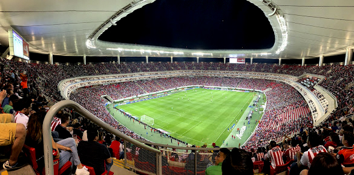
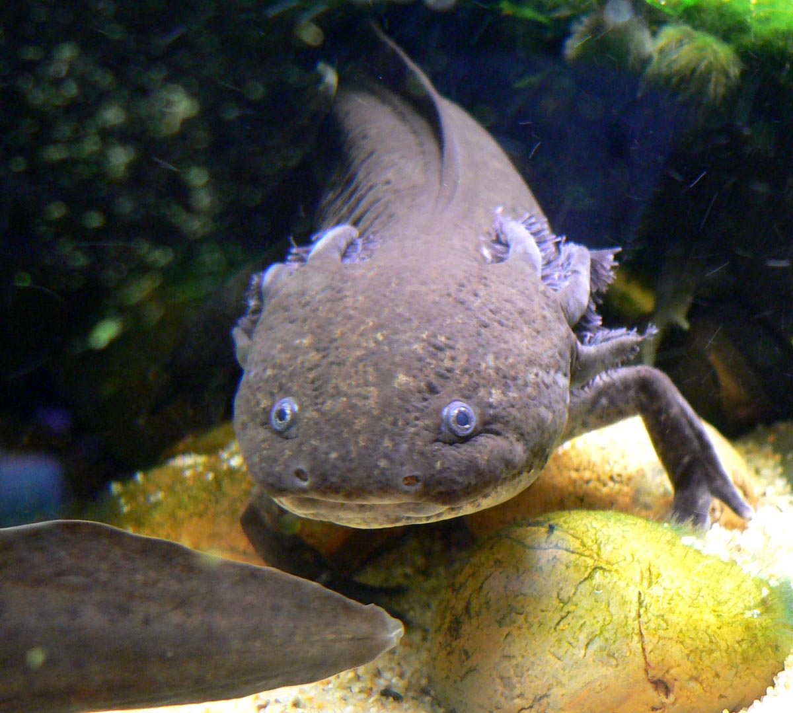

# Sección 08-C: La familia del OC (III) — El jersey y las otras reliquias

> **Biblia del universo de Sakura-sou no Pet na Kanojo (さくら荘のペットな彼女)**
> Documento de creación original para el fanfic de este repositorio.
> Los objetos con los que está construido **Jesús Fujioka Hernández**

  

---

## Por qué un documento sobre objetos

Porque este personaje **no se puede explicar con diálogos**. Su padre habla en keigo y su madre vive a doce mil kilómetros; ninguno de los dos le va a decir nunca lo que siente. Todo lo que Jesús sabe de sí mismo está guardado en **cinco cosas físicas**.

En una obra como *Sakura-sō*, donde los personajes no saben hablar, **los objetos son el idioma**. Mashiro pinta, Nanami cocina, Ryūnosuke programa, Misaki dibuja, Chihiro bebe. Jesús **lleva puesto** lo que no puede decir.

---

# 1. La reliquia principal: el jersey de las Chivas

  

## Ficha del objeto

| Campo | Dato |
|---|---|
| **Qué es** | Camiseta local del **Club Deportivo Guadalajara**, talla de adolescente, blanca, cuello sencillo, escudo bordado en el pecho izquierdo |
| **Origen** | Regalo de su madre. La última cosa que le dio en persona, en el aeropuerto, en 2018 |
| **Estado** | Usada. El cuello está flojo. Tiene una mancha de pintura azul sobre el escudo |
| **Cómo la cuida** | **La lava a mano.** Nunca en la lavadora. La seca colgada, a la sombra, en la ventana de su cuarto |
| **Cuándo la usa** | Los domingos. Y los días en que quiere molestar |
| **Dónde vive** | Doblada en la segunda repisa del clóset, encima de una bolsa de plástico, con una hoja de papel de china entre los pliegues |

## Por qué esa camiseta y no otra

Aquí está el hallazgo de esta sección, y es un dato real que verifiqué para escribir esto:

**La política histórica más característica del Club Deportivo Guadalajara es jugar únicamente con futbolistas mexicanos por nacimiento o de origen mexicano.** Es lo que lo distingue de todos los demás clubes de México desde hace más de un siglo. Y la regla **no aplica a los entrenadores**, que sí pueden ser extranjeros.

Léelo otra vez: **"por nacimiento o de origen mexicano".**

El club del escudo que Jesús lleva en el pecho **tiene un reglamento escrito para admitirlo**. Es el único equipo del mundo cuya norma dice, con todas sus letras, que un chico nacido en Tokio también cuenta. Mientras su padre le prohíbe hablar español en su propia casa, el escudo que su madre le regaló está hecho para gente como él.

**Eso es lo que hace que la camiseta sea un acto político y no una prenda.** No hace falta explicarlo en el fanfic. Solo hace falta que esté ahí, y que el padre lo sepa.

---

# 2. La escena de la pintura (el primer pleito)

Esta escena la planteó el autor del proyecto y es, probablemente, **la mejor puerta de entrada del personaje a Sakura-sō**. La desarrollo completa porque define la relación con Mashiro para toda la historia.

## Preparación

- Es una tarde de mayo. Jesús lleva **tres semanas** en Sakura-sō.
- La camiseta está secando en el respaldo de una silla de la sala común, junto a la ventana, porque él la lavó a mano esa mañana.
- **Mashiro está pintando en el suelo**, como siempre: sin periódico, sin delantal, con los pinceles esparcidos y un vaso de agua sucia que nadie ha movido de ahí desde marzo.
- Sorata le dijo tres veces que no pinte en la sala. Ella lo hace igual porque la luz es mejor.
- **Nadie en la casa sabe qué es esa camiseta.** Solo saben que es lo único que el chico nuevo lava a mano.

## El accidente

Mashiro se levanta para alcanzar un frasco del estante. Al hacerlo, **golpea el vaso**. El agua sucia, con restos de **azul ultramar**, salta.

No es un drama: es un chorro corto que cae justo sobre el pecho de la camiseta. **Sobre el escudo.** Tres manchas: una grande y dos pequeñas, en diagonal.

Mashiro mira la camiseta. Mira el pincel. Y dice, con la voz tranquila de quien resuelve un problema técnico:

> 「上から塗ればいい」
> *"Se puede pintar encima."*

## La explosión

Y ahí, por primera vez en tres semanas, **el chico amable grita.**

No grita en japonés. Grita en español, y nadie en la casa entiende una sola palabra, y eso lo empeora: está enojado en un idioma que **ninguno de ellos puede usar para pedirle perdón**.

Lo que dice, traducido, es una sola idea, repetida de cinco maneras distintas:

> *"No se arregla pintando encima. No todo se arregla tapándolo."*

**Y esa frase es su padre.** No la aprendió de un libro. Es la primera vez en su vida que se escucha a sí mismo y reconoce la voz de Makoto, y eso lo aterra más que la mancha.

## Lo que hace Mashiro

Mashiro **no se disculpa.** Mashiro no sabe disculparse.

Se queda sentada en el suelo, con el pincel en la mano, mirando a un chico que grita en un idioma que no entiende, y hace lo único que sabe hacer: **lo observa**. Mira cómo le tiembla la mandíbula. Mira cómo sostiene la camiseta con las dos manos, como se sostiene algo que se va a caer. Mira que el chico no está enojado por una camiseta.

Entonces dice lo único que diría Mashiro:

> 「そのシャツ、誰にもらったの？」
> *"¿Quién te dio esa camiseta?"*

Y Jesús no contesta. Se va al cuarto con la camiseta mojada.

## El silencio (tres días)

Tres días sin hablarse. Navidad en miniatura: todos incómodos, Sorata intentando mediar, Nanami diciéndole a Mashiro que "al menos pide perdón", y Mashiro sin entender **por qué hay que pedir perdón por agua**.

**El detalle que hay que meter aquí:** Mashiro no está indiferente. Está *pensando*. Se la pasa mirando la mancha del piso donde cayó el agua, con esa cara que pone cuando algo no le cabe en la cabeza.

## La resolución: el cuadro

Al cuarto día, Mashiro entra al cuarto de Jesús sin tocar y deja un lienzo apoyado en la pared.

Es **él**, de pie, con la camiseta puesta. Y la mancha **está en el cuadro**: tres trazos azules sobre el escudo, pintados como si fueran parte del diseño. No la tapó. No la disimuló. **La incluyó.**

Y en el reverso, escrito con lápiz, con su letra de niña extranjera que aprendió a escribir antes que a hablar:

> 「これは、はじめからあった」
> *"Esto ya estaba desde el principio."*

Jesús se queda mirando el cuadro mucho rato. Y entiende lo que ella le está diciendo, porque Mashiro solo sabe decir las cosas así:

**No te estoy devolviendo una camiseta perfecta. Te estoy diciendo que la mancha no la arruinó: la volvió tuya.**

## El después

- Al día siguiente, Jesús **se pone la camiseta manchada** para bajar a desayunar.
- Mashiro lo ve, no dice nada, y sigue comiendo.
- Nanami es la única que entiende lo que acaba de pasar y se le llena un poco la cara de lo que sea que le pasa cuando entiende algo.
- **El cuadro se queda colgado** en el cuarto de Jesús, y en el momento más oscuro de la historia, cuando él crea que no pertenece a ningún lado, **ese cuadro va a estar en la pared**.

## Por qué esta escena funciona

Porque **no es una escena de disculpa: es una escena de traducción.** Los dos personajes hablan idiomas que el otro no habla (uno literal, uno emocional), y el cuadro es la primera frase que se entienden.

Y porque **la mancha salva la camiseta**. Mientras era perfecta, era una reliquia: un objeto de museo, intocable, de un país al que no puede volver. Manchada, es **una camiseta que se usa**. Alguien la tocó. Alguien la arruinó. Ya no es un recuerdo: es una prenda.

---

# 3. La segunda reliquia: el dije del collar

En el cuello, una cadena de plata fina con un dije pequeño. En la descripción visual del personaje aparece como "un dije pequeño"; aquí le ponemos forma.

**Es un ajolote.**

  

## Por qué un ajolote, y no cualquier cosa

Porque el ajolote es el animal más útil del mundo para este personaje, y todo lo que sigue es **ciencia verificada**:

1. **Es endémico del sistema lacustre de la Cuenca de México.** Es decir: **existe en un solo lugar del planeta.** Como el personaje: un solo lugar, una sola casa, una sola abuela.
2. **Está en peligro crítico de extinción**, por pérdida de hábitat, peces depredadores introducidos, contaminación, sobreexplotación y venta ilegal. Un animal que se está quedando sin casa aunque nadie lo esté cazando.
3. **Es neoténico:** alcanza la madurez sexual **conservando sus rasgos de larva**. No completa la metamorfosis. **Literalmente, nunca termina de crecer.**

Y ese tercer punto es el personaje entero. Todos le dicen a Jesús que madure, que se concentre, que deje de ser un niño: **y él es un animal que, por naturaleza, no cambia de forma.** No está fallando en la metamorfosis. No le tocaba.

4. **Su nombre viene del náhuatl** *āxōlōtl*, compuesto de *atl* ("agua") y *xōlōtl* ("animal, monstruo"): significa **"animal acuático"** o **"monstruo de agua"**.

**Uso para el fanfic:** su padre lo llama 慈. Su madre le dice "mijo". Y alguien, en un momento de cariño, lo va a llamar **"monstruo de agua"** — y va a ser la primera vez que un apodo no le duela.

## Ficha del objeto

| Campo | Dato |
|---|---|
| **Material** | Plata, dije de 15 mm, hecho a mano en un taller de Tlaquepaque |
| **Origen** | Se lo mandó su madre por correo en 2020, con una nota de tres líneas |
| **Lo que dice la nota** | *"Este animal nunca crece. Yo tampoco quiero que crezcas."* |
| **Lo que él cree que significa** | Que su madre lo extraña |
| **Lo que significa de verdad** | Que su madre sabe exactamente qué le dicen los médicos, y le está diciendo que está bien así |
| **Cuándo se lo quita** | Solo para bañarse. Nunca delante de su padre, que jamás lo ha visto |

---

# 4. Las otras tres reliquias

## 4.1 · El formulario sin firmar

Un sobre de la oficina de su padre con un documento de **elección de nacionalidad**. Lleva un año en el cajón, con la esquina doblada.

- **No es un objeto bonito.** Es la cosa más fea y más importante que tiene.
- Su padre no lo menciona **nunca**. Mencionarlo sería reconocer que existe la posibilidad de que su hijo elija México.
- **Cuándo se firma o no se firma:** es el clímax del arco familiar. Y hay tres finales válidos: lo firma (elige Japón y se libera de su padre por dentro), **no lo firma** (no elige, y ese "no elegir" es su primera decisión adulta), o lo rompe.

## 4.2 · La tarjeta corporativa

Una tarjeta negra con su nombre en relieve. Cada gasto aparece en un informe mensual que él nunca lee.

- **El detalle:** Jesús la usa **poco a propósito**. Compra cosas absurdas y baratas para que aparezcan en el informe: un dulce de 80 yenes, un cilindro de gas para un experimento, comida para gatos callejeros.
- Es su forma de mandarle mensajes a un hombre que no contesta correos: **dejando huellas en su propio sistema de vigilancia.**

## 4.3 · El teléfono fijo del pasillo

El único teléfono de la casa al que llama su madre.

- **En Sakura-sō no hay teléfono fijo** (canon: el edificio es viejo y no tiene ni encendedor de gas que funcione). Así que la llamada de los domingos **pasa de un teléfono público o de un celular prestado**.
- Ese cambio es un dolor silencioso: en la casa de su padre, la llamada tiene un teléfono y una hora. En Sakura-sō, **la llamada tiene que pedir permiso para existir.**
- **Escena que vale oro:** la primera vez que Nanami le presta su celular para llamar a su madre, y se queda ahí, fingiendo que no escucha, y escucha todo.

---

# 5. El idioma: en qué piensa

Este apartado es puro oficio de escritura, y es la diferencia entre un personaje con dos culturas y un personaje con una etiqueta.

| Función mental | Idioma |
|---|---|
| **Pensar** | Japonés. Es su lengua materna y no hay forma de fingir lo contrario |
| **Contar** | Español. Cuenta en español y le sale mal en las clases de matemáticas |
| **Rezar** | No reza. Pero si lo hiciera, sería en español |
| **Enumerar en voz alta** | Japonés, con acento de Tokio, perfecto |
| **Insultar** | Español. Siempre. No hay excepción |
| **Soñar** | **Español.** Y siempre con la misma escena: un aeropuerto |
| **Contar un chiste** | Japonés. Y sus chistes son japoneses, y por eso nadie se ríe |
| **Decir te quiero** | **Ninguno de los dos.** Nunca lo ha dicho en ningún idioma |

**La regla de escritura:** cuando el personaje esté en su peor momento, **se le va a escapar el español**. Cuando esté en su mejor momento, **va a decir una frase en japonés que suene a su madre.**

---

# 6. Lo que heredó del padre (y lo que no)

| Heredado | Cómo se le ve |
|---|---|
| **El silencio de cuatro segundos** | Antes de contestar algo personal, se queda callado. Igual que él. Le da vergüenza |
| **El orden de los objetos** | Su cuarto es un desastre, pero sus tenis están alineados y su mochila tiene un lugar exacto |
| **La cortesía como escudo** | Cuando no sabe qué hacer, se vuelve formal y educado. Es su padre saliendo por su boca |
| **La obsesión por el trabajo** | Cuando algo le importa, no come, no duerme y no contesta mensajes. Su padre llama a eso "disciplina" |
| **El gusto por lo invisible** | Le gustan las cosas que nadie mira: el sonido de una puerta, el olor de un libro, la cinta adhesiva |
| ❌ **El borrado** | **Lo único que ha decidido no heredar.** Y es lo único que le va a costar de verdad |

---

# 7. Tabla de símbolos (para control de continuidad)

| Símbolo | Qué significa | Dónde aparece | Cuándo se pierde o se rompe |
|---|---|---|---|
| **El jersey blanco** | La madre. El origen. La identidad que no se quita | Siempre puesto los domingos | **Se mancha** (episodio de la pintura). Nunca se lava la mancha |
| **La mancha azul** | Que la identidad se puede habitar, no solo conservar | Sobre el escudo | Nunca. Se convierte en el centro del cuadro |
| **El cuadro de Mashiro** | Que alguien lo vio y lo entendió sin hablar | Pared del cuarto | Se queda cuando él se va (lo deja colgado) |
| **El dije del ajolote** | Que no está roto: está en su forma natural | Cuello, debajo de la camisa | Se le cae la cadena una vez. Lo busca como un loco |
| **El formulario** | La propiedad que su padre tiene sobre él | Cajón | Se firma, se rompe o se deja en blanco |
| **La tarjeta negra** | El amor del padre, en su único idioma | Cartera | La usa para comprar cosas absurdas que aparezcan en el informe |
| **La llamada del domingo** | Su madre, a 12 000 km | Pasillo / celular prestado | Un domingo **no suena**. Ese es el peor capítulo |
| **El idioma español** | La verdad | Escenas de crisis | Se le escapa cuando grita |
| **El silencio de cuatro segundos** | El padre dentro de él | Conversaciones incómodas | Desaparece el día en que aprende a contestar rápido |

---

# 8. Lo que este documento deja listo y lo que falta

**Listo:**
- El jersey, su origen, su significado y su escena fundacional con Mashiro.
- El dije del ajolote con todo su respaldo científico.
- El formulario de nacionalidad como arma del tercer acto.
- La tarjeta y el teléfono como objetos de control.
- El mapa de idiomas y el de herencias.

**Falta, y es la sección 09:**
- La ficha completa del OC: cumpleaños, altura, tipo de sangre, cumpleaños japonés, comida favorita, seiyū imaginario.
- Su "talento" y su lugar en la jerarquía de Sakura-sō.
- El diagnóstico y cómo se escribe el TDAH sin caricatura ni folleto.
- La relación con cada residente, una por una.
- **El nudo con Nanami**, que es la columna del relato y merece su propio documento (probablemente el 09-C, o una sección 10 entera).

---

## Verificación de esta sección

- **La política del Club Deportivo Guadalajara:** verificada en la Wikipedia en español, que la describe textualmente como *"su política de jugar únicamente con futbolistas mexicanos por nacimiento o de origen mexicano"*, y aclara que **no aplica a los entrenadores**.
- **El ajolote (Ambystoma mexicanum):** verificado en la Wikipedia en español. Es **endémico del sistema lacustre de la Cuenca de México**, está **en peligro crítico de extinción** (por pérdida de hábitat, especies exóticas depredadoras, sobreexplotación, contaminación, tráfico de mascotas y consumo), y es una **especie neoténica**: alcanza la madurez sexual conservando rasgos larvarios, sin completar la metamorfosis.
- **La etimología de "ajolote":** del náhuatl *āxōlōtl*, compuesto de *atl* ("agua") y *xōlōtl* ("animal, monstruo"), con el significado conjunto de "animal acuático" o "monstruo de agua", según la misma fuente.
- **La mancha de azul ultramar:** el ultramar es un pigmento real de uso común en pintura. No se afirma nada técnico sobre su comportamiento sobre algodón; la escena es ficción.
- **El idioma de los sueños y de las cuentas:** no es un dato verificable, es una **decisión de escritura** de este proyecto. Se presenta como tal.
- **Los objetos (jersey, dije, formulario, tarjeta, teléfono):** invención de este fanfic. El único elemento con respaldo documental es el **procedimiento de elección de nacionalidad** descrito en la sección 08-B.
- **El cuadro y la frase del reverso:** invención de este proyecto. La frase se ofrece en japonés con traducción propia; no existe traducción oficial.

---

## Fuentes de esta sección

1. **Wikipedia en español — Club Deportivo Guadalajara (México)** (política de jugadores mexicanos por nacimiento u origen): https://es.wikipedia.org/wiki/Club_Deportivo_Guadalajara_(México)
2. **Wikipedia en español — Ambystoma mexicanum** (endemismo, estado crítico, neotenia, etimología náhuatl): https://es.wikipedia.org/wiki/Ambystoma_mexicanum
3. **Wikipedia en japonés — さくら荘のペットな彼女** (reglas del edificio, sala común, carácter de los residentes): https://ja.wikipedia.org/wiki/さくら荘のペットな彼女
4. **Sakurasou Wiki (Fandom)** — Mashiro Shiina (su forma de pintar, su dificultad para verbalizar): https://sakurasou.fandom.com/wiki/Mashiro_Shiina
5. **Wikipedia en japonés — 多重国籍** (marco del formulario de nacionalidad): https://ja.wikipedia.org/wiki/多重国籍

---

*Documento anterior: [08-B — Cuatro generaciones](08b-familia-generaciones.md) · Siguiente: la ficha completa del OC (sección 09, pendiente)*
