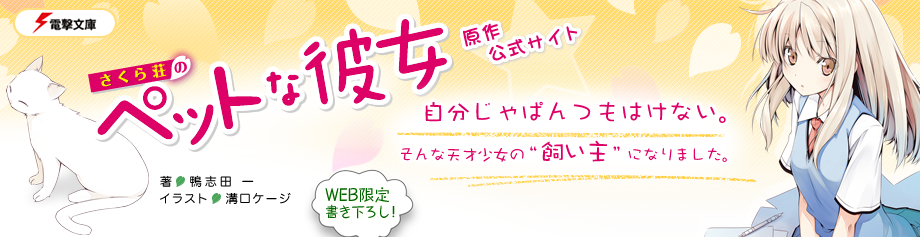

# 📖 Biblia さくら荘 — Sakura-sou no Pet na Kanojo

Documentación de referencia del universo de *Sakura-sou no Pet na Kanojo* (さくら荘のペットな彼女), conocida en inglés como *The Pet Girl of Sakurasou*. En español, con japonés donde vale la pena, para el proyecto de fanfic de este repositorio.

  

## Índice

### Sección 01 — Ficha técnica y datos de la obra ✅

1. [01-A · Identidad y publicación](01a-ficha-tecnica.md) ✅
   Ficha técnica maestra, significado del título, género, el autor (鴨志田一), el ilustrador (溝口ケージ), la editorial, los 13 volúmenes con fecha/páginas/precio/ISBN, los tres tomos cortos, cronología editorial, ediciones internacionales, tirada y recepción comercial, portadas.

2. [01-B · El anime y su equipo](01b-anime-y-staff.md) ✅
   Ficha del anime, producción y comité, equipo técnico completo, reparto con seiyū, temas musicales con autores, los 24 episodios con guion y storyboard, emisión, Blu-ray/DVD, licencias, y los cambios respecto a la novela (incluida la polémica del samgyetang).

3. [01-C · La franquicia completa](01c-franquicia-multimedia.md) ✅
   Manga, antología 4-koma, drama CDs, web radio, novela visual de PSP/PS Vita, 嫁コレ, 『電撃文庫 FIGHTING CLIMAX』, el crossover de 2016 con 青春ブタ野郎, cameos, cronología completa, cifras y crítica.

### Sección 02 — Temporada 1: capítulos con spoilers ✅

4. [02-A · Episodios 1 a 8](02a-temporada-1-episodios-1-8.md) ✅
   Presentación del mundo, llegada de Mashiro, primer verano, primer fracaso. Incluye el mapa de continuidad de los ocho primeros capítulos.

5. [02-B · Episodios 9 a 16](02b-temporada-1-episodios-9-16.md) ✅
   Llegada de Rita, producción de Nyaboron, festival cultural, Navidad, Año Nuevo en Fukuoka y la presentación de Sorata.

6. [02-C · Episodios 17 a 24](02c-temporada-1-episodios-17-24.md) ✅
   San Valentín, el examen de Yuuko, la amenaza de demolición, la graduación y el cierre de temporada, con el estado final de cada personaje.

### Sección 03 — Personajes principales ✅

7. [03-A · Sorata Kanda y Mashiro Shiina](03a-personajes-sorata-mashiro.md) ✅
   Fichas completas de los dos protagonistas: datos personales, significado de sus nombres, apariencia, personalidad, historia (anime y novela), relaciones, frases y guía de escritura. Incluye el panorama del elenco principal.

8. [03-B · Nanami Aoyama, Misaki Kamiigusa y Jin Mitaka](03b-personajes-nanami-misaki-jin.md) ✅
   La chica sin talento que trabaja, la genio que no puede parar y el cobarde que aprende a querer. Con la dinámica del trío y sus arcos completos.

9. [03-C · Ryūnosuke Akasaka, Maid-chan y Chihiro Sengoku](03c-personajes-ryunosuke-chihiro.md) ✅
   El hikikomori genio del teclado, su IA con voluntad propia y la adulta desastrosa que sostiene el dormitorio. Cierra con el mapa de relaciones de todo el elenco.

### Sección 04 — Personajes secundarios ✅

10. [04-A · La familia Kanda y los adultos del mundo creativo](04a-secundarios-familia-kanda.md) ✅
   Yūko, Akiko y el padre de Sorata; la editora Ayano Iida, el mentor Kazuki Fujisawa y Fūka Kamiigusa.

11. [04-B · Escuela, aula y vida cotidiana](04b-secundarios-escuela.md) ✅
   Miyahara, Mayu, Yayoi, Tatebayashi, Saori, Shiho, Koharu, Shiori Nanba, Momoko y Noriko.

12. [04-C · Residentes nuevos, Rita y la familia Akasaka](04c-secundarios-nuevos-residentes.md) ✅
   Kanna e Iori, la ficha completa de Rita Ainsworth, Yuriko Akasaka, Otoha Nakano y el equipo perdido de Ryūnosuke. Cierra con el mapa de cuartos antes y después del final.

### Sección 05 — Diferencias entre el anime y el manga/novela ✅

13. [05-A · Cobertura y estructura](05a-diferencias-cobertura.md) ✅
   Qué cuenta cada versión, qué tomos adapta el anime y cuáles no, la correspondencia entre títulos de capítulo y de episodio, la cronología de publicación y qué versión usar según lo que quieras escribir.

14. [05-B · Los cambios concretos del anime](05b-diferencias-cambios-anime.md) ✅
   El caso del samgyetang con toda su polémica, el cambio de clase de Miyahara, la declaración de Nanami que el anime eliminó, el reordenamiento del final y las diferencias de producción (openings, endings e insertos).

15. [05-C · El manga y las tres versiones](05c-diferencias-manga.md) ✅
   El manga de 8 tomos con su final propio (los padres de Mashiro), tabla escena por escena de las tres versiones y los drama CD con material original.

> Las secciones 06 en adelante se irán incorporando conforme se definan.

---

## Ficha de un vistazo

| | |
|---|---|
| **Obra** | さくら荘のペットな彼女 / *The Pet Girl of Sakurasou* |
| **Autor** | 鴨志田一 (Kamoshida Hajime) |
| **Ilustración** | 溝口ケージ (Mizoguchi Kēji) |
| **Editorial** | 電撃文庫 (ASCII Media Works → KADOKAWA) |
| **Novela** | 13 tomos, 2010–2014 |
| **Manga** | 8 tomos, 2011–2015 (草野ほうき) |
| **Anime** | 24 episodios, J.C.Staff, 2012–2013 |
| **Director** | いしづかあつこ (Ishizuka Atsuko) |
| **Guion** | 岡田麿里 (Okada Mari) |

---

## Convenciones de esta biblia

- **Nombres japoneses en orden original** (apellido primero), con romanización entre paréntesis la primera vez que aparecen.
- **Las fechas** van en formato AAAA-MM-DD cuando son datos de publicación, y en texto normal cuando son narrativas.
- **Los títulos de episodios y capítulos** se dan en japonés y en traducción propia; no existe traducción oficial al español.
- **Marcas de estado:** ✅ documento terminado · ⏳ pendiente · 🔍 en revisión.
- **Las fuentes** se listan al final de cada documento, priorizando Wikipedia (japonés, inglés, chino), Fandom y sitios japoneses oficiales.

---

*"Un genio, un mediocre y un montón de raros bajo el mismo techo."* 🌸
