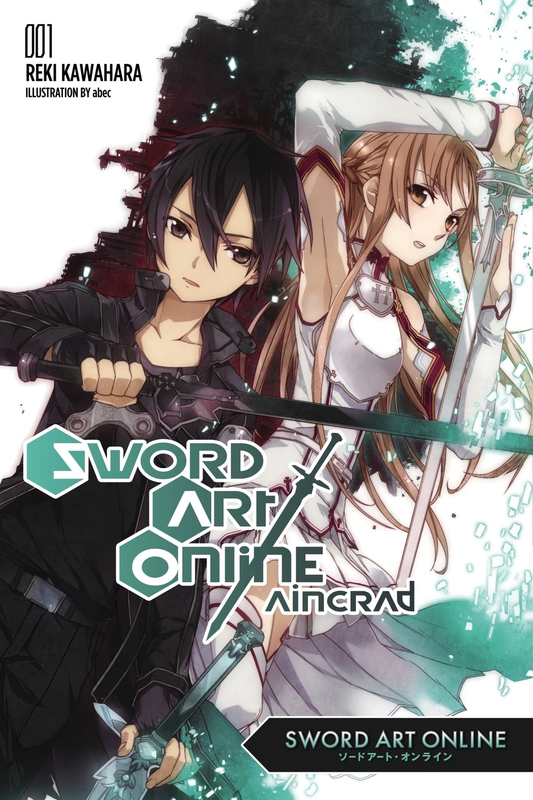
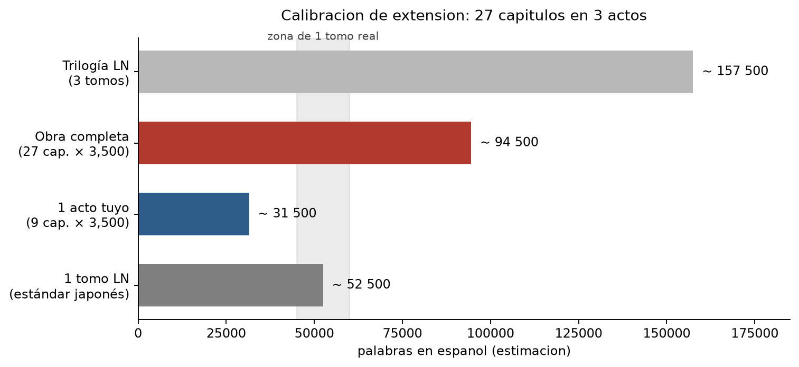

# 00 · Cuánto debe medir una novela ligera de verdad

> Investigación pedida antes de planear el Acto I: qué extensión tiene una novela ligera genuina, qué piden los concursos japoneses y cómo se traduce eso a los 27 capítulos de este fanfic.

  

## 1 · Qué es un tomo de novela ligera, en números

La cifra que se repite en las guías japonesas de escritura es simple: **una novela ligera va de 2万 a 20万字 (20,000 a 200,000 caracteres)**, y dentro de ese rango los concursos suelen separar **長編 (novela larga): 10万～20万字** y **短編 (novela corta): 2万～4万字**. Casi todos los premios para novela ligera exigen la categoría larga, o sea **100,000 caracteres como mínimo**.

¿Cuánto es eso en un libro físico? Un tomo de 文庫 tiene unas 600 casillas de texto por página; descontando líneas en blanco, diálogos cortos e ilustraciones, un tomo estándar de **280 a 340 páginas** ronda los **100,000 a 130,000 caracteres**. Para comparar con lo que ya tenemos documentado en esta biblia: *Sakura-sō* tomo 7 tiene **384 páginas**, así que la serie original va por encima de la media.

## 2 · Lo que piden los concursos (dato duro)

El premio de referencia del género es el **電撃小説大賞**, el mismo que publicó *Sakura-sō*. En su convocatoria número 34:

| Categoría | Páginas | Conversión a caracteres |
|---|---|---|
| 長編 (larga) | 80 a 130 páginas | **114,240 a 185,640** |
| 短編 (corta) | 15 a 30 páginas | 21,420 a 42,840 |

La página se cuenta como **42 caracteres × 34 líneas = 1,428** caracteres. El premio son 3 millones de yenes más publicación, y la fecha límite es el **10 de abril de 2027**.

Y hay una segunda puerta, la de **カクヨム** (la plataforma de KADOKAWA): **10万 a 15万字**, con la obra terminada obligatoriamente.

Traducido a tiempo de trabajo: a un ritmo realista de **1,000 caracteres por hora**, escribir 100,000 caracteres son **100 horas** de escritura pura, sin contar planeación ni corrección. Un tomo de novela ligera es un trabajo de tres a cuatro meses de escritura constante.

## 3 · Cómo se publica de verdad: primero en web, después en tomo

Los dos ejemplos que pediste, *Re:Zero* y *Sword Art Online*, comparten el mismo camino y conviene tenerlo presente, porque no se escribieron como libros: **se escribieron como episodios sueltos en internet** y después se compilaron.

- En **小説家になろう**, la convención es de **2,000 a 4,000 caracteres por episodio**, con **3,000 como punto dulce**. La razón es de lectura: un episodio de 3,000 caracteres se lee en la pantalla del teléfono en unos cuatro o cinco minutos.
- Los datos de las propias plataformas confirman que la práctica va por otro lado: el **promedio real por episodio ronda los 6,200 caracteres y la mediana los 4,500**. Es decir, mucha gente escribe episodios más largos de lo que la teoría recomienda.
- El umbral que la comunidad repite como "esto ya es un libro" son **100,000 caracteres**.

*Re:Zero* empezó en なろう en 2012 y sus tomos de MF文庫J rondan las **290 a 300 páginas** (el tomo Ex 1 tiene **292 páginas** en japonés y 224 en la edición inglesa). *Sword Art Online* empezó como novela web en 2002 y su primer tomo de 電撃文庫 es de los gruesos de la línea, cerca de **330 páginas**.

**Conclusión práctica:** el formato natural de este género no es "27 capítulos largos", es "**episodios cortos agrupados en arcos**". Y eso encaja perfecto con tus tres actos de nueve.

## 4 · La conversión que importa: caracteres japoneses a palabras en español

No hay una equivalencia oficial, pero el cálculo que se usa en traducción y en planeación editorial es este:

| Japonés | Español (estimado) |
|---|---|
| 10,000 字 | 4,500 a 6,000 palabras |
| 50,000 字 | 22,000 a 30,000 palabras |
| **100,000 字 (un tomo)** | **45,000 a 60,000 palabras** |
| 130,000 字 (tomo grueso) | 58,000 a 78,000 palabras |

El rango es amplio porque depende del estilo: el japonés con mucho diálogo corto "rinde" menos en palabras, y el que tiene descripción densa rinde más. En español, además, se tiende a la subordinación, así que la cifra suele quedar en la mitad alta.

## 5 · La cuenta de tus 27 capítulos

  

| Escenario | Palabras por capítulo | Total | Equivale a |
|---|---|---|---|
| A · ritmo web ligero | 2,000 | 54,000 | un tomo corto, se lee en dos tardes |
| **B · recomendado** | **3,500** | **94,500** | **dos tomos, o una novela grande con tres partes** |
| C · trilogía real | 5,000 | 135,000 | tres tomos de verdad, uno por acto |

Con el escenario B, cada acto de nueve capítulos mide **31,500 palabras**, que es exactamente el tamaño de un **tomo corto de novela ligera** (los hay de 60,000 a 80,000 caracteres). Es decir: tus tres actos funcionan como tres tomos breves, y el conjunto como una trilogía de bolsillo.

Con el escenario C, cada acto es un tomo completo de 45,000 palabras. Es el más fiel al género y el más exigente: unas 135,000 palabras en total, o sea **más de 300 horas de escritura**.

**Mi recomendación: B.** Tres actos de 3,500 palabras por capítulo. Es el punto donde el capítulo se siente "de novela ligera" sin volverse un ladrillo, y deja la puerta abierta a partir cada acto en su propio tomo en el repositorio.

## 6 · Reglas de forma del género (convenciones, no cifras)

Estas no salen de una fuente única: son las convenciones que se repiten en el género y en las guías de escritura japonesas. Las marco como recomendación, no como dato.

1. **Prólogo corto** (2 a 5 páginas) que planta una promesa. *Re:Zero* abre con Subaru ya en el otro mundo; *SAO*, con la trampa ya cerrada. Ninguno de los dos explica antes de prometer.
2. **Nueve capítulos por acto implica que cada capítulo vale por episodio y medio de anime.** No hay espacio para el capítulo de relleno: cada uno necesita su propio giro.
3. **Cada capítulo cierra con una pregunta abierta.** En web novel esto no es estética, es supervivencia: el lector decide si sigue en la última línea.
4. **Diálogo entre el 50% y el 60% del texto.** La novela ligera se lee rápido porque casi todo ocurre hablando.
5. **Un solo punto de vista.** En este caso el de Jesús, y por una razón técnica: es la única forma de que el lector *sienta* el TDAH en lugar de que se lo expliquen. Si la narración salta de cabeza en cabeza, el efecto se pierde.
6. **El acto cierra, aunque la historia siga.** Un tomo de novela ligera que no resuelve nada se siente como una estafa, y es el error más común de las sagas.
7. **Epílogo de dos o tres páginas** después del clímax, con la voz bajando. Es donde el género coloca la escena que el lector recuerda.

## 7 · Lo que esto cambia en el plan

Nada de la estructura: **27 capítulos en 3 actos de 9 sigue en pie**. Lo que cambia es la unidad de trabajo.

- Escribir por **capítulos de 3,500 palabras** (unas dos horas y media de escritura efectiva cada uno).
- Tratar **cada acto como un tomo**: con su prólogo, sus nueve capítulos y su epílogo, y con un cierre emocional propio.
- Los cortes de acto caen en el **9, el 18 y el 27**. El 9 y el 18 tienen que ser puntos de giro, no pausas: el mismo criterio que ya aplicamos al capítulo 13 del plan anterior. El 9 es la audición de Nanami, y el 18 es donde el padre aprieta de verdad.

---

## Verificación y fuentes

- **Extensión de una novela ligera (2万～20万字, 長編 10万～20万字, 短編 2万～4万字, ritmo de 1,000 caracteres por hora):** 自費出版比較ナビ, «ラノベの定義とは？文字数はどれくらい必要か» (29 de marzo de 2024). <https://jihishuppan-hikaku-navi.com/howto/ラノベの定義とは？文字数はどれくらい必要か/>
- **電撃小説大賞 第34回** (42文字×34行, 長編 80～130ページ, 短編 15～30ページ, 賞金300万円, plazo 10 de abril de 2027): ノベルポータル, ficha de la convocatoria. <https://creative-story.net/news/dengeki34/>
- **Ruta カクヨム del 電撃大賞 (10万～15万字, obra terminada):** nota de análisis de la convocatoria 33. <https://note.com/tinetu_soup/n/n20cd8579aaca>
- **Práctica en 小説家になろう (2,000～4,000 caracteres por episodio, 3,000 como referencia; 10万字 = un libro):** hilos del foro oficial de なろう y blogs de autores. <https://syosetu.com/bbstopic/top/topicid/8362/>
- **Promedio real por episodio (≈6,200 caracteres, mediana ≈4,500):** análisis recogido en NovelUp. <https://novelup.plus/story/302604398/612044931>
- **Páginas de *Re:Zero Ex* tomo 1 (292 japonés / 224 inglés):** Re:Zero Wiki (Fandom). <https://rezero.fandom.com/wiki/Re:Zero_Ex_Light_Novel_Volume_1>
- **Páginas de *Sakura-sō* tomo 7 (384):** ficha ya documentada en `biblia/01a-ficha-tecnica.md`.
- **Portada del tomo 1 de *Sword Art Online*:** Sword Art Online Wiki (Fandom).

**Nota sobre las cifras en español:** la conversión de caracteres japoneses a palabras en español es una **estimación de planeación**, no un dato publicado. El rango 45,000-60,000 palabras por tomo surge de aplicar la proporción habitual en traducción editorial japonesa-español (un carácter japonés equivale aproximadamente a 0.45-0.6 palabras). Tómala como orden de magnitud, no como medida exacta.

*Siguiente paso: el plan del Acto I, nueve capítulos con función, escena de apertura, escena de cierre y gancho final.*
