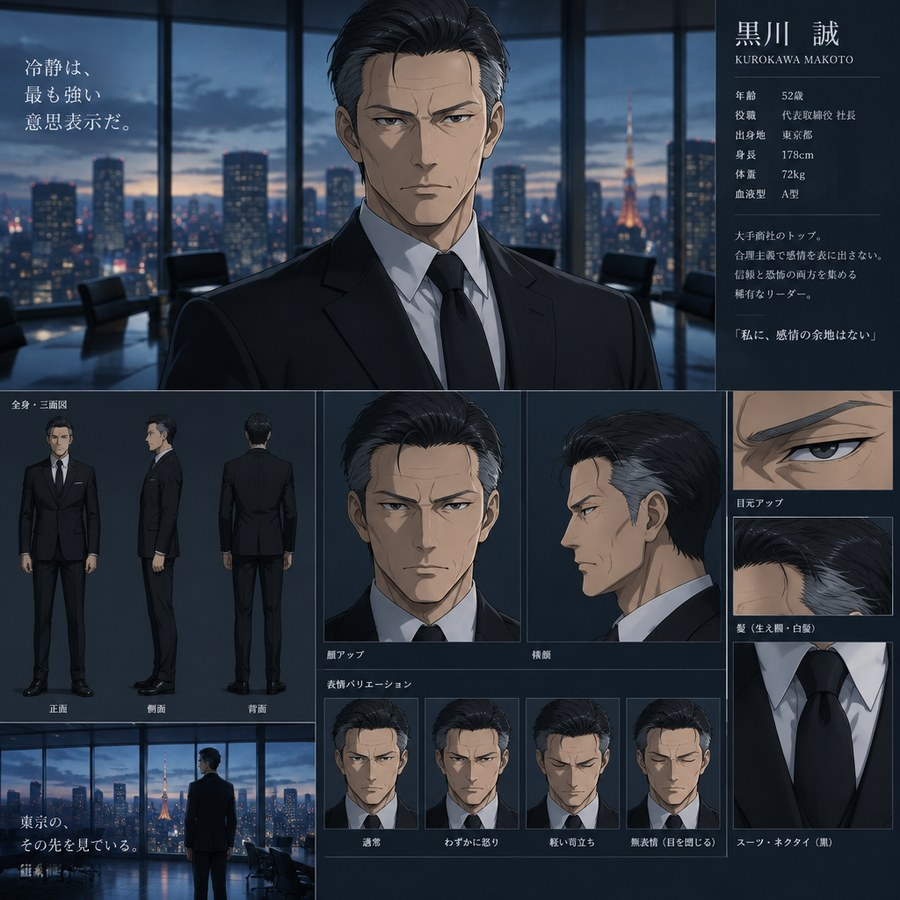

# Sección 08-A: La familia del OC (I) — El padre, 藤岡 誠

> **Biblia del universo de Sakura-sou no Pet na Kanojo (さくら荘のペットな彼女)**
> Documento de creación original para el fanfic de este repositorio.
> Personaje original: **Jesús Fujioka Hernández** · Antagonista: **藤岡 誠 (Fujioka Makoto)**

  

---

## Aviso de método

Este documento es **mitad investigación y mitad creación**. Todo lo que viene de la obra original de Kamoshida está citado con su fuente al final. Todo lo que es invención para este fanfic está escrito como invención, y las cifras de la empresa están marcadas como **canon interno de este proyecto**: son ficticias y no describen a ninguna compañía real.

El objetivo no es solo describir al padre. Es dejarlo **utilizable**: que cualquier capítulo pueda escribir una escena con él sin contradecir nada de lo anterior.

---

# 1. Ficha técnica

| Campo | Dato |
|---|---|
| **Nombre en Japón** | 藤岡 誠 (ふじおか まこと) · **Fujioka Makoto** |
| **Nombre en México** | Makoto Fujioka Zamora |
| **Significado** | 藤岡 = "colina de glicinias" (藤 wisteria + 岡 colina); 誠 = **sinceridad, verdad, fidelidad** |
| **Edad** | 51-52 años al inicio del relato |
| **Nacimiento** | Tokio, 1975 |
| **Altura** | 176 cm |
| **Tipo de sangre** | A (el mismo que Mashiro y Nanami: el de los que no saben decir las cosas) |
| **Ocupación** | Presidente del consejo (会長) de **FJ Holdings**; fundador |
| **Sector** | Envases, embalaje y logística de frío |
| **Domicilio** | Setagaya, Tokio. Casa de dos plantas, cochera, jardinero los martes |
| **Estado civil** | Divorciado. Custodia exclusiva del hijo desde 2018 (canon interno) |
| **Aspecto** | Traje negro impecable, camisa blanca, corbata negra, gemelos de plata. Nunca un color. Pelo negro con canas en las sienes, peinado hacia atrás. Ojos estrechos. No sonríe con la boca: cuando algo le parece bien, inclina la cabeza dos centímetros |
| **Voz (casting imaginario)** | 森川智之 (Morikawa Toshiyuki), en registro bajo y educado. Nunca alza la voz; no le hace falta |
| **Frase que lo resume** | 「二者択一です」 — *"Solo hay dos opciones."* |

---

# 2. Los tres nombres del padre

Este es el corazón del personaje, así que conviene verlo como tabla.

| Contexto | Cómo se llama | Quién lo usa |
|---|---|---|
| **México, antes de 1995** | **Makoto Fujioka Zamora** | Su madre. Su abuela. Los primos de Guadalajara |
| **Japón, desde siempre** | **藤岡 誠** | El mundo. Los bancos. Los periódicos |
| **En su propia casa** | **"Fujioka-san"** (apellido + san) | Su hijo, cuando habla de él con terceros |
| **Lo que nunca dice** | **"Zamora"** | Nadie. En ningún documento. En ninguna conversación |

**El detalle que lo define:** el hombre se llama a sí mismo 誠, "sinceridad", y lleva treinta años administrando la mentira más grande de su vida con una eficacia impecable.

Y hay algo todavía más cruel: **Fujioka Zamora es el nombre que aparece en el acta de matrimonio de sus padres, y no aparece en ninguna parte de su vida adulta.** Él no lo borró de un documento. Lo borró de su biografía.

---

# 3. Biografía por etapas

## 1975-1987 · El niño de la casa con dos cocinas

Makoto crece en una casa de Nakano con dos cocinas: una japonesa, pequeña, con arroz; otra con un comal que su madre usa para las tortillas y que llena la casa de un olor que el barrio comenta.

**Aprende dos cosas a la vez y las aprende mal:** que su madre es la persona más cálida del mundo, y que **su madre es un problema**. En la escuela, cuando ella va a las reuniones, los otros niños preguntan por qué habla raro. Cuando ella le pone un lunches con algo que no es japonés, los compañeros se ríen. Cuando ella le grita en español desde la ventana, él finge no oír.

A los nueve años toma la primera decisión de su vida adulta: **le pide a su madre que no vaya a la escuela**.

Ella deja de ir. Nunca se lo reprocha. **Ese silencio es la primera deuda.**

## 1987-1995 · El adolescente que se hizo japonés

En la secundaria decide algo simple y brutal: **si ser mitad no funciona, hay que ser entero.** Se vuelve el mejor alumno, el delegado de clase, el que habla en keigo perfecto, el que nunca lleva nada raro en la lonchera.

A los 17 años conoce a su padre por lo que es: un hombre que también pasó por lo mismo y también se rindió. Entre ellos no hay complicidad: hay **un pacto de silencio**.

En 1993 entra a la universidad (Keiō, canon interno) a estudiar Economía. Se afilia a un círculo de empresarios jóvenes donde conoce a la gente que después le prestará dinero.

**La frase que lo funda.** A los veinte años, en una cena de negocios, un ejecutivo mayor —con una copa en la mano y sin mala intención— le dice al oído:

> 「二つの国を持つ人間は、どちらの国にも属さない」
> *"Los que tienen dos países no pertenecen a ninguno."*

Makoto asiente, se ríe, agradece la enseñanza. **Y se la cree.** Toda su vida adulta es una respuesta a esa frase.

## 1995-2005 · La construcción

Se gradúa y trabaja cuatro años en una comercializadora de papel. En 1999 funda **藤岡包装 (Fujioka Packaging)** con dos empleados y un cliente: una panadería que necesitaba cajas.

La empresa crece por una razón que no es glamorosa y que a él le encanta: **los envases son invisibles**. Nadie felicita al que hace la caja. Nadie le pone cara. Se puede facturar cien mil millones de yenes fabricando algo que **nadie mira**, y el dueño puede seguir siendo un desconocido.

En 2003 se convierte en socio de una planta en Jalisco. **La empresa que Niega México se hace rica gracias a México.** No hay escena más irónica en todo este fanfic, y funciona mejor si el autor no la subraya nunca.

## 2005-2018 · El matrimonio

En 2007, en Guadalajara, en la boda de un proveedor, conoce a **Luz**. Tiene 19 años, trabaja en la administración de la planta y baila con una soltura que a él le parece indecente y envidiable.

Se casan en 2008. Él tiene 33. Ella, 20.

**Por qué se casó con ella:** porque era el único lugar del mundo donde no tenía que fingir. Con Luz podía hablar español, comer como en su casa, llamar a su madre por su nombre. Fue, durante tres años, **una tregua**.

**Por qué se rompió:** porque un hombre que ha construido su identidad sobre esconder algo **no soporta tener un testigo en casa**. Cada vez que ella decía su nombre en español delante de alguien, cada vez que ella ponía música, cada vez que ella existía en público con él, la tregua se rompía.

El divorcio se tramita en 2018. Los abogados de él son los mejores de Tokio y los de ella son de oficio.

## 2018-2026 · La cúpula de cristal

Desde el divorcio, Makoto vive solo en Setagaya, conduce un coche negro, ve a su hijo dos veces al mes y no ha vuelto a México.

**Su forma de ser padre desde entonces:** pagar. Colegio, dentista, uniforme, la mejor computadora, un curso de ajedrez, un maestro de etiqueta. Todo pagado. Nada elegido.

Cuando el colegio le informa que su hijo no puede seguir en el dormitorio general, no discute: llama a un asistente y pide "una solución" en cuarenta y ocho horas. La solución se llama Sakura-sō. **No pregunta qué es Sakura-sō.** No pregunta cómo es. Firma.

---

# 4. La empresa

**FJ Holdings (FJホールディングス)** — *todos los datos son canon interno de este fanfic.*

| Dato | Cifra |
|---|---|
| Fundación | 1999 |
| Matriz | FJ Holdings, Chiyoda, Tokio |
| Filiales | 藤岡包装 (envases), FJロジスティクス (logística de frío), FJメキシコ (planta en Jalisco) |
| Empleados | ~2 400 |
| Plantas | 6 (4 en Japón, 1 en Jalisco, 1 en Tailandia) |
| Facturación anual | ~92 000 millones de yenes |
| Cotización | Bolsa de Tokio, mercado Prime |
| Cargo de Makoto | 会長 (presidente del consejo). Ya no es 社長: delegó la operación en 2021 |
| Su frase sobre la empresa | 「箱は中身を守る。中身は箱を選ばない」 — *"La caja protege el contenido. El contenido no elige la caja."* |

**Por qué envases y no tecnología:** porque el envase es el único producto cuyo éxito consiste en **desaparecer**. El padre se hizo rico fabricando cosas que se tiran. Es un hombre que decidió ser el empaque de su propia vida y no el contenido.

**El detalle que da escalofríos:** la compañía tiene una planta en Jalisco desde 2003. Makoto viaja a México **dos veces al año** y **no ve a la madre de su hijo, ni a la familia de su madre, ni a nadie**. Duerme en un hotel, firma, regresa. Trece años así.

---

# 5. Psicología: el mecanismo

## La vergüenza no es un sentimiento, es un sistema

Makoto no está enojado con el mundo. Makoto **administra un riesgo**. Toda su personalidad es un procedimiento de control de daños:

1. **Nada que se pueda preguntar.** Si nadie pregunta, no hay nada que contestar. En su oficina no hay fotos de familia. En su casa no hay fotos de México.
2. **Nada que se pueda perder.** Controla todo lo que puede prever. Lo que no puede prever, lo elimina.
3. **Cortesía como distancia.** Habla en keigo incluso con su hijo. Un padre que le habla a su hijo en registro formal le está diciendo, en cada frase: *"esto no es una familia, es una relación profesional"*.
4. **La generosidad como sustituto del afecto.** No sabe decir "te quiero", pero puede pagar una escuela entera. **Confunde pagar con criar**, y esa confusión tiene cincuenta años.

## Por qué no conecta con su hijo

Aquí está el motor del conflicto, y no es el que parece:

**Makoto no está decepcionado de su hijo. Está aterrado de su hijo.**

Jesús es desordenado, impulsivo, ruidoso, incapaz de estarse quieto, se le va el tiempo, habla de más y se le tira el agua. **Cada uno de esos rasgos fue exactamente la lista de lo que Makoto tuvo que matar de sí mismo para sobrevivir.** Cuando mira a su hijo no ve a un adolescente con déficit de atención: **ve al chico que fue antes de aprender a fingir**, y el lugar donde lo mandan es el único lugar de Japón donde nadie está fingiendo.

Por eso la decisión que parece de mal padre es la única que lo salva: **lo manda a Sakura-sō creyendo que lo castiga, y ahí es donde el hijo se convierte en la persona que él no se atrevió a ser.**

## Lo que sí siente

No es un monstruo. Hay tres cosas que lo humanizan y conviene tener a mano:

- **Guarda el acta de matrimonio de sus padres** en una carpeta de cartulina, en un cajón cerrado, como quien guarda un pasaporte vencido.
- **Va al cementerio de Nakano** el día de muertos de su madre… todavía no. **Va el 2 de noviembre** al templo, y ese día no atiende el teléfono.
- **Una vez, cuando Jesús era niño, lo cargó dormido hasta la cama** y se quedó un rato en el pasillo. Nadie lo sabe. Él no lo comenta. Pero volvió a hacerlo dos veces más.

---

# 6. Cómo habla

Esto es lo que hay que copiar para escribir a Makoto y que dé frío.

| Rasgo | Ejemplo |
|---|---|
| **Keigo con su propio hijo** | 「充です。今日は六時までに帰宅できますか」 — *"Aquí Makoto. ¿Podrás estar en casa antes de las seis?"* (correo, nunca llamada) |
| **Nunca dice "Jesús"** | Lo llama 慈 (el nombre del koseki). Nunca pronuncia el nombre mexicano. Ni una vez |
| **Nombra a la madre por el apellido** | 「エルナンデスさん」 / *"la señora Hernández"* — usa el apellido que él mismo no se permite |
| **Responde en preguntas cerradas** | «¿Te fue bien? Sí o no.» Dos opciones. Siempre dos opciones |
| **Cuenta hasta cuatro** | Deja **cuatro segundos de silencio** antes de contestar cualquier cosa personal. Cuatro segundos exactos |
| **Corrige el idioma** | Si su hijo dice "güey" delante de él, responde: 「日本語で」 — *"en japonés"* |
| **Nunca amenaza** | No dice "si no apruebas, te saco". Dice: 「選択肢を整理しておきます」 — *"te organizo las opciones"* |
| **Sí dice "gracias"** | Y esa es su forma de humillar: agradece asuntos que no se agradecen, como si el hijo fuera un proveedor |

---

# 7. El arsenal: ocho armas de antagonista

Ninguna implica violencia. Todas implican poder, y todas son plausibles en un hombre de su clase.

### 1. La agenda
No invade: **organiza**. Le fija al hijo tres semanas de compromisos, y cada uno es una trampa: un desayuno con un socio que tiene un hijo modelo, una revisión médica para "confirmar el diagnóstico", una entrevista con un consultor educativo de Singapur.

### 2. El dinero
No lo amenaza con quitárselo: **lo administra**. El hijo recibe una asignación mensual en una tarjeta corporativa, y cada gasto aparece en un informe. Los tenis rojos aparecen en el informe. Las instrucciones dicen: *"gastos atípicos"*.

### 3. La corrección médica
Para él, el déficit de atención es un defecto de fabricación. **Propone tratamientos más agresivos**, más dosis, un internado en Suiza. Todo desde el cariño: "no quiero que sufras". Es la forma más pura de su violencia: **ofrecerle cambiar en lugar de aceptarlo**.

### 4. La cortesía
Va a Sakura-sō una vez en todo el relato. Se presenta con un regalo para la casa, saluda a todos con una reverencia perfecta y habla con Chihiro como se habla con una profesional competente. **Lo que rompe no es un insulto: es que Sakura-sō le parezca un lugar correcto.** Todos se sienten examinados, y el único que no se da cuenta es él.

### 5. La comparación
Nunca lo compara con otros chicos. **Se compara con él mismo a los diecisiete.**

> 「十七歳のとき、私は父に何も借りなかった」
> *"A los diecisiete yo no le debía nada a mi padre."*

Es cierto. Y es la frase que más daño hace de todo el fanfic.

### 6. La puerta abierta
「いつでも帰ってくればいい」 — *"Puedes volver cuando quieras."* Parece amor y es una sentencia: **significa que Sakura-sō no es su casa.**

### 7. Los regalos equivocados
Su hija de la mano: un reloj por el cumpleaños, un curso de etiqueta por las vacaciones, una pluma Montblanc por la graduación. **Nunca un ajolote, nunca un disco, nunca nada que no sirva.** Todo lo que regala tiene instrucciones de uso.

### 8. El papá de los abuelos
Aquí está la carta que se guarda para el tercer acto: **la nacionalidad**. Como su hijo adolescente no puede firmar solo ciertos trámites, y él es el tutor legal, **tiene el poder de dilatar o de forzar el proyecto** de cualquier cosa que el hijo quiera hacer: un concurso, un programa de intercambio, la universidad. Se abre y se cierra una puerta sin que nadie escuche la puerta.

---

# 8. Cinco escenas donde el padre actúa

Las escribo como beats listos para usarse, no como diálogos cerrados.

### Escena 1 — El despacho (capítulo 1)
Jesús va a que le firmen una autorización. El padre lo recibe de pie, detrás de un escritorio enorme, y no le ofrece asiento. La escena entera dura cuarenta segundos. **El padre no le dice que no.** Le dice que el documento "está en revisión". El hijo sale sin la firma y con la sensación de haber hecho algo mal.

### Escena 2 — La cena (mitad del relato)
Cena de cumpleaños del padre, en un restaurante francés, con dos socios y sus esposas. Jesús llega con la playera de las Chivas. **El padre no se enoja.** Presenta a su hijo con orgullo, dice que estudia en un dormitorio especial para alumnos de talento, y en la sobremesa pregunta, delante de todos, qué piensa hacer con su vida. La escena termina bien. Es la peor de todas.

### Escena 3 — La visita a Sakura-sō
Llega con una caja de dulces caros y una propuesta: pagar la reforma del edificio. Chihiro, que lleva treinta años lidiando con padres, le dice que Sakura-sō **no se reforma**. Él sonríe, inclina la cabeza dos centímetros y se va. Al día siguiente, el hijo recibe el informe de gastos con una nota: *"revisemos prioridades"*.

### Escena 4 — El templo (2 de noviembre)
Solo. Makoto en el templo, de pie, con un vaso de agua. No reza. Nadie sabe a quién viene a ver. **Es la única escena en la que el lector está solo con él**, y tiene que servir para que el lector no lo perdone pero sí entienda.

### Escena 5 — La abuela (final del segundo acto)
Lola lo llama por teléfono y le habla en español. Él contesta en japonés. Ella insiste en español. Él sigue en japonés. **La escena no se resuelve**: son cinco minutos de dos idiomas en el mismo teléfono, y ninguno de los dos cede. El hijo escucha desde el pasillo.

---

# 9. Lo que este personaje NO es

Trampas que arruinan antagonistas de este tipo, y que hay que evitar a toda costa:

| ❌ NO es | ✅ SÍ es |
|---|---|
| Violento o gritón | Silencioso y educadísimo |
| Un padre ausente | Obsesivamente presente, pero solo a través del dinero y la agenda |
| Un villano que odia a su hijo | Un padre que **ama a su hijo y sigue siendo su peor enemigo** |
| Un racista de caricatura | Un hombre que odia en sí mismo lo que ve en su hijo mexicano |
| Un pobre que se hizo rico | Un hombre de tercera generación que administra lo heredado y lo amplió |
| Un fracasado que se desquita | Un hombre exitoso cuya única derrota es un hijo que no quiere ser él |
| Un malvado de discurso final | Alguien que **nunca explica sus razones**, porque explicarlas sería admitirlas |

---

# 10. Cómo se derrota (y cómo no)

**No se derrota con un golpe, ni con un discurso, ni con un abrazo.** En esta serie nadie gana una discusión: se gana cambiando el terreno.

Tres rutas, en orden de fuerza dramática:

1. **Con un documento firmado.** El padre tiene poder sobre el hijo mientras sea su tutor y mientras el hijo dependa de su dinero. El día que el hijo firma una solicitud de beca o de residencia por su cuenta, le quita la llave. No hay escena de pelea: hay una carta que llega a la casa sin su firma.
2. **Con la abuela.** Makoto no puede atacar a su madre sin reconocerla. **Lola es el punto ciego de su armadura**: cualquier cosa que ella diga en público, él tiene que aceptarla, porque negarla es negarse a sí mismo. Una sola frase suya en una cena vale más que diez capítulos de confrontación.
3. **Con la verdad en un lugar incómodo.** No en privado: **delante de sus iguales**. En esta serie el castigo del padre será el único que un hombre así puede temer: que su hijo hable español delante de sus socios mexicanos y que él tenga que traducir.

**Y un aviso:** no lo redimas del todo. La obra original no redime a nadie; solo permite que la gente diga una cosa verdadera antes de que baje el telón. El máximo permitido para Makoto es **una grieta**: un gesto pequeño, tardío, sin explicación.

---

# 11. Cronología personal

| Año | Edad | Hecho |
|---|---|---|
| 1975 | — | Nace en Tokio. Hijo de 藤岡勇 (Isamu) y Dolores Zamora |
| 1984 | 9 | Le pide a su madre que no vuelva a la escuela |
| 1992 | 17 | Decide "ser entero". Corte de pelo, keigo, silencio |
| 1993 | 18 | Entra a la universidad |
| 1995 | 20 | Escucha la frase: *"los que tienen dos países no pertenecen a ninguno"* |
| 1999 | 24 | Funda 藤岡包装 con dos empleados |
| 2003 | 28 | Abre la planta de Jalisco |
| 2007 | 32 | Conoce a Luz en Guadalajara |
| 2008 | 33 | Se casa con Luz |
| 2009 | 34 | Nace su hijo |
| 2014 | 39 | Su madre cumple 76. Empieza a visitarla los domingos, solo, sin avisar |
| 2018 | 43 | Divorcio. Obtiene la custodia exclusiva |
| 2024 | 49 | Delega la presidencia. Se queda como 会長 |
| 2026 | 51 | El colegio le informa del problema. Firma la solución sin leerla |

---

## Verificación de esta sección

- **El nombre 藤岡 (Fujioka)** es un apellido japonés real, y también un topónimo: la ciudad de **藤岡市 (Fujioka-shi)**, en Gunma, y varias localidades más (Tochigi, Shizuoka, Yamagata, Aichi). Comprobado en la Wikipedia japonesa, que lista sus lecturas como apellido y como lugar.
- **誠 (makoto)** significa sinceridad, verdad o fidelidad. Es una lectura y uso real como nombre propio japonés.
- **El keigo dentro de la familia** no es una invención: es un registro real del japonés que se usa con superiores y clientes, y su uso de un padre hacia un hijo resulta, en la práctica, deliberadamente distante. Esta biblia lo usa como recurso de caracterización, no como norma familiar japonesa.
- **Las cifras de FJ Holdings** (empleados, plantas, facturación, mercado Prime) son **invención de este fanfic** y así se marcan en el texto. No describen a ninguna empresa real. La existencia de plantas japonesas de autopartes, envases y logística en Jalisco sí es un fenómeno real de la inversión japonesa en México, pero aquí no se cita ninguna compañía concreta.
- **La frase de los "dos países"** es invención de este fanfic. Se inspira en la experiencia documentada de los nikkei que regresan a Japón y quedan a medio camino entre dos identidades, pero **no se atribuye a ninguna persona real**.
- **La datación de la historia** no está cerrada: el anime transcurre en el curso 2012-2013 y la novela termina en 2014, así que las edades de Jesús y las de su padre pueden desplazarse. Esta biblia usa **edades relativas** (el padre tiene 51-52 al inicio del relato) para que el autor pueda situar el fanfic donde prefiera.
- **El nombre de la madre (Luz) y el de la abuela (Lola)** son propuestas de esta biblia, no datos del usuario, y están sujetos a cambio.

---

## Fuentes de esta sección

1. **Wikipedia en japonés — 藤岡** (apellido y topónimo): https://ja.wikipedia.org/wiki/藤岡
2. **Wikipedia en japonés — 藤岡市**: https://ja.wikipedia.org/wiki/藤岡市
3. **Wikipedia en japonés — 夫婦同氏** (régimen del apellido único en el matrimonio japonés, con datos de 2023): https://ja.wikipedia.org/wiki/夫婦同氏
4. **Wikipedia en japonés — 日系メキシコ人** (contexto de la comunidad nikkei mexicana): https://ja.wikipedia.org/wiki/日系メキシコ人
5. **Sakurasou Wiki (Fandom)** — para el tono y las reglas del universo en que se inserta el personaje: https://sakurasou.fandom.com
6. **Wikipedia en japonés — さくら荘のペットな彼女** (sistema de dormitorios y "alumnos problemáticos"): https://ja.wikipedia.org/wiki/さくら荘のペットな彼女

---

*Siguiente documento: [02 — La familia, cuatro generaciones](02-cuatro-generaciones.md)*
