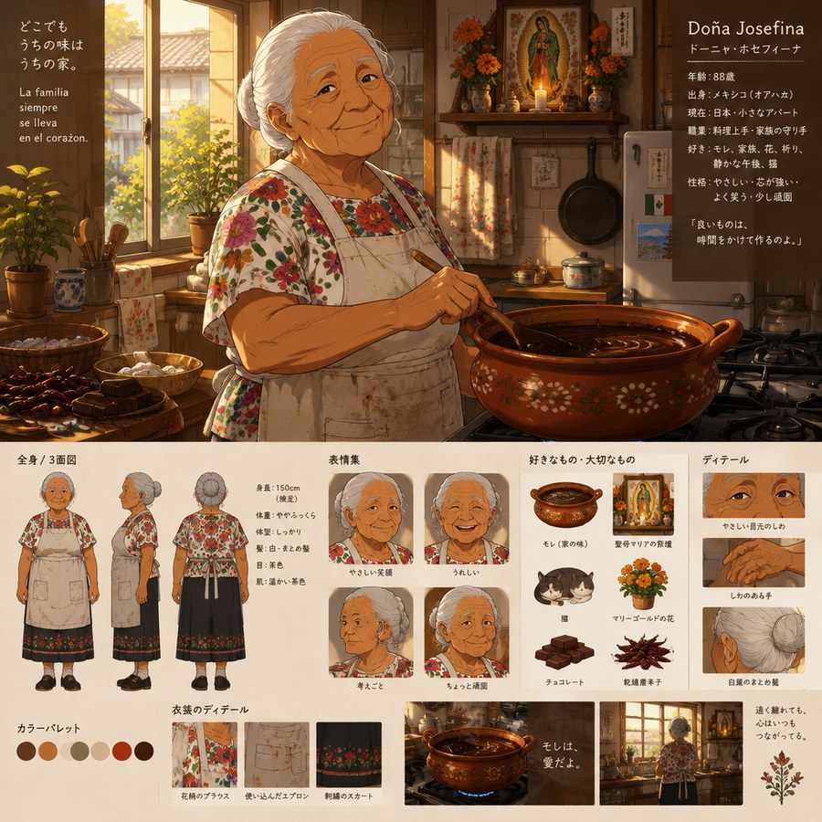

# 04 · La abuela en la trama

> ドロレス・「ロラ」・サモラ — Dolores «Lola» Zamora
> *Cómo una señora de 88 años ocupa el hueco narrativo que en la obra original ocupa una hermana pequeña.*

  

---

## La decisión

En la obra original, **Yūko Kanda** —la hermana menor de Sorata— cumple una función muy concreta: es la persona que **viene de fuera y lo desnuda**. Llega sin avisar, cuenta cosas que él no contaría, se mete donde no la llaman y obliga a todos a ver al protagonista como lo ve su familia.

En este universo **Yūko no existe**. Su lugar lo ocupa **la abuela Lola**, y funciona mejor, por una razón simple: Yūko conoce a Sorata desde que nació, pero **Lola conoce al padre desde que nació**. La hermana expone al chico; la abuela expone **de dónde viene el chico**. Y en esta historia el enemigo es el padre.

---

## Qué hace exactamente Yūko en la obra original

Para poder sustituirla hay que saber qué se está sustituyendo. La ficha completa está en [`../biblia/04a-secundarios-familia-kanda.md`](../biblia/04a-secundarios-familia-kanda.md), pero en resumen cumple cinco funciones:

| # | Función | Cómo la cumple Yūko |
|---|---|---|
| 1 | **Visitante que irrumpe** | Aparece sin avisar en el episodio 7 y desordena la vida del dormitorio |
| 2 | **Fuente de comedia** | Complejo con su cuerpo, celos, malentendidos constantes |
| 3 | **Reveladora de intimidad** | Cuenta en voz alta lo que el protagonista calla (la casa, los padres, la infancia) |
| 4 | **Espejo generacional** | Es la versión pequeña de él: quiere lo mismo, lo pide peor |
| 5 | **Promesa de continuidad** | Al final anuncia que entrará a Suikō el año siguiente: la serie no termina, sigue |

Las cinco se pueden trasladar. Tres mejoran con una abuela; dos hay que adaptarlas.

---

## El mapa, episodio por episodio

Los cuatro momentos donde Yūko aparece en la obra original, y su equivalente en este universo.

### 1. Episodio 7 — la visita que lo desordena todo

**Original:** Yūko llega a Sakura-sō, ve a su hermano en una situación comprometida, se queda unos días, se baña con las chicas, se hace la interesada en la vida de todos y termina confesando que vino a preguntar por la preparatoria.

**Versión Lola:** Lola aparece en Sakura-sō **con una olla de mole** y la excusa de que "pasaba por ahí", que es mentira porque vive en Fuchū y hay que tomar dos trenes. Entra, mira el edificio, dice *"aquí vivía gente más pobre que tú, ¿verdad?"*, y se instala en la cocina como si fuera suya.

- El malentendido de la obra original (todos creen que Jesús tiene una novia) se invierte: **todos creen que Lola es la mamá de Jesús** hasta que ella aclara, en español y sin bajar la voz, que es la abuela y que su hijo —el padre de Jesús— no la visita desde marzo.
- El baño compartido se convierte en **la caldera rota**: se baña Lola, se baña con agua fría y se bañan todos los demás después, y ella lo cuenta en la cena como si fuera una anécdota de la guerra.
- La "cita" del episodio original se convierte en **Lola llevando a las chicas de compras** por el barrio comercial, hablando en español con todo el mundo, con Jesús traduciendo y muriéndose de vergüenza, y con Mashiro comprando fruta que no sabe pelar.

**Lo que se gana:** el episodio deja de ser sobre "la hermana celosa" y pasa a ser sobre **una familia que existe fuera de la cúpula del padre**. La abuela es la prueba viviente de que hay un mundo anterior a Makoto.

### 2. Episodio 15 — Año Nuevo

**Original:** el grupo se va a Fukuoka, a la casa de los Kanda. Se conoce a los padres, hay escena de baño familiar, sale el sol, brindis.

**Versión Lola:** Año Nuevo en la casa de Lola, en Fuchū. Una casa pequeña, japonesa por fuera, con un altar budista en una repisa y una olla de mole en la cocina, y los dos conviviendo sin ningún problema porque ella nunca ha visto contradicción en eso.

Y **aparece Makoto**. Llega con su traje negro, se quita los zapatos, se arrodilla en el suelo y saluda a su madre con una reverencia perfecta. Se queda cuarenta minutos. Se va.

- La escena del baño familiar —que en la obra original es ternura entre padre e hijo— aquí se convierte en **la única proximidad física que tienen**: Makoto y Jesús en el mismo baño, de espaldas, sin hablarse, con el agua haciendo todo el ruido de la conversación que no tienen.
- El brindis del amanecer es en el techo de la casa, con Lola, y ella dice la frase que le da título al episodio.

**Lo que se gana:** el capítulo del Año Nuevo deja de ser un respiro y pasa a ser **la primera aparición real del antagonista en un espacio donde él no manda**. En su casa, Makoto es un hijo. Y eso lo vuelve más peligroso, no menos.

### 3. Episodio 18 — el número equivocado

**Original:** Yūko se presenta a Suikō y cree que no entró porque no aparece su número. Al final se descubre que **leyó mal el tablero**: el suyo era el 66, ella miró el 99. Entró.

**Versión Lola:** el número equivocado se convierte en **un resultado médico**. Lola se cae en el baño. Nadie se pone de acuerdo en lo que dice el papel; Jesús lo lee tres veces y se equivoca de columna. Es la misma escena —un chico leyendo mal un número por miedo— pero esta vez el número puede ser el final de una vida y no de una admisión.

**Lo que se gana:** el mismo defecto del personaje (leer mal lo que teme) queda elevado. Y el espectador ya sabe que en esta serie los números a veces mienten, así que la tensión funciona.

### 4. Episodio 24 — la continuidad

**Original:** Yūko se muda a Sakura-sō como nueva residente y hay fiesta de bienvenida. La serie termina con la casa llena otra vez.

**Versión Lola:** Lola **no se muda** —tiene 88 años y una casa— pero hace el gesto equivalente: le entrega a Jesús **su cuaderno de recetas**, escrito en español, con las cantidades a ojo y las instrucciones incompletas, y le dice que se lo dicta cuando vaya, porque *"lo que no se repite, se olvida"*.

- La fiesta de bienvenida de los nuevos residentes puede celebrarse **en casa de Lola**, y así la última escena de la temporada ocurre fuera de Sakura-sō, en el único lugar de Japón donde Jesús tiene un nombre que no es un apellido.

**Lo que se gana:** la promesa de continuidad ya no es "vendré el año que viene" sino **"te voy a enseñar antes de que se me olvide"**, que es más grave, más adulto y más cierto para una señora de 88 años.

---

## Cómo se escribe Lola

### Lo que puede hacer

- **Decir la verdad sin filtro.** Es la única persona del libro que puede decirle a Makoto en la cara lo que todos piensan, y lo hace en español, y él tiene que traducirla para los presentes.
- **Romper el ritmo.** Cada escena en la que entra se vuelve más lenta y más cálida. Es el único personaje que no corre.
- **Cocinar como forma de hablar.** Su amor es un plato. Su enojo, también: cuando está molesta, cocina y no prueba la comida.

### Lo que no puede hacer

- **No puede ser sabia todo el tiempo.** A veces se equivoca, a veces es injusta, a veces prefiere no ver. Si siempre tiene razón, deja de ser una persona y se vuelve un oráculo.
- **No puede resolver el conflicto.** No le va a decir a Jesús lo que tiene que hacer con su padre. Le puede dar la receta, no la respuesta.
- **No puede hablar mal de Makoto delante de Jesús.** Nunca. Es su hijo. Dice cosas terribles, pero siempre sobre el pasado, nunca sobre el hombre en el que se convirtió. La única vez que se le escapa, se calla y se va a la cocina.

### Su lengua

Habla **siempre en español**, incluso con quien no la entiende, y en japonés **solo con Makoto** —y ese es el detalle más cruel del personaje: la única vez que usa el japonés con su hijo es para herirlo con precisión. En español es una abuela; en japonés es una jueza.

Jesús traduce. Siempre. Es su trabajo en la casa y su condena: **es el único que entiende las dos mitades de su familia**, y por eso no puede estar del lado de ninguna.

### Sus tres secretos

1. **Sabe por qué Makoto se volvió así.** Estuvo ahí. Sabe el nombre de la persona que le dijo *"los que tienen dos países no tienen ninguno"*.
2. **Sabe que su nieto no la visita por amor, sino porque es el único lugar donde no tiene que fingir.** Y lo acepta, porque prefiere eso a nada.
3. **Sabe que Makoto quiere a su hijo.** Es lo único que sabe y jamás dirá, porque no hay prueba y porque decirlo le costaría la única visita que recibe.

---

## Relación con cada residente

| Personaje | Cómo la trata Lola | Qué saca ella de ahí |
|---|---|---|
| **Mashiro** | La aprueba en la primera visita, sin explicación. Le enseña a partir el pan. | Alguien que no la trata como genio ni como niña |
| **Nanami** | La pone a cocinar a su lado desde el primer día. Le pregunta por su madre antes que por su carrera. | Una nieta prestada que sí la llama por teléfono |
| **Misaki** | La deja gritar. Le grita de vuelta. Se llevan bien. | Ruido, que a su edad es compañía |
| **Jin** | Lo manda a cargar cosas. Le dice *"tú también estás huyendo"* y no explica. | Un joven al que puede regañar |
| **Ryūnosuke** | Le habla sin mirarlo, de espaldas, mientras cocina. Él contesta. | El único que la entiende sin traducir |
| **Chihiro** | Se tutean. Se conocen de antes de que Jesús naciera. Hay una historia ahí. | Una adulta con la que no tiene que ser abuela |

---

## Reglas de uso

1. **No la mates.** La amenaza es suficiente. Una abuela de 88 años ya es una cuenta regresiva; matarla cierra la puerta que el lector quiere ver abierta.
2. **No la uses para dar información.** Si tiene que explicar el pasado, que lo explique a medias y mal, como la gente real.
3. **Aparece poco y pesa mucho.** Cinco o seis escenas en toda la historia. Cada una tiene que cambiar algo.
4. **Nunca en el mismo capítulo que el padre**, salvo una vez, y esa vez es el clímax.

---

## Verificación de esta sección

- **Las cuatro apariciones de Yūko** (episodios 7, 15, 18 y 24) y su función narrativa: documentadas en [`../biblia/02a`](../biblia/02a-temporada-1-episodios-1-8.md), [`02b`](../biblia/02b-temporada-1-episodios-9-16.md) y [`02c`](../biblia/02c-temporada-1-episodios-17-24.md).
- **El episodio del número equivocado** (99 leído en lugar de 66): confirmado en la sinopsis del episodio 24 y en la ficha de Yūko (`../biblia/04a`).
- **La escena del baño familiar**: práctica cultural japonesa documentada; en la obra original aparece en el episodio 15.
- **Todo lo relativo a Lola, su casa, su lengua y sus secretos es material original de este proyecto** y no tiene fuente externa.

*Documento anterior: [03 · Objetos y símbolos](03-objetos-y-simbolos.md) · Siguiente: [05 · Los animales](05-los-animales.md)*
