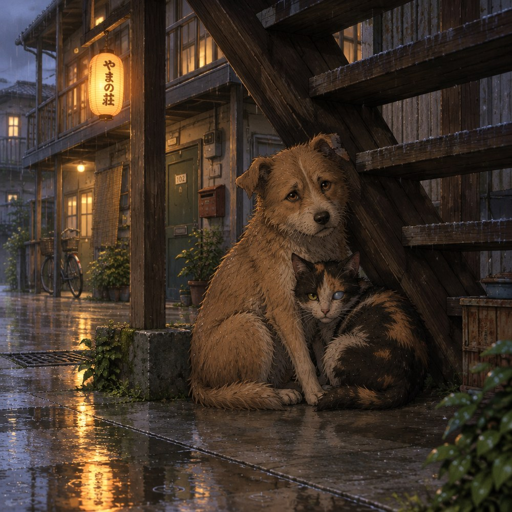

# 05 · Los animales

> フリホルとモレ — Frijol y Mole
> *Un perro y un gato callejeros que llegaron juntos y que no son de nadie.*

  

---

## La decisión

En la obra original, **Sorata Kanda** recoge gatos. Siete: Hikari, Nozomi, Kodama, Tsubasa, Komachi, Aoba y Asahi. Lo hace de forma compulsiva, sin poder evitarlo, y ese rasgo es lo que lo expulsa del dormitorio general (donde las mascotas están prohibidas) y lo manda a Sakura-sō. Es el motor de arranque de toda la serie.

**Ese rasgo no es de Jesús.** A él no lo expulsan por recoger animales: lo expulsan porque no puede seguir el ritmo del dormitorio. Así que la relación con los animales tiene que funcionar al revés, y ahí está la gracia:

> **Sorata recoge animales. A Jesús lo recogen los animales.**

Él no los busca. Ellos se quedan. Y eso, para un chico al que su padre nunca eligió, vale más que cualquier discurso.

En este universo son **dos animales, no siete**, y no son gatos: **un perro y un gato**.

---

## Quiénes son

### Frijol

| | |
|---|---|
| **Nombre** | Frijol |
| **Especie** | Perro mestizo, macho, castrado |
| **Tamaño** | Mediano-pequeño, unos 9 kilos |
| **Edad** | Calculados 4 años |
| **Aspecto** | Café claro deslavado, orejas caídas, una muesca en la oreja izquierda, rabo que no para nunca |
| **Quién le puso el nombre** | Jesús |

Un perro de nadie, de esos que en México llaman *frijolito* porque son chiquitos y cafés y andan siempre por la calle. Duerme atravesado en la puerta. Come cualquier cosa. Le tiene miedo a las escobas y a nada más.

### Mole

| | |
|---|---|
| **Nombre** | Mole |
| **Especie** | Gata tricolor (calicó), hembra |
| **Tamaño** | Pequeña, flaca, 3 kilos |
| **Edad** | Calculados 6 años |
| **Aspecto** | Parda oscura con manchas negras y un ojo nublado (perdió la vista de ese lado) |
| **Quién le puso el nombre** | Jesús |

Oscura, complicada, con muchas cosas dentro que no se ven a simple vista. Solo se deja tocar por una persona y esa persona es Jesús. Cuando él no está, se sube al techo del edificio y espera.

---

## Cómo llegan

Llueve. Es de noche y hay una gotera en el pasillo de la planta baja de Sakura-sō, junto a la escalera de madera.

Jesús baja a ver de dónde viene el ruido porque no puede dormir —esa es la primera verdad de su personaje: nunca puede dormir cuando debería— y encuentra a los dos, apretados bajo el último escalón, con el perro atravesado delante de la gata como una puerta.

No los llama. No les habla. Se sienta en el escalón de arriba, con la lluvia en los pies, y se queda ahí una hora.

**A la mañana siguiente siguen ahí.** Y a la siguiente también. Y la tercera, el perro sube las escaleras solo, se mete en el 101 y se echa en el suelo.

Nadie los adoptó. Simplemente dejaron de ser de la calle.

---

## Lo que cada uno significa

| Animal | Qué es | Qué dice de Jesús | Cómo se nota |
|---|---|---|---|
| **Frijol** | Su corazón | Leal, tonto, entusiasta, incapaz de guardar rencor, se emociona con cualquiera que lo mire | Es lo que él es por dentro y lo que su padre le enseñó a esconder |
| **Mole** | Su orgullo | Desconfiada, digna, con daño viejo, elige a una sola persona y no negocia | Es lo que él muestra por fuera, y lo que heredó de su padre sin querer |

Cuando Frijol se orina en el pasillo, Jesús se muere de vergüenza. Cuando Mole se deja tocar por Mashiro y no por él, algo se le rompe un poco y no sabe por qué.

---

## El nombre, y el chiste

Los nombres son **en español**. No son nombres japoneses adaptados: son palabras mexicanas dichas en voz alta en un pasillo de Tokio, y esa es la primera vez que Jesús dice algo mexicano sin pedir permiso.

Cómo los pronuncian los demás:

| Quién | Cómo lo dice | Nota |
|---|---|---|
| **Jesús** | *Frijol. Mole.* | Correcto, con el acento de Guadalajara |
| **Mashiro** | *Furijoru. More.* | Lo intenta en serio y le sale mal; él no la corrige |
| **Nanami** | *Furihoru. Mōre.* | Lo practica sola en la cocina hasta que le sale |
| **Misaki** | *¡FRIJOLITO! ¡MOLECITO!* | Grita. Los dos animales la adoran |
| **Ryūnosuke** | «el de 9 kilos» y «la de 3 kilos» | Se niega a usar los nombres |
| **Chihiro** | *Frijol, Mole* | Le salen bien y nunca lo comenta |
| **Makoto** | No los nombra | Dice «los animales». En plural. Una sola vez |

---

## El padre y los animales

Makoto **prohibió los animales en su casa**. No por alergia ni por aseo: porque un animal en la casa implica pelo en el sofá, y el pelo en el sofá implica que la casa se vive, y la suya no se vive, se mantiene.

Y hay un secreto que Lola suelta una vez y no repite: **Makoto tuvo un perro**. Se lo regaló ella cuando él tenía nueve años. Se llamaba algo que ella no quiere decir en voz alta. Cuando Makoto se fue a la universidad, el perro se quedó, y cuando el perro murió, Makoto no volvió para enterrarlo.

Jesús no sabe esto hasta muy tarde. Cuando lo sabe, entiende dos cosas a la vez: que su padre también quiso a un animal, y que por eso mismo no soporta ver a su hijo queriendo a dos.

---

## Funciones en la trama

**Frijol**
1. **Alivio cómico con consecuencias.** Rompe cosas, se come lo que no debe, aparece donde no toca. Pero cada travesura obliga a alguien a limpiar, y en la limpieza compartida se dicen cosas.
2. **Termómetro emocional.** Es el único que se alegra siempre. Cuando Frijol deja de mover el rabo en una escena, el lector sabe que algo va muy mal.
3. **El que perdona.** Es la única criatura de la historia que quiere a Makoto sin condiciones cuando Makoto aparece. Y eso humilla al padre más que cualquier reproche.

**Mole**
1. **Guardián de umbrales.** Duerme en los lugares donde no debe entrar nadie: la puerta de Jesús, el cuaderno de Lola, la caja donde él guarda el jersey.
2. **Detector de mentiras.** Se deja tocar por quien Jesús puede querer y se esconde de quien le hace daño. No falla nunca.
3. **Reloj.** Desaparece durante días y vuelve. Su ausencia mide el tiempo en los capítulos donde nadie dice cuánto ha pasado.

---

## Reglas de uso

1. **No son mascotas, son personajes.** Cada uno tiene criterio propio: Frijol quiere a todo el mundo, Mole no quiere a casi nadie. Si los usas como utilería, se nota.
2. **No los mates.** Ni para el drama ni para el clímax. Esta serie no necesita cadáveres de animales y el lector te lo va a cobrar.
3. **No hay peligro institucional.** En Sakura-sō nadie va a denunciar su presencia: en la obra original Sorata vivió años con siete gatos en el 101 sin que la escuela hiciera nada, porque la prohibición de mascotas aplica al dormitorio general, no a esta casa ([`../biblia/03a`](../biblia/03a-personajes-sorata-mashiro.md)). El único que objeta es el padre.
4. **Frijol no crece; Mole no se suaviza.** El perro seguirá siendo un tonto feliz en el último capítulo. La gata seguirá eligiendo a una sola persona. Lo que cambia es quién está cerca de ellos.

---

## Nota sobre los siete gatos de la obra original

Los nombres y el destino de los gatos de Sorata están documentados en la biblia, y **se conservan como referencia**, no como canon de este universo:

- Aparecen en [`../biblia/03a`](../biblia/03a-personajes-sorata-mashiro.md) (ficha del personaje, lista completa: Hikari, Nozomi, Kodama, Tsubasa, Komachi, Aoba, Asahi).
- El episodio 15 explica que durante las vacaciones **encuentran hogar para seis** y Sorata se queda con Komachi ([`../biblia/02b`](../biblia/02b-temporada-1-episodios-9-16.md)).
- Ese material sirve como guía: muestra cómo la serie usa animales para hablar de soledad, y qué ritmo tienen esas escenas.

En este universo, en cambio, hay **dos**: uno que representa lo que Jesús siente y otro que representa lo que Jesús muestra.

---

## Verificación de esta sección

- **Los siete gatos de Sorata y sus nombres**: [`../biblia/03a`](../biblia/03a-personajes-sorata-mashiro.md), contrastado con Wikipedia japonesa y Sakurasou Wiki.
- **Seis gatos encuentran hogar en vacaciones y se queda Komachi**: [`../biblia/02b`](../biblia/02b-temporada-1-episodios-9-16.md) (episodio 15).
- **La prohibición de mascotas aplica al dormitorio general** y es el motivo de la expulsión de Sorata: [`../biblia/01a`](../biblia/01a-ficha-tecnica.md) y [`../biblia/03a`](../biblia/03a-personajes-sorata-mashiro.md).
- **Frijol, Mole, sus características, su llegada y el perro de Makoto son material original de este proyecto** y no tienen fuente externa.

*Documento anterior: [04 · La abuela en la trama](04-la-abuela-en-la-trama.md) · Siguiente: 06 · Jesús Fujioka Hernández ⏳*
