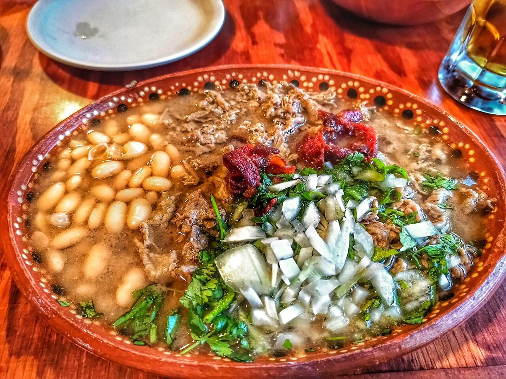

# 06 · Jesús Fujioka Hernández

  

> *«Yo no vine a este país a ser el hijo de nadie. Vine a ser el que se queda a comer.»*

Esta es la ficha del protagonista del universo alternativo. **No sustituye a nadie: ocupa un lugar distinto.** Donde la obra original tiene a un chico común que no sabe qué quiere, aquí hay un chico que sabe perfectamente qué quiere y no puede sostenerlo. Esa es la diferencia y de ahí sale toda la historia.

---

## Ficha rápida

| | |
|---|---|
| **Nombre japonés (koseki)** | 藤岡 慈 — *Fujioka Ji* |
| **Nombre mexicano (registro consular)** | Jesús Fujioka Hernández |
| **Cómo lo llama cada quien** | «Jesús» → quien lo quiere · «Fujioka» → la escuela · «慈» → su padre · «Chucho» → Lola |
| **Edad** | 16 años (segundo año, clase 2-1 de la sección general) |
| **Cumpleaños** | 12 de diciembre, Sagitario (Día de la Virgen de Guadalupe) |
| **Tipo de sangre** | O+ |
| **Altura** | 178 cm |
| **Cuarto** | 101 (el de la planta baja, junto a la escalera) |
| **Familia** | 藤岡 誠 Makoto (padre) · María de la Luz «Luz» Hernández Robles (madre, Guadalajara) · Dolores «Lola» Zamora (abuela paterna, Fuchū) · 藤岡 勇 Isamu (abuelo, † 2004) · 藤岡 勘次郎 Kanjirō (bisabuelo, † 1951) |
| **Mascotas** | **Frijol** (perro) y **Mole** (gata), callejeros, llegaron juntos |
| **Comida favorita** | **Carne en su jugo** |
| **Diagnóstico** | TDAH de presentación combinada, diagnosticado a los 9 años |
| **Ocupación** | Estudiante, cuidador de Mashiro, desarrollador de videojuegos sin terminar |
| **Fancast de voz (si alguna vez se anima)** | 花江夏樹 (Hanae Natsuki) — voz cálida, rápida, que se quiebra hacia arriba cuando se emociona |

---

## El cuerpo

Moreno de piel, del tono de quien se crió con sol y no con lámparas de techo. Pelo **rubio teñido**, corto, en picos que no se peina: se levanta y ya está. El tinte es lo primero que se le nota y lo primero que se le descolora; a las cinco semanas, en las raíces, vuelve a asomar el castaño oscuro de verdad, y él lo tapa con gorra hasta que encuentra dinero o tiempo. Ese detalle lo persigue: **el rubio es lo único de su cuerpo que puede elegir, y ni eso le dura.** Ojos cafés, grandes, que se mueven antes que la cara, como si estuvieran leyendo la habitación mientras él todavía no ha decidido qué decir.

La ropa es un manifiesto involuntario. **Chamarra de piel negra** con cierres plateados, comprada en un mercado de Guadalajara, demasiado abrigada para Tokio en mayo. Debajo, la **playera blanca del Club Deportivo Guadalajara**, escudo en el pecho. **Jeans claros**, gastados en las rodillas. **Tenis rojos de caña alta**, con las agujetas blancas siempre desiguales porque se las ata corriendo.

Al cuello, una **cadena de plata fina con un dije diminuto**: un ajolote de plata, del tamaño de una uña. Se lo puso su madre el día que se despidieron y no se lo ha quitado desde entonces. Duerme con él. Se baña con él. En el vestidor del gimnasio se lo mete bajo la camiseta.

Y la ceja: tiene un pequeño corte de pelo que no crece, de una caída de la infancia. Cuando miente, se le mueve. Cuando está enamorado, también.

---

## El nombre

Tiene dos nombres legales y ninguno es falso.

En el **koseki** japonés — el registro familiar, el documento que decide quién eres en este país — consta como **藤岡 慈**. El kanji **慈** significa *misericordia*, *compasión*. Lo eligió su padre. Es el nombre de un hombre que no ha tenido ninguna de las dos cosas con su hijo, y esa ironía no es un chiste: es la primera herida del personaje.

En el **registro civil mexicano**, levantado en el consulado, consta como **Jesús Fujioka Hernández**. Ese nombre lo puso su madre. Es el nombre que se dice en voz alta en una cocina de Guadalajara, el que lleva la fecha del 12 de diciembre, el que suena a barrio y a iglesia y a comida.

**Jesús no es un apodo: es el nombre que su padre no pronuncia.** En trece años, Makoto nunca ha dicho la palabra «Jesús» delante de él. Dice «慈». Y el chico aprendió hace mucho a leer esa diferencia como lo que es: *tú no eres el que yo quería*.

> **Regla de escritura:** quien lo llama «Jesús» lo quiere. Mashiro lo llama Jesús desde el tercer día, sin saber que estaba haciendo una declaración. Nanami tarda meses. Su padre, nunca.

---

## Personalidad

Simpático hasta lo imprudente. Habla con las manos, se ríe antes de que el chiste termine, y tiene la capacidad —que parece un don y es un síntoma— de caerle bien a cualquiera en cuatro minutos.

Es observador de una forma rara: no recuerda qué comió ayer, pero se acuerda de que Nanami se aprieta la muñeca cuando está nerviosa, de que Ryūnosuke siempre contesta al tercer timbre y nunca al primero, de que Mashiro deja el pincel en equilibrio sobre el frasco cuando está a punto de terminar.

Es **leal de forma casi animal**. Si alguien de Sakura-sō tiene un problema, aparece. No siempre sirve de algo, pero aparece.

Y es **impulsivo**. Dice la verdad en el momento en que no se debe. Abraza sin permiso. Compra cosas que no puede pagar. Se mete en defensa de un desconocido en la estación y acaba con el labio partido y una amistad nueva.

### Los tres defectos que no se curan

1. **Empieza todo y no termina nada.** No es flojera: es que el último tramo de cualquier proyecto es aburrido, y su cerebro literalmente no le entrega la llave para aburrirse.
2. **Confunde querer con necesitar.** Cuando alguien lo necesita, se siente real. Y eso lo vuelve capaz de dejar que alguien dependa de él más de la cuenta.
3. **No pide ayuda.** Puede decir «te quiero» a media clase, pero no puede decir «no puedo». Su padre le enseñó que la debilidad se cobra.

---

## El TDAH, bien explicado

Esto no es un adjetivo de personalidad: es un sistema operativo distinto, y la historia entera lo trata como tal.

**Diagnóstico.** A los nueve años, en Tokio, después de que una maestra de primaria le dijera a su padre la frase que lo cambió todo: *«Su hijo no es tonto. Es que no está.»* Makoto pagó el mejor especialista de la ciudad, que le recetó **metilfenidato de liberación prolongada** (comercializado en Japón como コンサータ). La medicina funciona. El problema es que la paga su padre, y por lo tanto también la controla.

**Cómo se ve en el día a día:**

- **Ceguera temporal.** Puede sentarse a programar a las ocho de la noche y descubrir que son las tres de la mañana. También puede pasar cuarenta minutos frente a un plato de arroz sin probarlo.
- **Parálisis de inicio.** Sabe exactamente qué tiene que hacer, sabe cómo hacerlo, y no puede empezar. No es que no quiera: es que la mano no se mueve.
- **Memoria de trabajo frágil.** Entra a la cocina por la sal y sale con una taza de café, sin sal, sin recordar por qué entró. Pierde llaves, cuadernos, y una vez perdió un examen terminado dentro de un refrigerador.
- **Hiperfoco.** Cuando algo le interesa, es una máquina. Diez horas sin comer, sin moverse. Es su superpoder y es la razón por la que sus dos juegos son buenos. También es la razón por la que cuando el hiperfoco termina, el proyecto muere.
- **Desregulación emocional.** Pasa de la risa al llanto en un minuto y después se avergüenza del llanto, y la vergüenza le dura tres días.
- **Sensibilidad extrema al rechazo.** Este es el rasgo que mueve la historia. Un comentario neutro lo atraviesa como una acusación. Por eso coquetea: un piropo es una declaración que se puede retirar; una sinceridad no.
- **Inquietud.** Mueve la pierna debajo del pupitre. Se levanta a media clase sin darse cuenta. En las juntas largas se dibuja las manos.

**Y lo que sí puede.** Ve patrones donde nadie los ve. Improvisa mejor que nadie. Es capaz de sostener diez conversaciones y recordar qué le dijiste en la tercera. Cuando alguien le importa, presta una atención que parece milagrosa.

> **Cómo escribirlo:** el TDAH no es una excusa que da el narrador, es algo que el lector ve. Nunca escribas «su TDAH le impedía concentrarse». Escribe que el arroz se le enfría, que se le olvidó el nombre de la profesora que le acaba de hablar, que abrió el cajón y ya no recuerda qué buscaba.

---

## Carne en su jugo

  

Plato tapatío: carne de res cocida en su propio jugo con tocino, frijoles de la olla, cebolla, cilantro y chile serrano, servido con tortillas de maíz y limón. En Guadalajara se come a mediodía, en platos hondos, con la mano.

Es su comida favorita por tres razones que él jamás admitiría en voz alta:

1. **Porque se lo hacía su madre.** Los domingos, antes de que todo se rompiera.
2. **Porque Lola lo hace igual** —con la receta de su hija política, no con la suya— y ese es el único puente que queda entre las dos mujeres.
3. **Porque en Japón no existe.** No es que no lo encuentre: no existe. Los chiles no son los mismos, el tocino no es el mismo, el maíz no es el mismo. Es el único plato que no se puede conseguir con dinero, y por lo tanto el único que su padre no puede comprarle.

**La escena de la cocina.** Un sábado, decide cocinarlo para todos en Sakura-sō. Compra lo que cree que son los ingredientes. Se pone los audífonos, se concentra, y a los veinte minutos está tan dentro de la receta que no nota que el tocino se está quemando. Suena la alarma. Misaki llega corriendo con el teléfono grabando. Nanami salva la cocina. El resultado es un guiso oscuro, salado, que nadie quiere probar.

Mashiro lo prueba. Dice: «Está feo». Y después se come el plato entero, sin decir nada más, delante de todos.

Ese es el primer momento en que Jesús entiende algo sobre Mashiro que llevará doscientas páginas desarrollar.

---

## El sueño y los dos juegos

Quiere hacer videojuegos. No como hobby: como vida. Y no es una fantasía infantil, porque **ya lo ha hecho**: tiene dos prototipos funcionales con ideas que gente de la industria le ha dicho que son buenas.

### Juego 1 — «止まれない» / *No puedo parar*

Un corredor automático donde el personaje **no puede detenerse**. Solo puedes girar, saltar y elegir por dónde ir. La gracia es que el juego no trata de llegar rápido: trata de encontrar curvas donde puedas descansar. El mundo está lleno de curvas hospitalarias que premian al que las busca.

- **Estado:** jugable de principio a fin, 40 minutos de duración, un jefe esquematizado.
- **Lo que falta:** arte real (todo son cuadros de colores), sonido, tutorial. *Lo aburrido.*
- **Porcentaje honesto:** 85 %.
- **Lo que nadie le ha dicho todavía:** el juego es un autorretrato. El personaje no puede parar porque él no puede parar.

### Juego 2 — «二つの言葉» / *Dos lenguas*

Un juego de puzles donde el escenario tiene objetos que **solo existen en un idioma**. Cambias de idioma y el mundo cambia: escaleras que aparecen porque en español hay una palabra para lo que en japonés no, puertas que se cierran cuando traduces algo que no debería traducirse. El objetivo del juego nunca se explica con claridad, y esa es la idea.

- **Estado:** documento de diseño completo (64 páginas escritas a mano, con dibujos), un nivel jugable.
- **Lo que falta:** todo el código que no sea el nivel uno. Y el nivel uno está hecho con una arquitectura que él mismo ya no entiende.
- **Porcentaje honesto:** 60 % de idea, 20 % de ejecución.
- **Lo que nadie le ha dicho todavía:** este juego es sobre tener dos países y no poder traducirse.

### El tercer juego que no existe

En una carpeta llamada `ideas_nuevas` hay **cuarenta y un documentos** con conceptos de juegos. Cuarenta y uno. Los abrió cuando el juego en el que estaba trabajando se puso aburrido. Ese es el verdadero costo del TDAH: no la falta de talento, sino **la imposibilidad de atravesar el tramo aburrido**.

> **Regla de oro de la trama:** Jesús no necesita aprender a tener ideas. Necesita aprender a **terminar**. Y la única persona en Sakura-sō que entiende eso por dentro es Ryūnosuke, que abandonó un proyecto por razones opuestas —él sí terminaba, y por eso se quedó solo.

---

## El cuarto 101

Planta baja, junto a la escalera, el más ruidoso de la casa. Cama individual sin hacer. **Dos monitores** sobre un escritorio que compró de segunda mano y que se tambalea, con un post-it pegado en el marco: *«hoy sí»*. Una pizarra blanca pequeña con el diagrama del juego de las dos lenguas, y en la esquina, tachado, el diagrama del otro. Ropa en el suelo en dos montañas: limpia y sucia, y ya nadie sabe cuál es cuál.

En la pared, **un cuadro de Mashiro** con la playera manchada de azul. En el clóset, una **caja de zapatos** con cosas de México: una foto de su madre, un billete de veinte pesos, un dulce de tamarindo seco, y un papel doblado que no es una carta.

En el suelo, dos platos: uno para Frijol, uno para Mole.

Debajo de la cama, escondido, **el formulario de elección de nacionalidad**, en blanco, con la fecha de vencimiento escrita a lápiz en el borde.

---

## Los animales

  

Llegaron juntos una noche de lluvia y se instalaron debajo de la escalera exterior. **Frijol** es un perro mestizo café, pequeño, oreja partida, que ama a todo el mundo con una insistencia que da vergüenza ajena. **Mole** es una gata calicó flaca, de un ojo nublado, que no deja que la toque nadie excepto Jesús y —esto es importante— Mashiro, a la que adoptó sin explicación.

**La inversión clave respecto a la obra original:** en Sakura-sō original hay un chico que **recoge** animales, uno detrás de otro, por compulsión. Aquí los animales **lo eligen a él**. No los buscó. Se quedaron. Para un chico cuyo padre nunca lo eligió, eso es una revolución silenciosa.

**El secreto de los animales:** Makoto también tuvo un perro. Se lo regaló Lola cuando tenía diez años y se llamaba igual que él no quiere recordar. Cuando el perro murió, Makoto tenía veinte y no volvió a tener otro. Jesús no lo sabe. Lola lo cuenta en el peor momento posible.

---

## El coqueteo

Lola le enseñó una regla cuando tenía ocho años, delante de una olla de mole:

> *«A las mujeres no se les dice lo que uno quiere. Se les dice lo que uno ve.»*

Lo tomó al pie de la letra y lo convirtió en deporte. Le dice a la cajera del konbini que sus aretes parecen dos gotas de agua. Le dice a la señora de la carnicería que su voz alegra la mañana. Le dice a Mashiro que sus manos son lo mejor que ha visto en Japón. Le dice a Nanami que su coleta se mueve como si tuviera opiniones propias.

**Para él es cortesía.** Un piropo es un regalo pequeño que se puede dar sin quedarse sin nada. Es lo contrario de una confesión: no compromete, no se puede rechazar, no deja marca.

**Para todos los demás es otra cosa.** En Japón, la adulación directa se lee como interés. Las chicas de Sakura-sō no están locas por leerlo mal: lo leen con el manual correcto de su país, no con el de Jalisco.

**Por qué lo hace, de verdad:** porque un cumplido cuesta cero y una sinceridad puede ser rechazada. Es el mismo mecanismo por el que no le dice a su padre lo que siente. Con las palabras bonitas no arriesga nada.

**El precio (el tiro por la culata):** al repartir el mismo piropo a todas, se vuelve **insolvente**. Cuando por fin diga algo en serio, nadie va a poder distinguirlo de su rutina. Y esa factura llega exactamente en el peor momento posible, con la persona que menos merecía pagarla.

---

## Un día cualquiera

- **6:40.** Suena la alarma. No la oye. Suena la segunda. Tampoco.
- **7:20.** Mashiro entra sin tocar y le quita la cobija. Esto pasa todos los días desde marzo.
- **7:25.** Se toma la pastilla. Se le olvida si ya se la tomó. Se la toma otra vez (dos veces por semana).
- **7:40.** Desayuno de pie. Le da de comer a Frijol, que ya comió porque Nanami se adelantó.
- **8:10.** Sale corriendo. Regresa por la mochila.
- **Clase.** Se pierde entre el minuto 12 y el 30. Copia el pizarrón sin entender lo que copia. Contesta algo que nadie preguntó.
- **Receso.** Es el centro de atención durante once minutos exactos. Después se aburre y se va a la azotea.
- **Tarde.** Hiperfoco o nada. No hay punto medio: o programa seis horas o mira el techo dos.
- **Noche.** Sakura-sō. Ruido. Cena. Alguien le pide algo. Lo hace.
- **1:00 a.m.** Abre el editor. «Solo veinte minutos.»

---

## Relaciones

**Mashiro Shiina.** La cuida porque se la encargaron y se queda porque quiere. Al principio le parece un cuadro andando; después descubre que es la persona más honesta que ha conocido. **Mashiro no lo halaga nunca**, y eso lo desarma: es la única que le dice «está feo» y se come el plato entero. Con ella no sirve el coqueteo, porque ella no lo interpreta: lo **estudia**.

**Nanami Aoyama.** Su espejo. Los dos trabajan el doble y no les alcanza; los dos esconden de dónde vienen (ella el acento de Osaka, él el español). Con ella no coquetea: **le habla en serio**, y por eso le hace daño. El nudo completo está en el documento [07](07-el-incidente-aoyama.md).

**Misaki Kamiigusa.** La que lo bautiza. Lo llama «Jesús-kun» y lo trata como un personaje que ella escribió. Es la que organiza la guerra de waifus, y la única que sabe que el chico no va a elegir a nadie: por eso puede jugar.

**Jin Mitaka.** El único que le habla como un adulto sin sermón. Le dice las verdades en el peor tono posible, y aun así es el único hombre de la casa que le da miedo decepcionar.

**Ryūnosuke Akasaka.** Su espejo inverso. Ryūnosuke termina lo que empieza y se quedó solo por eso; Jesús no termina nada y por eso está rodeado. Se detestan durante tres semanas y después se vuelven cómplices.

**Chihiro Sengoku.** La adulta. Lo amenazó con echarlo el primer día y no lo ha hecho. Sabe más de su padre de lo que dice, porque fue alumna de la misma escuela y ha visto a otros chicos ricos romperse.

**Lola.** El único lugar donde oye español sin pedir permiso. Le llama «chico apuesto» y le arruina la vida sentimental con una frase por semana. Ver [04](04-la-abuela-en-la-trama.md).

**Makoto.** El silencio. Toda la ficha del antagonista está en [01](01-el-padre.md).

---

## Frases

- «Nada más un minuto.» *(siempre son cuarenta minutos)*
- «Mi abuela dice que las manos se te ven cuando no estás pensando en ellas.»
- «Es que en español eso suena mejor.»
- «No estoy triste. Estoy cansado de una forma rara.»
- «¿Y si no sirvo para esto y ya? ¿Se puede vivir igual?»
- «Yo no quiero que me digas que sí puedo. Quiero que te quedes mientras no puedo.»

---

## Cómo escribirlo

1. **Muéstralo funcionando, no roto.** El TDAH se nota en el desorden, no en la lástima.
2. **Nunca lo hagas víctima de su padre.** Jesús pelea. Mal, tarde y en voz alta, pero pelea.
3. **Su talento es real.** Si el lector no cree que esos dos juegos son buenos, la historia no duele.
4. **El coqueteo es comedia hasta que deja de serlo.** Cuando deja de serlo, no avises: cambia el tono y deja que el lector sienta el piso moverse.
5. **No lo cures.** No hay arco de «superación del TDAH». Hay arco de aprender a terminar una cosa, con ayuda, despacio, y de perdonarse las otras noventa y nueve.

---

## Verificación

- **TDAH y medicación:** el metilfenidato de liberación prolongada se comercializa en Japón como コンサータ (Concerta), indicado para el TDAH; el país también dispone de atomoxetina (ストラテラ) y guanfacina (インチュニブ). Los síntomas descritos (ceguera temporal, parálisis de inicio, memoria de trabajo, hiperfoco, desregulación, sensibilidad al rechazo) corresponden al cuadro clínico habitual del TDAH en adolescentes.
- **Carne en su jugo:** platillo tradicional de Jalisco, asociado a Guadalajara; la imagen es una fotografía libre del plato.
- **Nombre 藤岡 慈:** el apellido y el kanji se verificaron en el documento [02](02-cuatro-generaciones.md); 慈 se lee *ji* y significa misericordia o compasión.
- **Cuarto 101:** asignado por el autor en el canon fijado del README.
- **Diseño de los dos juegos, la abuela, la madre y los animales:** material original de este universo, sin correspondencia con la obra original.

*Documento anterior: [05 · Los animales](05-los-animales.md) · Siguiente: [07 · El incidente de Aoyama](07-el-incidente-aoyama.md)*
